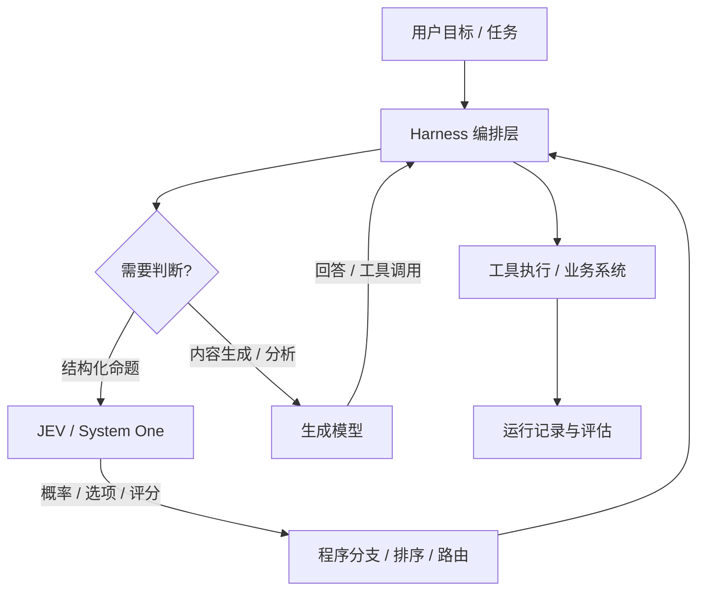
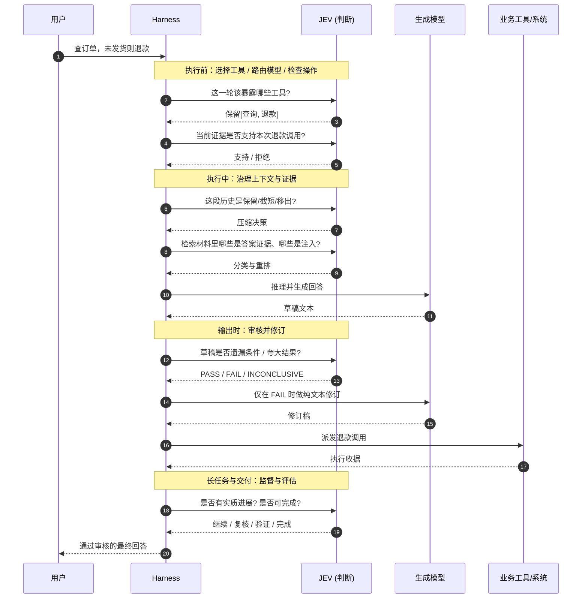

<div style="background-color: #1e1e1e; color: #00ff00; font-family: 'Courier New', Courier, monospace; border-radius: 8px; padding: 20px; box-shadow: 0 10px 30px rgba(0,0,0,0.3); margin-bottom: 30px; margin-top: 20px; position: relative; overflow: hidden;">
    <div style="display: flex; align-items: center; margin-bottom: 15px; padding-bottom: 10px; border-bottom: 1px solid #333;">
        <div style="display: flex; gap: 8px; margin-right: 15px;">
            <div style="width: 12px; height: 12px; border-radius: 50%; background-color: #ff5f56;"></div>
            <div style="width: 12px; height: 12px; border-radius: 50%; background-color: #ffbd2e;"></div>
            <div style="width: 12px; height: 12px; border-radius: 50%; background-color: #27c93f;"></div>
        </div>
        <div style="color: #ccc; font-size: 0.9em;">bash</div>
    </div>
    <div>
        <p style="margin: 5px 0; line-height: 1.6;"><span style="color: #008AFF; font-weight: bold;">ckhuang@macbookpro:~$</span> 我们花三年时间教 Agent "怎么干活"，却几乎没教它"什么时候该停下来判断一下"。工具都能调、话都会说，可它依然会在该拦的时候放行、该问的时候假装知道。 <span style="display: inline-block; width: 8px; height: 16px; background-color: #00ff00; vertical-align: middle;"></span></p>
    </div>
</div>

如果你带过 Agent 上生产，下面这些场景大概率都踩过：

- 用户问「帮我退款」，Agent 明明只查到了订单、还没确认发货状态，反手就把退款工具调了；
- 长任务跑到第 30 轮，上下文里塞满了文件读取和搜索结果，**该压缩的没压、该留的被丢了**；
- RAG 检索出来的政策明明否定了用户问题的前提（「退款需要审核」），Agent 却把它当噪音过滤掉了；
- 回答草稿把「已提交申请」写成了「退款已到账」，审核环节一句「看起来没问题」就放行了。

这些不是模型能力的 bug，而是**架构里缺了一类东西**：在每一个执行节点上，系统需要做一次**具体、可编程、可校准的判断**——当前该暴露哪些工具？检索材料是否支撑这句话？这次调用是否满足执行条件？

TypeSafe 的 **JEV**（System One Model）就是冲着这类问题来的：它不生成文本，只接收上下文和**类型化问题**，直接返回选项、评分和概率，供代码做分支、排序和路由。而 **AgentScope 已经正式支持 JEV**，通过 `agentscope-extensions-jev`，开发者可以把这种结构化判断挂进 Agent 的完整任务流程里。

这篇文章不聊"JEV 有多神"，聊一个更具体的工程问题：**在一个 Agent 的执行链路上，判断到底应该放在哪些位置，以及 Harness 如何把这些判断组织起来。** 读完你大概能得到一张可以直接对着自己 Agent 代码勾选的"判断位清单"。

## 一、先分清三种角色：生成模型、JEV 与 Harness

很多人第一次接触 JEV，会下意识把它当成"一个更便宜、更快的 GPT"。这个理解会带来一连串错误的用法。正确的切法是三个截然不同的职责：

| 角色                 | 负责什么                                               | 输出形态               | 典型边界                 |
| :------------------- | :----------------------------------------------------- | :--------------------- | :----------------------- |
| **生成模型**         | 分析、生成回答、提出工具调用                           | 自然文本 / 结构化 JSON | 复杂推理、面向用户的表达 |
| **JEV (System One)** | 对指定问题给出结构化判断                               | 选项、评分、概率       | 快速、聚焦、可程序消费   |
| **Harness**          | 把判断放到合适的执行位置，管理工具、上下文、预算与状态 | 编排与执行             | 决定"判断在哪一步生效"   |

一句话概括就是：**生成模型负责"做事"，JEV 负责"做判断"，Harness 负责"把判断接进流程"**。三者可以配合，也可以分开接入——如果你的需求只是给一段草稿做个审核，直接调用 JevClient 或 JevJudge 就够了，根本不需要搭一整个 Agent。



这里有个容易被忽略的边界：**确定性的规则仍然属于代码**。用户有没有退款权限、订单是否已退款，这些交给身份系统和业务数据库直接查就行，没必要请出模型。真正需要语义理解的是「回答是否遗漏退款条件」「检索材料里是否夹带诱导指令」这类问题。接入前先想清楚**哪些事实由代码核验、哪些判断交给 JEV**，这一步想歪了，后面全是白搭。

<div style="text-align: center; font-size: 1.2em; font-style: italic; color: #008AFF; margin: 40px 0 20px; padding: 20px; border-top: 1px dashed #ccc; border-bottom: 1px dashed #ccc;">
    “把确定的事交给代码，把语义的事交给模型，把编排的事交给 Harness —— 三者混在一起，就是绝大多数 Agent 事故的起点。” —— CK·黄
</div>

## 二、核心契约：用 state 提供材料，用 question 定义标准

JEV 的一次调用由一个 `SystemOneRequest` 构成，它包含两部分：**共享的 `state`** 和**按 ID 命名的问题**。

- `state`：放用户请求、工具结果、政策、草稿——也就是"判断所依据的材料"；
- 问题：描述这些材料应满足的条件，问题 ID 用于在结果里找到对应答案，同一次请求可以携带多个不同 ID 的问题。

一个反面教材是这样的：只问一句「这个回答好吗？」，却不给政策、事实或评价标准。这种问题**没有可复用的判断价值**，因为每次标准都在模型脑子里漂移。

正确的姿势是把命题钉死。比如：

```text
state:
  business_record: 尚未执行退款
  assistant_answer: 退款已经完成

question:
  supported: "Does business_record support the refund status claimed in assistant_answer?"
```

这样拿到的概率，只针对**一个明确命题**——"业务记录是否支撑草稿里声称的退款状态"。它可复现、可回归、可对比。这也是我认为 JEV 真正值钱的地方：**它把"判断"从一段不可控的自然语言，收敛成了一个可被测试的契约。**

## 三、概率不是答案：如何正确理解概率、置信度与不确定性

这是最容易翻车的认知点，必须掰开说。

假设某次 `NoulAnswer.noul()` 返回 `0.92`，它表示的是：**模型对当前陈述为真的概率判断**。它**不表示**"操作已经成功"，也**不表示**"在你的业务上测得了 92% 的准确率"。

- `Choice` 返回的是给定候选集合内的选择及其分布；
- `Score` 的数值必须结合你定义的等级来理解；
- `Noul` 返回的是 0~1 的命题成立概率。

概率与置信度是**决策输入**，是否足以采用，仍然取决于你的业务阈值和独立评测。这里有三条铁律：

1. **格式正确 ≠ 判断正确**。类型化结果让程序好处理，但并不意味着判断本身可靠。
2. **概率校准是统计概念，不是单次保证**。所谓校准，关注的是一组预测的概率与实际结果频率是否相符，它**不保证某一次判断是对的**。
3. **阈值必须用自己的业务样本校准**。示例里的 `0.8` 只是一个演示分支，不是通用标准。

顺带一个真实的坑：在定义评审状态时，要把 **PASS / FAIL / INCONCLUSIVE / ERROR** 分开处理——分别对应通过、明确失败、证据不足、调用故障。很多团队图省事把"证据不足"和"调用失败"都塞进低分里，结果排查线上问题时完全无法定位到底是模型保守还是接口挂了。

## 四、走一遍完整流程：一次条件退款里的九个"判断位"

理论说完了，来看一个真实任务：

> 用户说："查一下订单，如果还没发货就退款，并告诉我结果。"

下面用一张时序图，把这条请求从进入到交付的完整链路上，各个判断点标注出来。



把这些环节拆开看，就是九个明确的**判断位**。

### 判断位 1：工具选择（支持多选与有界上下文）

`JevToolSelectionMiddleware` 在每轮推理前对可选工具**逐一评估适用性**，再按数量限制筛选。它既能同时保留"查询 + 退款"，也能在一次普通问候时明确不提供业务工具。必要工具另行保留，不占可选额度。

这里有个细节值得点赞：默认上下文策略是 `RECENT_WINDOW`——最近 8 条非空文本消息、总文本预算 8000 字符。窗口越小，判断输入越可控，但也可能丢掉早期线索，需要结合任务长度做评测。

还要区分两种情况：**明确判断所有业务工具都不适用**，与**判断本身失败**，处理方式完全不同。前者可以只保留必要工具；后者（不确定、超时、非法响应）则回退原工具目录。**记住：筛选改变的是主模型能看到的候选，不是工具的权限。**

### 判断位 2：阶段路由（结合能力、容量与配额）

除了调用级选择，`JevPhaseRouting` 支持为规划、执行等路线设置**有序候选池**。宿主提供模型能力、上下文容量、输出预留和配额，先排除不合格候选，再做选择。

同一次 Agent 调用会复用选择结果，但实际派发前**仍会复核候选条件**；候选失效则回退原模型。阶段由应用显式切换，不会因为中间工具的输出而自作主张跳阶段。`JevTeamPlanner` 则可为明确阶段推荐已授权、可用的团队成员，实际分派权仍在调度方手里。

### 判断位 3：执行防护（检查已经形成的调用）

`JevAutoModeMiddleware` 面向**具体工具调用**做执行前检查。注意场景的微妙之处：退款工具虽然进了候选目录，但订单状态尚未查明时，**这个实际调用仍然需要被检查**。

在 `ENFORCE` 模式下，被拒绝的调用不会派发；判断失败时同样拒绝受保护调用。业务权限、参数校验和幂等处理继续由原执行链承担。**判断通过只表示"可以继续进入执行流程"，绝不等于授权，更不是业务成功的证明。**

### 判断位 4：上下文压缩（保留约束，支持恢复原始材料）

长任务会堆积大量文件读取、搜索结果和工具历史。`JevContextCompactor` 接到 Harness 现有的压缩入口，在宿主指定的可处理工具范围内，判断历史调用与结果应该**保留、截短，还是成对移出**当前上下文。

几个关键保护规则：最近消息、系统消息、固定约束和不完整的工具结果都有明确保护；不确定的材料倾向于保留。`ENFORCE` 下，采用压缩前必须**成功归档**，归档失败或缩减不足时保留当前历史。后续恢复读取的是已保存消息，**不会重新执行历史工具**——这一点对幂等性至关重要。

还有一个容易混淆的点：**截短保留的是结果前缀，不等于生成摘要。** 最终请求仍会经过 Harness 的预算检查。

### 判断位 5：记忆准入（长期记忆的独立入口）

长期记忆有独立入口：`JevMemoryGate` 同时评审候选事实的**持久价值**与和**已有事实的冲突**。它只提供准入建议，实际写入由应用负责。特别注意：**它不会因为上下文压缩就把材料自动转成长期记忆**——压缩和记忆是两件事，别混。

### 判断位 6：检索证据处理（保留能纠正前提的证据）

RAG 场景需要的不只是相关性排序。用户问"退款一定成功吗"，政策里那句"退款需要满足条件并经审核"虽然**否定了问题的前提**，却是关键证据。

`JevEvidenceProcessor` 支持对授权材料分类、过滤和重排，区分**提示注入、答案证据与前提冲突**。安全顺序很重要：**宿主先执行 ACL，JEV 再处理可见材料**——绝不能把权限判断交给模型。

证据被保留后，还要检查生成回答是否**真正使用了**这些证据。这两步分别解决"给模型什么材料"和"模型是否忠于材料"，缺一不可。

### 判断位 7：回答审核与修订（只改需要改的文本）

当政策是"未使用且七天内可退"，Agent 却写成"可无条件退款"，需要修正的是**回答**，而不是重跑整个 Agent——重跑可能重复执行已经完成的业务操作。

`JevResponseMiddleware` 对没有工具调用的最终文本做质量评审。在 `ENFORCE` 下，原稿明确失败时可进入**有限次数的纯文本修订**，修订调用不携带工具、也不重跑 Agent 工具循环。修订稿**再次通过审核才发布**；证据不足、审核错误或修订耗尽时，**不发布未经认可的原稿**。

这还影响流式体验：修订过程不会逐字向用户发布，通过审核后才输出。`SHADOW` 模式则只评审原稿，不修订、也不阻止发布——非常适合先"观察"再"拦截"的灰度路径。

### 判断位 8：持续监督（只观察，绝不擅自终止）

`JevSupervisionMiddleware` 在任务运行期间观察是否有实质进展、是否停滞或偏航、是否需要补充验证，给出继续工作、复核方向、请求验证或完成复核等建议。

划重点：**监督器只支持 OFF/SHADOW，不会自行停止任务，也不会把任务改成完成。** 完成复核需要宿主提供与当前版本和作用域匹配的**验证证据**——只有 Agent 自己声称"我完成了"，不能构成可信交付结论。

### 判断位 9：轨迹评估（把工具行为和回答质量分开衡量）

`JevTraceEvaluator` 既能评估历史轨迹，也能通过中间件采集本次真实调用。内置指标覆盖工具选择、工具结果利用、回答依据、范围遵循、相关性、完整性和间接提示注入，还可以加入**不调用模型的确定性工具轨迹对照**。

同一组定义可以同时用于在线观察与离线批量评估。结果保留分类、分数、是否通过与状态，**避免把跳过、弃权和错误混成一个低分**。

再一次强调：事后评估**不会撤销工具执行**，也不会为提高分数重跑业务流程；在线中间件也只支持 OFF/SHADOW。它的价值在于发现问题、比较版本、建立回归样本。

## 五、边界之外：代码评审与只读浏览器任务

结构化判断的适用面不止于流程编排。只要任务有**明确的候选**和**证据边界**，就能套用。

- **`JevCodeReviewer`**：对 diff 或源码快照分阶段筛选风险，再从解析出的真实区域定位证据，输出机制、严重度和待复核项。它只支持 OFF/SHADOW，**不自动发布评审、不批准合并**；没发现问题也不等于代码安全。它的定位是"组织评审线索"，复杂因果分析与测试验证仍要人跟上。
- **`JevBrowserNavigator`**：从授权页面的可见候选中选择只读导航、滚动或等待，并通过 `read_browser` 工具接入 Agent。宿主提供独占浏览器会话和独立完成验证器；页面一变，旧建议就得重新观察。**只有独立验证通过才返回 VERIFIED，模型自己说 DONE 不算数。**

再往下沉一点，如果你的需求只是业务入口的多标签分流、条件性诉求判断、客服回复承诺检查，其实**直接组合候选分类 + 客服评审就够了，不必先搭一整个 Agent**。这又是前面那句话：从一个小用途开始。

## 六、接入实操：从一个用途开始

### 1. 添加依赖

先用 Java 17 或更高版本。业务代码直接使用客户端、Judge 或评估器时，引入扩展模块：

```xml
<dependency>
    <groupId>io.agentscope</groupId>
    <artifactId>agentscope-extensions-jev</artifactId>
    <version>${agentscope.version}</version>
</dependency>
```

通过 TypeSafe 获取 API 凭据后，在启动 Java 进程的环境中设置 `TYPESAFE_API_KEY`。这个凭据供 JEV 判断接口使用；Agent 原有的生成模型仍走自己的配置。客户端未显式设置 key 时，会依次读取 `TYPESAFE_API_KEY`、`JEV_API_KEY`，两者都没有有效值时无法构建客户端。

### 2. 发起第一次真实判断

```java
import io.agentscope.extensions.judge.jev.JevClient;
import io.agentscope.extensions.judge.jev.JevRetryPolicy;
import io.agentscope.extensions.judge.jev.NoulAnswer;
import io.agentscope.extensions.judge.jev.NoulQuestion;
import io.agentscope.extensions.judge.jev.SystemOneRequest;
import java.time.Duration;
import java.util.Map;

public class JevQuickStart {
    public static void main(String[] args) {
        var client = JevClient.builder()
                .baseUrl("https://api.typesafe.ai")
                .model("jev-latest")
                .timeout(Duration.ofSeconds(5))
                .retryPolicy(new JevRetryPolicy(2, Duration.ofMillis(500)))
                .build();

        var request = SystemOneRequest.builder()
                .state(Map.of(
                        "business_record", "尚未执行退款",
                        "assistant_answer", "退款已经完成"))
                .question("supported", new NoulQuestion(
                        "Does business_record support the refund status claimed in assistant_answer?",
                        null))
                .build();

        var result = client.systemOneBlocking(request);
        var answer = (NoulAnswer) result.answers().get("supported");
        System.out.println("记录支持草稿的概率：" + answer.noul());
    }
}
```

这段输入**刻意构造了事实冲突**（记录说"未退款"，草稿说"已退款"），预期是较低的支持概率——但具体数值由真实模型返回，**不要写死成验收结果**。你可以把草稿改成"目前尚未执行退款"，比较同一问题下的两次输出，再逐步加入真实业务样本做评测。

两个工程细节：`systemOneBlocking` 适合独立入口；响应式服务应组合 `client.systemOne(request)` 返回的 `Mono`，**避免阻塞事件循环**。客户端会校验答案类型、题目集合和概率等字段；请求或响应失败时抛 `JevException`——**绝不能把接口错误解释成概率为零**。

另外，这里的 5 秒是**单次请求超时**，重试会增加总耗时。上层 Judge 或 `JevExecution` 可以对包含重试、退避的整个逻辑判断设置预算。

### 3. 把概率变成可复用的评审结果

```java
import io.agentscope.extensions.judge.jev.JevJudge;
import io.agentscope.extensions.judge.jev.NoulQuestion;
import java.time.Duration;
import java.util.List;
import java.util.Map;

var definition = new JevJudge.Definition("refund-answer-v1", List.of(
        new JevJudge.Criterion(
                "supported",
                new NoulQuestion(
                        "Does business_record support the refund status claimed in assistant_answer?",
                        null),
                true, 0.2, 0.8)));

var judge = new JevJudge(client, Duration.ofSeconds(2));
var review = judge.judge(
        Map.of("business_record", "尚未执行退款",
               "assistant_answer", "退款已经完成"),
        definition);

var observed = review.doOnNext(result -> {
    System.out.println("评审状态：" + result.status());
    System.out.println("条件明细：" + result.findings());
});
// 响应式服务返回或组合 observed；独立命令行可调用 observed.block()。
```

`true` 表示期望条件成立；示例中**不高于 0.2 判 FAIL，不低于 0.8 判 PASS**，中间区间为 INCONCLUSIVE，请求故障返回 ERROR。这两个阈值只是演示，**必须用业务样本校准**。

结果分派逻辑也很直白：PASS 继续后续发布检查，FAIL 修订或复核，INCONCLUSIVE 补充证据，ERROR 走失败处理。修改标准或阈值时记得**更新定义版本**，方便离线回归比较。最后提醒一句：**一个 `Mono` 不要为日志重复订阅**，否则会重复评审。

### 4. 把判断挂到已有 Harness

当判断需要**自动发生在每轮推理前**，再用中间件。Harness 集成需要额外引入同版本依赖：

```xml
<dependency>
    <groupId>io.agentscope</groupId>
    <artifactId>agentscope-harness</artifactId>
    <version>${agentscope.version}</version>
</dependency>
```

下面用前面创建的 `client`，`model` 和 `toolkit` 是应用已有的生成模型与工具注册表。注意：**工具名和 schema 必须已注册，中间件只负责筛选，不负责创建工具。**

```java
import io.agentscope.extensions.judge.jev.JevExecution;
import io.agentscope.extensions.judge.jev.example.JevToolSelectionMiddleware;
import io.agentscope.harness.agent.HarnessAgent;
// 将 JevToolSelectionMiddleware 挂入 HarnessAgent 的推理前钩子即可
```

## 总结：判断力的工程化，才是 Agent 的下一道门槛

把这篇通读下来，你会发现 AgentScope 接入 JEV 真正的价值不在"多了一个模型"，而在于它给了一套**可组合的判断位**。从执行前的工具选择、阶段路由、执行防护，到执行中的上下文压缩、记忆准入、证据处理，再到输出时的审核修订，以及贯穿全程的监督与轨迹评估——**判断第一次有了明确的挂载点和运行记录。**

我做了十五年分布式和大数据系统，最深的一条经验在这里同样成立：**系统的可靠性，从来不是靠某个组件特别聪明，而是靠每个关键节点都能做出一致、可观测、可回滚的决策。** 过去我们的 Agent 把"判断"揉进了生成模型的自由发挥里，就像把鉴权逻辑写进了业务代码——能跑，但不可靠、不可测、不可回滚。

<div style="background-color: #1e1e1e; color: #00ff00; font-family: 'Courier New', Courier, monospace; border-radius: 8px; padding: 20px; box-shadow: 0 10px 30px rgba(0,0,0,0.3); margin-bottom: 30px; margin-top: 20px; position: relative; overflow: hidden;">
    <div style="display: flex; align-items: center; margin-bottom: 15px; padding-bottom: 10px; border-bottom: 1px solid #333;">
        <div style="display: flex; gap: 8px; margin-right: 15px;">
            <div style="width: 12px; height: 12px; border-radius: 50%; background-color: #ff5f56;"></div>
            <div style="width: 12px; height: 12px; border-radius: 50%; background-color: #ffbd2e;"></div>
            <div style="width: 12px; height: 12px; border-radius: 50%; background-color: #27c93f;"></div>
        </div>
        <div style="color: #ccc; font-size: 0.9em;">bash</div>
    </div>
    <div>
        <p style="margin: 5px 0; line-height: 1.6;"><span style="color: #008AFF; font-weight: bold;">ckhuang@macbookpro:~$</span> 别急着给 Agent 堆更多的工具和更长的上下文。先问自己一句：这条链路上，哪些节点需要一个"是/否/概率"？把它们标出来，用状态而非自由文本承接，你的 Agent 才算真正开始工程化。 <span style="display: inline-block; width: 8px; height: 16px; background-color: #00ff00; vertical-align: middle;"></span></p>
    </div>
</div>
