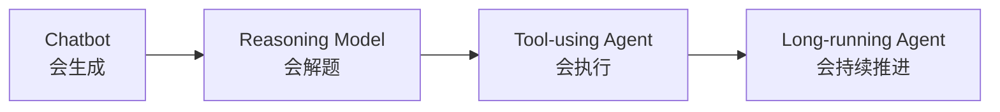
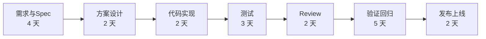
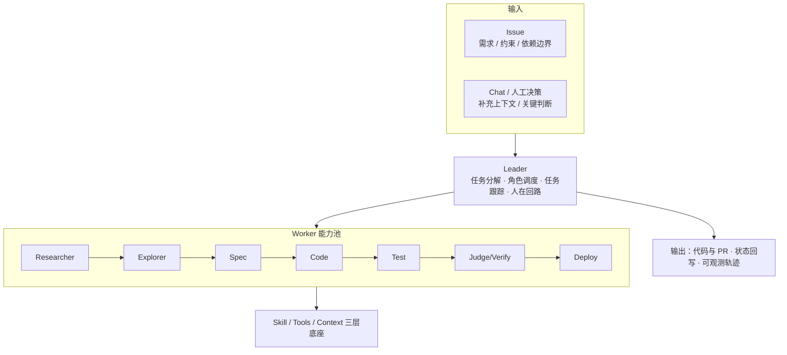
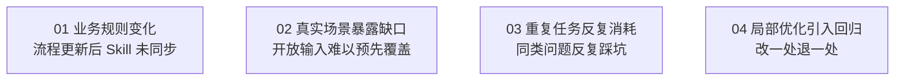
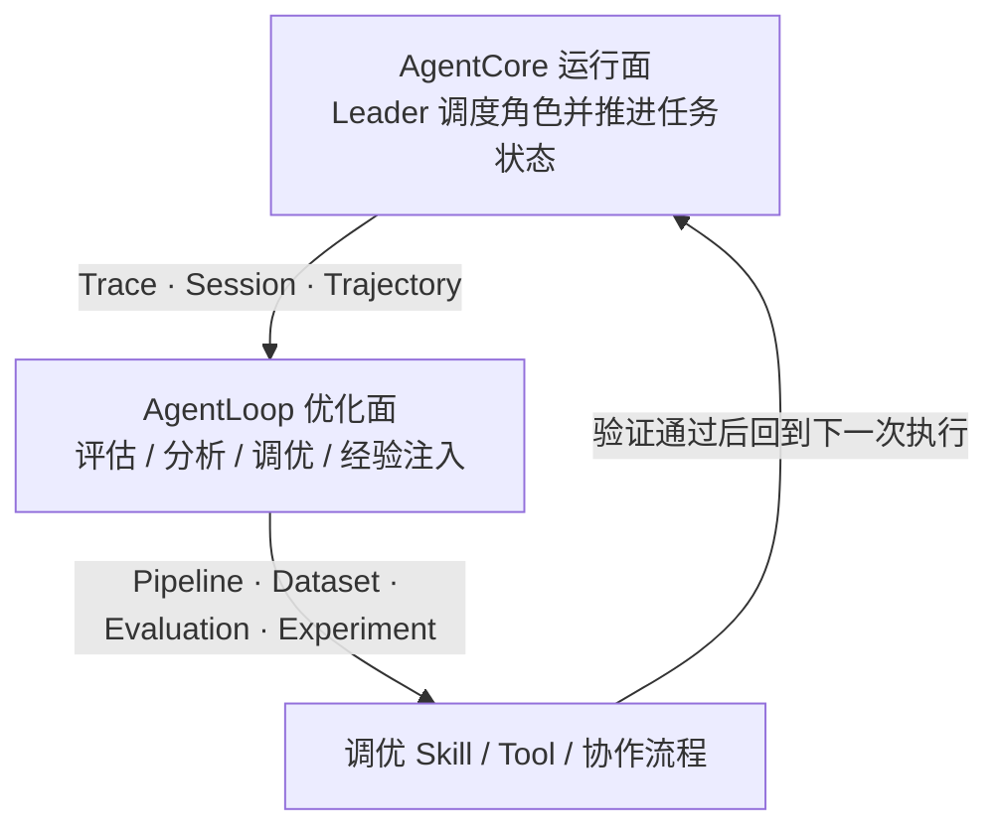
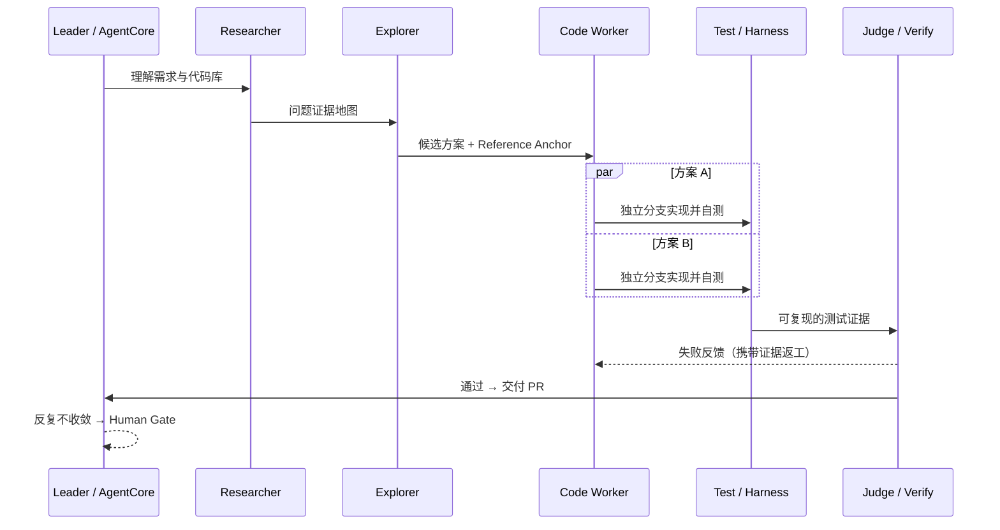
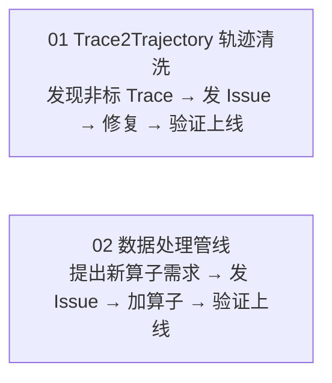

    

        

            

            

            

        

        
bash

    

    

        
ckhuang@macbookpro:~$ 我们把编码速度提升了 10 倍，结果交付周期只从 20 天变成了 18.2 天。这不是 Agent 不行，而是我们一直在优化流程里"最不痛"的那一段。 

    

这几年，Coding Agent 的进步肉眼可见：你把一个需求丢给它，它已经能读代码、改代码、跑测试，甚至顺手把 PR 都准备好了。可只要你真正在研发团队里待过，就会发现一个反直觉的现象——

> **代码写得越来越快了，为什么一个需求从提出到上线，还是那么慢？**

如果你正在负责把 AI 引入研发流程，这篇文章值得完整读完。它讲的不是"如何让 Agent 写得更快"，而是一个更硬核、也更少人认真解决的工程问题：**如何让一支由 15 个 Agent 组成的研发小队，真正参与完整交付流程，并且越干越好。** 我们会拆解一套"运行面（AgentCore）+ 优化面（AgentLoop）"的双层架构，说清楚角色怎么分工、状态怎么传递、经验怎么沉淀——以及它在真实场景里踩过的四类坑。

## 一、AI 已经从"回答问题"走向"持续做事"

最早我们用 Chatbot，模式很简单：问一个问题，等它给答案。它能帮我们整理知识、写文案、做摘要，但一旦问题变复杂，回答的可靠性就撑不住了。

后来，以 DeepSeek R1 等为代表的**推理模型**上线，模型可以通过更充分的思考去处理复杂问题。再往后，模型长出了**工具调用**能力，能读取外部信息、执行命令、修改文件——它开始真正"参与任务"，而不只是"回答问题"。

有了这些能力，下一步就顺理成章：**让 Agent 持续工作**。观察环境、执行操作、检查结果，遇到问题调整方法，然后继续推进。

这条演进路线，可以拆成四个能力台阶：

| 阶段 | 核心能力 | 典型应用 |
| --- | --- | --- |
| **Chatbot（会生成）** | 理解文本、生成一次性回答 | 问答、搜索、文案、客服 |
| **Reasoning Model（会解题）** | 分解问题、规划执行步骤 | 研究分析、方案规划 |
| **Tool-using Agent（会执行）** | 调用工具、改变外部状态 | 数据分析、浏览器和办公流程 |
| **Long-running Agent（会持续推进）** | 保持任务状态、验证失败并重试 | 复杂业务流程、端到端交付任务 |

能力进步的三个尺度也很直观：上下文从 **32K 迈向 1M**；Agent 能承担的任务时长**约每 7 个月翻一倍**；而在 Coding 这个最成熟的场景里，SWE-bench Verified 这类基准已经从约 **33.2% 提升到 74.9%**。

Coding 场景之所以**最先吃到红利**，是因为它的验证闭环最扎实：代码仓可读、工具链标准、结果能自动测试。这也是为什么，几乎所有关于"Agent 持续做事"的严肃探索，都从这个场景开始。

## 二、代码写得快了，交付为什么还慢？

我们先看一个团队里复杂 Feature 的典型流程估算：

整条链路加起来大约 **20 个工作日**，而真正的**代码实现只占 2 天**。

现在做一个思想实验：假设 Coding Agent 把编码速度提升了 **10 倍**，那 2 天变成 0.2 天。但放到完整流程里，交付周期只是从 **20 天变成了 18.2 天**——端到端只提升约 **1.10 倍**。

**剩下的时间花在哪？**

- 需求要讨论清楚，**Spec 要反复确认**；
- 方案要结合现有架构反复权衡；
- 代码写完后，还要**测试、Review、跨模块联调**；
- 再准备发布，中间一旦发现问题，**又可能回到前面的环节重新调整**。

这就是很多团队的真实写照：他们用尽全力把"编码"这一段从 2 天压到 0.2 天，却眼睁睁看着那 18 天岿然不动。**编码提速之后，需求确认、协作、验证和等待这些环节，反而变得更突出了。**

真正的解法不是让单个 Agent 更快，而是**让 Agent 也参与这些环节，把整个流程接起来**：上下文随着任务向后传递，验证结果直接推动下一步，而人则把精力收回到真正高价值的地方——**目标、架构和风险判断**。

## 三、把 15 个 Agent 组织成一支研发小队

思路很直接：把研发流程里不同角色承担的工作，拆成不同的 Agent，再通过 **AgentCore** 把它们组织起来。

这 15 个 Agent 组成一个**能力池**，由 Leader 根据任务需要调度。每个 Worker 都有自己的 **Skill、Tool 和上下文**，也有明确的职责边界。

几个核心角色的分工，可以整理成一张"岗位说明书"：

| 角色 | 主要职责 | 关键产物 |
| --- | --- | --- |
| **Researcher** | 理解需求与代码库，构建问题证据地图 | 相关模块、约束与历史变更 |
| **Explorer** | 寻找同构实现，形成候选方案 | Reference Anchor 与方案比较 |
| **Spec** | 把目标、边界和验收条件结构化 | 可执行 Spec |
| **Code Worker** | 在独立分支和会话中实现候选方案 | 代码变更 |
| **Test / Harness** | 编译、测试和端到端验证 | 可复现的测试证据 |
| **Judge / Verify** | 独立做候选优选、语义验收和对抗审查 | 审查结论与失败反馈 |
| **Deploy** | 准备环境并执行发布验证 | 发布与回滚证据 |

一个任务进来后，**Leader 真正要做的判断是四件事**：先做什么、交给谁、完成后怎么检查、出了问题回到哪里。举几个具体的路由策略：

- **测试没通过** → 回到原来的 **Code Session** 继续修复；
- **发现方案方向有问题** → 带着**失败证据**重新做 Research 和 Explore；
- **反复尝试仍然不能收敛** → 触发 **Human Gate**，请人补充判断。

这里我认为最容易被低估的一点是：**把任务状态保留下来**。前一个 Agent 做了什么、为什么这样做、验证时发现了什么，后面的 Agent 都应该能接着用。否则多 Agent 就退化成了"一堆各自为战的单 Agent"，交接处不断丢失上下文——这和分布式系统里"无状态服务之间的隐式耦合"是同一类病。

任务可以从 **Issue** 开始，也可以通过 **Chat** 补充信息。最终交付的内容，除了代码和 PR，还包括**测试报告、审查证据、进度、阻塞信息，以及完整的运行轨迹**。目标是：让这支小队能够从需求一路推进到经过验证的交付，并进一步向自动部署上线延伸。

## 四、流程跑通以后，新的问题也来了

把 Agent 组织起来、跑通一次任务，只是第一步。进入真实研发流程后，我们很快就遇到了几类**持续性**问题。

**第一，需求说清楚了，架构约束却未必传到位。**
比如我们希望在已有 API 上扩展能力，但如果没有把这个约束明确告诉 Agent，它很可能会选择一个更"省事"的做法——**新增一个 API**。单看当前任务，这种方式甚至更容易完成；但放到整个系统里，它违背了团队的设计要求。这类信息往往散落在代码、文档和人的经验里，需要持续整理并随业务变化更新。

**第二，真实场景总会带来预料之外的问题。**
传统软件可以围绕已知功能路径设计测试；而 AI 应用的输入更加开放，用户可能换一种问法，也可能提出设计时完全没考虑过的问题。最经典的例子：**在外卖应用里询问"Python 程序怎么写"**，这就已经超出了原有业务范围。我们很难在第一天就把这些情况全部覆盖，只能在运行中不断发现和补充。

**第三，同样的问题可能反复出现。**
一次任务跑通，不代表后续都能顺利完成——代码、业务规则和运行环境都在变化。如果没有持续积累经验，Agent 就会**反复踩同一个坑**，白白消耗时间和 Token，最后还是要人来兜底。

**第四，修好一个问题，也可能影响其他任务。**
改一个 Skill，当前案例通过了，另一个案例却可能退化。因此每次优化之后，都需要一套相对稳定的 **Benchmark 和回归验证**，帮我们判断整体表现到底有没有改善，而不是"感觉变好了"。

这四类问题指向同一个结论：**Agent 需要一套持续运行、观察和调整的机制。**

## 五、用 AgentLoop，把运行结果变成下一轮改进

我们的解法是双层架构：**AgentCore 作为运行面，AgentLoop 作为优化面。**

- **AgentCore** 负责带着这支小队完成任务；
- **AgentLoop** 则记录和分析任务是怎么完成的：调用了哪些模型和工具、在哪里失败、发生了多少次返工、最后结果是否符合要求。

这些 **Trace、Session 和 Trajectory** 数据，经过 **Pipeline、Dataset、Evaluation 和 Experiment**，可以变成**可复现的样本、可比较的指标，以及能够反复验证的实验**。

于是整个循环就闭上了：从一个具体问题出发 → 找到原因 → 调整 Skill、Tool 或协作流程 → 再运行一次 → 看是否真的有所改善。新的运行又会产生新的轨迹，继续进入下一轮调优。

在这个过程中，我们用了三种方式，习惯上把它们叫作**手动挡、半自动挡和自动挡**：

- **手动挡**：由业务专家主导。专家先定义清楚什么是好结果、要看哪些指标、用什么 Rubric 评估；评估后找到 Bad Case，放进数据集，再通过实验比较不同方案。
- **半自动挡**：由系统提供优化建议。比如哪些任务消耗了过多 Token、哪些步骤效率偏低、哪个工具持续报错。系统把这些问题整理成报告，业务专家据此做针对性调整。
- **自动挡**：通过**经验库**持续积累和复用经验。按照 **RAC** 的思路，系统从轨迹中提取经验，再动态注入 Agent。经验的沉淀和注入可以自动完成，专家不必逐条整理，Agent 也能在后续任务中用上之前积累的经验。

三者并不互斥：**专家定义目标，系统辅助分析，经验库负责持续积累。**

## 六、在 Coding 场景里，我们怎么调优？

具体到 Coding 场景，我们主要做了两件事：**用专家实现建立离线基线，再从真实运行中持续积累经验。**

**先说离线实验。**
我们从代码库里选了 **20 个质量较好的人类专家 Commit**，再根据这些代码反向生成对应需求，构建出一套 **Benchmark**。然后让 Agent Team 来完成这些任务，把结果和专家实现放在一起比较：方案有没有偏差、代码实现有什么问题、验证是否充分、Agent 之间的分工是否合适。找到问题后调整系统，再跑一轮实验和回归测试。这样，**每次调整都有一批相对固定的题目可以检验**，也能更清楚地看到哪些地方进步了、哪些还需要继续改。

**再说在线经验积累。**
真实任务会不断产生新的轨迹。经验库可以从中沉淀**同类问题的 SOP、较好的执行路径，以及工具调用和工具路由中的反模式**。比如：某种调用方式经常出错，就把这个模式记录下来，让 Agent 下次遇到相似情况时主动规避；某类问题有一条比较高效的解决路径，就把它整理成经验，在后续任务中复用。

多 Agent 的协作方式，则采用了一个不断迭代的 Loop：**先调研 → 再探索方案 → 完成实现后验证和比较 → 没有达到验收条件就带着反馈进入下一轮 → 满足条件后进入交付**。这和 ReAct 中"观察、行动、获取反馈"的思路是一致的，只是我们把它用到了**多个角色的协作**上。

实践中，有两个做法我认为特别重要：

1. **让实现和验证由不同的 Agent 承担**，使验证拥有独立的视角。自己写的代码自己验，天然会倾向"放过自己"——这和人类世界里"作者不能当自己的 Reviewer"是同一条经验。
2. **在迭代时保留必要的上下文**，让下一轮能够接着已有证据和历史尝试往前走，而不是从零开始重复踩坑。

本质上，这是把工程上早已验证过的原则——**职责分离、证据驱动、参考锚定、分层验证**——搬到了 Agent 协作里。

## 七、先从范围明确的场景做起

Coding 任务的开放性很强，同一个需求可能有很多种实现方法。因此我们的策略是：**先把任务范围和验收条件限定清楚**。目前已经有两个场景的样例上线：

其中一个场景来自 **Trace to Trajectory** 服务。这个服务负责把 Trace 数据转换成轨迹数据，线上会不断遇到新的解析异常。当出现无法解析的 **Bad Case** 时，我们把相关信息写入日志，通过**告警自动触发新的 Issue**，再启动研发小队，完成问题定位、代码修复和验证，最终形成经过验证的交付。

在最终验证中，我们选了 **19 道题**：其中约 **10 道**的实现结果与人类专家方案**近似等价**，另有 **5 道**接近专家水平。在这些受约束场景的实践中，**交付周期也从原来的约一个月缩短到一周以内**。

    “单点提速是杠杆，流程闭环才是支点——没有支点，再长的杠杆也撬不动那 18 天。” —— CK·黄

## 八、写在最后：从"更强的模型"到"会学习的系统"

回头看这套实践，最有价值的地方其实不是"15 个 Agent"这个数字，而是它**开始把需求、实现、验证和反馈连成一个完整流程**：

- **AgentCore** 让多个 Agent 像一支真正的团队一样协作——有分工、有交接、有状态、有人工兜底；
- **AgentLoop** 则帮助这支团队**记住做过的事**，从每一次交付中积累经验，逐步把后面的任务做得更好。

如果让我给正在做类似探索的团队一句建议，那就是：**别急着让 Agent 写得更快，先想清楚它会"忘"在哪里、会"退"在哪里、会"蒙"在哪里。** 那些地方，才是决定 Agent 能否真正走进研发流程的关键。

Agent 的下一程，拼的不再是"模型有多强"，而是**这套围绕模型构建的工程系统，能不能持续变强**。

---

*本文基于阿里云云栖大会关于 AgentCore 与 AgentLoop 的分享整理，并结合个人在分布式系统与 AI Agent 工程实践中的理解进行总结与点评。*
