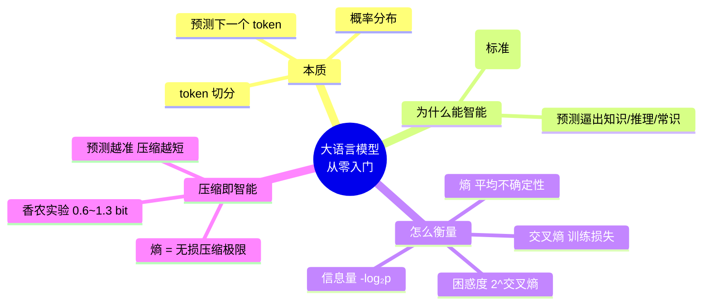

<div style="background-color: #1e1e1e; color: #00ff00; font-family: 'Courier New', Courier, monospace; border-radius: 8px; padding: 20px; box-shadow: 0 10px 30px rgba(0,0,0,0.3); margin-bottom: 30px; margin-top: 20px; position: relative; overflow: hidden;">
    <div style="display: flex; align-items: center; margin-bottom: 15px; padding-bottom: 10px; border-bottom: 1px solid #333;">
        <div style="display: flex; gap: 8px; margin-right: 15px;">
            <div style="width: 12px; height: 12px; border-radius: 50%; background-color: #ff5f56;"></div>
            <div style="width: 12px; height: 12px; border-radius: 50%; background-color: #ffbd2e;"></div>
            <div style="width: 12px; height: 12px; border-radius: 50%; background-color: #27c93f;"></div>
        </div>
        <div style="color: #ccc; font-size: 0.9em;">bash</div>
    </div>
    <div>
        <p style="margin: 5px 0; line-height: 1.6;"><span style="color: #008AFF; font-weight: bold;">ckhuang@macbookpro:~$</span> 我们每天都在调 prompt、堆上下文、算 token 成本，却很少有人能一句话说清：ChatGPT 到底在干什么？答案朴素得让人失望——它只是在"猜下一个 token"。可正是这个朴素到近乎无聊的目标，被做到极致之后，就长出了"智能"。 <span style="display: inline-block; width: 8px; height: 16px; background-color: #00ff00; vertical-align: middle;"></span></p>
    </div>
</div>

带团队做 RAG、做 Agent 这些年，我发现一个挺讽刺的现象：**我们能很熟练地"用"大模型，却很难准确地"讲"大模型。**

- 面试时问候选人「大模型在做分类还是在做生成」，十有八九答得含糊；
- 调参时把 `temperature`、`top_p` 当玄学，说不清它们到底在扰动什么；
- 看到论文里写「降低困惑度」，脑子里只有"越低越好"，却不知道它和交叉熵、和熵之间是什么关系；
- 讨论上下文窗口时，能说出"越长越贵"，但说不出**为什么"看得更长"能真的让模型更准**。

这些问题的根，其实都指向同一个原点：**语言模型的本质，是一个给定前文、输出"下一个 token 概率分布"的程序。** 只要把这个原点想透，"为什么预测能通向智能""怎么给模型打分""为什么压缩即智能"会像多米诺骨牌一样，一张一张地倒下去。

这篇文章想沿着一条线，把这件事讲清楚：**它在做什么、为什么能做到、怎么衡量做得好不好。** 用到的数学只有加减乘除和对数，我会从"折半了几次"这种大白话讲起。读完你拿到的不只是概念，而是一套可以拿去和别人讲清楚 LLM 的"信息论内功"。

## 一、本质：一个预测下一个 token 的程序

先玩个接龙游戏，补全下面的句子：

```
床前明月____
```

几乎所有人都会填"光"。再换一句：

```
今天天气很____
```

这次答案不唯一了：好、热、冷、不错……但也不是毫无规律，很少有人会填一个跟天气八竿子打不着的词，比如"今天天气很贵"。如果把各种可能按把握大小写下来，大概是这样：

| 候选 | 概率（示意） |
| :--- | :--- |
| 好 | 35% |
| 热 | 20% |
| 冷 | 15% |
| 不错 | 10% |
| 其他所有候选合计 | 20% |

把这道题交给语言模型，它给出的也是**这样一张表**。这里有个关键细节：表里的"不错"虽然两个字，却和"好"一样只算一个候选。因为语言模型处理文字的最小单位不是"字"，而是 **token**。一个 token 可以是一个字，也可以是由多个字组成的词：

```
今天 | 天气 | 很 | 好
```

"今天天气很好"这 6 个字，被切成了 4 个 token。之所以要合并，一是**省步数**：模型每生成一个 token 都要完整算一遍，合并后只需算 4 步；二是**常一起出现的字本就该当整体**，比如"今"后面经常跟着"天"，合成一个 token 后就不用反复去猜这种显而易见的搭配。

所以第一句结论可以写死了：

**语言模型，是一个给定前文、输出"下一个 token 概率分布"的程序。**

那一段完整的话是怎么写出来的？做法简单到有点"笨"：从概率分布里选出一个 token 接到前文后面，再把新的前文交回模型，循环往复。


我在给团队做新人培训时，会把这张图钉在白板上，然后强调一句话：**模型没有"写文章"这个动作，它只有"接龙"这一个动作。** 你看到的通顺长文，是几百上千次"接龙"叠加出来的涌现结果，而不是某一次"胸有成竹"的输出。想通这一点，后面很多关于幻觉、关于一致性的困惑，都会豁然开朗。

## 二、为什么"预测"能通向智能？

"预测下一个 token"听起来像高级版输入法联想，它凭什么和"智能"扯上关系？

1950 年，图灵在论文《计算机器与智能》里讨论"机器能思考吗？"。他觉得"思考"太难定义，于是换了个问法，设计了**模仿游戏**，也就是后来的**图灵测试**：一位裁判隔着屏幕，同时和一个真人、一台机器打字聊天，聊完判断哪个是人、哪个是机器。如果反复测试也分不出，就可以认为这台机器具备了人的智能。

请注意这个测试最精妙的地方：**裁判能看到的只有文字。** 机器用什么做的、内部怎么运转，都不重要，重要的是它写出来的东西像不像人写的。

再看语言模型：它从海量人类文字中学习"给定前文，人接下来会写什么"。学得越准，它一个 token 一个 token 接出来的文字就越像人写的。如果它预测的概率分布和人写作时的分布**完全一致**，那它写出的文字与人写的就没有区别，裁判怎么看也分不出来。

**所以，把"预测下一个 token"做到极致，就是在通过图灵测试。**

而要预测得准，光记住字词搭配远远不够：

- `法国的首都是____` → 要填"巴黎"，得有**知识**；
- `小明比小红高，小红比小刚高，最矮的是____` → 要填"小刚"，得会**推理**；
- `他发现牛奶过期了，于是皱着眉头把它____` → 要填"倒掉"，得懂**常识**。

人写下的文字里，藏着知识、逻辑、常识和情感。想把人接下来会写的 token 猜准，模型就**不得不**把这些东西学进去。**"预测"这个看似简单的目标，反过来逼着模型掌握文字背后的东西。**

这里我要泼一盆冷水，也是我特别想纠正团队里一个常见偏见：**"图灵测试"是个行为标准，不是"理解"的证明。** 机器是否真的"理解"，至今仍有争论。但它给了我们一个清晰、可操作的方向——**让模型预测的概率尽量接近人**。

那"接近"该怎么衡量？这就需要请出信息论了。

## 三、一场猜数字游戏，讲透信息量与熵

### 3.1 信息，就是帮助你消除不确定性的东西

我从 **1～8** 中等概率地选一个整数，不告诉你。你可以问问题，但我只回答"是"或"否"。

笨办法是一个一个问："是 1 吗？不是。是 2 吗？不是……"——每次得到"不是"，只排除一个数字，很浪费机会。

聪明的办法是**每次把剩余候选对半分**。假设我选的是 **6**：

| 第几问 | 你的问题 | 我的回答 | 剩余候选 |
| :--- | :--- | :--- | :--- |
| 开始 | — | — | 1、2、3、4、5、6、7、8 |
| 第一问 | 大于 4 吗？ | 是 | 5、6、7、8 |
| 第二问 | 大于 6 吗？ | 否 | 5、6 |
| 第三问 | 大于 5 吗？ | 是 | 6 |

三个问题，确定答案。注意这不是因为我碰巧猜中了 6，而是**任何一个答案都能在三问内被确定**：

```
8 个候选 → 4 个候选 → 2 个候选 → 1 个答案
```

**信息，就是帮助你消除不确定性的东西。** 在这个游戏里，每次折半的回答提供 1 bit 信息，三次一共 3 bit。bit 一点都不神秘，你完全可以把它理解成：**区分两个等概率可能性所需要的信息量。**

候选越多，起初越不确定，要找到答案需要的信息也越多：4 个数字要折半 2 次，8 个要 3 次，16 个要 4 次。

顺手还能得到公式——**单个结果的信息量**是：

$$I(x) = -\log_2 p(x)$$

底数为什么是 2？因为信息量的本质就是"**折半了多少次**"。概率 1/2 的结果，相当于在一半可能里确定它，折半 1 次，对应 1 bit；概率 1/8 的结果，要折半 3 次，对应 3 bit。概率每缩小一半，对数就加 1。你只要记住三点：

- 概率越小，结果出现时带来的信息量越大；
- 概率为 1（百分之百确定），信息量为 0；
- **越离谱 = 概率越小 = 信息量越大。**

### 3.2 熵：平均而言，答案有多难确定

现在改变规则：我选 1 的概率是 90%，剩下 10% 分给 2～8。这时"大于 4 吗"就未必是最优的第一问了——你可以先问"是 1 吗"，90% 的情况一问就结束。

这说明**难度不只由"有几个候选"决定，还和各候选的概率分布有关**。要描述游戏的平均难度，就把每种结果的信息量，按出现概率**加权平均**。这个平均值就是**熵**：

$$H(X) = -\sum_x p(x)\log_2 p(x)$$

用硬币对比一下最直观：

| 硬币的情况 | 熵 | 为什么 |
| :--- | :--- | :--- |
| 正反各 50% | 1 bit | 两种结果同样可能，不好提前判断 |
| 正面 90%，反面 10% | 约 0.469 bit | 大部分时候可以预期是正面 |
| 必定正面 | 0 bit | 没有不确定性 |

第二行是这么算出来的：

```
正面：概率 0.9，信息量 −log₂0.9 ≈ 0.152 bit
反面：概率 0.1，信息量 −log₂0.1 ≈ 3.322 bit
熵 = 0.9 × 0.152 + 0.1 × 3.322 ≈ 0.469 bit
```

注意这里的反直觉之处：**罕见的反面信息量很大（3.3 bit），但它只占 10%，拉不高平均值。** 熵衡量的是"平均不确定性"，而不是"最大惊喜"。

回到猜数字游戏，两种规则对比：

| 猜数字的情况 | 熵 |
| :--- | :--- |
| 1～8 等概率 | 3 bit |
| 1 占 90%，2～8 平分 10% | 约 0.750 bit |

同样是 8 个候选，概率一旦集中到 1 上，平均不确定性就从 3 bit 降到约 0.75 bit，只剩原来的四分之一左右。

熵还有一个非常实在的含义，也是我认为最该被工程师记住的一点：**它就是数据能被无损压缩到的极限。** 任何无损编码的平均长度都不可能低于熵。规律掌握得越准，编码越短；能压到熵，说明数据里所有能被利用的规律都已经挖出来了，剩下的是真正无法预测的随机性。

## 四、交叉熵：模型到底错在哪？

熵是**数据本身**的性质。只要我选数字的规则不变，熵就一直是 0.75 bit，模型估得准不准都改变不了它。会变的是：**按模型的估计去编码，实际要花多少 bit。**

假设真实规则还是"1 占 90%"，但模型傻乎乎地以为 8 个数字等概率。用 $p(x)$ 表示真实概率，$q(x)$ 表示模型认为的概率。模型按自己的判断安排编码：认为谁常见就给谁短编码，结果 $x$ 的码长就是模型眼中的信息量 $-\log_2 q(x)$。模型认为每个数字都是 1/8，于是各给 3 bit。可实际上 90% 的时候出现的都是 1，本来 0.152 bit 就够了，却每次都花 3 bit：

```
平均码长 = 0.9 × 3 + 0.1 × 3 = 3 bit
```

比熵多花了 2.25 bit，**这些都是因为估错了概率而白白浪费的。**

把上面的算法写成公式，就是**交叉熵**：

$$H(p, q) = -\sum_x p(x)\log_2 q(x)$$

和熵的公式相比，只是把对数里的 $p(x)$ 换成了 $q(x)$：

- $p(x)$（真实概率）负责**加权**：这个结果实际多常出现；
- $q(x)$（模型概率）负责**定价**：这个结果每出现一次要花多少 bit。

当模型估计和真实完全一致（$q = p$）时，交叉熵就等于熵。再看三种模型对比：

| 模型认为的概率 | 交叉熵 | 比熵多花 |
| :--- | :--- | :--- |
| 和真实一样：1 占 90% | 约 0.75 bit | 0 |
| 等概率（什么规律都不知道） | 3 bit | 2.25 bit |
| 2 占 90%，其余平分（自信地猜错） | 约 6.04 bit | 约 5.29 bit |

这张表里藏着两条工程上极其重要的结论：

1. **交叉熵永远不低于熵**，只有当模型的概率和真实完全一致时才相等。模型估得越偏，多花的就越多。
2. **自信地猜错，比什么都不知道还糟。** 等概率模型每次花 3 bit；而"认定是 2"的模型，在真正的 1 出现时（90% 的情况），每次要花约 6.13 bit。

第 2 条，正是我今天在 Agent 架构里反复强调的东西：**一个"不知道自己不知道"、还特别自信的模型，比一个"承认自己不确定"的模型危险得多。** 这也是为什么工程上要做结构化判断、要做置信度校准——本质上都是在**降低那个"自信猜错"带来的惩罚**。

### 真实概率不知道，怎么办？

交叉熵公式要用到真实概率 $p(x)$，可人写作时的真实概率，谁也不知道。好在**并不需要知道**——真实概率已经体现在真实数据里了。

把猜数字玩 1000 局，记下每局真实出现的数字，再把模型给这个数字的码长取平均。1 大约出现 900 次，平均的时候自然就按真实概率加了权，结果会接近交叉熵。

语言模型也一样。拿一段人写的真实文本，在每个位置上看模型给**真实下一个 token** 的概率：

```
今天天气很____  真实下一个 token：好
模型给"好" 35% → −log₂0.35 ≈ 1.51 bit（预测得不错）
模型给"好"  5% → −log₂0.05 ≈ 4.32 bit（预测得很差）
```

把海量文本里每个位置的值取平均，就是模型在这批文本上的交叉熵。**它就是训练语言模型时用的损失函数（loss），越低说明预测越准。** 训练的过程，就是在海量人类文本上，不断把交叉熵往下压。

### 困惑度：更直观的"犹豫程度"

交叉熵还有个更直观的说法叫**困惑度（Perplexity）**，等于 $2^{\text{交叉熵}}$，意思是：**模型的犹豫程度，相当于在几个等可能的候选里猜一个。**

- 等概率模型交叉熵 3 bit → 困惑度 $2^3 = 8$，正好对应"从 8 个数字里猜"；
- 掌握规律的模型约 0.75 bit → 困惑度约 1.7，相当于只在不到 2 个候选里犹豫。

这正是线上监控里我最爱看的指标：**困惑度突然飙升，往往意味着输入分布漂移了**（用户开始问模型没见过的东西），比单纯看响应时间更能反映模型"慌不慌"。

> 补充一个工程细节：实际训练中，对数通常以 $e$ 为底，单位叫 **nat**，和 bit 只差一个固定倍数（1 nat ≈ 1.44 bit），不影响结论。

## 五、香农的实验与"压缩即智能"

交叉熵告诉了我们怎么给模型打分，但还有一个问题：**人类语言本身的熵是多少？模型的交叉熵最低能降到哪？**

1951 年，香农在论文《印刷英语的预测与熵》里估算了这个数。英文 26 个字母加空格共 27 种符号，**已知信息越多，下一个字符越好猜**：

| 已知的信息 | 每个字符的熵（约） |
| :--- | :--- |
| 什么都不知道，27 种符号等可能 | 4.75 bit |
| 知道每个字母各自出现的频率 | 4.03 bit |
| 知道前 1 个字母 | 3.32 bit |
| 知道前 2 个字母 | 3.1 bit |
| 知道前面约 100 个字母 | 0.6～1.3 bit |

第一行就是"等概率猜数字"（$\log_2 27 \approx 4.75$）；第二行像"1 占 90%"那局——字母 E 比 Z 常见得多。**从第三行开始用上了上下文**：看到 Q，下一个几乎一定是 U；中文里看到"床前明月"，下一个字几乎确定。

**已知的上下文越多，下一个字越好猜，熵就越低。** 这句话值得每个做工程的人抄在本子上——它直接解释了**为什么语言模型要尽可能看更长的前文**，"长上下文"不是堆参数的面子工程，而是**从信息论上实打实降低不确定性**的手段。

前几行能靠统计数出来，最后一行不行：前文一长，组合多到数不过来。香农的办法很"野"——**直接让人当预测者**：遮住一段英文，让受试者一个字符一个字符地猜，记下每个字符是第几次猜中。懂英语的人大多一次就中，论文里一次实验中 102 个字符有 79 个是第一次猜中的。

设想发送方和接收方各有一个一模一样的预测者：发送方只传这份"第几次猜中"的记录，接收方按同样顺序去猜，就能还原原文。所以这份记录就是压缩后的文本——**里面满是 1，能压得很短**。香农由此估算出：英文每个字符的熵只有 **0.6～1.3 bit，大约相当于抛一次硬币**。

七十多年前，香农用人脑当预测者；今天，语言模型是一个**机器预测者**，而且给出的不只是猜测的先后顺序，而是每个候选的概率。由于交叉熵永远不低于熵，**模型在真实文本上的交叉熵，就是人类语言熵的一个上界**——模型越强，这个上界压得越低。

这就是 **「压缩即智能」** 的核心思路：

<div style="text-align: center; font-size: 1.2em; font-style: italic; color: #008AFF; margin: 40px 0 20px; padding: 20px; border-top: 1px dashed #ccc; border-bottom: 1px dashed #ccc;">
    “能把数据压缩得越短，说明对数据背后规律的掌握越深。 —— CK·黄
</div>

压缩和图灵测试，其实是同一件事的两面：

- 图灵测试给出的是**标准**：预测得和人一样，就可以认为有了人的智能；
- 压缩即智能给出的是**原因**：要预测得和人一样，就得把文字压缩到接近它的熵；而要压得这么短，最有效的办法就是学会文字背后的规律。

不过这里必须保持清醒，这也是我要求团队在写技术文章时守住的分寸：**"预测越准、压缩越短"是数学事实；"压缩得好就是智能"只是一个有启发性的研究视角，而不是已被证明的定理。** 比如"一万个 A"可以写成"A 重复一万次"，一个简单程序就能压得极短，但不能因此说它会推理。**压缩比高 ≠ 智能**，两者之间还隔着"是否学到了可泛化的规律"这一步。



## 六、给工程师的几点洞见

把上面这条线串起来，落到日常工程里，我会提炼出四个可以直接用的判断：

**1. 大模型的"生成"本质是"接龙"，所以它天然逐 token 逐位置地承担风险。**
每一次采样都是一次概率选择，长文里任何一步走偏都可能把后续带跑。这解释了为什么 `temperature`、`top_p` 会显著改变风格：它们不是在"改内容"，而是在**改从概率分布里选 token 的策略**。

**2. 交叉熵就是损失函数，困惑度就是它的指数形态，两者是一回事。**
别再把"降低 loss"和"降低困惑度"当成两个指标。看到困惑度 8，等价于交叉熵 3 bit，等价于"在 8 个等可能候选里犹豫"。这个换算能让很多玄学调参瞬间落地。

**3. 长上下文的价值有信息论背书。**
从"已知 0 个字符"到"已知 100 个字符"，熵从 4.75 bit 掉到 1 bit 量级。上下文越长，模型面对的不确定性越低——这是"为什么要做长上下文"的根本理由，而不只是商业噱头。

**4. "自信地猜错"是最大的风险源。**
交叉熵的表已经证明：一个自信却错的模型，代价比一个"什么都不知道"的平等模型还高。所以 Agent 系统里应该有独立的、可校准的**判断层**，让模型在不确定的时候敢说"我不确定"，这比让它永远自信地胡说要安全得多。

<div style="background-color: #1e1e1e; color: #00ff00; font-family: 'Courier New', Courier, monospace; border-radius: 8px; padding: 20px; box-shadow: 0 10px 30px rgba(0,0,0,0.3); margin-bottom: 30px; margin-top: 20px; position: relative; overflow: hidden;">
    <div style="display: flex; align-items: center; margin-bottom: 15px; padding-bottom: 10px; border-bottom: 1px solid #333;">
        <div style="display: flex; gap: 8px; margin-right: 15px;">
            <div style="width: 12px; height: 12px; border-radius: 50%; background-color: #ff5f56;"></div>
            <div style="width: 12px; height: 12px; border-radius: 50%; background-color: #ffbd2e;"></div>
            <div style="width: 12px; height: 12px; border-radius: 50%; background-color: #27c93f;"></div>
        </div>
        <div style="color: #ccc; font-size: 0.9em;">bash</div>
    </div>
    <div>
        <p style="margin: 5px 0; line-height: 1.6;"><span style="color: #008AFF; font-weight: bold;">ckhuang@macbookpro:~$</span> 一句话收尾：语言模型的本质是用"猜下一个 token"逼近人类语言的真实分布，而"猜得准"这件事，在数学上等价于"把文本压缩到接近它的熵"。图灵测试给了标准，香农的熵给了尺度，交叉熵给了标尺——把这三样东西想通，"智能"就不再玄学。 <span style="display: inline-block; width: 8px; height: 16px; background-color: #00ff00; vertical-align: middle;"></span></p>
    </div>
</div>

## 总结

用十几行把全文串起来：

- **本质**：语言模型 = 给定前文、输出下一个 token 概率分布的程序；一次只猜一个 token，循环就成了整段文字。
- **为什么能智能**：图灵测试只看文字，而要把"下一个 token"猜准，模型不得不学会知识、推理和常识——**预测逼出理解**。
- **信息量**：$I(x) = -\log_2 p(x)$，越离谱（概率越小）信息量越大。
- **熵**：$H(X) = -\sum p(x)\log_2 p(x)$，平均不确定性，也是**无损压缩的极限**。
- **交叉熵**：$H(p,q) = -\sum p(x)\log_2 q(x)$，模型估计偏差带来的额外代价，**就是训练的损失函数**；它永远不低于熵。
- **困惑度**：$2^{\text{交叉熵}}$，模型的犹豫程度"相当于从几个等可能候选里猜一个"。
- **香农实验**：英文每字符熵仅 0.6～1.3 bit，上下文越长熵越低——**长上下文有信息论支撑**。
- **压缩即智能**：能把文本压到接近它的熵，说明学到了背后的规律；但"压得短"是数学事实，"压缩好就是智能"只是启发性视角。

留给读者的三个思考题，也是我平时拿来考团队的问题：

1. 如果困惑度等价于"从几个候选里犹豫"，那么一个困惑度为 2 的模型，和一个困惑度为 20 的模型，**在同一个业务问题上的可靠差距**，你能不能用这个数字给出一个粗略的工程判断？
2. "自信地猜错比什么都不知道更糟"——在你的系统里，有没有一种机制能让模型**表达不确定性**，而不是把 5% 的概率伪装成 100% 的斩钉截铁？
3. 长上下文能降低熵，但也会带来成本与注意力稀释。在**"看更多"和"看得准"之间**，你会如何权衡？

<div style="text-align: center; font-size: 1.2em; font-style: italic; color: #008AFF; margin: 40px 0 20px; padding: 20px; border-top: 1px dashed #ccc; border-bottom: 1px dashed #ccc;">
    “把预测下一个 token 做到极致，就是在通过图灵测试。 —— CK·黄
</div>
