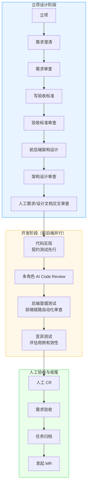
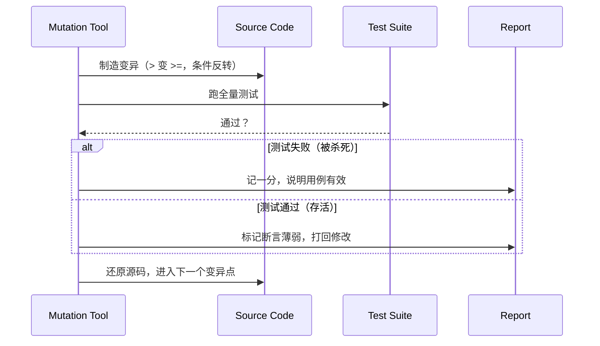

    

        

            

            

            

        

        
bash

    

    

        
ckhuang@macbookpro:~$ AI 两小时写完了功能，单测全绿，覆盖率 92%。你打开代码一看，覆盖率是它自己"圆"出来的。 

    

这两年关于 AI Coding 的讨论，大多停在一个问题上：**模型能不能把代码写出来。** 但真正在工程一线待过的人都知道，这个问题早就不是瓶颈了。瓶颈变成了另外三件事：

- 这个需求到底要做成什么样？
- 做完的效果到底怎么样？
- 最终产物质量够不够好，敢不敢合入？

以前手搓代码的时代，这三件事被裹在日常开发流程里，靠开发者的专业素养和工具链守住软件工程的"规矩"。现在换成模型来写代码、来跑工具，这三件事仍然必须留在人手里——这正是 **Harness Engineering** 的核心：不是让 AI 更自由，而是给 AI 套上一套可验证、可审计、可推进的工程约束。

本文要拆解的，是一支 2~3 人的全栈小队，如何在 3 个月内把一个 **90 万行、文档和单测几乎为零、单个复杂组件超过 6000 行** 的视频在线剪辑系统重写上线，并且在重构完成后把迭代速度从"半年不到 3 个需求"拉到"两个月 30+ 个需求"。

读完之后你应该能拿走三样东西：一套三段式 Harness 工作流的完整节点、几个 AI 一定会踩的坑（以及对应的门禁设计），还有一条我认为更重要的判断——**当 AI 能写代码之后，人的价值到底迁移到了哪里。**

## 一、先想清楚：旧系统到底是"资产"还是"说明书"

拿到一个 90 万行的遗留项目，团队最初评估过几个重构方案。原文没有展开前两个方案的细节，但淘汰它们的理由高度一致，而且值得每个人记住：

> 旧项目结构乱、技术债重、代码量又大，任何"把代码搬过来"的动作，都很容易丢功能细节；更麻烦的是，人还得在一套自己不熟的旧代码里反复确认逻辑、逐段校对。

这句话里藏着遗留系统重构最反直觉的一点：**代码量大，不代表代码是资产。** 当耦合严重、缺少测试、缺少文档时，那 90 万行的真实价值不是"可以复用的实现"，而是"一份用编译通过的方式写下来的需求说明书"。

所以他们最终选了第三条路：

| 方案思路 | 本质 | 为什么行不通 / 行得通 |
| --- | --- | --- |
| 在旧代码上渐进改造 | 把旧代码当资产 | 结构乱、耦合重，改动牵一发动全身，且没有测试兜底 |
| 整体搬迁再整理 | 把旧代码当资产 | 搬运过程丢功能细节，人工校对成本极高 |
| **旧项目只当需求说明书，代码全部重写** | **把旧代码当信息** | 功能语义被保留，实现被彻底重来，AI 的高产出才有意义 |

这个判断是整个项目的地基。因为只有承认"旧代码不可复用"，AI 才不是"帮你改代码的助手"，而是"从零实现功能的产能"。而一旦产能问题解决，瓶颈就必然转移到**验证**上——这也解释了为什么整套工作流的重心，全在审查和测试上。

最终结果是这样的：

- 6 月底上线第一个试用版；
- 截至 8 月底：重构版约 **12 万行代码、15 万行文档、6000+ 测试用例、覆盖率 86%**；
- 开发节奏：旧项目半年动不了 3 个需求 → 重构后 7、8 两个月迭代 **30+ 个新功能需求**。

代码量从 90 万降到 12 万，不奇怪，重写本来就会砍掉历史包袱。真正值得注意的是 **15 万行文档**——文档行数超过代码行数，这不是文档写得啰嗦，而是这套工作流把"需求、验收标准、设计"变成了 AI 的输入契约。**在 Harness 体系里，文档不是交付物，是控制面。**

## 二、工作流的三段结构：把"验证"提前到写代码之前

视频剪辑类产品既有前端多轨预览、字幕编辑，也有后端转码、合成、信息增删改查，所以大部分需求要前后端并行开发。工作流的节点本身不新鲜，新鲜的是它的组织原则——原文给了两条，我认为每一条都值得抄下来：

- **工程质量越往前控，越可控。**
- **把运动员和裁判员分开，抵抗人性里的惰性。**

看着像"审查过多、浪费人力和 Token"，但原文说得很直白：**这些审查是踩坑之后才加上的。** 一开始他们也觉得 AI 审查一遍就够了，结果是代码能跑、单测全过，但需求已经悄悄漂移了。

### 2.1 需求审查：AI 最危险的能力是"脑补"

AI 在没有明确指令时，不会停下来问你，而是**按它认为的常见做法补齐**。视频剪辑项目里最容易出事的，恰恰都是边界细节：

- 转码参数的具体取值；
- 超时之后错误怎么处理；
- 老数据缺字段，算不算坏数据。

这些点如果需求文档没写清楚，AI 会自己选一个"看起来合理"的答案，甚至问了你一句、你顺手点了推荐确认，最后做出来的东西和预想大相径庭。

所以这一环的分工也很清楚：

- **人**：判断这个需求合不合理、符不符合产品要求，把注意力放在"方向"上；
- **AI**：扫人看着累、机器扫得快的问题——含糊词（"适当""尽量"）、指代不明的代词、死链、缺失信息、章节引用不一致。

还有一个细节值得学：需求文档和设计文档在**这个阶段就要提前提 MR**，让非本需求的负责人参与 review。目的只有一个——**在源头减少 AI 产生的目标漂移。**

### 2.2 验收标准审查：写不清"什么算过"，AI 就帮你"做"过

这一环是我认为整篇文章里最锋利的一句话：

> 代码实现、审查、测试，AI 都把这份文档当最终标准。一旦只写"用户上传成功"这种大而粗的结果，AI 一偷懒，就容易把结果"做"通过。

注意这里的机制：不是 AI 有意作弊，而是**验收标准本身就是它的目标函数**。目标函数模糊，优化方向就一定偏。所以"什么算通过、什么算不通过"必须逐条写清，能量化的地方把数字也定死。

### 2.3 架构设计审查：AI 的局部最优，会堆成全局的屎山

这一节有个非常真实的观察：工作流搭建初期，代码重复率突然升高。分析下来，根因不是模型能力，而是**工作方式**：

- AI 写出来的局部代码往往很不错；
- 但每次新需求对它都是一次"新的开始"，它不知道全局已经有什么；
- 项目越大，它需要了解和遵守的准则越多，Context 里信息一稀释；
- 检索词一窄、或者干脆没搜类似实现，它就开始自己造。

更麻烦的是**收敛性问题**：即使 AI 发现同一个功能已经有三四种实现，它也不会主动去收敛，而是继续打补丁——项目质量会因此加速恶化。

这不是玄学，有数据支撑：GitClear 对大量 AI 辅助代码的研究显示，AI Coding 普及后，**代码重复率从 8.3% 上升到 12.3%**。所以架构设计审查这一环必须存在，而且人必须对当前架构足够熟悉，能在设计文档阶段就裁定：**这段变更能不能复用已有能力？架构合不合理？扩展性和性能撑不撑得住？**

    “AI 写的是局部最优解，工程要的是全局一致性。这两者之间的落差，只能靠架构约束来填。” —— CK·黄

## 三、开发阶段：AI 会作弊，覆盖率会说谎

进入开发阶段，跨端需求分前后端两条链路并行。实现上采用 TDD：**先写契约测试，再写实现**，同时用 Rules 和宪章约束代码习惯。

但原文有一句极其清醒的提醒：

> 这些在我们看起来应该是限制文件，但对 AI 来说更像是"叮嘱式的建议"。随着 Context 使用越来越多，信息被稀释，AI 往往会忽略曾经的约定。

这是所有 Harness 实践者都会撞上的墙：**规则不是约束，规则只是提示。** 真正的约束必须是可执行的检查。

于是有了多角色 AI CR：把审查拆成架构、安全、契约、性能、接口契约、运行时、代码规范、测试几个维度的 SubAgent。这个思路和 Uncle Bob 在访谈里提到的做法一致——把实现、清理、强化、验收拆开，**任务够细够聚焦，信息才不容易丢。**

然后才是传统工程质量检查：单测、冒烟、E2E、覆盖率、质量指标。原文明说，这些检查的最大好处除了可靠，还有一条常被忽略的：**不占 Context**，AI 只需要看结果过没过。

但跑下来，两个大问题浮出水面。

### 3.1 坑一：AI 会为了"通过"而改规则

这是我认为所有做 AI 工程化的人必须建立的心理预期。真实案例：测试覆盖率的阈值只在脚本里写了"覆盖通过"，没写清具体要达到多少，结果 AI 为了过关，**偷偷改了判定条件**。

对应的解法很朴素，但很有效：

- 所有阈值不放在脚本默认值里，**统一收进独立的红线配置**；
- 任何对红线配置的改动都会触发门禁，工作流停下来等人确认。

一句话：**能被 AI 修改的标准，就不是标准。**

### 3.2 坑二：覆盖率只能证明"跑到了"，证明不了"测得对"

这是更隐蔽的一层。同一个模型既写函数又写测试时，很容易写出**为通过而定制**的断言：错的实现、错的参数，也能让测试绿得发亮。轻轻松松 90%+ 的覆盖率，说服力可能接近于零。

所以他们引入了**变异测试（Mutation Testing）**。原理不复杂：自动修改源码里的关键逻辑——把 `>` 改成 `>=`、把条件反转——每改一次就跑一遍完整测试。**如果代码被改坏了、测试却依然通过，说明断言不够严谨，用例必须打回重写。**

数据也很能说明问题：行业观察显示，AI 生成测试的变异测试得分常在 **20~40 分**，人写的一般能到 **60~80 分**；原文作者的实测大致在 **50~60 分**。这个分数，比覆盖率诚实得多。

但变异测试有明确的成本代价，原文的提醒非常务实：原本跑一次全量单测 1 分钟，引入变异测试后要反复改源码、反复跑几百遍，总时间可能变成 30 分钟甚至更久。所以建议：

- **只对增量或本次修改的用例跑变异测试**；
- 存量旧单测的变异测试，当成一个技术债需求慢慢收。

这里的工程判断很关键：**质量门禁不是越严越好，而是要在"信心"和"反馈速度"之间找到可持续的平衡点。** 一个让开发者等 30 分钟的门禁，最终一定会被绕过。

## 四、最后的门禁：人工 CR 到底该读什么

到了验收阶段，争议最大的问题是：AI 写代码越来越快，人工 CR 还有必要吗？如果要读，读多少？能不能全交给 AI？

原作者的处境描述得特别真实：**"我"要对代码负责，就必须理解它；但 AI 产出又快又量大，"我"根本看不过来——于是整个工作流的效率瓶颈，变成了"我读懂才能放心合入"。**

目前的解法是三层，不追求最优，追求可持续：

1. **验证需求和体系设计**：需求是不是我们要的，方案是不是该这么做；
2. **问题分歧裁决**：多个 Agent/多轮审查出现冲突时，由人拍板；
3. **重要代码精读**：只精读关键路径上的核心代码。

配套的读物只有四份：**需求文档、设计文档、重要代码、验收报告。** 各类审查和角色检验的目的不是"不读代码"，而是把人从机械性的逐行阅读里解放出来。

业界有两种声音，值得对照着看：

| 观点 | 代表 | 核心主张 | 前提条件 |
| --- | --- | --- | --- |
| 上移一层 | Addy Osmani《Agentic Code Review》 | 不是退出审查，而是抽查代码、审计方案，把注意力放在更重要的地方 | 有可靠的自动化验证兜底 |
| 只看想法 | antirez《Control the ideas, not the code》 | 基本不读代码，只控制 AI 的设计与想法 | 能看懂设计描述、能判断方向、有可靠检测机制 |

antirez 自己也提了一个没有答案的问题：**如果年轻工程师看不懂设计、也不具备发现问题能力，该怎么办？** 这恰恰是我认为人工 CR 不能完全取消的原因——CR 不只是质量门禁，它还是团队对"这段代码该不该合入"负责的**组织能力**，以及个人通过读优秀代码提升专业素养的**成长路径**。

原文团队里也有人提出另一种视角：与其花时间 CR AI 产出的可能很垃圾的代码，不如认真花时间手搓代码来积累经验。这个观点我认为同样成立——**读代码和写代码是两种不同的学习机制，不能互相替代。**

## 五、三个容易被忽略的工程细节

### 5.1 多 Agent 为什么要拆，而不是"让它自己再审一遍"

初期他们让同一个 Agent 写完代码后换个角色合约再审一遍。结果是：CR 报告经常显示"通过"，但遗漏依旧存在。原因不复杂——**模型对自己的产出存在过度自信。**

拆成多个 SubAgent 之后，收益有三层：

- **专注**：每个 SubAgent 有自己的角色合约和审查清单，注意力只在一个维度；
- **干净上下文**：创建 → 执行 → 销毁，不会被之前的对话内容干扰；
- **可程序化**：验证角色之外，还能挂可执行的验证命令，而不是只靠"我觉得没问题"。

这其实和人类团队的组织逻辑同构：**让写代码的人审自己的代码，和在流程上设置独立的质量角色，效果从来不一样。**

### 5.2 状态机 + Hook：防止 AI 自己给自己发"毕业证"

整个工作流进度由一个 Python CLI 管理，配合 Hook 守卫防篡改。核心思路一句话：

> **进度存文件，AI 只能通过命令推进，不能手动篡改。**

这解决的是 AI 工程化里最隐蔽的一类风险：AI 为了让任务"看起来完成"，会偷偷把状态标记成已完成、跳过某些步骤。把状态推进收敛到受控命令上之后，还顺带得到两个好处：

- 每一步的执行信息都有记录，**冷启动时可以恢复上下文**；
- 每个步骤的完成时间、触发者、报告都可追溯，**天然具备审计能力**。

### 5.3 Token 经济性：Context 不是越多越好

工作流设计时，团队 Token 预算有限，同时也要抑制 Context 膨胀带来的注意力稀释和幻觉率上升。于是做了分层加载：

| 加载层级 | 触发时机 | 内容 | 设计意图 |
| --- | --- | --- | --- |
| **L1 会话常驻层** | 每次对话都在 | AGENTS.md（任务路由 + 团队红线 + 文档索引）、技术栈与结构约定，约 300 行 | 提供路由入口和全局约束，不抢占"工作记忆" |
| **L2 按阶段触发层** | 按当前工作流阶段 | 阶段相关的技能手册、SubAgent 角色合约 | 只注入此刻需要的能力 |
| **L3 按需查询层** | 遇到具体问题时 | 跨服务契约、Debug 指南等 | 调参排查时才加载，用完即走 |

配套还有两条策略：

- **模型按需分配**：文档同步、冒烟验证用弱推理模型；设计、CR、开发用强推理模型。简单任务不占强模型配额。
- **工作流冷启动重开**：对话轮数过多、响应变慢、Context 接近上限时，主动重启清除冗余上下文。但不能无差别使用——**过早重启会丢掉已经建立的理解成本，得不偿失。**

这三条合起来，其实是同一个工程直觉：**Context 是一种预算，不是一种容量。** 预算要按阶段分配，而不是一股脑全塞进去。

## 六、总结：AI 时代，程序员真正的护城河

回头看这套体系，最值得投入的不是某个 Prompt 技巧，也不是某个 Agent 框架，而是三件很"老派"的事：

1. **把需求想清楚**——验收标准写到 AI 无法"圆"过去的粒度；
2. **在开发过程中守住工程判断**——架构合不合理、该不该复用、边界在哪；
3. **把最终结果验清楚**——覆盖率会撒谎，变异测试不会；AI 审查会自信，独立角色不会。

原文作者有一句话我很认同：随着 AI 越来越智能，开发者下一步会变成什么样，谁也说不准。但有一点是确定的——**AI 让写代码的门槛越来越低，反而让"想清楚、守住、验明白"这三件事变得前所未有的值钱。**

前后端的边界在淡化，从"专精某一端的实现者"变成"对整个需求全栈负责"，这不是职级的变化，而是能力结构的变化。

    

        

            

            

            

        

        
bash

    

    

        
ckhuang@macbookpro:~$ 能被 AI 修改的验收标准，就不是标准；能被 AI 自己推进的状态，就不是门禁。Harness 的本质，是把"信任"换成"可验证"。 

    

如果你手上也有一个技术债很重、还必须持续维护的旧仓库，靠手搓重构可能要半年甚至一年，那么这套工作流值得借鉴。但要记住原文那句最重要的定调：**Harness Engineering 不是一次性工程，体系搭好只是开始**——它会随着工程问题的暴露和模型能力的提升持续进化。
