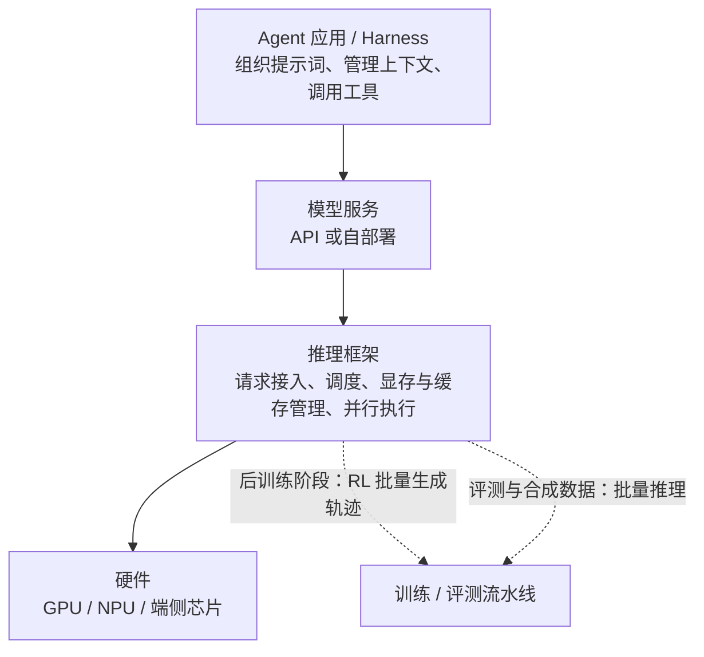
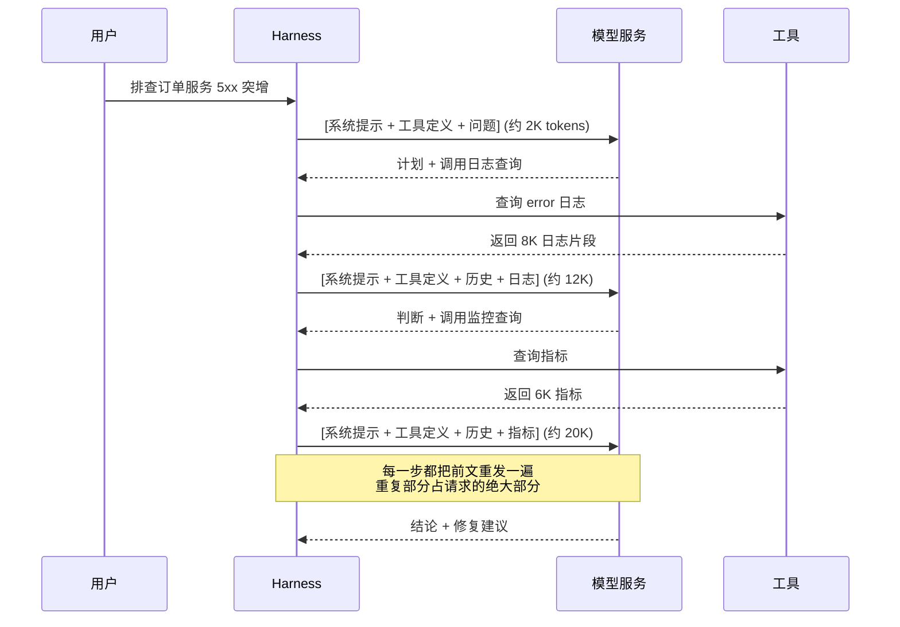
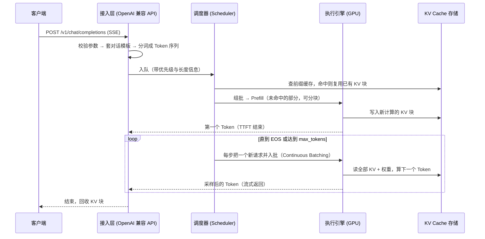
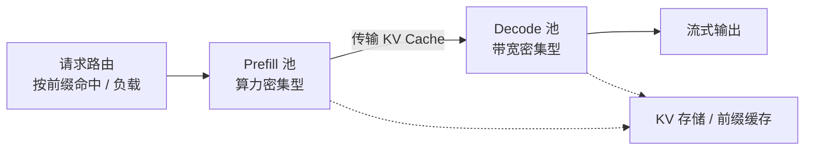

<div style="background-color: #1e1e1e; color: #00ff00; font-family: 'Courier New', Courier, monospace; border-radius: 8px; padding: 20px; box-shadow: 0 10px 30px rgba(0,0,0,0.3); margin-bottom: 30px; margin-top: 20px; position: relative; overflow: hidden;">
    <div style="display: flex; align-items: center; margin-bottom: 15px; padding-bottom: 10px; border-bottom: 1px solid #333;">
        <div style="display: flex; gap: 8px; margin-right: 15px;">
            <div style="width: 12px; height: 12px; border-radius: 50%; background-color: #ff5f56;"></div>
            <div style="width: 12px; height: 12px; border-radius: 50%; background-color: #ffbd2e;"></div>
            <div style="width: 12px; height: 12px; border-radius: 50%; background-color: #27c93f;"></div>
        </div>
        <div style="color: #ccc; font-size: 0.9em;">bash</div>
    </div>
    <div>
        <p style="margin: 5px 0; line-height: 1.6;"><span style="color: #008AFF; font-weight: bold;">ckhuang@macbookpro:~$</span> 输出 Token 比输入 Token 贵 4 倍，缓存命中比未命中便宜 50 倍。钱不是花在"模型更聪明"上，而是花在显存带宽和重复计算上。 <span style="display: inline-block; width: 8px; height: 16px; background-color: #00ff00; vertical-align: middle;"></span></p>
    </div>
</div>

这几年我们团队做过不少大模型落地项目，有一个现象反复出现：**大家对 prompt 工程、RAG、Agent 编排越来越熟，却对自己每月那张账单是怎么算出来的，几乎一无所知。**

- 能调 temperature、top_p，但说不清为什么流式输出还是"一卡一卡"；
- 知道"上下文越长越贵"，但不知道贵在显存，还是贵在算力；
- 老板问"我们自己部署一套模型能不能省钱"，只能凭感觉回答"看情况"；
- 智能体一上生产，延迟从 3 秒涨到 40 秒，第一反应是"模型不行"，其实是几十轮调用在串行累加。

这些问题的答案，都落在同一层上：**推理框架（Inference Framework）**。它是模型上线后离硬件最近的中间件，决定了你的首字要等多久、每秒能吐多少字、一张卡能同时服务几个人，以及最关键的——**每次调用到底花多少钱**。

这篇文章我会按"是什么 → 关键概念 → 开源格局 → 一个请求的旅程 → 谁该关心"的顺序，把这层黑盒拆开。读完之后，你至少能独立算清三笔账：**权重账（能不能跑）、KV Cache 账（能服务多少人）、延迟账（用户愿不愿等）。**

## 一、先定位：推理框架到底站在哪一层

一个大模型从无到有，大致走四步：**预训练**（用海量文本学语言和知识）→ **后训练**（SFT、RL、蒸馏，学会听指令、用工具）→ **评测**（确认任务表现达标）→ **部署上线**（API 或私有化服务，并持续监控迭代）。

所谓"推理"，就是用训练好的模型，根据输入计算输出的过程；"推理框架"就是负责把这件事做好：把模型加载到各类硬件和软件环境上，接收请求、组织计算、返回结果。

这里有个容易被忽略的事实：**推理不只发生在上线阶段。** 后训练里的强化学习需要模型反复生成大量轨迹，"生成"往往是整个训练流程中最耗时的部分，所以主流 RL 训练框架普遍会把成熟的推理引擎嵌进来做批量生成；评测阶段要跑成千上万道题、合成数据要批量产样本，用的也是推理框架。

<div style="text-align: center; font-size: 1.2em; font-style: italic; color: #008AFF; margin: 40px 0 20px; padding: 20px; border-top: 1px dashed #ccc; border-bottom: 1px dashed #ccc;">
    “训练是一次性投入，推理是持续性支出。训练决定模型能到什么水平，推理决定这份能力每用一次要花多少钱。” —— CK·黄
</div>

从分层上看，它嵌在这样一条链路里：



对于只调 API 的团队，这一层确实无感；但对于自部署模型的企业，**成本、首字延迟、吐字速度、并发劣化曲线，全部由这一层决定。**

而"做好"这件事，其实只有五个字：**快、多、省、稳、准**。它们彼此牵制——一次塞更多请求能让"多"更好，但每个请求变慢；精度压得更低能让"省"更好，但可能伤"准"。推理框架的大量设计，本质上都是在做这道多目标优化题。

| 目标 | 含义 | 对应的典型手段 |
| --- | --- | --- |
| 快 | 首字尽快出现，生成不卡顿 | 分块预填充、算子优化、投机解码 |
| 多 | 同硬件服务尽可能多请求 | 连续批处理、PagedAttention |
| 省 | 显存与算力用足，不重复计算 | 量化、KV Cache、前缀缓存 |
| 稳 | 高峰、超长请求、硬件故障下可用 | 集群调度、PD 分离、容错与扩缩容 |
| 准 | 输出与模型能力一致、格式可控可复现 | 对话模板、采样策略、结构化输出 |

## 二、为什么智能体把推理框架逼到了台前

如果说聊天机器人是一问一答，那么智能体执行一次任务，更像一场连续的多轮对话。以一个排查线上故障的智能体为例：它先理解问题、拟定计划，调用日志查询工具，读返回结果，判断下一步，再调监控工具，再判断……一次任务下来，模型可能被调用十几次甚至几十次。

更关键的是**每一次调用都要重发全部历史**：系统提示词、工具定义、此前每一步的思考和工具返回，加上新内容，一起打包给模型。上下文越滚越长，而其中绝大部分内容，在上一次请求里已经出现过。



于是智能体负载呈现出三个鲜明特征：**输入很长、输出相对较短、前后请求高度重复。** 同时端到端耗时是每一步的累加，单步多等一秒，几十步下来就是几十秒。

这就把竞争维度改了：聊天场景里，推理框架比的是"谁算得快"；到了智能体场景，还要比"谁能少算"——算过的能不能记住、能不能跨请求复用。**前缀缓存命中率，直接就是一个智能体产品的毛利率。** 这也是为什么 DeepSeek 开源推理框架 DeepInfer 会被行业当成一块重要拼图：智能体要真正跑起来，模型、Harness、推理框架缺一不可。

## 三、别拿训练框架的直觉套推理框架

很多工程师第一次接触推理框架，会本能地拿 PyTorch、Megatron-LM、DeepSpeed 来类比。两者都和 GPU 打交道，但要解决的问题截然不同。

| 对比维度 | 训练框架 | 推理框架 |
| --- | --- | --- |
| 核心目标 | 把模型练出来 | 把模型用起来 |
| 计算内容 | 前向 + 反向传播，更新权重 | 只做前向计算，权重固定 |
| 负载特点 | 数据批量备好，按计划跑完 | 请求随机到达，长短不一，随时进出 |
| 时间要求 | 跑几天几周都可接受 | 秒级甚至更短响应 |
| 显存主要用途 | 权重、梯度、优化器状态、中间激活 | 权重、KV Cache |
| 关注指标 | 训练吞吐、收敛、算力利用率 | 首字延迟、生成速度、吞吐、单位成本 |

我在团队里一直用一个说法来对齐认知：**推理框架其实是一个"面向 GPU 的在线服务系统"。** 它面对的问题和数据库、Web 服务器高度同构——请求排队、资源调度、缓存命中、负载均衡、故障恢复、背压控制。只不过它调度的不是 CPU 和磁盘，而是极其昂贵的 GPU 和显存。

一旦用这个视角看问题，很多设计就变得理所当然：为什么要排队？因为 GPU 是稀缺资源；为什么要批处理？等价于数据库的批量提交；为什么要有前缀缓存？等价于页缓存命中。**你在后端系统里攒的那些直觉，在这里几乎全部通用。**

## 四、五个绕不过去的核心概念

### 1. Token：不只是切词单位，更是计费单位

模型不直接处理文字，而是先切成 Token 再映射成数字编号。英文里一个 Token 大约相当于 3/4 个单词；中文里一个汉字对应几个 Token，取决于分词器。

**Token 同时是大模型的计费单位。** 几乎所有 API 都把输入、输出分开计价，输出通常贵好几倍。为什么"写"比"读"贵？答案在下一节。

### 2. Prefill 与 Decode：先读题，再作答

一个请求分两个阶段：

- **Prefill（预填充）**：一次性读入全部输入，所有输入 Token 可以**并行**计算，GPU 计算单元被充分调动，结束时产出第一个输出 Token。
- **Decode（解码）**：每次只生成一个 Token，接到已有内容后面，再生成下一个，循环往复直到结束。

Decode 阶段的本质是：**每生成一个 Token，都要把整个模型权重从显存里读一遍，却只做很少的计算。** 打个比方，为了写一个字，要把整本参考书从头翻一遍。所以 Decode 的瓶颈不在算力，而在**显存带宽**——也就是"翻书"的速度。

**Prefill 吃算力，Decode 吃带宽。** 这一句话能解释后面几乎所有的现象：

- 输出为什么贵？因为它必须串行地一个 Token 一个 Token 生成，占用 GPU 的时间远多于并行处理的输入。
- 为什么要有批处理？既然 Decode 的主要开销是"翻一次书"，那翻一次书时顺便帮 64 个请求各写一个字，耗时几乎不变，产出的 Token 却多几十倍。
- 为什么早期的静态批处理体验差？它要凑齐一批一起出发，等最长的请求写完才换下一批，"短请求陪跑"。后来的**连续批处理（Continuous Batching）** 以每一步生成为单位调度，写完的随时下车、新来的随时上车，像一趟随上随下的环线公交。如今这已是主流引擎的标配。

### 3. KV Cache：模型的草稿纸，也是显存的头号消耗者

注意力机制下，每生成一个新 Token 都要"回头看"前面所有内容。若每次都重算，计算量随长度急剧膨胀。解决办法是把每个 Token 在每层算出的 Key / Value 中间结果存下来，新 Token 直接取用——这就是 **KV Cache**，模型的草稿纸。

草稿纸不免费。它的大小**正比于上下文长度，也正比于并发请求数**。作为干了十几年分布式系统的老毛病，我习惯把它写成一行公式，落到具体数字上：

```text
单 Token KV Cache 字节数 = 2 × n_layers × n_kv_heads × head_dim × bytes_per_element
```

以常见的 70B 级 GQA 模型为例（80 层、8 个 KV 头、head_dim 128、FP16 存储）：

```text
2 × 80 × 8 × 128 × 2B ≈ 320 KB / token
8K 上下文单个请求 ≈ 2.5 GB
```

也就是说，**光是一个 8K 上下文的请求，就要占掉 2.5 GB 显存**；80 GB 的卡除去权重和临时缓冲，能同时跑的并发数屈指可数。这解释了行业里那句糙话：

> **模型能不能部署，先看权重的显存账；能服务多少人，主要看 KV Cache 的账。**

把草稿纸和权重"压薄"的常规手段是**量化**：用更低精度存权重、KV Cache 或中间结果。16 位降到 8 位，在多数通用任务上影响很小，已是生产常见选择；降到 4 位压缩更明显，但效果强依赖模型与任务，**必须用自己的业务数据验证**，不能拍脑袋。此外，不少新模型在设计阶段就采用了压缩 KV Cache 的注意力结构（如 MLA、GQA、滑动窗口），从源头把草稿纸做薄。

顺便解释前文那个"缓存命中便宜 50 倍"：命中的部分不需要再做 Prefill，算力和带宽都省了，成本自然断崖式下降。**推理框架优化的终极形态，就是把"重复的部分"全部变成缓存命中。**

### 4. TTFT、TBT 与吞吐：三个此消彼长的指标

| 指标 | 含义 | 主要决定阶段 |
| --- | --- | --- |
| TTFT（首 Token 时延） | 从发请求到收到第一个 Token | Prefill |
| TBT / TPOT（Token 间时延） | 相邻两个输出 Token 的平均间隔，即"语速" | Decode |
| 吞吐（Throughput） | 系统单位时间处理的 Token 数或请求数 | 整体调度与批大小 |

三者很难同时最优：批次越大吞吐越高，但每个请求分到的时间片变少、语速变慢；优先插队处理新请求的 Prefill，首字延迟降下来了，正在生成的老请求却会卡顿（业内称 prefill 抢占导致的 decode 抖动）。

所以真正该盯的指标不是裸吞吐，而是**有效吞吐（Goodput）**：**满足延迟要求的那部分吞吐。** 对智能体来说还要再算一笔：一次任务总耗时 ≈ Σ(每步首字延迟 + 生成长度 × TBT + 工具耗时)。单步多 300 ms，30 步就是 9 秒——用户感知到的"这个 Agent 好慢"，往往和模型能力一点关系都没有。

<div style="text-align: center; font-size: 1.2em; font-style: italic; color: #008AFF; margin: 40px 0 20px; padding: 20px; border-top: 1px dashed #ccc; border-bottom: 1px dashed #ccc;">
    “推理优化的本质，是在用户能接受的等待时间里，让每张卡多服务几个人。” —— CK·黄
</div>

### 5. MoE：参数很多，每次只用一小部分

当前主流大模型很多采用 MoE（混合专家）结构，模型内部有大量"专家"子网络，每个 Token 只交给少数几个处理。以 DeepSeek-V3 为例，总参数 6710 亿，每个 Token 实际只激活约 370 亿参数——知识容量很大，单 Token 计算量却相对小。

代价是**所有专家都必须常驻显存**，一台机器往往装不下，只能把专家分散到多张卡上。于是跨卡通信、专家负载均衡成了推理框架的新课题：某个专家被路由得过多（热点专家），整批请求都要等它。这是典型的分布式系统问题——**分片带来了容量，也带来了倾斜。**

## 五、开源格局：四条脉络和三个趋势

从 2023 年算起，开源推理框架只发展了三年多，却已经形成四类清晰的角色。以下星标数截至 2026 年 10 月，仅反映社区关注度，不做优劣评判。

### 1. 服务端通用推理引擎（使用最广的一类）

| 项目 | 发起方 | 首次公开 | 代表特点 |
| --- | --- | --- | --- |
| vLLM | UC Berkeley Sky Computing Lab | 2023.06 | 提出 PagedAttention 分页管理 KV Cache；2025.05 进入 PyTorch 基金会 |
| SGLang | LMSYS | 2024.01 | 提出 RadixAttention，自动复用跨请求公共前缀；重视结构化生成 |
| TensorRT-LLM | 英伟达 | 2023.10 | 面向英伟达 GPU 深度优化 |
| LMDeploy | 上海 AI Lab InternLM 团队 | 2023 | 集模型压缩、部署、服务于一体 |

另外值得一提的是 Hugging Face 的 TGI，2022 年就出现，是最早一批面向大模型的推理服务框架，2025 年 12 月宣布进入维护模式，建议用户转向 vLLM、SGLang。

### 2. 本地与端侧运行

llama.cpp 用 C/C++ 实现，能在普通 CPU、苹果芯片等消费级硬件上跑模型，其 2023 年 8 月推出的 **GGUF 格式**后来成了本地量化模型最常用的文件格式之一。Ollama 把模型下载、运行和简易 API 封装成一条命令，2025 年起逐步转向基于 GGML 张量库的自研引擎。此外 MLC-LLM 通过机器学习编译，把模型部署到手机、浏览器等更多设备。

有个细节很能说明问题：**本地工具的星标数高于服务端引擎**（Ollama 超过 18 万，llama.cpp 超过 13 万，而 vLLM 约 9.4 万）。原因不复杂——在自己电脑上跑模型的个人开发者，数量远多于需要部署推理集群的工程师。

### 3. 集群编排层：竞争重心从单机走向集群

2025 年以后出现了一类新项目，它们不替代推理引擎，而是架在引擎之上管理整个集群：请求路由、PD 分离部署、跨机 KV Cache 传输、按负载扩缩容。

- **NVIDIA Dynamo**（2025.03 GTC 发布）：PD 分离、感知 KV Cache 分布的智能路由、KV 管理与高速传输，可搭配 TensorRT-LLM / vLLM / SGLang。
- **llm-d**（2025.05 由红帽联合 CoreWeave、谷歌云等发起）：基于 vLLM 构建、原生跑在 Kubernetes 上的分布式推理方案。
- **Mooncake**（月之暗面 Kimi 背后的推理服务平台）：以 KV Cache 为中心的 PD 分离架构，开源了数据传输引擎、KV Cache 存储等核心组件，相关论文获 FAST 2025 最佳论文奖。

这类项目兴起，正是前文两个变化的直接结果：**模型大到一台机器装不下；智能体的长上下文高重复负载，让跨请求、跨机复用 KV Cache 的价值变得巨大。**

### 4. 模型厂商与互联网企业的自研系统

大厂开源自家推理系统，本质是把内部多年压成本的经验外溢。这类系统通常与自家模型结构、自家硬件和流量特征强绑定，**参考价值大于直接套用价值**——看它们的取舍逻辑，比抄它们的代码更值钱。

### 三个趋势，值得每个架构师记下来

1. **学术与工程的距离被压缩到极限。** 连续批处理来自 2022 年的 Orca 论文，分页 KV Cache 来自 2023 年的 PagedAttention，加速注意力计算的 FlashAttention 发表于 2022 年，投机解码的奠基论文在 2022 年底到 2023 年初，PD 分离的代表性研究 DistServe 与 Splitwise 发表于 2024 年——几乎都在发表后极短时间内进入主流引擎。
2. **核心功能高度趋同。** 连续批处理、分页 KV Cache、前缀缓存、分块预填充、投机解码、结构化输出，如今是主流引擎的共同配置。**这说明"能不能做"已经不是壁垒，"做得多稳、多快适配"才是。**
3. **竞争焦点外移。** 转向新模型发布后多快能支持、能覆盖多少种硬件、大规模集群下表现如何。这也是推理框架开始"卷"国产芯片适配的原因。

## 六、一个请求的旅程：把概念串起来

把前文概念串成一条链路，一个请求在推理框架内部大致这样走：



几个工程点值得展开：

- **入口层**做的不只是转发：对话模板（chat template）套错，模型输出质量会以肉眼可见的方式崩掉；分词与截断策略决定了你到底"给了模型多少上下文"。这部分对应"准"。
- **调度器**是整套系统的大脑：谁先跑、一批塞多少、Prefill 要不要切块（chunked prefill）、长请求要不要降级，都在这儿决策。**这是最像数据库查询优化器的地方。**
- **执行层**负责并行策略：张量并行（TP）切层内矩阵、流水并行（PP）切层、专家并行（EP）切 MoE 专家，再叠加 FlashAttention、CUDA Graph 这类算子级优化。
- **缓存层**决定成本上限：前缀缓存复用公共前缀，PagedAttention 用分页方式管理 KV 块以消除显存碎片，KV 还能下沉到 CPU/远端存储。
- **PD 分离**是近两年的关键架构变化：把吃算力的 Prefill 和吃带宽的 Decode 拆到不同机器池，各自按需扩缩容，中间传 KV Cache。它解决的是"一种硬件配置同时优化两种截然不同负载"的结构性矛盾。



## 七、谁真的需要关心推理框架

不是所有人都要自己搭。按使用方式来分，大致五类：

| 人群 | 与推理框架的关系 | 关注点 |
| --- | --- | --- |
| 模型厂商、云厂商 | 直接自研/深度定制 | 推理效率就是竞争力，单位 Token 成本决定毛利 |
| 需私有化部署的企业 | 自建服务 | 数据不出域，同时要算清 GPU 利用率与 TCO |
| 做智能体与应用的团队 | 间接使用、直接受益 | 前缀命中率、单步延迟、上下文工程 |
| 后训练与科研团队 | 嵌入训练流程 | 批量生成吞吐、采样多样性、可复现性 |
| 个人开发者 | 本地运行工具 | 一条命令跑起来、量化后的效果损失 |

对于应用团队，我给三条非常具体的建议：

1. **把 system prompt 和工具定义放在最前面且保持稳定。** 前缀缓存靠的是"前缀完全一致"，一个每次变化的时间戳、一个动态排序的工具列表，就能让命中率归零。
2. **上下文要"瘦身"而不是无限堆。** 长上下文不仅线性吃 KV Cache 显存，还会拉长每一次 Prefill；把中间结果做摘要压缩，往往比换更长的窗口更划算。
3. **压测要看 Goodput，不要只看 QPS。** 只看吞吐会把批大小越调越大，最后吞吐漂亮、用户全在骂卡顿。

## 八、总结：三笔账，一个判断

回到开头那些疑问，答案其实可以浓缩成三笔账：

- **权重账**——模型能不能部署：参数量 × 精度字节数，先看能不能塞进显存；
- **KV Cache 账**——能服务多少人：`2 × 层数 × KV 头数 × head_dim × 长度 × 并发`，这是并发上限的真正天花板；
- **延迟账**——用户愿不愿等：TTFT 由 Prefill 决定，TBT 由 Decode 和批大小决定，智能体还要乘以步数。

再给一个我自己的判断：**推理框架正在从"算法工程师的专属工具"变成"AI 基础设施的公共底座"。** 模型在往上卷能力，Harness 在中间卷编排，推理框架在下面卷成本与延迟——三者共同决定了一个智能体产品能不能真正跑通商业闭环。未来两三年，能不能把推理框架这层吃透，很可能就是"能用 AI"和"能用得起 AI"之间的分水岭。

<div style="background-color: #1e1e1e; color: #00ff00; font-family: 'Courier New', Courier, monospace; border-radius: 8px; padding: 20px; box-shadow: 0 10px 30px rgba(0,0,0,0.3); margin-bottom: 30px; margin-top: 20px; position: relative; overflow: hidden;">
    <div style="display: flex; align-items: center; margin-bottom: 15px; padding-bottom: 10px; border-bottom: 1px solid #333;">
        <div style="display: flex; gap: 8px; margin-right: 15px;">
            <div style="width: 12px; height: 12px; border-radius: 50%; background-color: #ff5f56;"></div>
            <div style="width: 12px; height: 12px; border-radius: 50%; background-color: #ffbd2e;"></div>
            <div style="width: 12px; height: 12px; border-radius: 50%; background-color: #27c93f;"></div>
        </div>
        <div style="color: #ccc; font-size: 0.9em;">bash</div>
    </div>
    <div>
        <p style="margin: 5px 0; line-height: 1.6;"><span style="color: #008AFF; font-weight: bold;">ckhuang@macbookpro:~$</span> 别再问"哪个推理框架最快"，先问"我的负载是 Prefill 重还是 Decode 重、前缀复用率高不高"。答不出这两问，换什么框架都是玄学调参。 <span style="display: inline-block; width: 8px; height: 16px; background-color: #00ff00; vertical-align: middle;"></span></p>
    </div>
</div>

> 本文基于阿里云云原生团队《深入浅出推理框架》（AI Agent Handbook 第 17 章）整理，并结合笔者在分布式系统与 Agent 工程上的实践经验做了提炼与补充。原文链接：[https://mp.weixin.qq.com/s/WP7gqwg1w0JHtgKWzbpO4w](https://mp.weixin.qq.com/s/WP7gqwg1w0JHtgKWzbpO4w)
