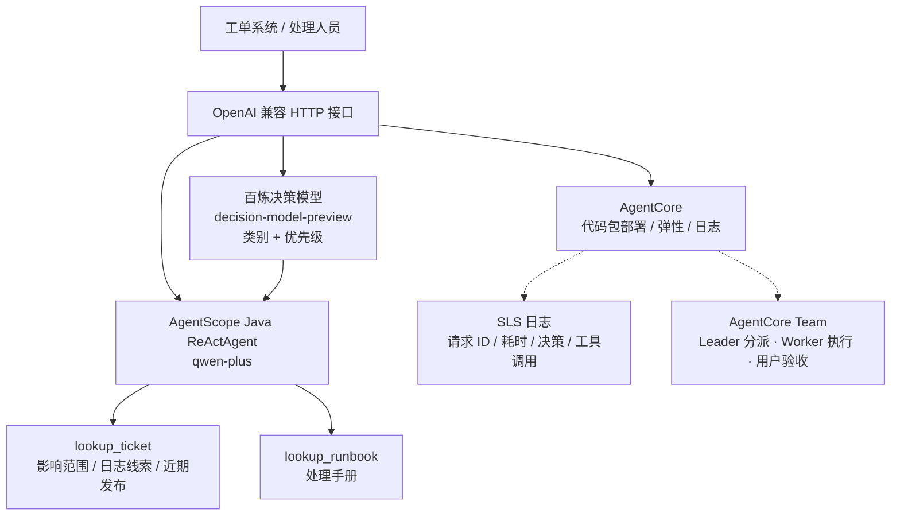
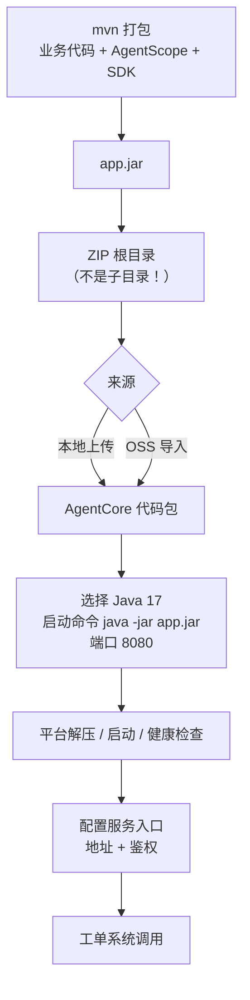
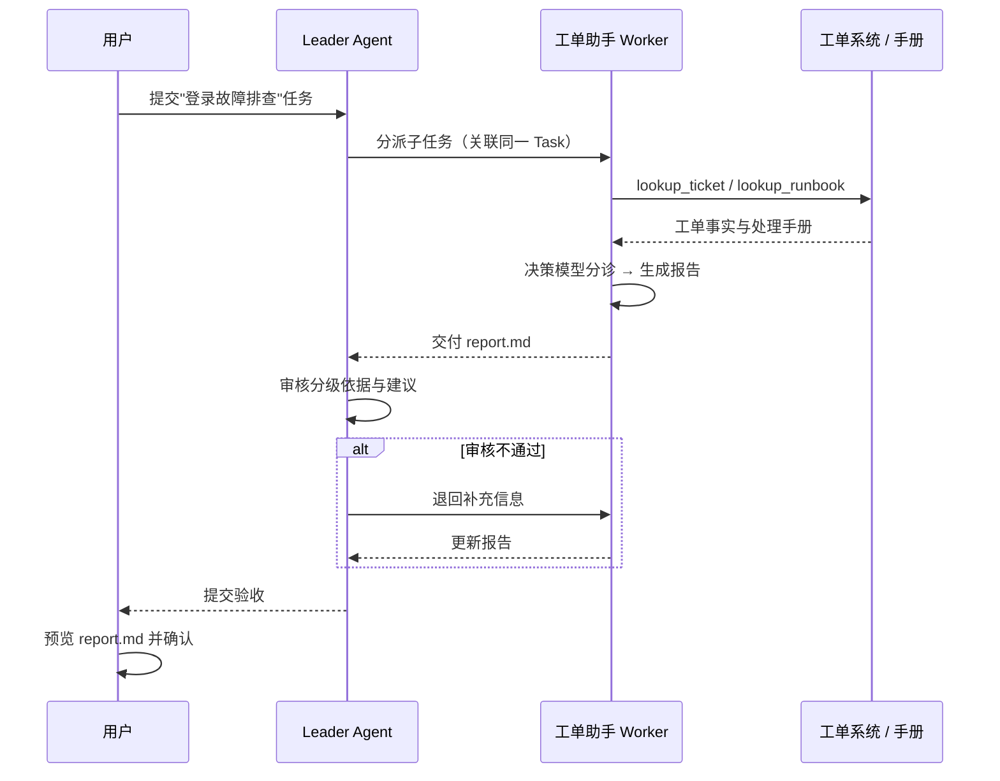

<div style="background-color: #1e1e1e; color: #00ff00; font-family: 'Courier New', Courier, monospace; border-radius: 8px; padding: 20px; box-shadow: 0 10px 30px rgba(0,0,0,0.3); margin-bottom: 30px; margin-top: 20px; position: relative; overflow: hidden;">
    <div style="display: flex; align-items: center; margin-bottom: 15px; padding-bottom: 10px; border-bottom: 1px solid #333;">
        <div style="display: flex; gap: 8px; margin-right: 15px;">
            <div style="width: 12px; height: 12px; border-radius: 50%; background-color: #ff5f56;"></div>
            <div style="width: 12px; height: 12px; border-radius: 50%; background-color: #ffbd2e;"></div>
            <div style="width: 12px; height: 12px; border-radius: 50%; background-color: #27c93f;"></div>
        </div>
        <div style="color: #ccc; font-size: 0.9em;">bash</div>
    </div>
    <div>
        <p style="margin: 5px 0; line-height: 1.6;"><span style="color: #008AFF; font-weight: bold;">ckhuang@macbookpro:~$</span> Agent 的 demo 只要一下午，Agent 的上线要一整个季度。中间差的不是模型能力，而是运行环境、发布方式、观测手段和故障排查路径。 <span style="display: inline-block; width: 8px; height: 16px; background-color: #00ff00; vertical-align: middle;"></span></p>
    </div>
</div>

带 Agent 项目这些年，我在评审会上最常说的一句话是：**"你演示的是效果，我问的是它怎么活过下个季度。"**

本地跑通的 Agent，离生产通常还差五道坎：

- **运行环境**：开发机上是 JDK 21 + 一堆本地环境变量，线上要 Java 17 加受控依赖，谁保证一致？
- **发布方式**：每个 Agent 单独写 Dockerfile、单独维护镜像流水线，三五个月后没人说得清哪个镜像对应哪版逻辑。
- **弹性**：故障工单会在十分钟内集中涌入，恢复后又迅速回落，长期按峰值预留 GPU/CPU 就是纯浪费。
- **排障**：线上答非所问，你既不知道它调了哪个工具，也不知道它引用哪份手册，只能让用户复述一遍。
- **协作**：任务一旦跨角色，谁分派、做到哪一步、报告谁验收，全靠群里刷屏。

这篇文章用一个**工单分诊助手**做样本，把开发、打包、上线、验证、迭代、协作整条链路走一遍。技术选型是 **AgentScope Java + 百炼决策模型 + AgentCore 代码包部署 + Team**。读完之后，你应该能把同一套方法平移到自己的业务 Agent 上——**尤其是"代码包部署"这个被低估的选项，它能让绝大多数团队省掉一条镜像流水线的维护成本。**

## 一、场景：为什么"技术类"这个判断还不够

企业工单队列里，登录故障和发票申请会同时出现。处理人员要做三件事：判断类别、判断影响范围与紧急程度、找到对应的处理手册。看两个真实形态的例子：

> **工单 A**：生产登录接口全部返回 502，所有用户无法登录，十分钟前开始，尚未确认根因。
>
> **工单 B**：申请补开上月发票，没有服务中断。

这两张单子的差别不只是"技术 / 计费"。A 是 P1，需要立刻拉值班；B 是 P3，走正常账期核对即可。**"全部用户无法登录"和"个别用户登录缓慢"都属于技术问题，但优先级天差地别。** 所以分级条件必须显式告诉模型，而不能指望它从语义里猜。

这正好落在决策模型的射程内：**有明确选项、有判断标准、需要概率与结构化结果**，而不是要它写一篇分析。

整个应用的分工很清晰：



分工上：**AgentScope Java 组织模型与工具调用，百炼提供决策与生成能力，AgentCore 负责部署和运行，Team 是按业务需要接入的协作扩展。** 分级规则、结果校验、查询工具都按企业规则调整，还要接已有工单系统，所以这里选高代码方式，逻辑留在业务工程里。

## 二、开发：先把"判断"和"干活"拆开

### 1. 依赖与 SDK 适配

AgentCore SDK 提供 Python、JavaScript / TypeScript、Java 三个版本，也适配了常用 Agent 框架：

| 开发语言                | 已提供适配的框架                                                   |
| ----------------------- | ------------------------------------------------------------------ |
| Java                    | AgentScope Java、Spring AI、LangChain4j                            |
| Python                  | AgentScope、LangChain / LangGraph、Google ADK、Pydantic AI、CrewAI |
| JavaScript / TypeScript | LangChain / LangGraph、Google ADK、Mastra、AI SDK                  |

这意味着**已有工程不用推倒重来**：原来的技术栈继续用，按需接入平台上的模型、MCP 工具、Skill、记忆和凭证即可。工单助手使用基础 SDK 和 AgentScope 适配模块：

```xml
<properties>
    <agentcore.version>0.1.3</agentcore.version>
</properties>
<dependencies>
    <dependency>
        <groupId>io.github.ai-agentcore</groupId>
        <artifactId>agentcore-sdk</artifactId>
        <version>${agentcore.version}</version>
    </dependency>
    <dependency>
        <groupId>io.github.ai-agentcore</groupId>
        <artifactId>agentcore-sdk-agentscope</artifactId>
        <version>${agentcore.version}</version>
    </dependency>
</dependencies>
```

接入 SDK 后，原有的工单查询工具可以继续用，再与平台托管的模型、MCP 或 Skill 组合。注意一个细节：**SDK 只是胶水，模型 Provider 仍要按业务显式引入**——别指望加个依赖就自动获得全部能力。

### 2. 决策模型：只回答"是哪一个"，不负责"为什么"

Jev 这类 System One 决策模型的接口形态是：给上下文 + 类型化问题，返回选项、评分和概率，供代码做分支、排序与路由。我们在[《让 Agent 学会判断》](https://mp.weixin.qq.com/s?__biz=MzUzNzYxNjAzMg==&mid=2247587697&idx=1&sn=2fc194cf2a61a602ef10e3f407213b18)里拆过它在 Harness 中的九个判断位，这里只落地其中一个：**分诊**。

AgentScope Java 已提供 Jev 决策模型扩展，把类型化请求、结果解析和校验封装进 `JevClient`。由于国内网络无法使用 Jev，本例改用百炼的 `decision-model-preview`，在工程里封装一个 `DecisionClient` 调用其 System One 接口：把工单描述与分类条件一起提交，拿到结构化的类别和优先级。

这里有两个工程要点，比接哪个模型更重要：

1. **分级条件必须写进请求**。P1 = 全部用户或核心业务中断；P3 = 普通咨询或无服务中断。规则不进 prompt，模型只能瞎猜。
2. **决策结果必须二次校验**。拿到结果后，代码要确认类别与优先级落在预设选项内，越界就降级到人工。**决策模型降低的是判断成本，不是免责成本。**

> **一个容易踩的坑**：我用过不少团队把决策模型当成"根因分析器"，输入一堆日志让它判断"故障原因是什么"。它不是干这个的——它给的是分类与概率，根因仍要靠工具数据和人。**分诊结果只能当路由依据，绝不能当结论写进给用户的报告。**

### 3. 工具与报告：让证据链闭合

确定优先级后，下一步是找处理依据。两个工具各司其职：

- `lookup_ticket`：提供影响范围、日志线索、近期发布记录；
- `lookup_runbook`：提供对应的处理方法。

然后由 `qwen-plus` 结合资料和决策结果生成建议，并显式列出**需要人工确认的事项**。代码把两个环节串起来：

```java
var decision = decisionClient.classify(input);
String content = input
    + "\n百炼决策模型分诊结果（分类不是根因结论）：" + Main.json(decision);

var agent = ReActAgent.builder().name("triage")
    .model(model).toolkit(toolkit)
    .sysPrompt(prompt).maxIters(6).build();

String text = agent.call(List.of(new UserMessage(content)), context)
    .block(Duration.ofSeconds(150)).getTextContent();
```

三处细节值得抄走：

- **`maxIters(6)` 是成本闸门**：ReAct 循环没有上限，一个检索工具抽风就能烧掉几十轮调用；
- **`block(Duration.ofSeconds(150))` 是延迟兜底**：超时必须有明确行为（降级 / 转人工），不能无限等；
- **prompt 里那句"分类不是根因结论"**：这是给模型的护栏，也是给下游人看的免责说明——**在 Agent 里，一句提示词往往等价于一个业务约束。**

工单助手对外提供兼容 OpenAI Chat Completions 的 HTTP 接口。本地验证通过后，就可以发布到 AgentCore，交给工单系统调用。

<div style="text-align: center; font-size: 1.2em; font-style: italic; color: #008AFF; margin: 40px 0 20px; padding: 20px; border-top: 1px dashed #ccc; border-bottom: 1px dashed #ccc;">
    “决策模型负责把问题变成选项，工具负责把选项变成证据，模型负责把证据变成人话。三者任一越位，Agent 就会开始编。” —— CK·黄
</div>

## 三、部署：代码包还是镜像，这是个架构决策

### 1. 先做选择，而不是先写 Dockerfile

AgentCore 同时支持**代码包**和**容器镜像**两种部署方式。这个选择的判断标准很朴素：

| 维度         | 代码包部署                          | 容器镜像部署                         |
| ------------ | ----------------------------------- | ------------------------------------ |
| 基础运行环境 | 平台维护（Python / Node.js / Java） | 自己维护                             |
| 交付物       | 应用与运行期依赖（如 `app.jar`）    | 完整镜像                             |
| 适用场景     | 标准运行时、无特殊系统依赖          | 已有成熟镜像流水线，或需定制系统组件 |
| 额外成本     | 几乎为零                            | Dockerfile、镜像仓库、构建与扫描链路 |

这个工单助手用平台提供的 Java 环境就能跑，因此选代码包。**判断逻辑很简单：只要你的应用没有定制系统组件，就没必要为它单独维护一套镜像。** 我在多个团队见过"为了部署一个 200MB 的 Agent 服务，养了一条完整的镜像流水线"的配置，纯属给自己加戏。

### 2. 打包与配置：三个必须对齐的点

打包方式不变，还是 Maven：业务代码、AgentScope 和 SDK 等运行期依赖一起打进 `app.jar`，**再把 JAR 放到 ZIP 根目录**——这份 ZIP 就是交付物。



有三个点必须对齐，错一个就起不来：

1. **JAR 在 ZIP 根目录**。放成 `build/app.jar` 这种结构，启动命令就得跟着改，很多人在这里白排查半小时。
2. **运行环境版本**。本例选 Java 17；本地用 21 编译的字节码丢进来，平台直接给你一个 `UnsupportedClassVersionError`。
3. **端口与启动命令一致**。`java -jar app.jar` + 8080，平台的健康检查才探得通。

上传后，AgentCore 负责解压、启动，并通过健康检查确认服务状态。应用就绪后配置服务入口，工单系统就能用对应地址和鉴权信息发起请求。**原先本地验证的分诊逻辑，到这里才真正有了可被业务调用的入口。**

### 3. OSS 来源的"快照语义"：一个必须讲清楚的发布契约

如果代码已经通过流水线构建，可以把 ZIP 存进 OSS，再从 OSS 导入。这里有个非常容易被误解的行为：

> **AgentCore 在创建或更新时保存代码包快照。覆盖 OSS 上的源文件，不会改变正在运行的代码；只有发起 Agent 更新，才会读取新包并部署。**

换个说法：**OSS 只是"收货地址"，不是"热更新通道"。** 这其实是好事——它把"上传产物"和"发布上线"两件事解耦了，发布时机由团队自己掌握。但它也意味着，如果有人覆盖了 OSS 文件却发现线上没变化，那不是 Bug，是设计。**发布流程里必须有一个显式的"更新 Agent"步骤和对应的审批人。**

## 四、验证：两种调用方式，两种消费场景

部署完成后，把开头的两张工单交给助手。验证覆盖两种调用方式：

- **普通调用**：一次返回完整报告，方便后端接收后继续处理（比如写库、派单）；
- **流式调用**：逐步返回内容，用户在工单页面里边生成边查看建议。

实际输出（工单与手册均为演示数据）：

**工单 A —— 技术故障，P1**

- 已知事实：登录接口返回 502，影响全部用户；日志线索 `upstream_connect_error`，近期有应用发布；
- 排查建议：检查上游健康、连接池、超时设置和近期发布，保留请求 ID 与相关日志；
- 人工确认事项：上游当前是否可达、近期变更是否有关联、是否需由值班负责人授权修复或回退。

**工单 B —— 计费类，P3**

- 引用的是发票处理手册，建议围绕账期、订单主体和发票状态展开，无服务中断的紧急处置。

注意这里输出的形态：**判断给结论、事实给来源、建议给动作、风险给待确认项**。这四段式比一段漂亮的自然语言有用得多——处理人员需要的不是"AI 说得真好"，而是"我能在两分钟内复核完"。

## 五、弹性与可观测：别让 Agent 变成黑盒

登录服务故障时，相关工单会短时间集中涌入；恢复后又迅速回落。AgentCore 支持按需弹性伸缩，可以按业务并发配置策略，高峰扩容、低谷回收，减少长期按高峰预留资源的压力。

但比弹性更重要的是**排障入口**。AgentCore 把实例与 Session、基础监控、运行日志放在同一个 Agent 下：先确认运行状态，再沿应用日志追具体请求。为助手启用日志采集并配置 SLS Logstore 后，团队可以直接在控制台看运行日志。

我给团队定过一个"Agent 可观测性最小字段集"，这个工单助手就是按它落日志的：

| 字段         | 能回答的问题                             |
| ------------ | ---------------------------------------- |
| 请求 ID      | 这一次调用到底串了哪些日志               |
| 执行耗时     | 慢在哪一步：Prefill、工具还是模型重试    |
| 决策结果     | 分诊成了什么类别与优先级，是否被校验拦下 |
| 工具调用记录 | 查了哪张工单、用了哪份手册               |
| 最终输出摘要 | 建议与待确认项是否合理                   |

**没有这五个字段，Agent 的线上问题就只能靠"用户描述 + 猜"。** 有了它，跑偏的建议可以直接回到业务代码里定位：是分级条件没写清、工具查错了单，还是报告模板缺了待确认项。

## 六、迭代：发布应该是日常动作

要接真实工单接口，或调整登录故障的分级条件，路径不变：回到原有工程修改 → 本地测试 → 重新构建代码包 → 通过 AgentCore 更新 Agent。

这条链路的价值不在"能发"，而在**"敢发"**：规则改动、工具调整、prompt 修订，都走同一套工程流程，有版本、有快照、有回滚点。相比在平台上直接改 prompt 的"热修"，我更倾向这种"回到代码里改"的方式——**Agent 的行为逻辑一旦离开版本控制，就再也说不清是谁在什么时候改坏的。**

## 七、进阶：把助手放进 Team，让协作留下痕迹

单点分诊跑通后，真实的高优先级故障往往还需要有人分派、补充信息、审核报告。任务交给了谁、分析到哪一步、结果是否验收，都需要留痕。这时可以接入 AgentCore Team。

| 参与者                           | 职责                                         |
| -------------------------------- | -------------------------------------------- |
| 托管 Agent（Leader）             | 分派登录故障分析任务，审核 Worker 提交的报告 |
| 工单助手（Worker，高代码 Agent） | 查询故障工单与处理手册，完成分诊并提交报告   |
| 用户                             | 补充任务要求、参与复核，验收最终报告         |



接入只需增加协作依赖（基础 SDK 与 AgentScope 适配仍是 0.1.3）：

```xml
<dependency>
    <groupId>io.github.ai-agentcore</groupId>
    <artifactId>agentcore-collaboration</artifactId>
    <version>0.1.0</version>
</dependency>
```

协作 SDK 把领取任务、文件交付等能力作为工具接入现有 Agent，并补充 Worker 协作规则。业务查询工具和分诊 prompt 全部保留：

```java
var workspace = Path.of(".");
var collaboration = Collaboration.auto(workspace);
var workerTools = new ArrayList<>(collaboration.tools().block());
Skill.tools(collaboration.skills().block(), workspace).stream()
    .filter(tool -> !"execute_command".equals(tool.name()))
    .forEach(workerTools::add);
workerTools.forEach(tool ->
    toolkit.registerAgentTool(AgentCoreAgentScope.tool(tool)));

var worker = ReActAgent.builder().name("ticket-worker")
    .model(model).toolkit(toolkit)
    .sysPrompt(collaboration.composePrompt(businessPrompt))
    .maxIters(18).build();
```

两个细节值得注意：

- **`filter(!execute_command)` 不是随手一行**。把 Skill 里的命令执行工具暴露给 Worker，等于给一个会自动改写自己行为的 Agent 开了 shell。**白名单式注册工具，是 Agent 安全的最低门槛。**
- **`composePrompt(businessPrompt)` 而不是覆盖**。协作规则和业务 prompt 必须叠加，否则 Worker 会忘记"我是来分诊的"，只剩下"我是来领任务的"。

任务上下文随本次调用传入，让分析和报告归属正确的任务；`trustedHeaders` 来自可信的平台请求，普通与流式调用用同样方式传递：

```java
var taskContext = CollaborationContext.fromHeaders(trustedHeaders);
var contextBuilder = RuntimeContext.builder().sessionId(sessionId);
if (taskContext != null) {
    contextBuilder.put(CollaborationContext.KEY, taskContext);
}
var context = contextBuilder.build();

var response = worker.call(List.of(new UserMessage(input)), context)
    .block(Duration.ofSeconds(150));
// 流式调用：worker.streamEvents(new UserMessage(input), context)
```

接入后仍然是"重新构建代码包 → 更新 Agent"发布。最终交付的 `report.md` 里，P1 分级依据、已知工单事实、排查步骤和待人工确认事项都成文列出，Leader 和用户对照复核即可，不必再从多轮对话里拼结论。

> 需要提前说明：高代码 Agent 的协作能力目前采用白名单开放机制，需要提交工单申请开通。**别把未开通的能力写进你的架构方案里，否则上线前一周才发现，只能临时改设计。**

## 八、总结：一份 Agent 上线检查清单

回到开头那五道坎，这个样本给出的答案是：

1. **环境交给平台**：代码包部署由平台维护基础运行环境，交付物只有应用构建产物；
2. **发布走工程流程**：Maven 打包 → ZIP（JAR 在根目录）→ 上传或 OSS → 显式"更新 Agent"；快照语义保证运行中的代码不会被偷偷换掉；
3. **弹性按业务配**：高峰扩容、低谷回收，别按峰值长期预留；
4. **观测记录五字段**：请求 ID、耗时、决策结果、工具调用、输出摘要；
5. **协作留痕**：Team 把子任务、执行记录和报告挂在同一 Task 下，Leader 审核、用户验收。

<div style="background-color: #1e1e1e; color: #00ff00; font-family: 'Courier New', Courier, monospace; border-radius: 8px; padding: 20px; box-shadow: 0 10px 30px rgba(0,0,0,0.3); margin-bottom: 30px; margin-top: 20px; position: relative; overflow: hidden;">
    <div style="display: flex; align-items: center; margin-bottom: 15px; padding-bottom: 10px; border-bottom: 1px solid #333;">
        <div style="display: flex; gap: 8px; margin-right: 15px;">
            <div style="width: 12px; height: 12px; border-radius: 50%; background-color: #ff5f56;"></div>
            <div style="width: 12px; height: 12px; border-radius: 50%; background-color: #ffbd2e;"></div>
            <div style="width: 12px; height: 12px; border-radius: 50%; background-color: #27c93f;"></div>
        </div>
        <div style="color: #ccc; font-size: 0.9em;">bash</div>
    </div>
    <div>
        <p style="margin: 5px 0; line-height: 1.6;"><span style="color: #008AFF; font-weight: bold;">ckhuang@macbookpro:~$</span> 判断用决策模型，取证据用工具，写人话用生成模型，发布用代码包和版本控制。四件事各归其位，Agent 才算真正上线。 <span style="display: inline-block; width: 8px; height: 16px; background-color: #00ff00; vertical-align: middle;"></span></p>
    </div>
</div>

> 本文基于阿里云云原生团队《工单分诊助手的开发、部署与 Team 协作实践》（AI Agent Handbook 案例篇）整理，并结合笔者在 Agent 工程化与分布式系统上的实践经验做了提炼与补充。原文链接：[https://mp.weixin.qq.com/s/2MCJjvGsqYRr7IEwOTeTvQ](https://mp.weixin.qq.com/s/2MCJjvGsqYRr7IEwOTeTvQ)
