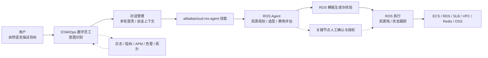
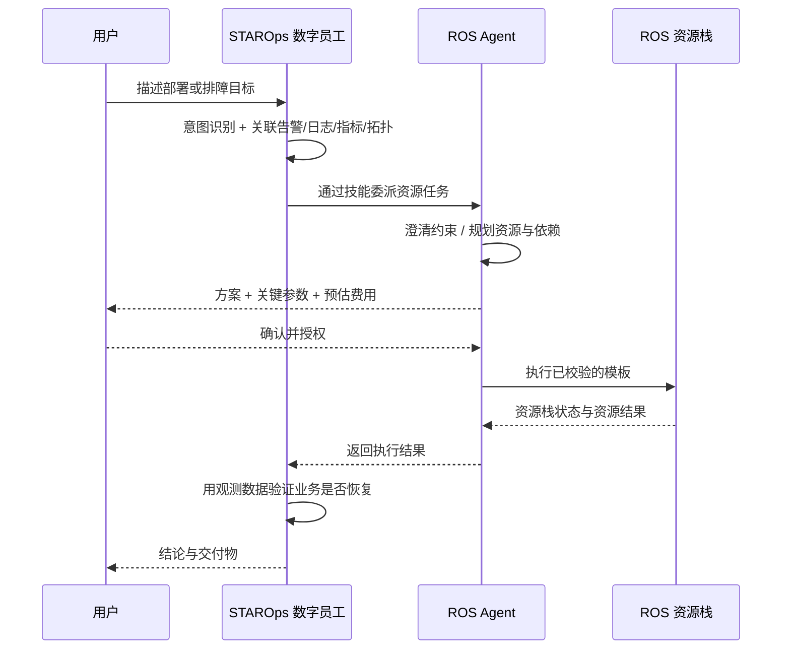
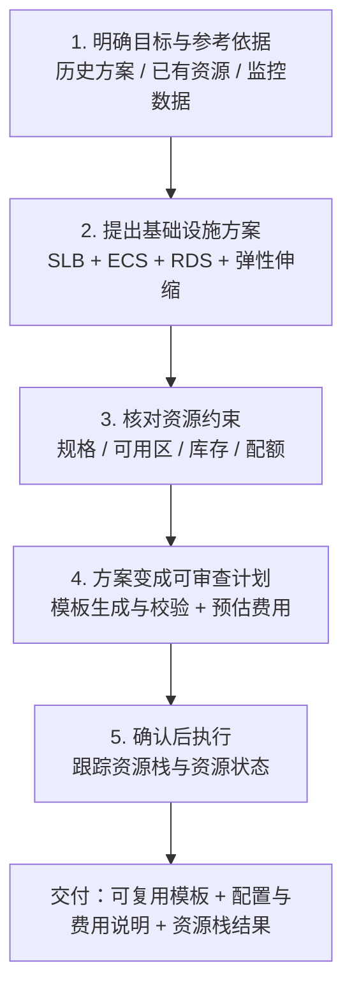
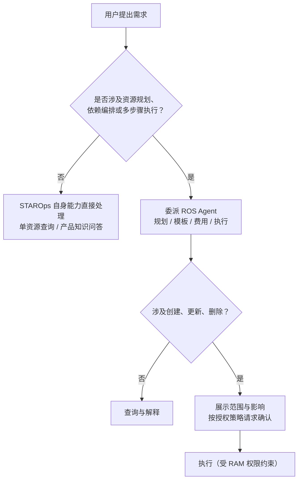

    

        

            

            

            

        

        
bash

    

    

        
ckhuang@macbookpro:~$ 运维最贵的成本，从来不是点鼠标，而是把散落在五个控制台里的同一份“资源事实”，在人脑里重新拼成一张图。 

    

大促前一周接到一个新服务上线的需求，你会经历什么？

选 ECS 规格、划 VPC 网段、配 SLB、估 RDS 容量、挑监控指标——五个控制台、十几张表单。中间任何一个依赖关系没理清楚，就得退回去重来。三天后服务上线，凌晨你还在补监控大盘和告警规则。又过四天，促销开场，凌晨两点四十七分告警响起：CPU 打满。

你摸出手机看指标、翻日志、对着资源拓扑找线索，三张标签页、四块大盘拼在一起，才勉强回答三个问题：**发生了什么，严重吗，现在该干什么。**

这篇要拆的，就是阿里云把这套流程收进一个对话框的尝试：**STAROps 数字员工 + ROS Agent**。读完之后，你应该能拿到三样东西：一条可复用的“部署—观测—恢复”Agent 协作链路，一套判断“什么该交给 Agent、什么必须自己拍板”的边界标准，以及几个容易被演示效果掩盖掉的落地陷阱。

## 一、真正的瓶颈不是操作多，而是链路断

先把痛点说准确。运维的重复劳动看起来是“填表单”，本质是**同一份资源事实被切碎在多个系统里**：

- 部署阶段，资源依赖关系存在架构师脑子里，模板里只有参数；
- 观测阶段，日志、指标、调用链、资源拓扑分别归属不同产品；
- 排障阶段，判断根因要跨四个数据源交叉验证；
- 扩容阶段，伸缩组的配置、配额、库存、实例就绪时间又是另一组事实。

传统 IaC 解决了“可重复”：模板描述资源与依赖，创建、更新、删除可以自动完成。但它没有解决“可表达”——**写不出模板的人，依然进不去这扇门**；写得出来的人，也要为一次临时扩容去改模板、走流水线。

所以这一代 AIOps 的真正命题不是“让大模型点按钮”，而是三件事：

1. **把目标翻译成方案**：自然语言 → 资源架构 → 可审查的执行计划；
2. **把跨域数据合成判断**：告警 + 日志 + 指标 + 调用链 + 拓扑 → 根因与影响面；
3. **把执行关进笼子**：方案可见、变更可审、结果可验。

## 二、架构：谁负责想，谁负责干，谁负责验

先把角色摆清楚，这是理解后面所有场景的前提。

- **STAROps 数字员工**：阿里云基于大模型和智能体技术打造的全域智能运维平台，提供统一的运维对话入口。它融合跨域可观测数据与模型推理能力，支持用自然语言定义目标，由运维智能体完成动态规划、安全执行与结果验证。
- **ROS**：阿里云的基础设施即代码（IaC）服务，通过模板描述云资源及其依赖关系，自动完成资源的创建、更新和删除。
- **ROS Agent**：面向云基础设施的资源管理智能体，通过自然语言辅助完成资源规划与选型、ROS／Terraform 模板生成与校验、费用评估，以及授权后的创建、变更、查询和清理。

两者之间不是“互相调用 API”，而是**技能级的任务委派**：STAROps 挂载 `alibabacloud-ros-agent` 技能，把基础设施规划和变更任务交给 ROS Agent，并通过会话上下文衔接多轮任务。

这个分工里有两个设计细节，值得做 Agent 架构的人抄作业：

- **上下文是资产，不是参数**。STAROps 在场景二里能直接复用场景一的资源栈信息，用户不需要重复说“刚才那套促销服务”。任务状态跟着会话走，而不是跟着单次请求走。
- **权限与授权是外层约束**。ROS Agent 的规划可以很大胆，但执行范围受账号权限和授权策略限制；涉及创建、更新、删除时，必须先展示操作范围与影响，再请求确认。模型负责“想”，RAM 负责“能不能”。

用一张时序图看完整链路更清楚：

    “Agent 的架构图里，最该画粗的那条线不是调用链，而是授权链。” —— CK·黄

## 三、场景一：七天上线，Plan 比 Apply 更重要

需求很典型：杭州地域部署电商促销服务，日常 2000 QPS，峰值 8000 QPS，要负载均衡和数据库，参考去年活动方案但今年流量更大。

ROS Agent 的处理是五步，注意每一步的“产出物”而不是“动作”：

几个真正体现专业度的地方：

- **容量不是算出来的，是验出来的**。Agent 会围绕负载均衡、计算、数据库和弹性伸缩设计架构，说明“提前预留容量”与“按需扩容”的取舍，但容量建议必须结合应用特征和压测结果验证。**模型给出的是起点，不是结论。**
- **建资源不等于改业务**。建议引入 Redis 时，还需要明确业务接入方式和一致性要求——创建缓存实例本身，并不等于完成业务改造。这句话值得贴在每个 AIOps 项目的墙上。
- **约束核对是硬门槛**。规格、可用区、库存、配额都要查；遇到冲突要说明影响并给替代方案；涉及网段、可用区这类关键调整，必须经用户确认后修改。
- **模板校验通过 ≠ 部署成功 ≠ 压测通过**。应用发布、预发压测和业务验收，需要结合实际应用与相应工具另行完成。把“资源就绪”误当成“业务就绪”，是自动化里最常见的事故源。

最终交付的是一套可复用的基础设施模板、一份关键配置及预估费用说明、以及资源栈执行结果和相关资源信息。**模板是资产，对话只是过程。**

## 四、场景二：先有可查询的数据，再有可用的告警

服务上线第三天，要给促销服务接入日志、指标、APM，并配置告警发到运维钉钉群。STAROps 提供了一个专门的 `/数据接入` 技能，Agent 复用会话里的资源栈信息，确认服务、主机和依赖资源范围，检查已有指标，再引导完成日志采集、客户端和 APM 探针接入。

先看它实际交付的告警规则：

| 规则                    | 阈值 / 持续    | 级别     |
| ----------------------- | -------------- | -------- |
| 促销服务-ECS CPU 使用率 | > 80% / 5min   | WARNING  |
| 促销服务-ECS CPU 使用率 | > 90% / 3min   | CRITICAL |
| 促销服务-ECS 内存使用率 | > 85% / 5min   | WARNING  |
| 促销服务-ALB 活跃连接数 | > 40000 / 5min | WARNING  |

整个会话用时约 1 分 16 秒，4 条规则全部 `enabled=true`、`status=OK`。但如果只看到这里，你会低估这套东西——**真正有价值的是它怎么证明自己干完了**：

- 用真实 PromQL 对 ECS 指标做了数据打点验证（CPU、内存均有实际值）；
- 4 条规则通过 `dry-run` 在服务端校验，逐字段核对 `displayName`、`enabled`、`contentTemplate`、`expr`、`datasourceConfig`、`durationSec` 等属性是否一致；
- 关键设计上，ECS 规则用弹性伸缩组标签做过滤，而不是写死实例 ID——大促扩容到 8 台时新实例会自动纳入告警，无需改规则。

更值得说的一点是它主动披露的限制：**ALB 指标当时还没有真正落到 Prometheus**。规则创建成功、状态正常，但无法用真实数据验证，Agent 明确把这条标为“验证的缺口”，并解释了采集链路（CloudMonitor 的 `acs_alb` 到 Prometheus 的转换）当前没有流程数据。

做过监控的人都知道，这比“全部成功”四个字珍贵得多。规则建好了和告警真的会响，中间隔着数据源、标签、聚合、静默策略四道坎。**一个可靠的运维 Agent，必须能区分“已完成”和“已验证”。**

## 五、场景三：告警响起时，最值钱的不是方案，是代价

促销开场前预热未完成：伸缩组 CPU 目标值 60%，但流量到来时只有 6 台 ECS 在承接，CPU 已超 85%。伸缩组确实触发了扩容，但新实例还在启动和应用就绪过程中，告警先于扩容完成触发。

STAROps 关联告警、日志、指标、APM 调用链和资源拓扑，判断业务影响与瓶颈位置，并核对近期变更；ROS Agent 根据诊断信息查询资源状态、可用性与约束，辅助制定变更方案。诊断结论是：**开场已就绪容量不足，流量增长快于新增实例投入服务的速度。**

然后它给出的不是一个方案，而是三个带边界的选项：

| 策略                         | 具体操作                                                                         | 适用情况                                               | 代价与边界                                                                             |
| ---------------------------- | -------------------------------------------------------------------------------- | ------------------------------------------------------ | -------------------------------------------------------------------------------------- |
| 方案一：滚动升配（激进）     | 逐台摘流量、提升 ECS 规格并重启，健康检查通过后恢复流量；同步后续扩容规格        | 单机规格偏小、横向扩展受限，且有维护窗口或足够冗余     | 涉及停机重启，切换期间可用容量减少，成本与变更风险高。**只改伸缩配置不会升配存量实例** |
| 方案二：同规格扩容（折中）   | 按实时负载与压测结果确定目标总容量，计入启动中实例后补足缺口，必要时调最大实例数 | 服务可横向扩展，需增加承载容量，且避免对存量实例变配   | 增加实例费用，仍受配额、库存、就绪时间约束；若伸缩活动不允许并发，需等其完成           |
| 方案三：调整伸缩策略（保守） | 例如把 CPU 目标值从 60% 下调到 50%，保留更多余量，观察本轮扩容                   | 扩容即将完成、在途容量已够、业务错误率与响应时间可接受 | 目标值更低通常需要更多实例；**无法直接加快实例启动**                                   |

本例中 Agent 优先推荐方案二；如果核对发现在途实例已足够承接流量、业务指标仍可接受，则选方案三继续观察。用户选定后，ROS Agent 说明目标容量、预估费用与执行条件，获得确认和授权后执行并查询变更结果；STAROps 再用应用就绪状态、后端健康检查、错误率和响应时间验证恢复效果。

这里藏着一个很硬的经验：**资源变更成功，不等于业务已经恢复。** 伸缩组从 6 台变成 12 台，和用户能正常下单，是两件事。前者是 API 返回，后者是业务指标。运维 Agent 的验收标准必须落在后者。

## 六、边界：什么时候不该委派

原文对适用范围的界定相当克制，我认为这是全文最工程化的部分：

三个要点：

- **资源数量不是能力门槛**。ROS Agent 适合需要规划、依赖编排和多步骤执行的基础设施任务，一个 VPC 也可能值得委派，二十台同构 ECS 的批量查询反而可能不需要。
- **简单查询不要绕路**。单个确定资源的查询、普通云产品知识问答，STAROps 用自身能力直接处理即可，多一次委派只是多一次延迟和失败点。
- **能力边界由资源类型、服务能力和账号权限三者共同决定**。本文验证的集成范围是阿里云资源管理，涉及 ECS、RDS、负载均衡、VPC、Redis、OSS 等产品，具体可执行操作取决于上述三项。

## 七、落地建议：先别拿生产环境试

官方给的快速开始只有三步：

1. 登录 STAROps 控制台（https://starops.console.aliyun.com/），创建一个数字员工；
2. 在技能中心搜索 `alibabacloud-ros-agent` 并挂载；
3. 在对话框里描述你的部署或排障需求。

但以我带团队做自动化的经验，还有三条需要自己补上：

- **先拿一个非生产需求跑通全链路**。耗时与结果取决于账号内资源规模、监控数据完整度和所选方案，生产环境的变量远多于演示。
- **最小权限 + 关键节点审批**。把“谁能授权什么级别的变更”写成策略，而不是指望模型自我约束。模型可以建议，RAM 才能拒绝。
- **把“验证”做成流程里的一等公民**。每次变更都定义三个验收点：数据是否可查、资源是否就绪、业务指标是否恢复。缺一个，这次自动化就只能算“执行了”，不能算“完成了”。

## 八、写在最后

把三个场景串起来，主线其实只有一句：**运维从“多控制台切换”，变成了“说清需求 + 关键节点确认”。**

Agent 替你记住控制台在哪、依赖怎么连、参数默认值是多少；你负责两件机器做不了的事——**说清楚要什么，以及在该拍板的时候拍板。**

我做了十几年基础设施，对 IaC 的感情很深，也见过太多团队把模板写成没人敢改的黑盒。这一代 Agent 最大的价值，不是替代 IaC，而是**把 IaC 从专家工具变成对话接口**：门槛降下来了，但资源依赖、约束核对、审批与验证这些硬骨头一块都没少，只是换了个更聪明的入口。

    “自动化解决的是手速，可观测解决的是判断，而授权与验证解决的是你敢不敢让它上生产。” —— CK·黄

    

        

            

            

            

        

        
bash

    

    

        
ckhuang@macbookpro:~$ 判断一个运维 Agent 好不好，别看它规划得多漂亮，看它敢不敢说“这条规则我建好了，但还没被真实数据验证过”。 

    

