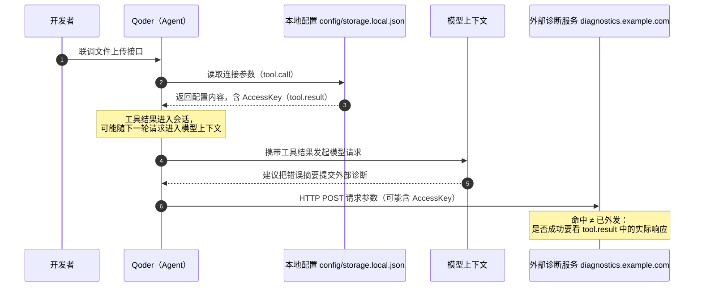
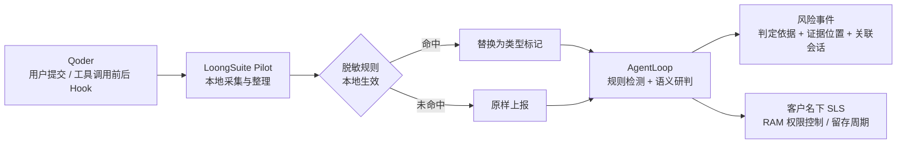
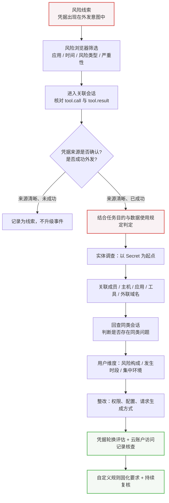
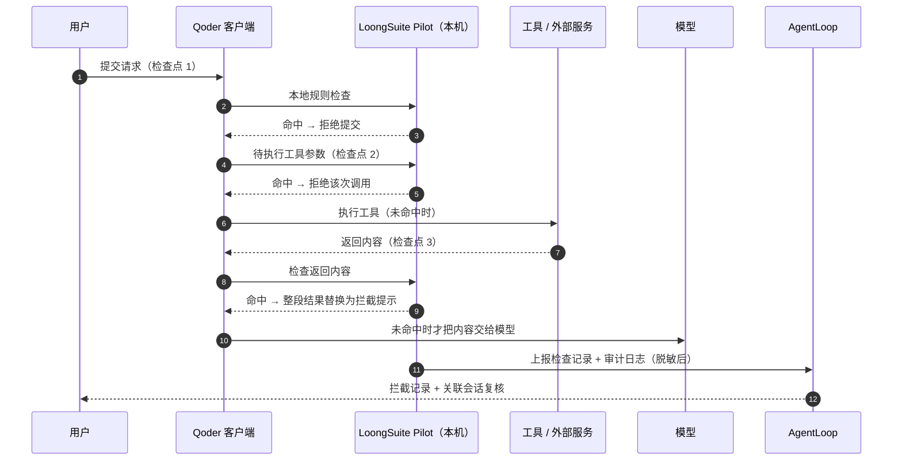
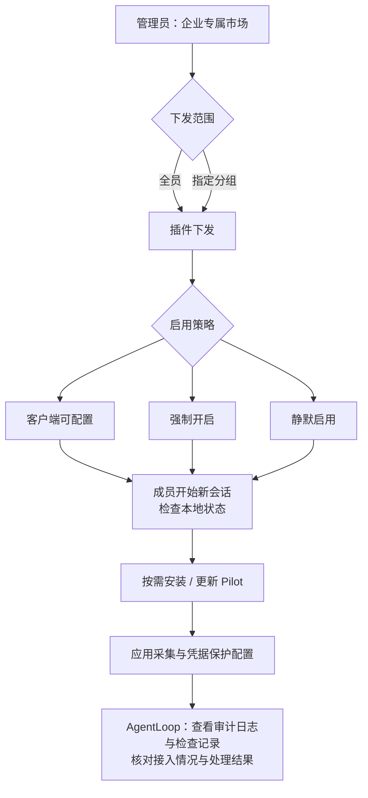
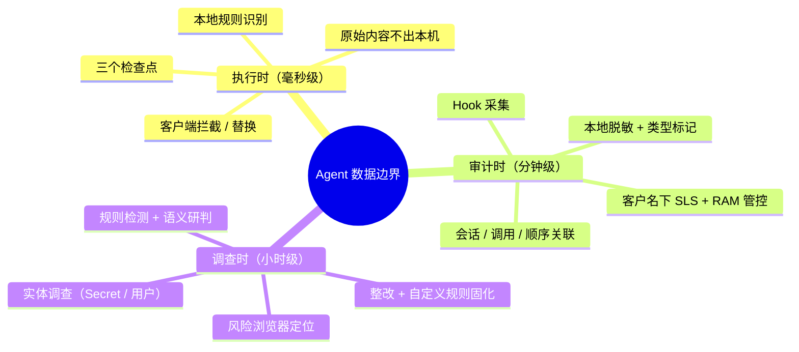

    

        

            

            

            

        

        
bash

    

    

        
ckhuang@macbookpro:~$ 你没有写错一行代码，也没有点错一次授权。你只是让 Agent 去排查一个 <code>AccessDenied</code>——它读了配置文件，顺手把你云账号的 AccessKey 带进了模型上下文，然后又"体贴地"帮你把错误摘要 POST 到了外部诊断服务。日志里一切正常，任务圆满成功。 

    

这是我今年最不愿意承认的一个事实：**绝大多数 Agent 安全事故，都不需要一个恶意的人。** 只需要一个合理的任务、一次正常的排错、一段被顺手读进上下文的配置。

云原生团队最近公开的 Qoder × AgentLoop 实践，恰好把这条链路完整地拆开了：Qoder 提供 Hook 扩展点，LoongSuite Pilot 在本地采集审计日志，AgentLoop 做规则检测与语义研判，最后再回到客户端，在凭据"离开本机之前"把它拦下来。

读完本文，你会得到三样东西：

1. 一条**凭据在 Agent 任务中的完整传递路径**（以及为什么"命中 AccessKey"不等于"凭据已泄露"）；
2. 一套**从风险线索到整改复核的调查闭环**，包含实体调查和用户维度分析；
3. 一个我认为更重要的判断——**事后审计和事前拦截，是两种完全不同的安全能力，谁也替代不了谁**。

## 一、先别急着防"坏人"，先看清"好人"是怎么把凭据带出去的

### 1.1 2026 年的三组数据，把问题摆到了台面上

原文引用了三组公开数据，值得逐个看清口径：

- **Snyk（2026 年 6 月）**：基于近 1 万个开发环境的匿名遥测研究显示，在已安装 MCP 服务的开发者样本中，**约每 7 人就有 1 人**的配置检出至少一项安全问题，**约每 12 人就有 1 人**检出高危或严重问题。注意原文特意标注的一句：**检出率不等于实际泄漏率**。
- **GitGuardian（2026 年 3 月）**：在公共 GitHub 的 MCP 相关配置文件中发现 **24,008 项**不同的密钥等敏感信息，其中 **2,117 项**在验证时仍然有效。
- **Noma（2026 年 9 月）**：一名企业员工指挥 Coding Agent 收集、打包私有源码等公司数据并上传到外部云存储，后续指令还明确要求"不排除认证密钥"；整段活动跨越两天，最终转移了数十 GB 数据。原文也如实标注了该案例的限制：**来自厂商披露，未公开客户名称或原始日志，仅凭公开材料无法独立核验全貌**。

我欣赏最后这一句的克制。做安全和做性能一样，**口径不清的数据比没有数据更危险**——它容易让你得出错误的结论，然后据此做出错误的投入。

### 1.2 更常见的形态：任务合理，路径失控

原文给了一个非常典型的场景，我把它拆成时序看得更清楚：

开发者在 Qoder 里新增一个文件上传接口，复用项目已有的文件存储服务。联调时存储服务返回 `AccessDenied`，为了核对连接参数，Qoder 读取了 `config/storage.local.json`，文件里的 AccessKey 随内容一起出现在**工具返回结果**中。如果这段工具结果被带回后续的模型请求，凭据就进入了**模型上下文**。

更进一步：开发者要求把错误摘要提交到外部诊断服务 `https://diagnostics.example.com/report`（示例地址），Qoder 随后发起 HTTP POST。**如果请求参数里除了错误摘要，还带着刚读到的含凭据配置**——凭据就可能随请求发送到外部服务。企业即便允许使用这个诊断服务，向其提交访问凭据依然可能超出允许范围。

这条链路里没有任何一步是"越权"的：读配置是合理的，查错是合理的，用诊断服务也是被允许的。**问题出在数据边界，而不是权限边界。** 这也是为什么传统的 RBAC 体系在这里几乎失效——你给 Agent 的权限没错，错的是数据流动的路径没人看。

### 1.3 三类敏感数据，三种进入方式

原文给出的分类表，我认为可以直接当作企业梳理资产清单的模板：

| 数据类别       | 常见来源                                                        | 进入任务的方式                               |
| -------------- | --------------------------------------------------------------- | -------------------------------------------- |
| 访问凭据       | 云账户 AccessKey、API Key、访问令牌、私钥、带密码的数据库连接串 | 粘贴配置、读取凭据文件、诊断输出、工具参数   |
| 业务与个人信息 | 客户记录、订单样例、含个人信息的日志、故障工单                  | 日志分析、测试数据读取、通过工具查询业务系统 |
| 研发与内部资料 | 私有源码、架构文档、未公开方案、内部服务配置                    | 代码搜索、文件读取、文档检索、任务附件       |

注意"进入任务的方式"这一列——**它才是可落地的控制点**。你没法阻止 Agent 读日志，但你可以控制"读取到的内容还能不能继续往下走"。

    “安全团队真正要回答的从来不是‘这条命令有没有越权’，而是‘这份数据有没有离开它该待的地方’。前者看权限，后者看链路。” —— CK·黄

## 二、审计的前提：把"来源—内容—结果"三者钉在一起

判断一次凭据风险，原文列出的三个核查要素我完全认同，而且顺序不能乱：

1. **来源**：这份凭据是从哪里进来的？`config/storage.local.json`？粘贴？还是某个工具的返回值？
2. **内容**：请求参数里到底是什么？是错误摘要，还是把整段配置一起塞了进去？
3. **结果**：请求到底发出去没有、成功了没有？这必须看 `tool.result` 里服务端的实际响应。

**仅命中 AccessKey，不能证明凭据已成功外发。** 这是审计里最容易犯的错——把"出现了敏感串"直接当成"泄露事件"，最后安全团队疲于奔命地处理一堆误报，真正的风险反而被淹没。

### 2.1 Qoder 的 Hook + Pilot：谁来做那些"脏活"

Qoder 提供 Hook 扩展机制，可以在用户提交、工具调用前后等环节运行自定义逻辑——这为审计采集和安全检查提供了接入基础。但原文很实在地指出：**如果直接基于 Hook 自建审计，企业要自己开发和维护日志采集、格式整理、会话与调用关联、脱敏和上报。**

这几件事单拎出来都不难，凑在一起就是一条需要长期维护的流水线。我在多个团队见过同一个结局：一期做完能跑，二期没人维护，三期数据就残缺了。

AgentLoop 用开源采集组件 **LoongSuite Pilot** 承接这一层。Pilot 运行在 Qoder 所在的终端或主机上，持续采集并整理用户请求、工具参数和返回结果，形成 Agent 审计日志——保留**会话、调用标识与执行顺序**，并关联**用户、主机和工作区**。

关联用户、主机、工作区这三个维度看似平淡，实战中却是救命的设计。同一条凭据可能出现在十几个人的机器上，没有"谁、在哪台机器、哪个工作区"的锚点，你根本无法把一次孤立事件扩展成一次范围可控的排查。

### 2.2 脱敏的取舍：宁可失去唯一性，也不能留存原值

审计日志本身也可能夹带凭据。Pilot 的做法是**在企业本地域内**按已启用的脱敏规则，把命中的敏感值替换为**类型标记**，再上报处理后的日志。内置规则覆盖特定格式的云 AccessKey、API Key、SSH 私钥等凭据，以及部分个人信息。

这里有一个必须讲清楚的张力：**脱敏保护了原文，但牺牲了唯一标识。** 两把不同的 AccessKey 脱敏后可能长得一模一样，你无法据此断定"这是同一把密钥"。

所以在调查方法上，我建议守住两条线：

- **关联靠结构，不靠值**：用会话、调用标识、出现位置、时间线去建立关联，而不是用脱敏后的字符串做等值匹配。
- **原文只在受控域内流动**：上报链路里只走标记值；需要核对原值的场景，回到本地域内、按企业既定流程处理。原文也提到，企业可以结合 Pilot 的**源码与部署配置**核查采集范围、脱敏规则和上报流程是否符合自身安全要求——这一条对金融、政企客户尤其关键。

上报后的审计日志存储在**客户名下的 SLS**，通过 **RAM 权限控制**访问，企业可自行设置审计人员的访问范围与日志保留周期。

## 三、AgentLoop 的调查闭环：从一条线索，走到一类问题

安全团队不可能逐条读会话。AgentLoop 的分层思路是：**规则检测匹配已知特征与行为条件，模型语义研判处理需要上下文判断的线索**。满足判定条件后形成风险事件，保留判定依据、证据位置与关联会话。

原文的四个调查动作，构成一个层层扩展的闭环：

### 3.1 第一步：在风险浏览器里定位，而不是在几千条日志里"感受"

安全团队可以按**应用、时间、风险类型和严重性**筛选事件，先找到需要调查的那批请求——以上面的诊断请求为例，若发往外部诊断服务的请求参数中包含访问凭据，就会形成"云凭证出现在外发意图中"的风险线索。

这一步的价值在于**把调查变成可复现的操作**，而不是依赖某个人的直觉。我在做 APM 时深刻体会过：**没有筛选维度的平台，等于没有平台**——你只能看，不能查。

### 3.2 第二步：会话回查，把过程还原出来

从风险事件进入关联会话后，调查人员要核对的是：

- 向 `diagnostics.example.com` 发起请求的那次**工具调用**；
- 对照**配置读取结果**与**后续模型交互**，确认凭据是否来自 `config/storage.local.json`；
- 追溯凭据**进入诊断请求参数的完整过程**；
- 依据 `tool.result` 中的**服务响应**，核实请求是否发送成功。

这里我再强调一次原文那句极其重要的限定：**仅命中 AccessKey，不能证明凭据已成功外发。** 判定必须落在"实际响应"上，而不是"参数里出现过"。

对于已确认外发的凭据，还要结合**云账户访问记录**核查访问来源与操作内容，判断是否存在未经授权的使用——这一步是把"应用层泄露"接到"云上真实影响"的关键桥梁，很多团队恰恰漏掉了。

### 3.3 第三步：实体调查，把单点事件扩成一类问题

同一把凭据很可能被多个任务使用。AgentLoop 支持以凭据为起点做**实体调查**：

- **Secret 实体概览**：汇总该凭据关联的风险与会话；
- **实体关系**：展示相关成员、主机、应用、工具和外联域名。

于是调查可以从"这次请求带出了凭据"扩展为"围绕 `qoder:read`、`qoder:exec` 与 `diagnostics.example.com` 等关联对象，回查其他会话里是否也存在同样的模式"。

这是我最看重的设计。**单点事件是运维问题，实体关系才是安全问题。** 你在分布式系统里排查一个慢调用，不会只看一个 Span，而是拉出整条调用链看拓扑——凭据调查同理，密钥就是那个"被多个服务共享的中间件"。

### 3.4 第四步：用户维度，看风险是不是"反复出现"

调查还可以从凭据延伸到关联用户：AgentLoop 的用户风险详情汇总当前查询范围内该用户关联的风险与会话，提供主机、应用、工具和外联域名等信息。安全团队据此判断——

- 凭据暴露是否**反复出现**在这个人身上？
- 非预期代码执行、文件删除等风险是否**集中在特定任务或环境**？

这决定了核查的优先级：**偶发是流程问题，重复是习惯问题，集中是环境问题。** 三种成因，对应三种完全不同的整改方案。

### 3.5 整改与固化：把"要求"变成"规则"

整改动作要按成因区分：

- 研发团队调整**配置访问权限**与**诊断内容的生成方式**，避免凭据被写入对外请求；
- 凭据负责人结合**暴露范围与云账户访问记录**，评估是否需要轮换凭据或调整权限；
- 若多起问题源于**共用配置或诊断工具**，应同步修正涉及的项目；成因不同的问题分别处理。

更妙的是最后一步：**把整改中明确的数据使用要求，转成后续任务的审计条件。**

内置规则负责通用风险（如凭据外发）；企业特有的限制，用自定义规则补充。原文的例子非常具体：整理客户数据或生成报表时，要求 `data/customer-export/` 和 `data/finance/` 目录中的文件**仅提交至**批准的 `files.corp.example`。若 Qoder 调用工具把这些目录中的文件上传到 `convert.example.com` 等未获准服务，规则就能根据**上传参数中的文件路径与目标地址**发现不合规请求。

这个检测有两个我很欣赏的性质：

1. **不依赖日志中是否包含完整文件内容**——只比对路径与目标，避免为了审计而搬运数据；
2. **不以命中已知凭据特征为前提**——它管的是"数据该去哪"，而不是"这段内容像不像密钥"。

落地方式也做了工程化考虑：审计人员用**自然语言**说明受限目录、批准服务和判定条件，由 Agent 助手生成规则，并准备**正例与反例**验证——同一文件上传到未获准服务应命中，上传到批准服务则不应命中。经验证和人工审核后再启用。

    “一条规则的价值不在于它能拦住多少，而在于它敢不敢被正反例验证。没跑过反例的规则，只是给安全团队制造新的噪音。” —— CK·黄

## 四、执行时拦截：发现风险的时候，凭据可能已经出门了

前面所有能力都有一个共同的软肋：**它们是事后的。** 通过审计日志发现风险、追查原因、推进整改——但发现风险时，相关操作可能已经执行，凭据也可能已经进入模型上下文或发送到外部服务。

所以原文的结论很直接：**除了事后调查，企业还需要在任务执行过程中介入，在凭据被传递之前进行检查和拦截。**

### 4.1 为什么拦截必须在本机做

凭据拦截依托本机运行的 LoongSuite-Pilot 服务：**Pilot 用本地规则识别凭据，Qoder 根据检查结果执行阻断。**

原文列出了这个设计的三个直接收益，我认为还可以再往下挖一层：

- **原始内容不出本机**——这是合规底线，尤其对数据不出域要求严格的行业；
- **不依赖模型推理**——没有远端网络往返，也没有推理等待；
- **不产生额外模型调用费用**——这条最容易被忽略，却直接决定"能不能在日常开发中持续开启"。

也就是说，这不是一个"要不要开"的功能，而是一个"成本是否足够低以至于可以默认常开"的功能。安全能力的第一性原理是：**摩擦越低，覆盖率越高。** 任何需要人主动点的安全开关，最终覆盖率都会趋近于零。

### 4.2 三个检查点，恰好卡在数据流动的闸门上

在已适配的 Qoder 客户端（包括 Qoder CLI）中，企业可启用本地凭据保护，Pilot 在三个环节检查：

| 检查环节   | 检查对象                     | 命中后的处理                                   |
| ---------- | ---------------------------- | ---------------------------------------------- |
| 用户提交时 | 用户输入内容                 | Qoder **拒绝提交**                             |
| 工具调用前 | 待执行的工具参数             | Qoder **拒绝该次调用**，阻止请求执行           |
| 工具返回时 | 文件读取或脚本执行的返回内容 | 在交给模型前，把**整段工具结果替换为拦截提示** |

这三个位置选得很讲究——**它们正好是数据跨越信任边界的三道闸门**：人→系统、系统→外部、外部→模型。任何一次泄露，必然经过至少其中一道。

### 4.3 我唯一想"挑刺"的地方：fail-open

原文明确写了一句：**Pilot 服务不可用或检查超时时采用放行策略**，因此核查保护效果时也要关注本地服务是否正常、相应规则是否启用。

这个选择在工程上完全合理——如果本机检测服务挂了就阻断所有开发操作，产品会被直接卸载。但它带来一个必须被显式管理的运维风险：**保护能力的可用性，变成了一个静默的、无感的单点。**

所以我的实践建议是三条：

1. **把 Pilot 的健康状态纳入观测**——服务可用率、检查超时率应当作为一个 SLI 被盯着，而不是只盯拦截数量；
2. **把"规则是否启用"变成可审计的配置事实**——而不是依赖成员自觉；
3. **用审计日志反向校验拦截效果**——"拦截记录"中的处理决策要能和会话记录、客户端反馈对得上，确认 Qoder 是否**实际执行**了拒绝或替换，而不是"记录了但没生效"。

原文也给出了复核路径：Pilot 将本地凭据检查记录和相关 Agent 审计日志上报至 AgentLoop，敏感字段按启用的脱敏规则处理；安全团队可在**"拦截记录"**中查看处理决策，并结合会话记录与客户端反馈核实执行情况。

### 4.4 当前的覆盖边界，要说清楚

本地保护目前主要覆盖**规则可识别的凭据传递风险**：特定格式的云 AccessKey、部分 API Key、私钥和带密码的数据库连接串。

这是规则类能力的共性边界——**格式明确的能拦，语义模糊的拦不住。** 一段自然语言描述的内部架构、一份"看起来不像密钥"的业务数据表，规则是无能为力的。后续计划支持**基于审计风险发现的自定义拦截规则**：安全团队可依据审计调查中确认的风险和企业安全要求配置拦截条件，对后续任务中命中条件的操作实施阻断。

这就形成了一个漂亮的闭环：**审计发现 → 自定义规则 → 执行时拦截 → 审计复核。** 事前与事后不再是两套系统，而是同一套认知的两个阶段。

## 五、企业级落地：别让人去装，让策略去装

再好的能力，装不上就等于没有。原文给出的部署路径是：通过 **Qoder 的企业专属市场**统一分发 Pilot 安装插件，并随插件交付管理员准备的初始配置，减少成员逐一安装和配置的工作。

- 管理员可选择向**全员**或**指定分组**下发插件；
- 按企业管理要求设置**客户端可配置、强制开启、静默启用**等策略，分别确定部署范围与客户端启用方式；
- 插件下发并启用后，会在成员**开始新会话时**检查本地状态，按需安装或更新 Pilot，并应用相应的采集与凭据保护配置。

这套"分发 + 策略 + 会话启动自检"的组合，解决的是安全产品最经典的最后一公里问题：**覆盖率不是靠宣导，是靠默认值。** 把"可配置"作为最宽松档位、把"强制开启"作为合规档位，企业就能按团队性质做分级治理——核心研发强制，试点团队可配置。

## 六、总结：把"数据边界"当成一等公民

回到最初那个 `AccessDenied` 的故事。整个过程里没有攻击者、没有越权、没有异常命令，唯一的错误是——**一份本不该继续流动的配置，被允许继续流动了。**

原文这套 Qoder × AgentLoop 的方案，本质上是在三个时间尺度上构建了同一条数据边界：

我的三点判断：

1. **权限治理≠数据治理。** Agent 拿到的权限可能是完全合规的，但数据仍然可以在"合规权限"下流向不该去的地方。把数据边界当成和权限边界同等重要的设计对象，是 2026 年做 Agent 平台的必修课。
2. **审计和拦截不能互相替代。** 拦截守当下，但规则有边界；审计能看清全貌，但只能事后。真正的成熟度体现在两者能互相喂养——审计发现的问题变成拦截规则，拦截记录反过来验证审计覆盖。
3. **不要用"命中数"当安全指标。** 命中 AccessKey 不等于泄露，命中受限路径不等于数据出境。安全团队的核心产出是**"已确认外发且超出允许范围"的事件**，其余都是线索。把线索当事件，最终只会换来业务方的疲劳和不信任。

    

        

            

            

            

        

        
bash

    

    

        
ckhuang@macbookpro:~$ 给 Agent 加能力，是今年所有平台都在做的事；给 Agent 加"围栏"，才是明年能活下来的平台在做的事。围栏不是限制它干活，而是确保它干完活之后，你的数据还留在原地。 

    

> 相关链接（摘自原文）：
>
> - Snyk 研究：https://snyk.io/blog/agentic-development-security-ai-coding-risk/
> - GitGuardian 报告：https://blog.gitguardian.com/the-state-of-secrets-sprawl-2026/
> - Noma 案例：https://noma.security/blog/ai-agents-are-changing-the-insider-risk-equation
> - LoongSuite Pilot：https://github.com/alibaba/loongsuite-pilot
> - 审计接入指南：https://help.aliyun.com/zh/agentloop/user-guide/audit-access-guide
> - AgentLoop 演示环境：https://sls.aliyun.com/doc/playground/agentloopdemo.html
