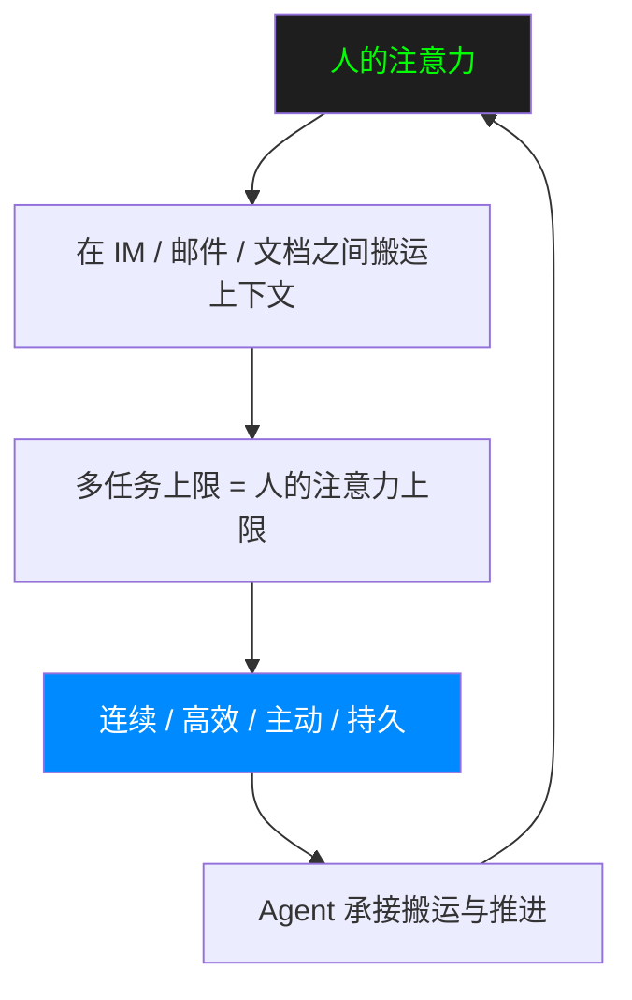
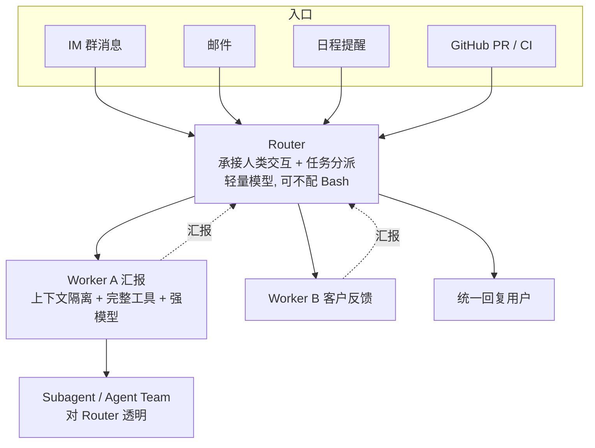
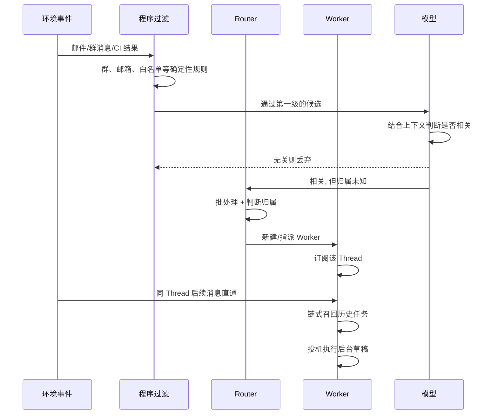
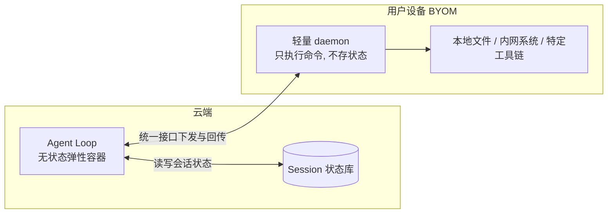

    

        

            

            

            

        

        
bash

    

    

        
ckhuang@macbookpro:~$ IM 里说的、邮件里改的、文档里定的，最后全靠人肉在三个窗口之间同步——这不是 Agent 不够聪明，是它压根没有"同一件事"这个概念。

    

做 Agent 落地这几年，我见过太多团队把 80% 的精力花在提示词上，却在系统层面留下一个致命空洞：**任务一旦离开当前会话，就失忆了。**

用户在 IM 里布置一件事，在邮件里改需求，在文档里补充数据。对人是"同一件事的三条线索"，对 Agent 却是三次互不相干的输入。中间的搬运、比对、纠错，全由人完成。多任务的上限，本质上是人的注意力上限。

DeepSeek 在 8 月开源的 **DeepSeek Harness** 走的是"一切插件化"的路子，这次的 `dsh-superagent-prototype` 则把矛头指向了另一个更硬的问题：Agent 的**"连续实体"**能力。它要打破 Agent 与"单次手动会话"的绑定，让 Agent 成为一个能跨会话保持上下文、并行推进多项复杂任务且互不干扰的连续实体。

这篇文章不打算复述概念，而是把它拆成可落地的工程结构。读完之后，你应该能回答三个问题：

1. **"连续实体"到底需要哪四种能力**，以及它们和"全局记忆"的区别在哪；
2. **支撑这些能力的五个模块**分别借用了哪些经典软件设计思想；
3. **哪些是当前明确解掉的，哪些还是开放问题**——这决定了你现在该不该照着做。

## 一、先看场景：连续实体解决的是"上下文搬运"

早上主管在 IM 群里让你写一份季度汇报，时长 20 分钟，你把任务交给了 Agent。下午主管转发了一封 +2 的邮件，要求改成 10 分钟、重点讲未来规划。

今天你必须手动把邮件里的信息同步给 Agent。而在"连续实体"的形态下，Agent 会自己识别出：**这封邮件和早上 IM 里说的是同一件事**，然后自主更新任务，不需要人介入。

这个场景听起来平淡，但工程上要连着完成四步：

1. 接住这封邮件（渠道接入）；
2. 判断它和早上那件事是同一件事（语义关联）；
3. 找到正在执行的那个任务（任务寻址）；
4. 让后续工作按新要求继续（执行控制）。

任何一步靠"模型自己想想"都不稳。这也是为什么 DeepSeek 要专门为一个"场景"开源一套插件包——**连续性是架构问题，不是模型能力问题。**

## 二、四个技术特征：连续、高效、主动、持久

DeepSeek 用四个形容词概括这种形态，但形容词最难落地。把它翻译成可验证的工程约束更实用：

| 特征     | 工程含义                                                     | 反例（今天常见的做法）     |
| -------- | ------------------------------------------------------------ | -------------------------- |
| **连续** | 同一 Agent 把不同渠道里关于同一件事的信息接起来              | 每个渠道一个 Bot，各自失忆 |
| **高效** | 支持"插话"：上一条任务没结束也能接新指令，且不打断在跑的任务 | 单会话串行，新需求排队     |
| **主动** | 持续观察环境事件，值得处理就推进，不值得就保持安静           | 每条消息都回一句"收到"     |
| **持久** | 始终在线、接入真实工作环境、异常后自动恢复                   | 关掉电脑，任务就停在半路   |

这里有一个特别容易混淆的点，原文点得很准：**"连续"和 Agent 的全局记忆不是一回事。**

- 全局记忆解决的是**知识层面的连续**：它记得你偏好什么、上次结论是什么；
- 运行层面的连续，解决的是**"这件事现在是第几步、下一步该谁动手"**，靠的是状态、事件、订阅关系这些工程手段。

记忆再强，也补不上"运行时状态丢失"这个洞。这是我特别认同的一条分界线：很多团队把两者混为一谈，最后做出来一个"记得很多、但接不上活"的 Agent。

## 三、五个模块：每一条都是老架构思想的新用法

DeepSeek 的判断是：**单个 ReAct Loop 无法同时支持上面四个特征**，底层需要一套成体系的架构。原文给出的基本框架包含双层架构、事件驱动、面向人的交互、计算/状态/环境分离、Watchdog。

有意思的是，这些模块几乎都能在经典软件工程里找到对应物：

| 模块                 | 熟悉的软件设计概念                  | 在 Agent 中解决的问题                          |
| -------------------- | ----------------------------------- | ---------------------------------------------- |
| 双层架构             | 调度与执行分离                      | 协调者保持响应，执行者并行工作                 |
| 事件驱动             | 消息队列、异步通信、发布—订阅、缓存 | 程序的多样化驱动                               |
| 计算、状态与环境分离 | 无状态服务、共享存储、远程执行      | 更换计算实例不丢必要状态，工作环境不用整体迁移 |
| Watchdog             | 健康检查、外部控制循环              | 不仅检查服务存活，还检查任务是否在推进         |

这张表值得多看两眼。它说明 **Agent 工程并不是全新的物种，而是把分布式系统的老问题换了一套输入输出**：调度、消息、状态、探活，一个都没少。区别在于，输入端从"HTTP 请求"变成了"人的一句话"，执行单元从"无状态函数"变成了"会推理的循环"。

### 3.1 双层架构：Router 只做两件事

先看一个更狠的问题：Agent 正在改汇报，你又让它整理客户反馈，中间还随口问了句"Q2 产品留存率是多少"。三件事几乎同时到，怎么办？

- **全塞进一个会话**：上下文最连续，但一个 ReAct Loop 只能一步一步走，改汇报时客户反馈只能排队，吞吐低，多任务细节还会互相污染；
- **每条消息新开会话**：并发最高，但下午的邮件会被当成新任务，只能靠全局记忆兜底，一旦超出记忆边界，效果立刻下滑。

这就是**会话组织上的权衡**：上下文一贯性 vs 吞吐量。和分布式系统里的"单体事务 vs 分片并发"是同一种取舍。

DeepSeek 的解法是双层架构，本质是**调度与执行分离**：

关键在于 **Router 的职能被刻意收缩了**。常见 Agent Team 里，Team Lead 要理解任务细节、拆子任务、高频协调，自己就成了上下文瓶颈。DeepSeek 的 Router 只做两件事：**承接所有入口的人类交互、处理任务之间的分派与协调**。它不介入单个任务内部怎么拆，不亲自执行，用轻量模型往往就够。

这其实比"造一个全能主管"更难，因为它要求架构承担起原本靠"主管聪明"兜住的东西。

#### Router 会不会被挤爆？

这是我看这类架构时第一个要问的问题。DeepSeek 的答案是**批处理**：Router 上一轮推理期间到达的消息先积压，下一轮一起处理。

它们的压测数据值得记下来：需要决定的消息从每分钟约 1 条增加到约 40 条时，平均每批从 1.0 条增至 2.8 条，单次请求耗时只从 2.5 秒增至 3.9 秒，**分摊到每个决定上的推理时间反而从 6.4 秒降到 1.6 秒**。

这就是批处理的老规律：它提高的是**有效吞吐**，不保证每条消息的等待时间都更短。这和数据库批量写入是同一个道理。再往上扩，Router 也可以切成多个会话，但切得越细，分片之间的上下文越不连续——在全局记忆问题解决之前，这个权衡会一直存在。

#### 为什么不干脆用一个会话 + Subagent 工具？

因为"分不分工"不能交给提示词和模型的临场判断。DeepSeek 做过对比：约 300 条消息里混着约 20 个工作请求，每种方案跑 5 次。

- 中性提示词：主会话 5 次里**一次都没调用 Subagent**，全自己干，还不断被打断，p95 完成时间 **29.5 分钟**；
- 改成"优先委派"：5 次里 4 次分了工，整体仍慢于双层架构；剩下 1 次判断活"很小"，又自己干了；
- 双层架构：p50 **12.4 分钟**，p95 **15.7 分钟**。

这组数据的价值不在绝对值，而在于它证明了：**稳定性来自结构，不来自措辞。** 一个靠提示词才愿意分工的系统，它的性能分布是不可预测的。

    "能由架构保证的事，别写进提示词——提示词是给模型解释意图的，不是用来替代调度器的。—— CK·黄"

### 3.2 事件驱动：一条 Trigger 的四问

Agent 的驱动力有两类：人的指令，和环境事件。DeepSeek 把群聊消息、邮件、日程提醒、代码评审评论、CI 运行结果统称为 **Trigger**。

一条 Trigger 从进系统到被处理，要依次回答四个问题。

**第一问：这条消息需要处理吗？** 接入真实群聊和邮箱后，绝大多数消息与 Agent 无关——比如群里讨论周五团建去哪。每条都让大模型判一遍，延迟和成本都扛不住。

DeepSeek 借用了 **Fast Path / Slow Path**：先跑程序规则（哪个群、哪个邮箱、发件人在不在白名单），在调模型之前筛掉大部分；剩下的才交给模型结合上下文判断。这就像邮箱收件规则加一位秘书——广告自动归档，剩下的秘书再判断。

**第二问：这条消息该交给谁？** 这里引入了 **Thread** 概念：同一个 IM 话题、同一串往来邮件、同一个 PR 下的连续消息，构成一条 Thread。

Router 根据 Thread 的第一条消息创建 Worker 后，这个 Worker 就**订阅**这条 Thread。之后同一 Thread 的消息由程序直接投递，不再经过 Router——这叫**订阅直通**。只有尚未被订阅的新消息，才需要 Router 判断。

订阅是多对多的：一个 Worker 可以订阅多条 Thread（汇报 Worker 同时订阅 IM 话题和邮件），一条 Thread 也可以被多个 Worker 订阅。Router 仍能看到所有消息，掌握全局；新消息超出任务范围时，Worker 可以退订或交回 Router 重新分派。

直通的价值主要在成本上。消融实验显示：去掉直通后，任务完成时间基本不变，但 Router 需要做的决定增加约 **30%**，读缓存 token 从 **2323 万** 涨到 **3177 万**，增幅约 **37%**。

> 做过消息中间件的人对这套东西应该很熟：**先确定归属并建立订阅，后续按已有关系投递，而不是每条消息都重新路由一遍。** 借用的是发布—订阅的思想，但不代表实现必须绑某一种 MQ。

**第三问：怎么找到之前那件事？** Router 能判断"下午的邮件和上午的汇报是同一件事"，前提是它还找得到上午那件事。历史任务越积越多，不可能全塞进窗口。

DeepSeek 把上下文窗口当**缓存**来管理，借用了编译优化的两个词：

- **Inline**：近期很可能用到的信息直接放进窗口，省掉一次工具调用；
- **Spill**：放不下或不常用的完整内容留在窗口外，只保留摘要和引用，需要时再读。

更关键的是 **链式召回**：每条消息、每条 Thread、每个 Worker 会话都有自己的 ID，注入上下文时附带紧密相关对象的 ID。邮件关联到汇报 Worker，再从 Worker 找到上午的 IM 话题——像顺着参考文献往下翻，而不是把整座图书馆搬到桌上。

必须说清楚：**链式召回解决的是近期任务与会话历史的检索；跨月甚至更长时间的长程记忆，仍然是开放问题。** 这一点在选型时别自我欺骗。

**第四问：还没正式下指令，能不能先准备？** 借用 CPU 的**投机执行**：14:30 主管在群里随口说"+2 最近好像更关心明年的规划"，这还不是正式要求，Agent 不动汇报，但在后台先整理一份规划提纲；16:10 邮件到了，提纲立刻派上用场；邮件不来，这份提纲也不打扰任何人。

这里有一条不能越的线：**投机执行改变的是准备的时机，不改变谁有权做决定。** 后台产出在被确认前只是草稿，绝不能当正式要求去改交付物。我在不少项目里见过反例——Agent"贴心"地替用户做了决定，信任一次就没了。

### 3.3 计算、状态与环境分离：全天候任务的标配

18:30 关电脑下班，汇报还没改完。我们希望云端继续推进，但有些步骤（读本地文件、访问内网财务系统）必须等那台电脑上线。

拆成两步看。

**第一步：计算与状态分离。** Agent Loop 放进云端无状态弹性容器，Session 这类需要持久化的状态存数据库。容器可水平扩展、重启、替换，新实例读到已有状态，就不会把任务当成新任务重来。

这跟 Web 应用处理登录态一模一样：Session 只存在某台机器内存里，流量一回不去状态就丢；放进 Redis 这类共享存储，任何实例都能取到同一份。但共享 Session 只解决"换台机器还能找到状态"，**并不保证正在执行的工作自动恢复**——Agent 还需要知道接着执行哪一步，以及上一条工具命令是否已生效。状态保存是恢复的基础，不是恢复的全部。

这也解释了为什么 Router 可以"常驻"，而计算容器可以无状态：**持续存在的是协调职责和会话状态，不要求某个进程永不退出。**

**第二步：计算与执行环境分离。** 把环境复制到云端沙箱？真实工作环境里有未提交的本地修改、私人凭据、只能内网访问的服务、特定硬件和工具链，复制成本高还容易漏。让用户搬到云端？财务、员工这类私密信息必须留在本地，多数企业推不动。

DeepSeek 的选择是：**环境不搬，留在原地。端侧只装一个轻量 daemon，不保存会话状态，只负责执行命令、返回结果。** 这几乎就是 CI 系统里的 Runner：调度在中心，活在各台机器上跑，Runner 并不记得流水线走到哪一步。

这和 Anthropic 提的"脑手分离"是一个思路，差别在场景：Anthropic 讨论的是托管服务里按需创建的沙箱，DeepSeek 接入的是用户日常使用、可能时而上线时而离线的个人电脑——所谓 **BYOM（Bring Your Own Machine）**。

拆完之后，一个 Agent 可以按任务需要选择具备相应文件、工具和权限的设备执行命令——注意，**不是任意机器都能替代原来的环境**。它也可以等待设备上线：第二天早上打开办公室电脑，云端 Agent 核对等待中的步骤，把结果写回本地 PPT，再去内网财务系统核对数字，完成交付。

代价也很明确：这套设计默认云端和端侧彼此信任。放到企业环境里，这个"默认信任"往往就是安全评审第一刀要切的地方。

### 3.4 Watchdog：从"服务活着"到"任务在推进"

原文把 Watchdog 列为框架模块之一，对应的是健康检查与外部控制循环，并且给出了一个我认为很关键的判断标准：**不仅检查服务存活，还检查任务是否在推进。**

这两者在 Agent 场景下差别巨大。传统探活看进程在不在、端口通不通；但一个 Agent 完全可能"进程健康、循环空转"——反复重读同一份文件，或者在工具调用失败后不断重试同一个错误参数。

从工程角度看，这类问题必须由**循环之外的观察者**来发现，因为循环内部的模型会倾向于"继续努力"。所以我的实践建议是给任务定义可观测的推进信号：步骤序号是否单调前进、最近 N 分钟是否产生了新的有效副作用、同一工具调用是否出现重复指纹。这些信号一旦停滞，外部控制器就该介入——重试、降级、或者把任务挂起并交回给人。

说白了，**Agent 的 SLO 不该只是可用性，还得是"有进展"。**

## 四、我的判断：什么该抄，什么该等

把这套东西放回帕累托前沿上看，结论会更清楚。

**该抄的，是结构。**

- **Router/Worker 分离**：把"承接交互"和"深度执行"拆开，收益立刻可见，而且不依赖任何特定模型；
- **订阅直通**：已知归属的消息走程序投递，只把不确定的交给模型。这是最朴素也最省钱的优化；
- **计算/状态/环境三分离**：无状态计算 + 外部状态 + 端侧执行器，这是把 Agent 从"聊天框玩具"变成"生产系统"的必经之路；
- **可观测的推进信号**：哪怕没有完整 Watchdog，也先把"任务是否在前进"做成指标。

**该等的，是记忆。**

链式召回解决的是近期任务与会话历史的检索，跨周长程记忆仍是开放问题。这意味着今天的"连续实体"更像**"有限窗口内的连续"**：它能接住这几天的事，但别指望它记得上季度的结论为什么是那样。谁在这个问题上给出工程解，谁就拿到了下一代 Agent 架构的入场券。

**最值得记住的一句，是那句"分不分工不该取决于提示词写得好不好、模型怎么判断，而应由架构来保证"。**

这句话不只适用于 Agent。做了这么多年分布式系统，我见过太多团队在"要不要加一层协调"上反复摇摆，最后靠"人盯"和"经验"维持运转。Agent 让我们重新面对同一个问题，只是这次，被协调的对象从服务变成了会推理的循环。

    

        

            

            

            

        

        
bash

    

    

        
ckhuang@macbookpro:~$ 短期可以只做三件事：把调度从执行里拆出来、把已知归属交给订阅、把"任务有没有在推进"变成指标。剩下的，等记忆问题被解掉再说。

    

---

**参考来源**：[从长程 Agent 到 Super-agent，解锁更多场景](https://mp.weixin.qq.com/s/vL-Pj18UZb65LJTfZbTXkQ)（阿里云云原生，2026-11-02）；DeepSeek 开源的 `dsh-superagent-prototype` 及《Super-agent 设计探索：迈向更自主的 Agent 系统》。
