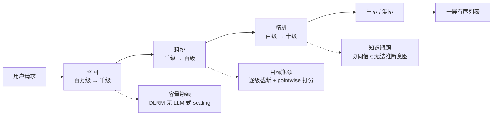
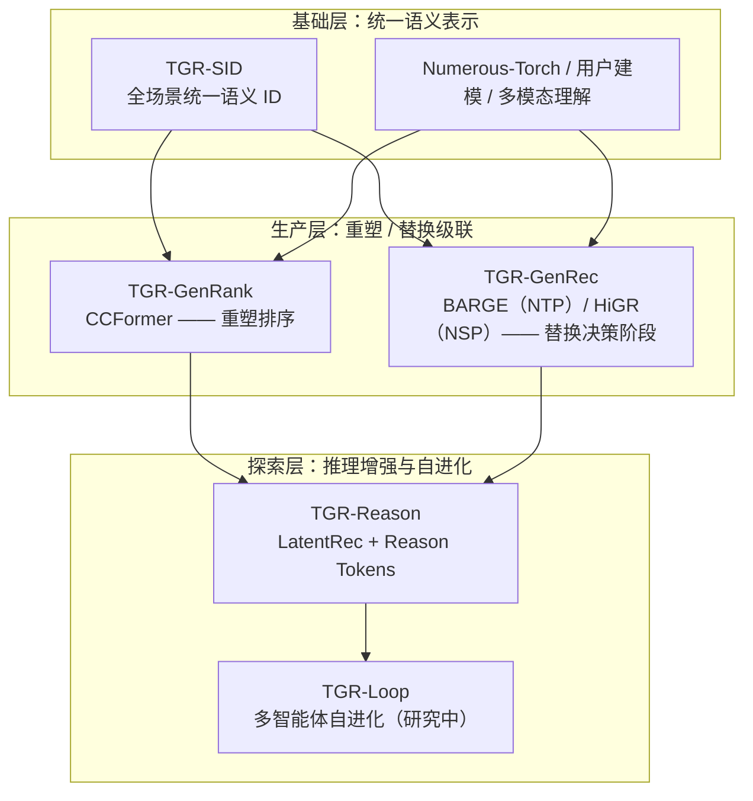
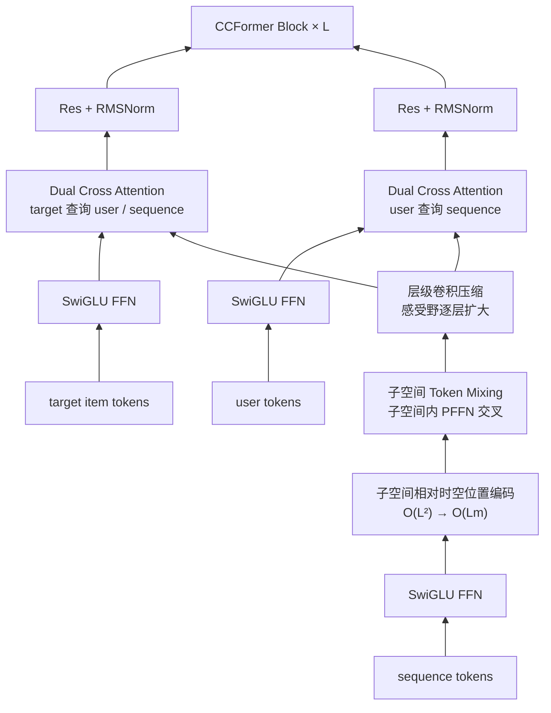
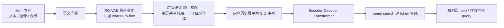
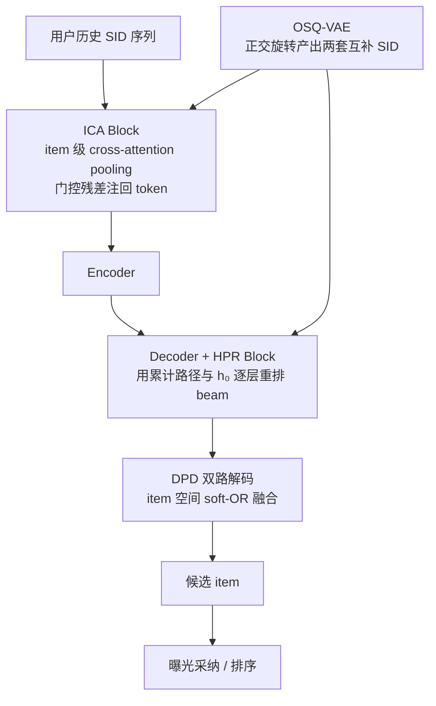
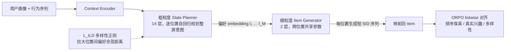
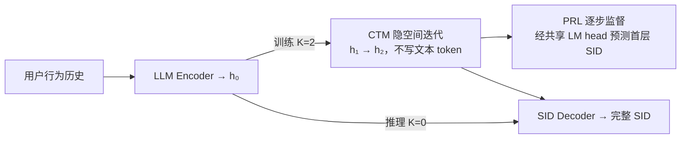
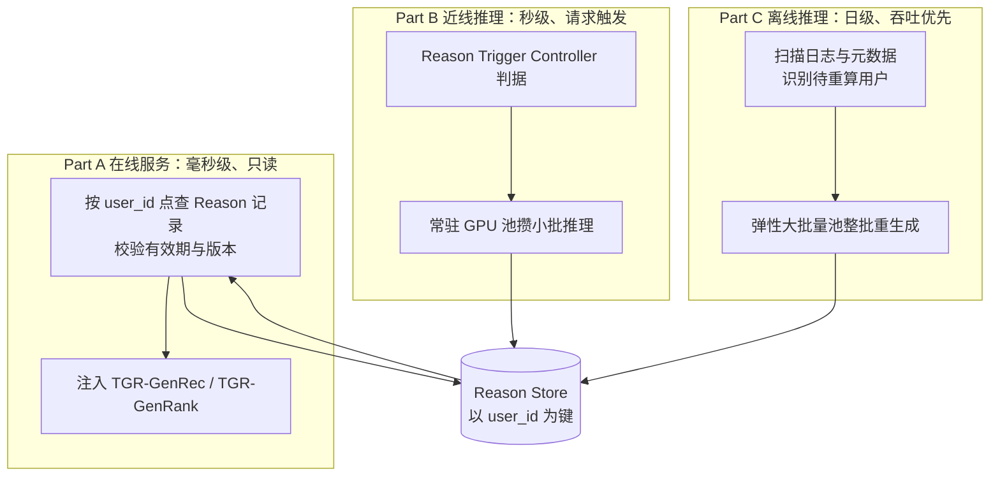

    

        

            

            

            

        

        
bash

    

    

        
ckhuang@macbookpro:~$ 你把排序模型的参数翻了三倍，AUC 涨了 0.02，GPU 账单涨了 300%。这不是 scaling law，这是给机房交学费。

    

这句话我在很多次架构评审上都说过，但说完之后通常没人接话——因为大家都知道问题在哪，只是不知道除了"再堆一个特征交叉模块"之外还能做什么。

腾讯 PCG 这次公开的 **TGR（Tencent Generative Recommendation）** 技术栈，是我近期看到把这件事讲得最完整的一份工业实践：它没有停在"用 LLM 做推荐"的口号上，而是把级联架构的三个结构性瓶颈逐个拆开，给出了四条彼此不同、但共享一套语义基础设施的技术路线，并且都在真实流量上跑出了数据。

读完本文，你会得到三样东西：

1. **一套判断标准**：什么样的推荐系统瓶颈，是"加特征"解决不了的，必须改范式；
2. **四条技术路线的取舍逻辑**：CCFormer（重塑排序）、BARGE / HiGR（端到端生成）、LatentRec / TGR-Reason（推理增强），分别在什么约束下成立；
3. **一份可以直接迁移的工程经验**：SID 设计、延迟预算、离线物化、对齐算法选型，这些坑和模型结构无关，和工程现实强相关。

## 一、级联架构的天花板，到底卡在哪

先看今天绝大多数推荐系统的样子，它几乎是一个行业标准件：

每一级都是一个独立的深度学习推荐模型（DLRM）：底层按 sparse 特征、dense 特征、多域行为序列分别抽取，中间用 DeepFM / DCN / DIEN 这类结构做特征交叉，顶层用 MMoE / PLE 输出多任务分数。这套架构统治了工业界十年，但腾讯把它的瓶颈总结为三条，我认为总结得非常准确：

### 1.1 容量瓶颈：参数加上去，效果不涨了

DLRM 的天花板不在算力，而在结构：embedding 查表受内存带宽限制，人工设计的交叉结构表达能力有限。参数和算力继续加，效果趋于饱和，**没有 LLM 那种可预测的 scaling 曲线**。

Meta 的 HSTU 是第一次可信的突破：把特征和行为序列统一 token 化，交给单个 Transformer 完成交叉，排序模型第一次表现出随参数量与序列长度可预测提升的特性，甚至把序列转导模型推到了万亿参数量级，线上 A/B 拿到 +12.4%。

但代价紧接着就来了：self-attention 对序列长度是 **O(L²)**。在数十到百毫秒的延迟预算下，万级用户序列只能截断或预压缩，细粒度的跨域交互被牺牲。**换句话说，HSTU 证明了路是对的，但没证明这条路在工业延迟下走得通。**

### 1.2 目标瓶颈：每一级都在做局部最优

级联的第二个问题更隐蔽：决策被切碎了。

- 上游截掉的 item，下游永远看不到，信息逐级损失、样本偏差逐级累积；
- 每一级独立优化、独立截断，跨阶段联合优化的边际收益递减；
- 最要命的是，用户体验到的是**一屏有序列表**，列表质量取决于 item 之间的兼容性、多样性和位置效应，而 pointwise 打分天生刻画不了这些关系。

局部最优的拼接，不等于全局最优。这个道理做分布式系统的人应该很熟——**你没法通过让每个节点各自最快，得到一个整体最快的系统。**

### 1.3 知识瓶颈：协同信号只会"记忆"，不会"推断"

协同信号学到的是行为共现："看过 A 的人接着看了 B"。它在绝大多数请求上有效，却恰好在三类请求上失效：

| 场景            | 协同信号的状态               | 真正需要的能力       |
| --------------- | ---------------------------- | -------------------- |
| 新用户 / 冷启动 | 历史为空或极短，没有共现证据 | 人群先验、内容语义   |
| 长尾 item       | 交互边稀疏，几乎没有可学信号 | 多模态理解、世界知识 |
| 意图模糊的会话  | 历史指向多个方向             | 意图推断，而不是匹配 |

这三类请求要的是**推理**，而协同信号给的是**匹配**。模式匹配不等于推理，这就是协同信号的覆盖边界。

我的总结是：这三个瓶颈分别对应 **容量、目标、知识**。加特征、调结构、换损失函数，都只能缓解第一层；后两层必须动决策单元本身。

## 二、TGR 的整体选择：两条路线并行，而不是二选一

面对级联，业界其实有两条改造路径，腾讯没有押注单一路线，而是同时推进：

- **重塑（Reshape）**：保留级联骨架，用生成式范式的建模技术重写每一层的模型；
- **替换（Replace）**：用单一生成模型替掉召回、排序、重排这些学习型决策阶段，直接产出 item 或整屏 slate。

这个分层里最值得注意的不是模型，而是最底下那个 **TGR-SID**：一套全场景统一的语义 ID，既是内容理解与语义表示的基础设施，也是所有方向共享的解码空间。**这是整个技术栈的"类型系统"**——没有它，BARGE 生成的 SID、HiGR 规划的 SID、Think 模型产出的 reason tokens 就无法在同一个空间里对话。

我的判断是：TGR 选择"两条路线并行"不是技术上的犹豫，而是业务现实。新闻、视频、小说、浏览器，各场景的候选规模、延迟预算、数据量差异极大，**用一套架构覆盖所有场景，在工程上从来都是灾难**。按场景选路线，才是负责任的架构决策。

## 三、CCFormer：把"充分交互"和"算力效率"拆开拿

TGR-GenRank 的目标很明确：在级联结构内替换排序 backbone，让排序模型既有可预测的 scaling，又不炸延迟预算。

### 3.1 先看清业界两条路线的死结

| 路线                           | 代表工作                   | 优势                                 | 死结                                         |
| ------------------------------ | -------------------------- | ------------------------------------ | -------------------------------------------- |
| 范式 A：特征交互型             | Wukong、RankMixer          | 算力利用率高，骨干只处理少量压缩表示 | 序列先压缩后交叉，细粒度信息在进骨干前就丢了 |
| 范式 B：统一 token 化 + 注意力 | HSTU、ULTRA-HSTU、OneTrans | 交互充分，scaling 可预测             | O(L²)，万级序列在工业延迟下算不动            |

后续工作基本都在给 self-attention 做减法：半局部稀疏注意力、注意力截断、金字塔式缩减 query、跨请求缓存 KV。**但所有这些方法，都是在一个错误的约束下做优化——它们默认"跨域交叉"和"序列内交互"必须由同一个算子承担。**

CCFormer 的设计出发点就一句话：**把这两件事解耦，各用最合适的算子。**

### 3.2 四个模块，对应四种复杂度

1. **特征域分离的 Cross Attention**：把排序拆成三个域之间的关系——用户与历史序列的偏好检索、目标物品与历史序列的相关性匹配、目标物品与用户的兼容性建模。异构域之间的相关性建模，Cross Attention 是最合适的算子，且复杂度只有 **O(L)**。
2. **子空间相对时空位置编码**：把长序列切成多个相邻 m token 的子序列，在子序列内分别算相对时间与相对位置的参数矩阵，复杂度从全局 O(L²) 降到 **O(Lm)**。
3. **子空间 Token Mixing**：把序列 token 划成 m×n 的子空间，每个子空间的 embedding 展开后过参数独立的 PFFN，再做维度还原，完成子空间内的特征交叉——绕开了全局 attention。
4. **层级卷积压缩**：用逐层有重叠的一维卷积聚合相邻行为 token，卷积核自适应学习聚合模式，感受野逐层变大。**关键在于压缩不再前置于交互，而是在骨干内部逐层进行**，让细粒度信息先参与交叉，再被压缩。

第 4 点是我认为最"工程正确"的一处设计。范式 A 的根本问题不是压缩本身，而是**压缩的时机**——先压缩再交叉，等于先把简历折成一页再让面试官判断能力。CCFormer 把压缩放到交互之后，信息损失发生在该发生的时候。

### 3.3 数据说话：一半算力，更陡的斜率

在 40 亿样本的真实业务数据集上，CCFormer 的 **AUC 77.94%、GAUC 71.36%**，相对 HSTU（77.66% / 70.86%）分别提升 0.28 和 0.50 个百分点，相对提升 1.01% 与 2.40%，训练加速 **2.21×**。

但真正值得看的是 scaling 实验：

| 维度          | CCFormer                                           | HSTU                     | 结论                         |
| ------------- | -------------------------------------------------- | ------------------------ | ---------------------------- |
| 256 维 / 算力 | AUC 77.94%，18.28 GFLOPs                           | —                        | —                            |
| 512 维 / 算力 | —                                                  | AUC 77.79%，63.47 GFLOPs | CCFormer 用不到 1/3 算力反超 |
| 序列长度      | 0.5K 即达到 HSTU 2K 的 AUC，GAUC 反超              | 2K 才达到同等水平        | 短一半序列打平               |
| 规模扩大      | ΔAUC 从 0.84% 拉到 1.22%，ΔGAUC 从 1.02% 拉到 2.4% | —                        | 领先幅度随规模扩大           |

消融也印证了每个模块都在干活：去掉相对时空位置编码，GAUC 掉到 71.13；把 token mixing 换成 self-attention，GAUC 掉到 71.21、训练加速从 2.21× 掉到 1.41×；去掉序列压缩，训练加速只剩 1.29×。

CCFormer 已在 5 个业务场景取得显著收益，多个场景推全上线。

**我的解读**：这份数据里最值钱的不是 +0.28 个点，而是"算力换算力的斜率更陡"。在推荐系统里，AUC 的绝对值早就卷到小数点后两位，**真正决定能不能上线的，是"每多花 10% 算力能换回多少效果"**。CCFormer 把这条曲线的斜率做陡了，这比单点指标重要得多。

## 四、TGR-GenRec：从 next-item 到 next-slate

如果 CCFormer 是"重塑"，GenRec 就是真正的"替换"——用一个生成模型直接产出用户要看的 item，甚至整屏列表。

### 4.1 推荐的因果结构，和语言不一样

端到端生成式推荐的标准链路是：

这条路和 LLM 同构：不再对全库逐一打分，可以复用 Transformer 骨干、scaling 规律和训练推理基建。但**语言自回归不等于推荐自回归**，两个结构性缺口必须补：

- **Item Boundary Gap（编码端）**：一个 item 被展平成 D 个 SID token 后，边界信息丢了。模型看见的是 token，不知道哪些 token 属于同一个物品；更麻烦的是，同一个 code index 在不同前缀下语义完全不同——第二层的码字 3，在 ⟨1,3⟩ 和 ⟨7,3⟩ 下查表 embedding 相同，语义却不同。
- **Semantic Drift（解码端）**：层级解码一旦某层走岔，之后每层都只能在错误子树里搜索，目标 item 被永久排除。原文的数据很刺眼：teacher forcing 下第三层目标概率 0.787、排名 7.4、准确率 80.5%；换成自回归整体只剩 0.015、119.5、1.6%。按前缀是否正确拆开看，前缀正确时准确率 77.0%，前缀一错只剩 0.6%，相差 128 倍。

这也是为什么"加大 beam"没用：更宽的 beam 只是留下更多路径，**它无法判断整条路径的语义是否还和用户一致**，而且时延随 beam 宽度线性增长。

### 4.2 BARGE：四个模块修补 NTP 范式

1. **OSQ-VAE**：对码本做正交旋转后一分为二，为每个 item 产出两套互补 SID；编码器输入两套、两个解码器并行解码。
2. **ICA Block（Item Context-Aware Attention）**：进 encoder 前，用可学习 query 对同一 item 的 L 个 SID token 做 cross-attention pooling，得到 item context，再以门控残差注回每个 token。实测门控强度落在中等区间，说明模型选择的是"补充"而非"覆盖"原有 SID 信息。
3. **HPR Block（Hierarchical Path Reranking）**：用累计路径和 decoder 初始隐状态 h₀ 给候选打分，逐层重排 beam。训练用 InfoNCE，负样本包括批内其他路径、NTP 高概率错误前缀、曝光未点击等业务负样本——**专门针对"负样本太容易"这个老问题**；推理分数 = 生成分数 + λ × 路径匹配分数；每层用 Top-N 扩展评分池，下一层仍只留 Top-B，beam 宽度不变。
4. **DPD（Dual-Path Decoding）**：两条通路共享 encoder、私有 decoder，在 item 空间做 soft-OR 融合。经验上两条通路高度互补：Top-10 候选的 Jaccard 只有 0.172–0.183，前 10 名只有约 3 个重合，OR 命中里 15.6%–24.3% 仅由单通路贡献。

效果上，Beauty R@10 0.0927（相对最强列内基线 +16.6%，相对 TIGER +43.1%），Sports R@10 0.0544；两个工业场景 Hit@5 相对 OneRec 分别 +10.2% 与 +16.9%。线上小说场景两周 A/B（6% 流量）：CTR +0.60%、点击 UV +1.34%、总阅读时长 +1.70%，全量上线后长期反转组收益更稳。

工程部署上有个细节很值得抄：**同一个生成模型，按 quota 选两种落地方式**。

- 小 quota：beam 输出 50 组 SID 路径，直接映射 item，一路召回直出，或直接送精排替掉"召回 + 粗排"；
- 大 quota：生成 50 个 SID 种子，每个种子做 ANN 扩展，去重后约 480 个候选（重复率约 4%），进入现有下游级联。

这就是我说的"工程地心引力"：**算法给你一个生成器，工程要回答的是它在链路的哪个位置、以什么 quota 接入。**

### 4.3 HiGR：把生成单元从 item 升级为 slate

BARGE 解决的是"如何生成一个 item"，HiGR 要解决"如何生成一张好列表"。后者难得多，因为列表质量不只取决于单个 item 的相关性，还取决于位置、item 间关系和多样性。直接扩展 NTP 会遇到三个断层：

1. **纠缠的 SID 空间**：标准残差量化的前缀既不反映语义也不反映协同关系，前缀相同不一定同类，前缀不同却可能相似——规划器没法在高层"规划意图"。
2. **低效的细粒度解码**：M 个 item × D 层 SID 要解 M×D 个 token，全序列 beam search 在实时约束下扛不住，而且把 item 内组合和 item 间转移纠缠在一起。
3. **目标错位**：token 级似然不优化用户感知的 slate 质量（顺序、真实兴趣、多样性）。

HiGR 的答案是 tokenizer、解码器、训练目标三件套协同设计：

**PCRQ-VAE** 解决 SID 空间纠缠：只对前 D−1 层施加 InfoNCE 前缀对比约束（正样本取语义相似或高共现 item），让前缀负责"聚类"、最后一层负责"区分"；同时用全局量化损失替代逐层累计损失，抵抗残差坍塌。结果：碰撞率 2.37%、集中度 93%、一致性 66.47%，较 RQ-VAE 提升约 10.7 个百分点。把约束延伸到叶子层反而"身份坍缩"——一致性只边际提升，碰撞率升高近 4 倍。

**HSD** 解决解码效率：下层规划器在紧凑的偏好 embedding 空间里逐位置自回归，先把整屏意图定下来；上层生成器把每个偏好落成 D 个 token 的短 SID 序列，参数跨位置共享，模型大小不随 slate 长度增长。beam search 只在 item 级短序列内进行，解码复杂度显著下降。深度分配上，**14 层规划 + 2 层生成**是生产最优：相比 12:4，时延降 26%，NDCG@5 只降 0.6%。这个结论很有信息量——**算力应该压在"规划整屏意图"上，item 级解码用很浅的网络就够**。

**ORPO listwise 对齐**解决目标错位。这里的选型逻辑特别值得讲，因为它是一次"工程约束反向决定算法"的典型案例：

| 方案     | 机制痛点                             | 工业阻碍                                                |
| -------- | ------------------------------------ | ------------------------------------------------------- |
| DPO      | 损失里含参考模型预测                 | 显存翻倍、吞吐减半，小时级更新扛不住                    |
| GRPO     | 需要环境对每次采样即时准确反馈       | 推荐离线训练没有高保真用户模拟器，生成 G 组完整列表极慢 |
| **ORPO** | 无需参考模型，偏好优化折叠进监督学习 | 单模型、单向传播，速度与普通 SFT 几乎持平               |

偏好对用"三元目标"构造：正样本三目标共用（真实观看 + 高停留，按反馈强度重排），负样本分别对应排序保真（打乱顺序）、真实兴趣（替换为曝光未点击/负反馈）、列表多样性（后续全填与锚点相似的 top-k）。三类样本全部从隐式反馈挖掘，不需要人工标注。

工程加速上，Flash Attention、KV Cache、Memory Beam（利用 GEMM 并行优化 beam search，避免把序列复制 beam 宽度份）、代码级优化叠加，推理提速 **5 倍以上**，训练提速 2 倍以上，成本降低 60%。

效果：同 25M 参数下，HiGR 在工业数据集 5 个指标全部超过 OneRec-25M——Impressions Hit@5 +15.9%、Effective Views Hit@5 +21.3%、NDCG@5 +21.2%；100M 模型 NDCG@5 达 0.0831，较 OneRec-25M +41.1%。已在腾讯新闻、QQ 浏览器小说等场景推全，三个场景全流量上线，人均观看时长、CTR、广告收入各有提升，**而且这些收益是在推理成本下降的前提下拿到的**。

## 五、TGR-Reason：推理不能放在请求路径上

前两条线解决的是"打分效率"和"生成单元"，但判别式和生成式有一个共同点：**它们学的都是行为共现**。协同信号密集处很强，稀疏处就露怯——这恰好是新用户、长尾、意图模糊这三类最需要推理的请求。

大模型能补"推断"，但推荐系统的现实是：每天数十到千亿次请求，延迟预算数十到数百毫秒，而一次 LLM 推理基本是秒级，**差 1 到 2 个数量级**。成本同样致命：请求内推理的成本随曝光量线性增长，大量曝光并不转化，GPU 还得按峰值配置。

所以 TGR-Reason 的核心不是"用大模型推理"，而是**"把推理放在哪里"**。答案是把快慢思考拆开：

- **慢思考**（Think 模型 / 大模型）负责推理，低频重训，承载语义与世界知识；
- **快思考**（在线生成器）负责毫秒级生成，持续学习，承接新 item 与新用户；
- 两者通过共享的 SID 空间和 **reason tokens** 接口衔接。

### 5.1 LatentRec：把推理摊销进参数

LatentRec 的思路是训练期多步展开、生成期直接解码：

三个设计分别解决三个问题：

1. **CTM**：隐空间多步展开，不生成文本 token，避开 CoT 的数百 token 开销；
2. **STS（Soft Token Selection）**：hidden state 的范数约 45，词表 embedding 约 3，相差约 14 倍，直接反馈回输入会改变尺度与方向。STS 维护 64 个可学习向量（由词表 embedding 初始化），用当前隐状态投影出 query 做加权求和，作为下一步输入；
3. **PRL（Per-step Reasoning Loss）**：每个中间状态经同一个 LM head 预测目标的第一层 SID，损失取各步 CE 平均，温度逐步降低（K=2 时 T₁=3.5、T₂=1.0）。只监督首层是有意为之——更深码字会把 latent 轨迹和固定解码路径耦合。

模型很轻：Qwen3-1.7B + LoRA rank 16 + 64 个 soft token（约 2.5M 参数），新增参数不到骨干的 0.2%。

结果：K=0 的 LatentRec 在 Beauty / Toys / Sports 三个数据集上 HR 与 NDCG 全面优于基线，HR@10 相对 CoT SFT 分别 +5.0% / +4.5% / +4.0%；单样本推理耗时从 **10.80 秒降到 0.59 秒（约 1/18）**，HR@10 还从 0.0625 升到 0.0656。配合批量单步 beam 与前缀 KV 复用，8×A100 上 41.8 万条样本生成耗时从 174 分钟降到 80 分钟。

**注意这里的取舍**：K=1 的 HR@10 是 0.0660，略高于 K=0，但三个数据集上收益不一致，所以默认 K=0。这就是工业界的判断方式——**没有稳定收益的精度提升，不值得多付一次前向**。

### 5.2 TGR-Reason 系统：三层架构 + 两个注入点

在线只读、近线按需刷新、离线兜底，三层共享一个 Reason Store。这个结构解决的不只是延迟，还有**持续学习节奏不一致**的问题：大模型周级发布，在线生成器小时级更新，两者用离线预计算的 reason tokens 解耦。

注入有两个入口：

- **GMR（Reasoning-Guided Group Memory Retrieval）**，作用在 encoder 侧：以每条 reason token 为 query，在全量历史序列中检索其后续窗口，得到"推断意图之后用户通常会看什么"的群体记忆；每个 query 独立取 top-M 再拼接，不做全局重排，保留每个推断意图各自的后继行为；群体记忆由独立 Group Encoder 编码，再与个人记忆做向量门控的非对称融合——**个人记忆始终是主信号**。
- **DRI（Direct Reasoning Injection）**，作用在 decoder 侧：top-K 条 reason token 与 encoder 输出做 cross-attention，结果作为 soft prompt 插在每层目标码字之前。按码本层重组、保留全部 K 个候选；以 Personal Encoder 输出为 query 选证据，学的是"哪些候选与个人记忆兼容"，而不是照抄 LLM 的 top-1；beam search 前算一次、所有 beam 共享，**SID 决策数与搜索空间都不变**；reason tokens 全缺失时 prompt 位置被 mask，退化为原路径。

这个"缺失即退化"的设计我很喜欢：**任何新增模块，都应该允许自己被关掉而不影响主链路**，这是灰度上线的基本素养。

效果上，离线以 3 个测试日等权平均，对照线上在用的 TGR-GenRec：

| 流量                    | Hit@1                          | Hit@5  | Hit@50 |
| ----------------------- | ------------------------------ | ------ | ------ |
| 全部推荐流量            | 0.3385 → 0.4339（+28.2%）      | +10.4% | +2.4%  |
| 主推荐流量              | 0.2247 → 0.3563（+58.6%）      | +13.1% | —      |
| 主推荐流量 · 冷启动用户 | 0.0451 → 0.2606（**+477.8%**） | +39.2% | +11.6% |

线上 A/B：有效消费率 +1.75%，新用户曝光-转化率 **+13.09%**，均统计显著。

两个观察值得记住：**增益集中在列表头部**（Hit@1 +28.2% vs Hit@50 +2.4%），说明推理的主要价值是把合理目标推到前几位，而不是扩大召回面；**冷启动增益最大**，说明 reason tokens 提供的语义先验，恰好补上了协同信号最稀缺的地方。

## 六、从这份实践里，我提炼出六条工程判断

技术细节会过时，判断标准不会。以下六条，我认为可以直接迁移到任何做推荐 / 搜索 / 广告系统的团队。

### 1. SID / tokenizer 是新一代的 schema 设计

RQ-VAE 的层级语义 ID，本质上是在给物品建一套**可生成、可检索、可对齐的索引结构**。它决定了三件事：生成模型的上限、跨模型协作的接口、以及冷启动能不能靠语义先验接住。

HiGR 的消融证明了这一点：只改 tokenizer 的前缀约束，碰撞率、集中度、一致性全变，下游生成效果跟着变。**tokenizer 不是预处理，它是数据建模。**

### 2. 延迟预算会反向决定算法选型

ORPO 被选中，不是因为它理论上最优，而是因为 DPO 要加载参考模型（显存翻倍、吞吐减半），GRPO 需要在线反馈（推荐场景没有高保真模拟器）。**在推荐系统里，一个跑不动的先进算法，价值为零。**

同理，LatentRec 的 K=1 精度更高却不默认启用，CCFormer 用 0.5K 序列打 HSTU 的 2K——所有决策都指向同一个约束：单位算力的效果增益。

### 3. "离线物化 + 在线点查"是工业界的通用解

Think-Ahead 把思维链离线写好、在线只做约束解码；Reason Store 把推理结果物化成 tokens、在线只做点查注入。**同一个模式出现了两次，说明它不是技巧，而是范式**：把昂贵的计算移出请求路径，用存储换延迟。

这背后是一个更底层的判断：**推荐系统的请求路径是稀缺资源，任何不能压进 100ms 的计算，都必须提前算好。**

### 4. 端到端不等于一步到位，最小改造往往最先上线

BARGE 没有推翻 NTP 骨架，只在 SID 建模、编码器、解码器、解码策略四处做结构适配，就以"一路生成式召回"的身份上线了。HiGR 也是先做同规模对比、再做 scaling、再推全。

对比很多团队"一步替换整个级联"的激进方案，TGR 的路径更像**渐进式重构**：先让新模块以一路召回的身份进入链路，用真实流量证明增量，再逐步扩大职责。这是我在分布式系统迁移里反复验证过的规律——**能被灰度、能被回滚的改造，才有机会活到全量。**

### 5. 评测体系必须升级，否则你测不出生成式的好

AUC / GAUC 是 pointwise 指标，它天生看不见列表顺序、多样性和位置效应。HiGR 用的是 Impressions Hit@5、Effective Views Hit@5、NDCG@5、ILD（列表内多样性）；TGR-Reason 用的是 Hit@K 分层（全部流量 / 主流量 / 冷启动）加有效消费率、新用户转化率。

**如果你的评测还停在 AUC，那你连"生成式到底有没有用"这个问题都回答不了。**

### 6. Agentic 自进化是下一个战场，但门槛是 ROI 和可审计

TGR-Loop 想让 LLM 智能体自主提出、验证、迭代推荐模型，目前还在研究阶段。腾讯自己提出的问题是"如何在 ROI 约束下，让多智能体在有限算力和流量预算内形成可控、可审计的闭环"——这个问法很清醒。

我补一句：**自进化的难点从来不是"能不能提出方案"，而是"能不能证明这个方案值得上线"**。没有可靠的离线评估、没有小流量求证机制、没有回滚能力，自进化只会加速犯错。

    "推荐系统的下一代竞争，不是谁的模型更像 LLM，而是谁能把 LLM 的推理能力装进 100 毫秒的预算里。" —— CK·黄

## 七、写在最后

把 TGR 的四条线放在一起看，会发现它其实在回答同一个问题的四个侧面：

- **CCFormer** 回答"排序模型怎么在延迟内获得 scaling"——解耦算子，压缩后置；
- **BARGE** 回答"生成式怎么在不大改架构的前提下落地"——修边界、纠漂移、加通路；
- **HiGR** 回答"怎么生成一张好列表"——把决策单元从 item 升到 slate，规划与生成分离；
- **LatentRec / TGR-Reason** 回答"大模型推理怎么进生产"——训练期摊销，或离线物化。

它们共享同一套 SID、同一套语义空间、同一套评测口径。**这才是"技术栈"和"一堆论文"的区别。**

    

        

            

            

            

        

        
bash

    

    

        
ckhuang@macbookpro:~$ 生成式推荐真正的门槛，不在模型结构，而在你敢不敢承认：级联架构的每一级，原本都只是在替下一级擦屁股。 

    

---

**参考资料**

- 腾讯技术工程，《腾讯 TGR：以生成式范式重塑推荐系统》，2026-10-30
- TGR Team, "TGR: Advancing Industrial Recommendation from Generative-Paradigm Ranking toward Unified Generation and Reasoning," arXiv:2609.00986
- Wang et al., "CCFormer: Efficient Cross-Field Interaction and Hierarchical Sequence Compression for Industrial Recommendation at Tencent," arXiv:2607.28070
- BARGE: "Bridging the Structural Gap: Adapting Autoregressive Generation for Recommendation"
- HiGR: "HiGR: Industrial-Scale Hierarchical Generative Slate Recommendation Framework in Tencent," CIKM 2026 (Oral)
- LatentRec: "Do Recommenders Need to Think in Words? Latent Reasoning for Efficient LLM-Based Recommendation," CIKM 2026

> 注：文中所有效果数据均引自腾讯公开发布的技术文章，测试口径、数据集与对照组以原文为准；不同业务场景的收益不可直接横向比较。
