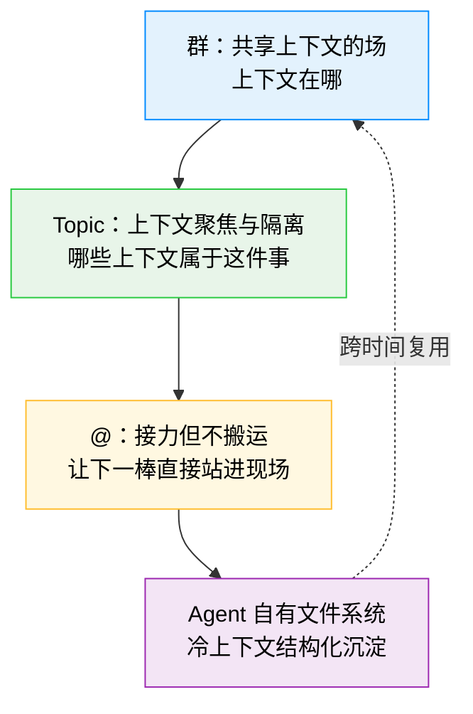
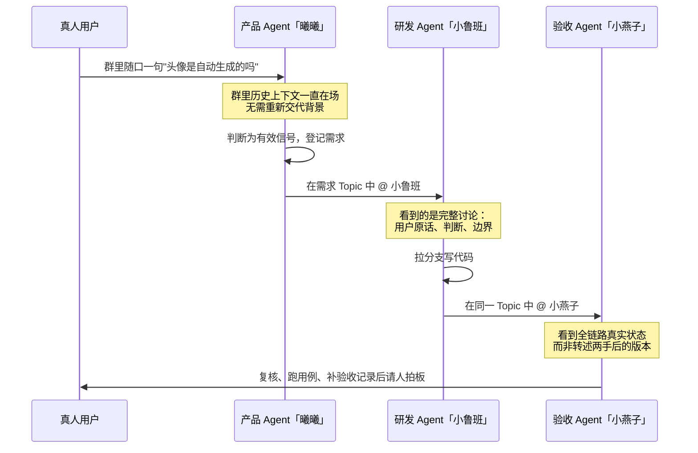

<div style="background-color: #1e1e1e; color: #00ff00; font-family: 'Courier New', Courier, monospace; border-radius: 8px; padding: 20px; box-shadow: 0 10px 30px rgba(0,0,0,0.3); margin-bottom: 30px; margin-top: 20px; position: relative; overflow: hidden;">
    <div style="display: flex; align-items: center; margin-bottom: 15px; padding-bottom: 10px; border-bottom: 1px solid #333;">
        <div style="display: flex; gap: 8px; margin-right: 15px;">
            <div style="width: 12px; height: 12px; border-radius: 50%; background-color: #ff5f56;"></div>
            <div style="width: 12px; height: 12px; border-radius: 50%; background-color: #ffbd2e;"></div>
            <div style="width: 12px; height: 12px; border-radius: 50%; background-color: #27c93f;"></div>
        </div>
        <div style="color: #ccc; font-size: 0.9em;">bash</div>
    </div>
    <div>
        <p style="margin: 5px 0; line-height: 1.6;"><span style="color: #008AFF; font-weight: bold;">ckhuang@macbookpro:~$</span> 你让 Agent 写竞品分析，再转述给同事，同事转述给他自己的 Agent——一条任务链上下文被编码解码四次。Agent 算得再快，也卡在你这个"人肉中继器"上。<span style="display: inline-block; width: 8px; height: 16px; background-color: #00ff00; vertical-align: middle;"></span></p>
    </div>
</div>

在 Agent 落地的工程讨论里，大家习惯性把注意力放在两个地方：模型选型、Tool 编排。但只要你真正跑过多 Agent 协同的场景，就会发现瓶颈几乎从来不在单点能力上——**它卡在"上下文怎么在两个 Agent 之间流动"这件事上**。

腾讯技术工程最近分享的内部工具 **Siboot**，做的正是这件事的重构。它没有去卷"更聪明的 Agent"，而是把矛头指向了协作工具本身：我们过去二十年的 IM、文档、会议，全部是为"人转述给人"设计的。Agent 上桌之后，这套范式的成本被放大了一个量级。

这篇文章把原文的核心脉络梳理清楚，并补上几处工程视角的判断。读完之后你应该能回答三个问题：

1. 为什么多 Agent 协作的损耗是**乘法**而不是加法；
2. "靠共享上下文来通信"这句话在工程上到底意味着什么；
3. 群、Topic、@ 与 Agent 自有文件系统这四个构件，分别堵住了哪一类上下文泄漏。

## 一、被跳过的前提问题：协作在传递什么

我们习惯把协作理解成"发消息"。于是工具演进的方向一直是**让消息更快、更正式、更协同编辑、更有情绪**。

但消息只是载体。真正流动的是**上下文**：你为什么做这个决定、考虑过哪些方案、排除了什么、现在卡在哪、手里有哪些材料、这件事的边界在哪。

说出来的一定比脑子里的少，听的人再解码一遍又少一层。**协作的全部难题，本质是上下文在传递过程中的折损问题。**

人类社会对抗折损的方式很有意思：会议纪要、需求文档、复盘、对齐会、周报——这些动作没有一件在"生产价值"，它们全都在**搬运上下文、对齐上下文、补齐上下文**。

一个每天都在发生的例子：产品与研发开了一小时会敲定方案，散会后产品写需求文档把聊透的东西再落成文字，研发回去跟没参会的组员再同步一遍，测试同学只能等文档出来从头理解。这一小时真正产生的价值，可能就是几个关键决策；为了让它流到每个人脑子里，团队又额外付出了写、开、答疑的成本——**而且每传一手，都会丢一点、变一点形。**

在"人-人"时代这可以忍受：链路短，人有常识、会脑补、能追问。但这个前提已经变了。

## 二、Agent 上桌后，折损开始按乘法叠加

Agent 变强后，最自然的做法是把它塞进熟悉的工作流——能 @、能回消息、像个同事。这一步是对的，人不用搬家，Agent 就能进到上下文生产最密集的地方。但它只解决了"Agent 进场"，没解决"进场之后上下文怎么流动"。

一个几乎人人都经历过的场景：

```text
你的 Agent 写出一版竞品分析
  ↓ 你读完、消化，转述给同事："A 比我们强在 X，我们的机会在 Y"
同事按他的理解，再讲给他手上的 Agent，让它据此出方案
  ↓ 同事的 Agent 产出，同事再读一遍、再转述回给你
```

一圈下来，最初那份分析里的细节——那些 Agent 明明分析到了、你觉得"太细就没提"的部分——**在第二个 Agent 眼里从一开始就不存在。**

一条任务链，上下文被编码-解码了四次，每一次都是一道有损压缩。单人时代折损是加法，**人-人-Agent 时代折损是乘法**：每多一个协作节点就多一层转述，每多一层转述，前面所有损耗都被继承下来，再叠加一层新的。

更糟的是**人被卡在链路中间当中继器**。Agent 算得再快，也要停下来等你把上下文"翻译"给下一棒。你越忙，整条链路越堵。

这才是多 Agent 协作真正的天花板：不是模型不够强，是**上下文的流动方式还停留在"为人转述"设计的旧范式里**。

<div style="text-align: center; font-size: 1.2em; font-style: italic; color: #008AFF; margin: 40px 0 20px; padding: 20px; border-top: 1px dashed #ccc; border-bottom: 1px dashed #ccc;">
    “你越忙，整条链路越堵。你不是在协作，你是在给一群比你算得快的东西当传声筒。” —— CK·黄
</div>

## 三、两条路径：让 Agent 学会转述，还是让大家共享上下文

面对这个问题，行业里分出了两条路。

### 路径一：让 Agent 更像人

教它把工作成果打包成一段漂亮的总结，@ 给下一个人或下一个 Agent，像同事之间发消息一样。

这条路很顺，因为它不改任何人的习惯。但它没触碰问题根部：只要还靠"总结-转述-再理解"，折损就还在，只是把搬运的活从人手里挪到了 Agent 手里。**本质仍然是用通信来共享上下文。**

### 路径二：不靠通信共享上下文，而靠共享上下文来通信

这句话是整件事的转折点。

人为什么必须"说出来"别人才懂？因为人的想法锁在自己脑子里，不说没有第二条通路。但 Agent 不一样：它做过什么、改了哪个文件、生成了什么产物、任务跑到第几步——**这些本来就是可被实时记录、也可被另一个 Agent 直接读取的结构化状态。**

把这些压成一段聊天记录，再让下一个 Agent 从消息里去"猜"人类想表达什么，是一种倒退。**能直接读的东西，不该被重新翻译成人类包装过的语言，再让机器去逆向解码。**

所以真正的解法不是优化转述，而是**消灭转述**：让协作各方站在同一份实时上下文之上。不是把上下文从一个脑子搬到另一个脑子，而是让它从一开始就摆在大家都能看见的地方。

协作不再是"我把我知道的告诉你"，而是"我们看着同一个现场一起干"。

## 四、Siboot 的四个构件：各自堵住一类泄漏

想清楚上面那层，Siboot 的形状就不是产品选型问题，而是被逻辑推出来的必然结果。它做的不是"能调用 Agent 的工作台"，而是一个**让人和 Agent 共享同一个工作现场的空间**。



### 1. 群：共享上下文的"场"

群不是聊天窗口，而是**持续在场的上下文容器**。人说的话、Agent 做的事、产生的文件、跑起来的任务，都沉淀在同一个空间里，对人和 Agent 实时可见。

这意味着新任务抛进来时，群里的 Agent 不需要你重新交代背景。上周的决策、昨天的结论、刚才那份文档，它本来就"在场"。

原文的例子很典型：周五下午用户在项目群随口说"麦林炮手 Agent 那个头像挺带感的，是自动生成的吗？"，产品 Agent「曦曦」看到了——它不需要你讲清楚"我们在做什么产品、这个头像功能归谁、之前讨论过没有"，因为这些上下文它一直在群里看着。它判断这是有价值的信号，顺手登记成一条需求，还带上原始出处。人只做一件事：看一眼登记得对不对。

**你不再需要为每一次协作重新组装上下文。上下文不是被传递进来的，它一直就在这里。**

### 2. Topic：上下文的聚焦与隔离

共享有一个天敌：噪音。一个群什么都往里装，很快变成一锅粥。人会被淹没，Agent 更会——它会把闲聊、跑题、临时插话全当上下文吃进去，然后给你一个被污染的判断。

Topic（话题线程）就是上下文的管理单元：每个议题独立成线，相关的人、Agent、材料收拢在一条线里，与其他议题物理隔离。

一个二十人的项目大群，同一上午可能在并行聊三件事：新版本告警策略、线上 BUG 复盘、下季度规划。全糊在一个消息流里，人得靠翻记录考古；Agent 更惨——你让研发 Agent 跟进那个 BUG，它的上下文窗口里塞满"规划方向"和"告警策略"，判断容易被带偏，Token 也白烧。拆成三条 Topic 后，跟进 BUG 的 Agent 只活在"BUG 复盘"这条线里。

这件事的深层价值不在"界面整洁"，在于**它让上下文变得可界定**：

- **对人**：点进一个 Topic，看到的是这件事的完整脉络，不用在几百条消息里考古。
- **对 Agent**：上下文窗口不被无关信息稀释。**Topic 边界就是 Agent 的注意力边界，也是它的成本边界。**

如果说群解决了"上下文在哪"，Topic 解决了"哪些上下文属于这件事"。**多 Agent 协作能不能不崩，很大程度上取决于你能不能把上下文切干净**——这是最容易被忽略、但最致命的一环。

### 3. @：接力，但不搬运

有了共享的场和干净的焦点，最后一件事是**接力**。在很多产品里，接力等于"打包 + 转述"：我把这段成果总结一下发给你，你再从总结里理解我做了什么——又回到折损的老路。

在 Siboot，接力就是最朴素的一件事：在一条 Topic 里 @ 下一个人或下一个 Agent。**关键不在 @ 这个动作，而在被 @ 的人和 Agent 本来就站在这条 Topic 的完整上下文里。** 你不需要把前因后果打包给它——它一进来看到的就是这件事从头到尾的原始现场，不是你压缩过两道的"结论"。

原文那条完整链路值得复述一遍：



整条链路里，**没有任何一次"把上下文从一个脑子搬到另一个脑子"**。@ 只负责喊下一棒进场，上下文早在 Topic 里等着它。人只在最后出现一次：验收。

群、Topic、@ 三者合起来，是一条**低折损的上下文流水线**：上下文在场（群）→ 上下文聚焦（Topic）→ 上下文接力（@）。这不是三个功能的堆叠，是同一个协作哲学的三个切面。

## 五、还差一维：Agent 得会管自己的文件

前面讲的都是横向的——此刻大家怎么站在同一个现场里一起干。但协作还有一个**纵向**维度：时间。

一条 Topic 讨论完会沉底，一次会话结束热的上下文会慢慢变冷。今天群里吵得热火朝天的决策，三个月后还有没有人记得、Agent 还引不引得出来？如果答案是"忘了"，那所谓共享上下文就只是**一次性**的——用完即焚。

人怎么解决？笔记本、文件夹、Wiki、归档——把流动的对话沉淀成可反复调取的结构化资产。一个靠谱的同事，不只是当下反应快，更是"这事儿他那儿有记录、有沉淀、越干越门儿清"。

这里有个被严重低估的误区：很多人以为 Agent 的记忆问题靠"更大的上下文窗口"就能解决。但把所有历史都塞进去既烧钱又低效，窗口再大也装不下一个团队几个月的全部信息。真正的解法和人一样：**不是把所有东西都记在脑子里，而是分门别类地写下来，需要时精准取回。**

原文作者给产品 Agent「曦曦」设计了一块云盘，结构是这样的：

| 区域 | 职责 | 解决的问题 |
| --- | --- | --- |
| 收件区（inbox） | 群里冒出的新反馈、新想法先暂存 | 信号不散落丢失 |
| 事实与决策记录（notes） | 项目背景、已拍板的决策 | 不再"忘了上次说过什么" |
| 需求与 BUG 独立档案 | 每条需求/BUG 一个文件，带编号、来源、状态 | 从群聊一句话变成可跟踪、可检索、可去重的资产 |
| 分层报告目录 | 日报、周报、月报各自归位 | 时间维度的可回溯 |

更关键的不是"AI 员工有这些文件夹"，而是**它知道怎么维护它们**。原文提到曦曦有一套定时任务：定期醒来拉取群里新消息、判断哪些是有价值的信号、登记成需求或 BUG、更新决策记录、到点写日报。**新登记一条需求前，会先在已有档案里检索一遍，命中相似的就补充进去，而不是建一条重复的。**

这套动作和一个尽职的人类同事整理工作台的方式几乎一模一样。区别只在于：AI 员工不会累，不会忘，也不会因为周五下午犯懒就跳过归档。

放到协作层面看，这一维的价值更清楚：

- **对人**：你不用再当 Agent 的"外置硬盘"，天天提醒它"上次我们定的是这个""那个文档在哪"。
- **对 Agent 之间**：一个 Agent 沉淀下来的结构化档案，是另一个 Agent 可直接读取的上下文源——**又是一次"共享上下文来通信"，只不过这次跨越的是时间。**
- **对团队**：Agent 的文件系统是**白盒、可治理**的。整理得对不对、沉淀了什么、有没有偷懒，人随时能打开看、随时纠正。这跟"黑盒记忆"是两回事——**你能管的记忆，才是能托付的记忆。**

## 六、那人去哪了：位置反而更清楚了

一定有人问：上下文都共享了、Agent 之间自己接力了，人是不是被架空了？恰恰相反。**人从"中继器"里被解放出来，回到了本该在的位置。**

过去人被困在链路中间，大量精力花在搬运、转述、补充解释、对齐同步——这些都是**低价值的胶水劳动**，它们之所以存在，只是因为上下文没法自己流动。

回到那条需求：从"用户群里一句随口的话"到"测试环境 URL 摆在你面前"，人只动了两下——**开头确认这个需求值得做，结尾验收这个功能能不能上。** 中间所有的搬运、转述、同步，都被系统吃掉了。

当上下文能共享、能接力，剩给人的是机器给不了的四件事：

1. **定目标**：这件事到底要解决什么，值不值得做。
2. **做判断**：方案对不对、取舍合不合理、结果能不能接受。
3. **划边界**：什么能做、什么不能碰、红线在哪。
4. **做验收**：最后拍板的那一下，责任落在人身上。

这四件事没有一件是"搬运信息"，全是**判断和责任**——而这恰恰是人区别于工具的地方。

人-人-Agent 协作的理想态，不是人指挥一群机器，也不是机器取代人，而是大家站在同一个共享的工作现场上，各自做自己最该做的事，中间没有传声筒。

## 七、工程视角的补充判断

看完原文，有几处值得从落地角度再往前推一步。

**第一，"共享上下文"的代价被低估了。** 群作为上下文容器非常好用，但它同时也是**上下文膨胀**的入口。Siboot 用 Topic 做了物理隔离，这本质上是一次手动的上下文切分（context partitioning）。在工程上，这意味着 Topic 的划分质量直接决定了 Agent 的表现上限——切得太细，跨议题的关联信息会丢；切得太粗，噪音又会污染判断。这块的自动化（比如让系统根据语义自动建议 Topic 边界）是一个真实存在的开放问题。

**第二，Token 成本是这套架构的隐性 KPI。** 原文那句"Topic 边界就是成本边界"说得很实在。多 Agent 协作最常见的翻车方式不是效果差，而是账单失控——每个 Agent 都读一遍全量上下文，成本随节点数量线性甚至超线性增长。设计时必须把"每个 Agent 该看到多少上下文"当成一个显式的资源预算来分配。

**第三，白盒文件系统是这套方案最容易被忽视、但最有工程价值的部分。** 黑盒记忆（向量库、隐式记忆）最大的问题是不可审计——出了错你不知道它记了什么、为什么这么判断。而"文件 + 目录 + 定时整理"这套东西，朴素得不像 AI 方案，却恰好满足了生产环境最硬的要求：**可看、可改、可回滚、可 diff。**

**第四，也是最需要注意的边界：** 原文自己也坦诚，很多地方还在摸——哪些交给 Agent、哪些必须人拍板，边界依然是模糊地带。我的经验是，随着 Agent 可靠性提升，这条边界会持续向 Agent 一侧移动，但"验收"这一环不会轻易让渡，因为它的本质是**责任归属**而非能力问题。

## 八、结语

这些年 AI 产品的能力曲线很陡：从单点问答，到 Agent 执行，到多 Agent 协作。大家都在卷模型、卷工具、卷 Agent 数量。

但越往下做越会确信一件事：**当每个 Agent 都足够强之后，胜负手不在单个 Agent 有多能干，而在这些 Agent 和人之间，上下文能不能低折损地流动起来。**

模型决定了每个节点有多强，**上下文管理决定了整个网络能不能协同**。前者是算力问题，后者是产品问题——也是 Siboot 选择死磕的地方。

协作的本质，从第一天起就是共享上下文。只是在人的时代，我们用转述凑合了几千年；到了人-人-Agent 的时代，凑合不下去了。

群是场，Topic 是焦点，@ 是接力，文件是记性。前三件让上下文在此刻低折损地流动，最后一件让它跨越时间沉淀下来——横向共享，纵向沉淀，一个协作网络才算真正立起来。

<div style="text-align: center; font-size: 1.2em; font-style: italic; color: #008AFF; margin: 40px 0 20px; padding: 20px; border-top: 1px dashed #ccc; border-bottom: 1px dashed #ccc;">
    “别再让人给 Agent 当传声筒。让大家看着同一个现场一起干；让每一次协作，都变成明天还取得回来的沉淀。” —— CK·黄
</div>
