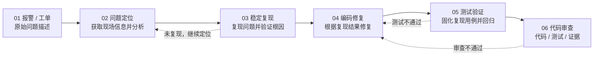
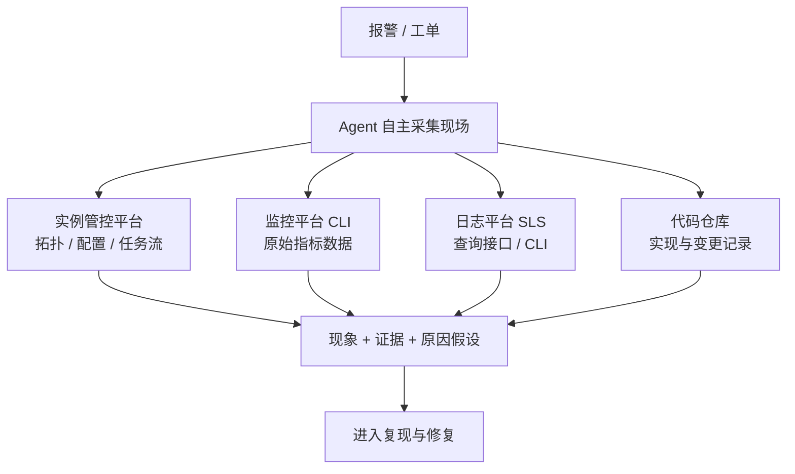
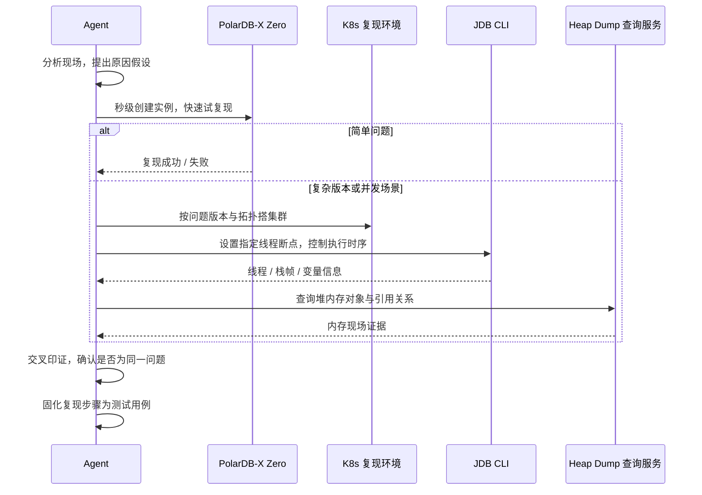
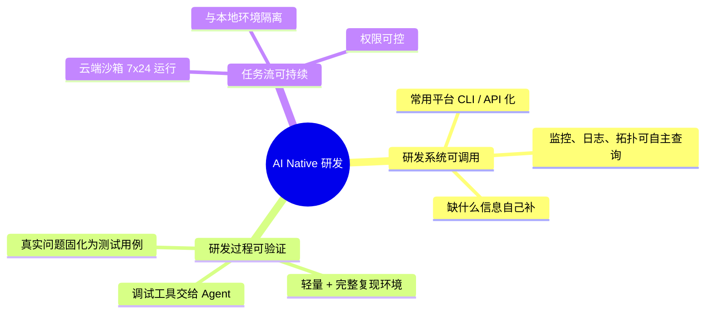

    

        

            

            

            

        

        
bash

    

    

        
ckhuang@macbookpro:~$ 真正花时间的从来不是那两行代码，而是"问题到底出在哪"——而这一步，恰恰是最不该交给静态分析的。

    

年初修过一个印象很深的 Bug：最后的改动只有两行，但查日志、看监控、分析原因花了整整一天。为了复现，只能在会议间隙反复调试，前后断断续续拖了近一周，之后还要补测试、跟评审、等合码。

这两年 AI 写代码已经很熟练了，可如果只让它写那两行，其实省下的时间非常有限。真正的时间黑洞在**前面**：从一条报警或工单出发，搞清现场、定位原因、稳定复现、验证结论。

PolarDB-X 团队把这套流程整体交给了 Agent。这篇文章基于阿里云开源的 *Alibaba Cloud AI Agent Handbook* 实践篇章，拆解他们是怎么做的，以及其中哪些判断值得其他团队直接借鉴。

先给结论：**这条路能跑通，靠的不是更强的模型，而是把研发系统改造成 Agent 可调用、研发过程改造成可验证、任务流改造成可持续的形态。**

---

## 一、先分清任务：什么该让 Agent 自主，什么不该

PolarDB-X 是分布式数据库，承载大量用户业务，正确性和可靠性要求极高；系统本身又多组件、多模块、多版本并存，一处修改可能波及别处。这种场景下讨论"让 Agent 参与研发"，第一步不是选模型，而是**分类**。

他们把研发任务分成两类，用完全不同的协作方式：

| 任务类型 | 典型场景 | 特点 | 协作方式 |
| --- | --- | --- | --- |
| **新功能 / 迭代优化** | 优化分布式事务、实现新的数据压缩能力 | 目标清晰，但实现细节需要持续判断；开发与验证周期长 | **研发主导**方案设计与关键决策，Agent 协助编码和测试 |
| **缺陷修复 / 工单报警** | 线上报警、工单、缺陷修复 | 问题相对明确，改动通常较小，结果可通过测试验证 | **Agent 自主迭代**，研发负责审核交付结果 |

这个划分非常关键，但很多团队容易忽略：**Agent 的自主程度，应该由"结果可验证性"决定，而不是由"模型有多强"决定。**

新功能开发之所以不能放手，不是因为 Agent 不会写，而是因为"做对了没有"缺少客观判据——需求本身在开发过程中还在变，方案取舍依赖对业务的长期理解。而缺陷修复天然带有验证信号：复现了没有、测试过了没有、原问题还在不在。有验证信号，才谈得上自主闭环。

    “Agent 能自主到什么程度，取决于这条任务链上有多少个可自动判定的验证点。” —— CK·黄

---

## 二、端到端修复流程：六步，三个门槛

围绕缺陷修复，他们建了一条完整的链路：Agent 接到报警或工单后，先获取现场信息、分析可能原因，再准备环境尝试复现、验证自己的判断；等问题能稳定复现之后，才修改代码，并把复现过程固化成测试用例；回归通过后，再把代码和验证结果交给研发审查。

流程看起来顺理成章，真正有信息量的是他们设的**三个关键门槛**：

1. **现场信息要完整**：报警只说现象，不足以形成修复需求，必须补齐时间线、日志、指标、变更记录；
2. **问题要能稳定复现**：没有复现，就无法确认分析结论是否正确；
3. **修复结果必须经过测试验证**：测试通过不等于问题解决，得先证明用例真的触发过原问题。

这里有个反直觉的判断值得展开。谈到 Agent 产出可靠性，多数人的第一反应是"怎么保证它写的代码正确"，于是去做各种 Skills 和编码约束。但在缺陷修复里，**稳定复现才是最重要的那一步**。

原因很简单：分析错了，代码写得再规范也没用——它解决的可能根本不是那个问题。复现是把"猜测"变成"事实"的唯一手段。这也是为什么后面大量的工程投入，都砸在了工具和环境上，而不是砸在提示词上。

---

## 三、现场还原：让研发系统先"可被调用"

报警和工单通常只记录了现象。早期这些补充信息全靠研发：看监控、查日志、结合源码分析，确认是缺陷后才整理成修复需求交给 Agent。

后来他们试着把收集到的现场信息直接给 Agent，让它自己分析——结果发现它往往做得比人更好：时间线梳理得更清楚，擅长从海量日志里检索，还能注意到人工排查时漏掉的关键线索。

于是更进一步：**让 Agent 直接接收报警和工单，自己收集信息。** 它按分析需要查询实例管控平台的拓扑、配置和任务流，查看监控指标和日志，再结合代码仓库中的实现和变更继续分析。

举个例子：一条 SQL 执行报错，Agent 根据报警里的实例 ID 和报错信息，到日志系统找到对应堆栈，再结合源码分析原因，最终整理出问题现象、现场证据和原因假设。

这一切的前提是：**Agent 必须能自主获取这些系统的数据。**

监控平台是个典型细节。以前的做法是把监控截图发给 AI 帮忙看——曲线方便人眼观察趋势，但 Agent 需要的是能按需查询、解析和比较的**原始结构化数据**。阿里云提供了官方 CLI，Agent 可以用命令查询指定时间范围、指定节点的监控数据；日志则先汇聚到 SLS 这类日志平台，再通过查询接口或 CLI 暴露给 Agent。

> 分析过程中缺什么信息，Agent 就自己去查，而不是等研发补充材料。这一点决定了闭环能不能真正跑起来。

对于那些缺少维护、没人提供 Agent 友好工具的存量平台怎么办？他们给了一个很接地气的例子：公司内部有个很受欢迎的"抢会议室"CLI，一条命令就能订会议室，还能让 Agent 设定时任务到点自动抢。后来发现作者只是一个普通研发同学，**手里并没有会议室平台的源码**。

启发很直接：**常用平台上的能力，可以由我们自己封装成 CLI。** 具体做法是让 Agent 参考已有 CLI 的实现和认证方式，操作网页、分析背后的接口请求，再把需要的功能封装出来。他们大约花了一周，就把监控指标、日志、实例拓扑等常用功能集成进了一套 CLI。

这一段是我认为全文最值得抄的工程细节。很多团队做 Agent 时反复卡在"数据拿不到"，然后寄希望于模型能"理解截图"。但真正的解法是补基础设施：**把系统从"面向人的界面"改造成"面向 Agent 的接口"。** 这不是 AI 团队能独立完成的事，它本质上是一次研发平台的接口改造。

---

## 四、分析不等于事实：让 Agent 自己动手验证

接下来这个故事，几乎每个做过线上排障的人都似曾相识。

他们遇到过一个**低概率并发问题**，在线上存在了很长时间，因触发概率低、极难复现，一直没查清原因。Agent 拿到现场信息后，几分钟就给出了一份分析报告：代码位置、执行过程、可能出问题的地方，写得完整、专业、很有说服力。

团队花了两小时验证，结论不成立。

把结果反馈给它，它很快给出新版分析——还是不对。来回几次，报告攒了一堆，问题依然没搞清楚。文章里那张"被实际验证全部推翻的分析报告列表"，大概是所有 Agent 落地团队都该打印出来贴在墙上的图。

根因不在模型推理能力，而在**手段缺失**：当时的 Agent 只能做静态代码分析，没有断点调试、没法控制线程执行时序、看不到内存现场。给出的解释和真实运行情况对不上，也无法独立完成验证。

于是他们补了两类工具。

### 4.1 把调试能力做成 Agent 友好的 CLI

核心组件用 Java 编写，第一反应是 JDK 自带的 JDB。但 JDB 是为人设计的：需要在终端持续交互。Agent 使用时得维护一个交互进程，再通过进程通信发命令、读输出，非常别扭。

于是他们基于 Java 调试接口（JDI）重新实现了 JDB CLI，几个设计点很关键：

- **会话管理**：后台持续保留调试进程和现场，前台每条命令执行完即可退出，下次调用接着操作同一个会话；
- **结构化返回**：结果以结构化形式返回，Agent 可解析、可检查，也能等待断点命中后获取相关线程、栈帧和变量信息；
- **指定线程断点**：只让目标线程触发断点，命中后也只暂停这个线程，其他线程继续运行；配合恢复操作，就能控制相关线程按特定时序交替执行。

最后这条能力，正是复现那个低概率并发问题的钥匙。

### 4.2 把 Heap Dump 变成可查询的证据

除了调试运行中的程序，还要能检查锁泄漏时的内存现场。Java 堆内存快照（Heap Dump）能查看对象字段值、引用关系和内存占用，但文件通常极大。

他们的做法是：把文件放到大内存云服务器上集中加载处理，专门为 Agent 提供查询接口。Agent 通过接口查所需数据，根据结果继续分析，不必在本地处理整个大文件。分析完成后，还能把分析记录和最终报告上传平台，方便研发查阅。

**内存现场由此从"人肉分析的素材"变成了"Agent 可直接检查和引用的证据"。**

---

## 五、复现环境：轻量验证与完整还原，两条路

有了工具，还得有能跑起来的环境。他们提供两种选择：

| 环境类型 | 定位 | 能力 |
| --- | --- | --- |
| **PolarDB-X Zero**（轻量） | 秒级创建临时实例，快速验证简单问题 | SQL / DDL 与功能级验证；固定版本，可观察新版本是否仍有问题；用完立即释放 |
| **K8s 完整集群** | 承载复杂版本、拓扑与并发场景 | 部署任意版本或修改后代码；版本、拓扑、运行配置可控；适合并发、事务等复杂问题排查 |

Agent 的复现路径也随之分成两条：简单问题先在 Zero 里快速试，几秒建实例、验证完立刻释放；需要特定历史版本、特定拓扑或复杂并发场景时，就到 K8s 里按问题实例的版本和拓扑搭集群，再配合调试工具复现。修复完成后，还能把改后的版本部署进去，用同样的方法检验问题是否真的解决。

回到那个并发问题：有了工具和环境，Agent 开始自己尝试复现，并根据实际运行结果迭代分析和调试。几轮之后，它找到了关键触发条件，复现出与原问题相同的 **MDL 锁泄漏**现场。

关键在于，它通过调试工具让两个线程按特定时序交替执行，**把原本极难碰到的偶发问题主动构造了出来**；调试结果还能与内存现场相互印证，确认复现的是同一个问题。

到这里，手上有根因分析、有可重复执行的操作步骤、还观察到这些步骤确实触发了原问题——分析结论第一次有了实际运行的证据支撑。

---

## 六、交付门槛：复现用例必须"双向"通过

这是整套实践中我觉得最硬核的一条设计。

他们把**稳定复现用例设为进入代码评审的一道关键门禁**。注意：Agent 补了测试、测试跑通了，**不足以**说明原问题已解决。首先得确认用例确实触发过那个问题。

于是规则变成一组对照验证：

- 同一个用例，在**修复前**的版本上必须能稳定复现原问题；
- 在**修复后**的版本上必须验证问题不再出现；
- 完成这组对照，并通过完整回归测试，代码才能进入评审。

Agent 提交合并请求时，会一并交付代码、用例和验证结果。研发的审查顺序也被改变了：**先看有没有对应的复现用例，再对照最初的问题描述确认用例复现的确实是原问题，然后才看代码改动。**

这个顺序值得所有做 AI 代码生成的团队参考。传统评审的默认假设是"人要理解全部改动"，所以从 diff 开始看。而 Agent 提交的变更，评审者真正需要的是**信任锚点**——复现用例就是那个锚点。它把"你信不信这段代码"变成了"你能不能验证这个用例"，评审成本大幅下降。

那个低概率并发问题，最终也由 Agent 完成修复并通过了验证。

---

## 七、从演示到日常：把流程搬到云端

要让这套流程承担日常工作，还需要一个持续运行的环境。

早期他们把它跑在笔记本上，结果屏幕一合，整个流程就断了。这个细节非常真实——**Demo 和生产的差距，往往就是"电脑会不会合盖"。**

于是他们基于云端沙箱构建了 PolarDB-X Agent，让流程 7×24 小时持续运行。沙箱还带来两个额外好处：与本地开发环境隔离，执行任务不影响研发电脑；可以限制沙箱内工具的访问和操作权限，让执行过程更安全可控。

实际运行数据：

- 所有报警都会先由 Agent 完成首轮分析和处理，**首轮覆盖率 100%**；
- 半年内，从上万次报警处理中识别并记录了 **200 多个缺陷**；
- 其中**超过 70%** 的缺陷能够稳定复现，并由 Agent 完成修复后进入代码评审。

对研发来说，原来要花大量时间排查、复现、修复的问题，现在可以先由 Agent 处理，再把问题描述、代码修改和验证结果交给研发审查。人的角色从"执行者"转向"审核者"。

> 注意 70% 这个数字的含义：它不是"Agent 修好了 70% 的报警"，而是"200 多个真实缺陷里有 70% 能被稳定复现并修复"。**剩下 30% 卡住的，大概率还是卡在复现上**——这也再次印证了稳定复现才是这条链路的核心瓶颈。

---

## 八、三条工程启发

**第一，让研发系统可以被 Agent 调用。** 从团队常用系统入手，配上 CLI 工具或开放 API，让 Agent 能自主获取信息、操作这些系统；分析过程中缺少材料时，它可以自己补齐。

**第二，让研发过程可以验证。** 给 Agent 提供调试工具和运行环境，让它自己复现问题、检验分析结果。只有实际运行的反馈，才能帮它发现错误、调整分析，并继续完成修复。

**第三，让任务流能够持续运行。** 把流程放到云端，让 Agent 持续执行任务，不再依赖研发的本地电脑。

对其他团队，他们的建议也很务实：先选一个**目标明确、结果可验证**的任务，为 Agent 准备好所需的工具和环境，把流程跑起来，再根据实际遇到的问题逐步完善。

---

    

        

            

            

            

        

        
bash

    

    

        
ckhuang@macbookpro:~$ 别急着给 Agent 换更强的模型，先问问自己：它缺的那份数据，有没有一条 CLI 能拿到？

    

回头看这套实践，它真正解决的问题不是"AI 会不会写代码"，而是**把一段高度依赖个人经验的排障工作，拆成了可调用、可验证、可交付的工程流水线**。

如果要我提炼一句给正在做 Agent 落地的团队：先别做万能助手，去找一条有明确验证信号的任务链，把它的输入接口、验证手段、运行环境三件事补齐。补齐之后你会发现，限制 Agent 的从来不是智力，而是它伸手够不够得着证据。

---

*本文基于开源项目 [Alibaba Cloud AI Agent Handbook](https://github.com/aliyun/ai-agent-handbook) 实践篇章整理与解读。*
