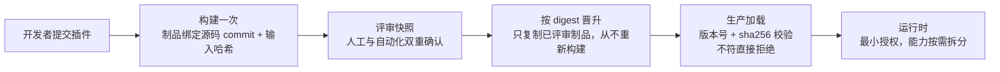
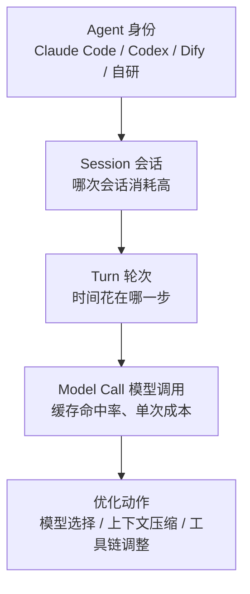
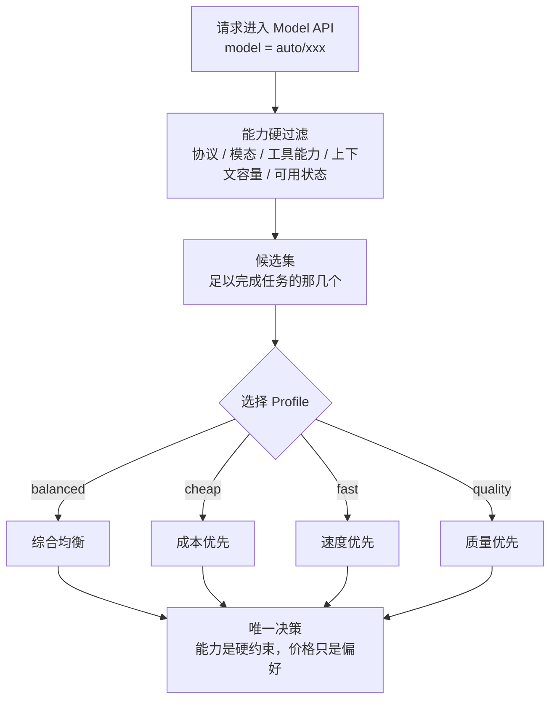

    

        

            

            

            

        

        
bash

    

    

        
ckhuang@macbookpro:~$ 你为了统一 API Key、做限流计量，架了个 LLM 代理，顺手把它丢进生产集群、挂上云角色、开着公网出口。恭喜，你用一份 yaml，造出了整个系统里信任密度最高的单点。

    

做大模型应用的团队，过去一年的演进路径几乎一模一样：

先是只接一个模型，跑通就行；后来多接几家，为了比价、兜底、跑不同模态；接着问题来了——各家 Key 散落在每个服务里，限流各写一套，账单对不上，于是架一个 **LLM 代理**做统一入口；等模型越接越多，又冒出最后一个问题：**这次请求到底该交给哪个模型？**

这条路上有三笔账，绝大多数团队是事后才发现的：

1. **安全事故的代价**——代理被投毒后能带走什么；
2. **自建自维护的投入**——镜像、版本、漏洞、容量，谁来值守；
3. **散落在应用代码里的模型选择逻辑**——模型一换、价格一变，就得发版。

有意思的是，这三笔账在 LiteLLM 2026 年的经历里全部能找到注脚。这篇把原文脉络梳理清楚，并补几处工程视角的判断。读完你应该能回答三个问题：**为什么统一入口天然是攻击面、爆炸半径由什么决定、以及"选模型"这件事该被放在哪一层。**

## 一、先把演进路径摊开：你可能已经站在了错的位置

我们回头看这条演进链，会发现一个被忽略的事实：**LLM 代理不是一根管道，它是凭据的汇集点。**

它的职责天然要求它持有全部上游厂商的 Key（否则无法代你转发）、要求它跑在生产集群里（否则接不了业务）、要求它能出公网（否则调不到模型）。这三个"必须"，恰好是攻击者最想要的三件套。

做过 API Gateway 或 BFF 的同学对这个味道不陌生：**越靠近边界的组件，越早接触到不可信输入；而越集中的能力，一旦被拿下，损失越不可分割。** 网关时代我们用 WAF、用最小权限、用插件沙箱来压这个面；到了 LLM 代理这里，很多人却把它当成了一个"内部工具"，直接 `pip install` 装上生产，容器里还挂着云厂商的实例角色。

这就是第一笔账的起点。

## 二、第一笔账：半年两次投毒，和一串 CRITICAL

LiteLLM 是周下载量约 **2300 万**的开源 LLM 代理。2026 年 3 月和 10 月，它两度遭遇**供应链投毒**，两次的手法还不一样：

- **3 月**：攻击者通过被污染的 CI 拿到了发布 Token，直接以官方身份发版；
- **10 月**：攻击者用盗来的开发者 OAuth Token 篡改发布工作流，从**仿冒仓库**构建。这次最值得警惕——**源码是干净的，有毒的只有构建产物**，而且发布审批还被"正常"通过了。

恶意代码的落地方式也很讲究：它利用 Python 的 `.pth` 启动钩子。这里值得展开一句，因为很多同学对 Python 的加载机制没这么细的认知：

> `site` 模块在解释器启动时会扫描 `site-packages` 下的 `.pth` 文件，**凡是 `import ` 开头的行会被直接 `exec`**。也就是说，只要文件被装进环境，进程一起来就执行了——**不需要任何业务代码 `import litellm`**。

执行之后干什么？查询代理自己的数据库，把组织里所有上游模型厂商的 API Key 导出去。

我必须说，这一招选得极其精准。它没有去攻击业务应用，而是**直取代理的价值核心**：代理必须明文持有所有厂商 Key 才能工作，它天生就是一把万能钥匙。你花了三个月做的 Key 统一管理，在对方面前变成了一次 SQL 查询。

漏洞层面同样密集，而且严重度不低：

- **CVE-2026-42208**：预认证 SQL 注入，CVSS **9.8**，公告发出 **36 小时**即出现在野利用；
- **CVE-2026-42271**：MCP 测试端点命令执行，已进入 **CISA KEV**（已知被利用漏洞目录）；
- **CVE-2026-59822**：MCP 认证绕过；
- **CVE-2026-47101**：虚拟 Key 提权。

单看每一起，都能归因成"某个账号被盗"或"某段代码没写好"。但放在一起看，就是结构性问题了。原文的拆解我认为非常到位，代理天然具备三个特征：

| 特征 | 具体表现 | 能不能回避 |
| --- | --- | --- |
| **钥匙集中** | 所有厂商的 Key 汇总在一处 | 不能，这是它存在的理由 |
| **位置敏感** | 跑在生产集群、带着云角色、必须能出公网 | 不能，这是它的部署前提 |
| **扩展即进程** | Python 依赖、回调与代理同权限，进程能读的文件、环境变量、网络它都能用 | **能，这取决于架构** |

前两条由业务需求决定，绕不开。所以真正的问题不是"会不会出事"，而是——**出事之后，恶意代码究竟能带走什么。** 这就是爆炸半径。

    “单点故障可以用冗余解决，单点信任不能。信任一旦集中，就必须用架构去限制它被滥用时的破坏力。” —— CK·黄

## 三、第二笔账：爆炸半径由架构决定，不由代码质量决定

原文举的对照物是阿里云 AI 网关（与开源 Higress 同源）。它的数据面基于 **Envoy（C++）**，AI 代理、鉴权、限流、内容安全等扩展能力以 **Wasm 插件**运行在内嵌虚拟机里。

真正的分水岭只有一句话：

> **Python 依赖默认拥有进程的全部权限；Wasm 插件默认只有宿主明确开放的那几项能力。**

把 10 月那次投毒的恶意动作逐条放进沙箱推演，会看到一张很干净的对照表：

| 恶意动作 | Python 系代理（进程权限） | Wasm 插件（默认无权限） |
| --- | --- | --- |
| 启动即执行 | `.pth` 钩子，装上就跑 | 不存在该机制，插件**只有被显式引用才加载** |
| 读云凭证 / SSH 私钥 / K8s Token | 能 | **没有文件系统**，一个字节都读不到 |
| 窃取配置 | 能读环境变量 | **环境变量默认不可见** |
| POST 到仿冒域名外发数据 | 直接出网 | **不支持 socket**，只能经 Envoy 转发到已注册服务 |
| 起子进程 / 读其他插件内存 | 能 | 进程与内存隔离，做不到 |

注意最后一行和有界性：这不是"我们加了几个检查"，而是**能力在物理上不可达**。安全设计里最可靠的一类，永远是"做不到"，而不是"我们拦住了"。

沙箱之外还有三项配套机制，这三项才是让"架构安全"落地的关键：

- **加载校验**：插件按"版本号 + sha256"锁定加载，校验和不符直接拒绝；能力拆分、最小授权。
- **密钥托管**：企业版 API Key 由 **KMS 加密托管**，配置里只留加密引用，不以明文出现在文件、环境变量或日志中。这一条直接把"导出 Key"这条链路的收益打到接近零。
- **不可变发布**：构建一次、评审快照、按 digest 晋升。制品绑定源码 commit 和输入哈希，正式发布只复制已评审的制品，**从不重新构建**；公共标签不可变，digest 不一致直接失败。

这里我想多说一句自己的判断。10 月那次"源码干净、产物有毒、审批通过"的攻击，本质上击穿的是**"源码可信 ⇒ 制品可信"这个默认假设**。这个假设在软件工程里早就被证伪了，业界对它的解法是制品来源证明（provenance）加不可变晋升——你评审的是什么，发布就必须是什么，中间不允许再"构建一次"。原文这套"构建一次 + digest 晋升 + 标签不可变"，和这条思路是一致的，而且它把"人可能审错"这个变量也考虑进去了：**审批的对象是快照，不是分支。**

当然，用 Wasm 换安全是有代价的：能力靠宿主 ABI 暴露，需要本地文件、长连接、非 HTTP 协议的场景就要提前评估。但从"LLM 代理"这个组件的实际职责看，它的输入输出高度收敛在 HTTP + JSON 上，这笔交易非常划算。

## 四、第三笔账：运维纪律，能不能被平台承载

架构安全是底子，但自建网关的安全最终还是要落到运维纪律上：镜像从哪拉、版本锁没锁、漏洞多快跟进、高峰容量留多少。

这里有个特别值得玩味的细节：**LiteLLM 官方提到，使用其私有企业镜像仓库的客户没有受到 10 月投毒影响。** 同一个漏洞窗口，同样的代码，结果不同——差别不在技术，在"有没有人把纪律执行下去"。

托管的价值就在这：**把纪律交给专业团队持续执行。** 阿里云 AI 网关 Serverless 的做法是把这个门槛压到最低：

- **标准版 0 元起步**，无实例费、按实际用量计费，适合试用和低流量业务；
- **企业版**面向正式生产：独立入口、自定义域名、**99.95% SLA**，实例费参考价 **0.245 元/小时**；
- **引擎由平台构建、发布和升级**；自定义插件在 WebIDE 开发、**VPC 集群内构建，全程不经公网**；
- 一键对接 **WAF** 与 **AI 安全围栏**，拦截注入攻击、识别提示词注入与敏感内容。

性能也有实测支撑（同一压测条件下，对比开源自建）：

| 场景 | Serverless 企业版时延表现 |
| --- | --- |
| 1 MB 请求 | 网关处理时延低 **68.8% ～ 97.1%** |
| 10 MB 大报文 | 低 **82.7% ～ 90.2%** |
| 中小规模综合费用 | 降 **70% ～ 90%** |

我一直觉得这笔账最容易被漏算的是"人"。镜像同步、版本锁定、CVE 跟进、容量水位，每一项都不是一次性工作，而是每周都在发生的值守成本。**自建省下的是订阅费，付出的是安全债和运维人力**——而安全债的利息，往往在一个平常的周二凌晨到期。

## 五、从"能跑"到"敢上生产"：Fallback 与会话观测

安全和成本解决的是可用性问题。真正上生产还要答两道题：**模型抖动时业务怎么不断、Token 花在哪能不能说清。**

### 1. AI Fallback：主模型限流，业务不中断

模型服务限速、抖动是常态。网关侧开启 Fallback 后，**主模型返回 4xx/5xx、或流式首包超时**，网关就自动切换到你预配置的备用模型，应用侧无感知。

一个 Model API 可以配**多级备用链路**，逐级降级。备用模型、顺序、超时阈值都是控制台上的一次配置变更——不用每个应用各写一套重试逻辑，也不用为了改一个兜底策略发一次版。

我补一条工程提醒：**兜底是"掩盖故障"的机制，它必须和观测成对出现。** 备用模型顶上之后，业务表面绿灯，但你的主力模型可能已经在地板上躺了两小时。Fallback 率如果没人看，兜底就会变成"把问题藏起来"。

### 2. Agent 管理与 FinOps 会话观测：把每一分 Token 对应到任务

企业里的 Agent 越来越多——Claude Code、Codex、百炼、Dify、自研应用——最终可能共用同一个 Model API。这时接口维度的汇总数据只能回答"用了多少"，说不清**来自哪个 Agent、哪项任务、哪一轮**。

AI 网关的做法是给每个 Agent 建立统一身份，一张拓扑图看清"谁在访问它、它访问哪些模型"；用量按 Agent 维度聚合请求数、Token、错误率、Fallback 率和 P95 延迟，并给出每日智能洞察。

往下还能按三层下钻：

从"哪次会话贵"，到"时间花在哪一步"，再到"缓存命中多少"，逐条可查。**优化模型选择、压缩上下文、调整工具调用流程，从"凭感觉"变成"看数据"。**

这件事在 Agent 时代真正难的地方，是**成本归因本身**：多个 Agent 共享一个 Model API，接口层的总量是所有租户的加总，没有身份与会话维度就永远拆不开。归因做不出来，FinOps 就只能靠吼。

## 六、第三笔账的真解法：把"选模型"从应用代码里拿出去

当入口安全、运行稳定与成本透明都就位了，问题才回到开头那个：**每次请求该给哪个模型。**

常见做法各有各的痛：

- **全丢给旗舰模型**：成本和限流压力一路涨，简单任务也按最贵的价格付费；
- **在应用代码里手写选择逻辑**：模型一换、价格一变，就得发版；逻辑散落在 N 个服务里，没人能说清全局策略；
- **每次请求都重新判断**：Agent 工具链会"中途换脑"，缓存失效、时延徒增。

阿里云 AI 网关把"选模型"收进智能路由，思路我概括成八个字：**先满足任务，再优化偏好。**

两个细节值得点出来：

**第一，候选集来自 ModelCard 结构化元数据，而不是靠模型名猜。** 这是把"哪个模型能干这活"变成事实查询，而不是一张容易过期的对照表。

**第二，Agent 时代，知道什么时候"不重选"同样重要。** 上下文保持机制（ContextHold）按对话节奏决定何时换模型：同一轮任务里的连续工具调用不换；用户发来新消息才重新判断；上下文压缩后原选择仍适用就保持。实测一次 40 次请求的编码任务，**35 次（87.5%）直接沿用已有选择**——既保住 KV Cache 的上下文亲和，又免去每次工具往返重走路由的时延。

### 换模型会不会把缓存省的钱赔回去？

这是我最喜欢原文里的那段算账，因为它把一个容易被拍脑袋否定的事算清楚了：

1. **缓存损失只发生在切换后的第一次请求。** 一轮调用 n 次，只有 1 次未命中，所以**整轮命中率下降不超过 1/n**。
2. **往便宜模型切时，旧上下文全价重处理往往比贵模型读缓存还便宜。** 10 万 token 前缀这个量级：旗舰模型读缓存约 **0.10 美元**，经济模型全价重处理约 **0.019 美元**。
3. 对照实验中，混合路由相比全程旗舰**省下 91% ～ 92%**，而且这还是**经济模型缓存命中为 0** 的最保守情况。
4. 反推一下：**旗舰模型要降价约 95% 才能打平**——因为便宜模型的账单大头在**输出**，而缓存只给**输入**打折。

第 3、4 点尤其值得记：很多人对"缓存亲和"的直觉来自输入侧，而 Agent 场景的成本重心偏偏在输出。**你为了省输入缓存而放弃的省钱空间，比你以为的大一个数量级。**

### 接入成本

不需要新 SDK：控制台把 Model API 的后端场景设为"智能路由"，配置候选模型（最多 5 个自定义候选，也可开启平台内置的经济/标准/旗舰档位），调用侧把 `model` 改成 `auto/balanced`、`auto/cheap`、`auto/fast` 或 `auto/quality` 即可。**继续填具体模型名的请求完全旁路，原有行为不变**——这点对灰度很重要。路由状态只保存有界任务摘要，不持久化完整 Prompt 和凭据。

## 七、结语：入口架构应该一次做对

回看 LiteLLM 的 2026 年，攻击者集中瞄准 LLM 代理，根源是**这个架构位置本身的吸引力**，和代码工程质量关系不大。这类结构性风险很难靠补丁一个个消掉，治理手段必须落在架构层：

- **默认无权限的 Wasm 沙箱**，限定恶意代码进入系统后的行动边界；
- **不可变发布链路**，把它拦截在制品进入生产之前；
- **运维纪律交由托管平台**持续执行；
- 在此之上，**Fallback 与会话观测**保障连续性与透明度，**智能路由**把省下来的成本留在业务侧。

如果把这篇文章压缩成给团队的五条行动项，我会这么写：

1. **盘点你的代理站在哪**：它是不是跑在生产集群、挂着云角色、开着公网出口？
2. **盘点它持有多少凭据**：Key 是否明文存在于文件、环境变量或日志里？
3. **评估扩展的执行边界**：你的插件/回调，和代理是不是同一个权限域？
4. **锁死制品**：版本 + 校验和、按 digest 晋升、公共标签不可变。
5. **别把"选模型"写进业务代码**：它是一项入口级策略，不是每个服务各写一遍的 if-else。

    “架构不是把功能拼起来，而是在一开始就决定好：出事的那一天，损失到哪儿为止。” —— CK·黄

> 本文基于阿里云云原生团队《LLM 代理的三笔隐性账单：安全事故、运维投入与模型选择》整理与延伸，原文作者：邵丹（营火）。
