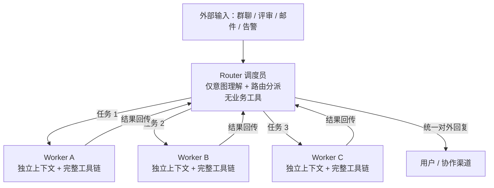
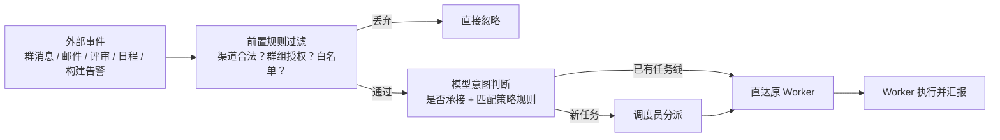
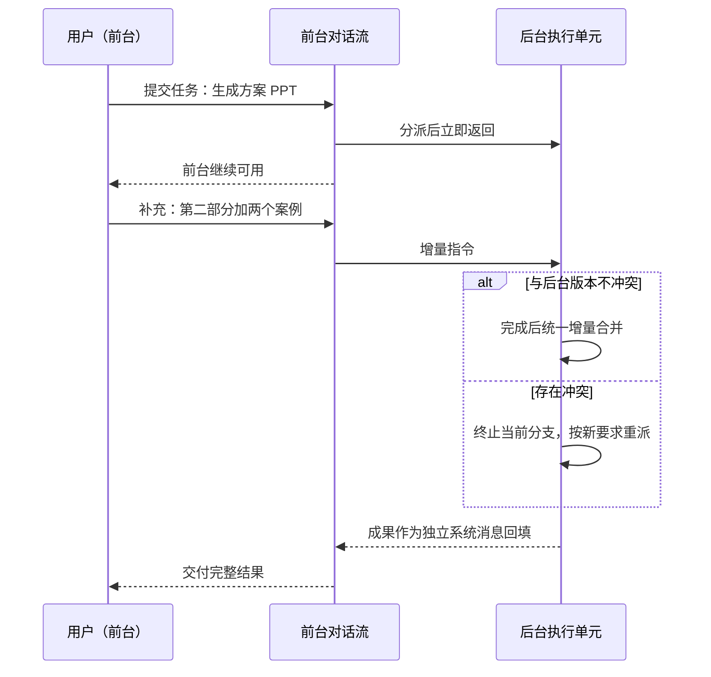
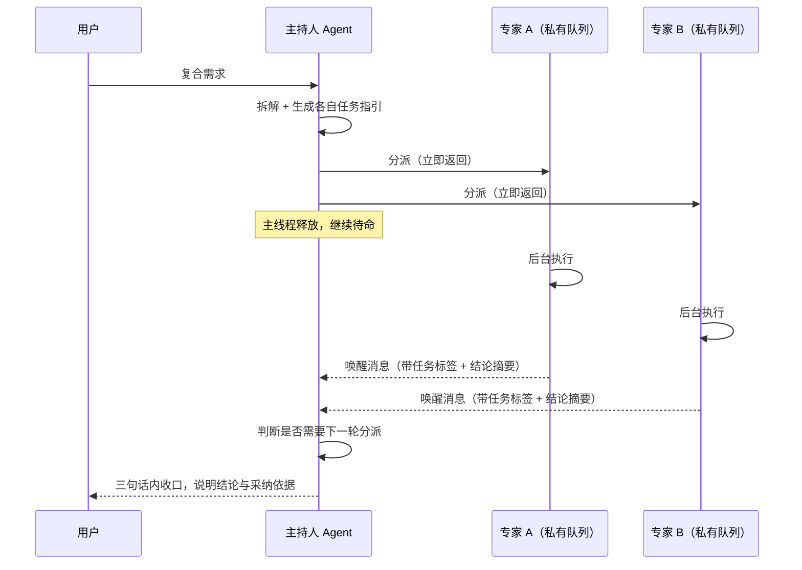

    

        

            

            

            

        

        
bash

    

    

        
ckhuang@macbookpro:~$ 你的浏览器开了 11 个标签页，每个标签页里都有一个跑到一半的任务，而你还在靠脑子记"第三页的数据是在哪个窗口生成的"。这不是模型不够聪明，是你一个人硬扛了一套本该由调度系统承担的状态管理。

    

前段时间 DeepSeek 发了一篇长文，系统讲了他们对 Super-agent 的设想：AI 不该被锁在"一次只干一件事"的窗口里，而应该是"调度员 + 执行单元"的双层结构，长任务转后台、前台继续接活。

有意思的是，腾讯云开源的 Octop 在 1.0.2 版本就上线了「团队模式」——一个主持人 Agent 拆任务、多个专家 Agent 并行干活。一条从底层研发工具向上提炼，一条从本地助手向外延展，**两拨人在没见过彼此方案的前提下，走到了几乎同一个架构上。**

这篇文章不打算做产品评测，而是把 DeepSeek 的框架当成一把尺子，去量 Octop 团队模式的具体实现。读完之后，你应该能回答三个问题：

1. **"多任务并行"在系统层面到底卡在哪几处**，为什么靠提示词解决不了；
2. **Octop 用哪些工程手段兑现了同样的目标**，哪些地方和 DeepSeek 做了不同取舍；
3. **两套方案共同留下的坑是什么**——这决定了你现在该不该把自己的系统往上押。

## 一、先把问题说清楚：多任务的天花板在人身上

场景很日常：群里通知周五交季度汇报 PPT，你手头还在排查线上故障，还有个功能要赶进度。于是你把 PPT 需求复制出来，新开一个会话窗口。

随后事情开始失控：窗口越开越多，每个推进到哪一步全凭记忆；两天后同事说第三页数据要更新，你已经想不起当初是在哪个窗口生成的，只能重新把前因后果描述一遍；改的过程中助手要花几分钟重生成整份内容，你不敢合电脑，只能干等。

DeepSeek 给了一个很直观的数字：**一个人通常只能同时跟进三到五个处于进行状态的复杂会话。**

这句话点破了本质：**一件事能不能做好，取决于底层模型的能力；多件事能不能并行，考验的却是人的精力上限。**

### 四个形容词，翻译成工程约束才好落地

Super-agent 提了四个目标，但形容词是最难验收的东西。把每个词换成"系统必须满足什么"，才具备可实施性：

| 目标 | 工程含义（可验收） | 今天的常见反例 |
| --- | --- | --- |
| **连续性** | 同一实体跨渠道接力，群聊、评审、邮件里关于同一件事的信息能合并 | 每个渠道一个 Bot，各自失忆 |
| **高效率** | 前置任务未结束时不阻塞新指令，多任务真正并发 | 单会话串行，新消息排队 |
| **主动性** | 从环境事件中自主识别该介入的事，无关事务静默旁观 | 每条消息都回一句"收到" |
| **持久性** | 常驻真实工作环境，长跑中单点故障后可基于持久化上下文恢复 | 进程一挂，推倒重来 |

注意第一行和第四行：**连续和持久，都是状态问题，不是推理问题。** 这就是为什么这类系统最终一定会变成一套"任务状态机 + 消息总线 + 存储分层"的东西，而不是一段更长的提示词。

## 二、第一个关键设计：把"调度员不许自己干活"写进架构

Super-agent 的双层结构，用了一个很贴切的比喻：大模型是马，工具和环境是马具，产品是车行，用户是每天要发货的货主。

传统用法是：每来一批货，货主亲自去车行雇一辆马车，全权托付。新开一个对话窗口，就是重新雇一次车。

Super-agent 的做法是：**车行常驻到工作群里**，群聊、代码评审留言、流水线失败告警都能统一感知。车行里配一名调度员（Router），职责极窄——只做任务辨识与分派，判断该给哪辆马车、要不要多车协同、结果怎么汇总。真正拉货的是 Worker。

关键在于那句容易被忽略的话：**调度员不配置任何业务工具。**

这不是审美选择，是被试验逼出来的。DeepSeek 做过一组很说明问题的对照：

- 系统提示词写"需要时可以寻求帮手"，**五次任务没有一次触发分工**，其中耗时最长的一项被拖了近半小时；
- 提示词强化成"尽量把任务分配出去"，五次里仍有主 Agent 觉得自己能干，亲自下场，**主窗口当场被长任务卡死**。

做过 Agent 工程的同学应该对这一幕很熟。这不是模型不听话，而是**你把"该不该委托"这个决策交给了一个概率模型，而它恰好又是一个乐观主义者**。凡是关键路径上的行为约束，只要还能被"模型判断"绕过，就等于没有约束。

所以正确做法是从权限层面断掉可能性：调度员手里没有业务工具，它想干也干不了。**架构负责保证的事，不要写进提示词里祈祷。**

顺带一个收益：调度员只做意图理解和路由，可以选更轻更快的模型；重活交给配齐全套工具、独立上下文的 Worker。整套系统的吞吐，取决于最短的那条路径——而调度员的路径被刻意做短了。

## 三、第二个关键设计：事件驱动，但要先挡住 99% 的噪音

执行体系建好之后，下一个问题是：**系统什么时候开始运转？**

Super-agent 的答案是：不再由用户在对话框里逐字输入提示词来驱动，而是由协作网络中自然发生的事件驱动——一条群消息、一封新邮件、一次日程提醒、一条评审评语、一次构建失败。用户甚至不需要专门找到它。

但这里立刻撞上一个现实问题：工作群里 99% 是闲聊。每条消息都送进大模型做语义分析，延迟和成本都吃不消。

所以是**双重过滤**：

第一层是廉价的确定性规则，第二层才是昂贵但灵活的自然语言策略。**贵的算力只花在已经过筛的少量事件上**——这是任何一个高吞吐系统的常规操作，放到 Agent 场景里同样成立。

### 任务上下文线：一个被低估的小设计

同一份代码评审、同一个话题、同一串往来邮件，系统会把它抽象成一条持续的"任务上下文线"（Thread）。一旦某条任务线被分配给某个 Worker，**后续追加的上下文直接路由给这个 Worker，不再绕回调度员重新流转。**

效果是这样的：代码评审提交二十多分钟后，评审人补了一条修改意见，负责该任务的 Worker 能立刻接上历史背景，用户完全不需要重述前因后果。

我在做消息中间件时对这套结构很熟——它本质上就是**用业务键做分区，让同一 key 的消息落到同一个消费者**，只不过这里的 key 从订单号换成了"一次评审 / 一次讨论"。一旦某条任务线被认领，调度员就不再干预，把精力留给全局监控和未分配的新任务。这就是一个天然的"所有权"模型。

### 上下文管理：办公桌整理法则

还有一个隐性成本：上下文膨胀。单会话长度有上限，塞太多背景会稀释注意力导致重点漂移；留太少又会让模型反复调工具检索。

Super-agent 的策略很像整理办公桌：当前轮次紧密相关的核心信息常驻活跃上下文；篇幅长、调用频次低的原始资料，主流程只留摘要和引用标识，正文归档到持久化存储，需要深挖时再按需取回。

原文有句话我认为值得抄在工位上：**在上下文窗口里浪费空间，本质上是在浪费模型的推理能力。**

## 四、第三个关键设计：全双工，前台不等后台

传统交互是"半双工"：新消息虽然被系统接收了，但必须等当前轮次跑完才能处理。生成一份完整 PPT 要几分钟，这几分钟用户只能盯着屏幕；强行打断，前面产出全废。这就是对讲机逻辑——一方不松开通话键，另一方插不进来。

全双工改变了这个机制：重型任务转后台异步执行，前台保持待命，随时接收后续输入。

这里有三个值得注意的工程细节：

1. **冲突要有明确的处置策略**——不冲突就增量合并，冲突就果断终止当前分支重新派发。含糊地"再看情况"只会产出一份四不像；
2. **成果以独立系统消息回填**，而不是塞回某一条已有消息里。这让前台始终是"一条连续、可读的时间线"；
3. **等待的承载者变了**：从"模型等待工具返回"变成"系统承载等待，模型持续响应交互"。做过分布式系统的同学看到这应该会心一笑——这就是**异步消息 + 回调**，只是主语从服务换成了模型。

输出策略也必须因地制宜：即时通讯群里遵循最小打扰原则，只在关键决策或交付节点发声，**单次回复尽量控制在百词以内**；代码评审、长邮件、技术文档这类非即时场景才展开完整背景、改动明细和验证报告。同一个系统，在不同渠道上说不同长度的话。

## 五、第四个关键设计：手脑分离与独立巡查

最后一个现实问题：下班合上笔记本，本地跑的 Agent 就断了。全搬云上也行，但未提交的代码、内网访问权限、本地凭据，按安全要求不能随便上云。

Super-agent 的解法是"手脑分离"：

- **认知在云上**：轻量无状态容器承载规划逻辑，全局对话状态与任务轨迹持久化进高可靠数据库；
- **执行在本地**：本机部署轻量守护进程，只负责接收并执行云端派发的命令；
- **容器崩了就换一个**：新实例读持久化记录，无缝续上；
- **代码与凭据始终不出本地**。

另外，长周期任务最难的不是"进程别挂"，而是"模型别跑偏"。因此在主系统之外通常还会挂一个独立的**看门狗（Watchdog）**：周期性唤醒、巡检全局状态，不仅看接口报错和超时，还能用轻量模型评估"每个 Worker 是否在切实推进目标、当前路径是否偏离"。

这个判断很关键：**Agent 系统最棘手的故障往往不是进程崩溃，而是模型陷入逻辑死循环或偏离目标**——这类逻辑层面的偏航，`supervisor`、`systemd`、K8s 的 liveness probe 一个都抓不到。传统监控只管"活着"，不管"在做对的事"。

## 六、再看 Octop 团队模式：同一套设计的另一种落法

Octop 是一款多用户 AI 助手（腾讯云开源，命名取自章鱼——多条触手协同作业）。1.0.2 版本上线的团队模式，逻辑和上面几乎是同构的：**主持人先做结构化拆解，再把子任务分给不同领域的专家 Agent，各自闭环后由主持人统一收口。**

### 6.1 主持人权限很克制，专家彼此物理隔离

主持人的系统权限被刻意做窄：只配置了查看团队成员、分派子任务、检索长期记忆、感知时间这几样轻量工具。用户提出复合需求时，请求先由主持人承接，它先把核心目标、业务边界、限制条件、交付形式厘清，再为每位专家生成一份**定制化任务指引**——目标、禁止边界、输出标准、必要的背景上下文，交代清楚。

从系统内核看，这就是把 Super-agent 架构工程化了：**每位专家被封装成标准化的工具接口**，主持人通过工具调用把任务消息发给专家，专家在本地执行完再异步通知。而每个专家在底层是高度隔离的——专属工作目录、独立绑定的模型服务、独立记忆沉淀、隔离的会话流。

用户既可以在主房间发起多专家协作，也可以私聊某位专家深聊，甚至把同一位专家拉进多个团队，**上下文记忆不会串味**。这一点很重要：隔离不是洁癖，是正确性。

### 6.2 交互上的一处明显取舍

DeepSeek 倾向于完全屏蔽执行单元的对外发声，所有输出收敛到调度员一人，界面极致精简。Octop 反过来：**专家的回复直接带自己的头像展示在协作房间里。**

这是个产品级的取舍，我倾向认为 Octop 在这个阶段选对了：

- 中间过程可见，用户能判断任务到底推进到哪一步，而不是盯着一个"正在思考"的转圈；
- 当专家之间出现方案分歧时，团队成员能一眼追溯不同立场的逻辑根源；
- 主持人只在全部环节结束后输出一段**不超过三句话**的全局收尾，且严格避免重复专家已讲的细节。

代价是界面更"吵"，收益是可观测性。**在多 Agent 系统还没有成熟 trace 体系的今天，把过程摊开给人看，本身就是一种最便宜的可观测性方案。**

### 6.3 分派即返回：提交、并发、回调

执行机制上，Octop 同样是"提交即返回"：主持人分配完子任务，系统不会原地同步等待，而是立即转入待命，随时响应用户的新指令。子任务交由专家在后台并发推进；不同专家之间任务独立运行，**同一位专家名下的多项任务则在其私有队列里有序排队**。

两个细节值得单独拎出来：

- **回调消息带标签，明确标示"这是已有任务的回调，不是用户的新提问"**。没有这个标签，主持人很容易把回调误当新需求，二次拆解，任务越滚越大；
- **回调里只带核心答案节选**，不是全量。全量留在专家侧，主持人需要细节时再取。

差异只在等待机制的抽象层次：DeepSeek 重构的是单次工具调用的等待协议，Octop 把协同链路抽象成一套**事件收件箱 + 回调唤醒**体系。目标一致——把重型任务从前台交互流里彻底剥离。

### 6.4 上下文克制与场景化表达

几个很"工程"的小设计：

- 冗长的工具返回数据，前端渲染前截断并保留折叠标记；
- 给主持人审阅的专家答卷，默认只提取核心结论节选；
- 向下分派任务时，把房间内的历史讨论压缩成一份精简背景概要，并**显式标注"仅供背景参考"**——避免下级把背景当指令；
- 在 IM 这类没有富文本界面的渠道：分派成功立即补一条"已指派某某专家处理，请稍候"；专家完成推送带署名的结果；主持人复盘单独打"【主持人总结】"前缀；
- 主持人支持在同一轮决策中把复合任务拆给多位专家并行推进，避免被单一路径阻塞。DeepSeek 的做法则是把短时间涌入的消息合并成批处理——手法不同，要规避的串行阻塞是同一个。

### 6.5 云端协作：手脑分离的产品化版本

Super-agent 讲"脑在云、手在本地"，Octop 把它做成了两台实例之间一条能走通的路径：

- 一台放在云上，人离开工位后从手机或另一台电脑仍能打开，任务从这儿进、分配和对话也在这儿发生——这是随时可达的**认知入口**；
- 一台留在家里或办公室常开的机器上，仓库、凭据、内网都在它旁边——这是**执行的双手**；
- 两边连上后，云端界面里会出现"家里的专家"，分配给他的操作与本地专家完全一样；
- 请求经云端协作的桥送到专家所在实例，模型循环、工具调用、文件读写都在那台机器上完成，改动落在工作区原本所在的磁盘上，对话记录以专家侧为准，云端把结果流回你正在看的界面。

技术上值得说一句：家里的机器通常处在 NAT 之后，没有公网 IP，云端很难逐次直接访问它的服务端口。所以连接建立后，**后续请求改走已经连上的通道**——这是典型的长连接 / 反向通道思路，和 IoT 设备接入、内网穿透的原理并无二致。**环境留在原来的机器上，而人可以离开那台机器。**

### 6.6 一处关键分歧：谁来把关

DeepSeek 用独立的 Watchdog 巡检来保障可靠性；Octop 没有引入完全程序化的外部巡检，而是把安全边界交给人类：

- 专家执行中若涉及敏感系统工具，**链路主动暂停，等待人工显式确认，最长等待半小时**，期间系统绝不会误判该轮任务超时结束；
- 分派中遇到网络异常或上下文超限，如实唤醒主持人说明情况，由主持人决定重派还是终止上报，**严禁模型在异常状态下编造替代结果**；
- 只要专家身上还有未收尾的活跃任务，规则层面就禁止把它移出团队或删除。

这两条路线我不认为有绝对优劣，它们的成本结构完全不同：**Watchdog 买的是"无人值守时的可用性"，人工把关买的是"无人监督时的不可越界"。** 前者适合跑在后台的长周期工程任务，后者更适合会碰到真实凭据、真实资损的操作。真正危险的组合是——既没有外部巡检，又给了模型无约束的写权限。这也正好说明，Octop 当前把敏感操作卡在人工确认上，是一个清醒的选择。

## 七、把两张图叠起来看：概念映射

把 DeepSeek 的概念和 Octop 的实现并排放在一起，会发现它们几乎是逐个对应的：

| Super-agent 概念 | Octop 团队模式的实现 | 底层本质 |
| --- | --- | --- |
| 调度员 Router | 主持人 | 只管意图理解、任务分配与最终收口，不参与重型计算 |
| 执行单元 Worker | 专家（团队成员） | 独立模型 + 独立上下文，专注单一细分领域的深度执行 |
| 触发事件 Trigger | 交互消息 / 外部 Webhook / 定时调度 | 由外部环境真实状态驱动，而非前台人工轮询 |
| 任务上下文线 Thread | 协作房间 + 派生独立会话 | 同一任务后续增量精准回到原上下文链路 |
| 全双工 Full-Duplex | 非阻塞分派 + 异步回调唤醒 | 耗时任务转入后台并发，前台持续保持响应 |
| 桌面整理法则 | 长结果截断展示 + 任务指引背景压缩 | 严控活跃上下文消耗，长文本按需检索 |
| 按场景适配输出 | 分派进度提示 + 专家署名 + 主持人收口 | IM 低噪音，控制台保留完整细节 |
| 手脑分离 | 云端协作：云上入口分配，本地专家执行 | 执行、凭据与工作区留在专家所在机器 |
| 看门狗 + 人工把关 | 敏感操作人工确认 + 异常如实回执 | 核心决策与安全红线由外部严格看管 |

## 八、两套方案共同留下的坑

原文和我看到的设计文档在这个问题上都很坦诚，这点值得尊重。

DeepSeek 明确说公布的原型仍属阶段性探索，未达商用标准：全双工机制在内部推理框架里验证过，但对外产品尚未默认全面放开；数月甚至更长时间维度的记忆一致性如何保证、Agent 自主调用生产凭据时如何防止泄进模型上下文、数据隐私隔离怎么做，都还挂着。作者甚至给了个很硬的判断：**如果安全与隐私隔离的红线找不到彻底解，全自主 Agent 就只能被限制在一个范围极小且高度受信的封闭沙箱里。**

Octop 的克制写在路标里：团队模式仍处 Beta，当前不开放多团队嵌套协同，也没有跨专家的集中共享工作区；**前台任务收件箱主要靠内存状态维护，底层服务进程一旦非预期重启，流转中的未决任务存在状态丢失风险**；尚未集成全自动的独立看门狗，也没有"群聊讨论阶段就提前生成补丁"的推测执行；跨异构通讯软件与研发平台的跨端协同仍在探索。

最后这条我觉得是最该被重视的：**收件箱是内存态，等于把整套异步架构的可靠性，押在了一个进程不重启的假设上。** 做过消息系统的都清楚，异步架构最怕的不是"消息慢"，而是"消息没了"。任务队列一旦不是持久化的，前面所有的"提交即返回"都会在最不该出问题的时候出问题。这大概率也是它标注 Beta 的原因之一。

## 九、我的判断：这七条可以抄

把两套系统对照完，我认为它们的价值不在于"谁先发明了多 Agent"，而在于把几十年的系统设计经验重新映射到了 Agent 场景。以下几条，我会建议任何正在做多任务 Agent 的团队直接拿走：

1. **调度者的执行能力必须是架构级剥夺**，不能靠提示词。没有工具的 Router，才是真的 Router。
2. **事件入口必须前置廉价过滤**。规则先挡，模型后判，钱花在过筛之后。
3. **用业务键做任务线寻址**，让追加信息直达原执行单元，而不是每次绕回调度中心重来。
4. **回调必须带类型标签**，否则调度者会把"任务完成"误读成"用户新需求"，任务无限套娃。
5. **上下文要做分级归档**，活跃区只放当前决策必需的信息，长文按需取回。
6. **长任务的等待应由系统承载**，前台永远保持可交互；冲突要能终止并重派，而不是含糊合并。
7. **隔离要彻底**：工作目录、记忆、会话流、模型绑定，一个都不能省。多 Agent 系统里最难查的 bug，往往来自两个 Agent 悄悄共享了同一份状态。

    “多 Agent 系统的难点从来不是让模型更聪明，而是让状态有主、让等待有处、让越权无门。这三件事，提示词一件都办不到。” —— CK·黄

    

        

            

            

            

        

        
bash

    

    

        
ckhuang@macbookpro:~$ 两拨互不知情的团队，最后都走向了分层、队列、缓存、回调、隔离、推测执行——这不是巧合，这是系统工程的引力。

    

Super-agent 的重大价值，是把行业里散落的自发实践做了理论升维，还附带实验数据把边界划清；而 Octop 用"主持人、专家、分工协作、工作房间"这套温和的产品隐喻，让没有系统设计背景的普通用户也能无门槛用上多智能体协同。

对真实用户来说，最朴素的需求永远只有一句：**把手头的事交代清楚，然后在约好的时间拿到靠谱的结果。** 至于背后的技术叫 Super-agent 还是团队模式，大可以事后慢慢聊。

而那些还没攻克的题——状态的长期可靠保存、异常后的自动恢复、人机协作的安全边界——依然整齐地躺在两家团队的待办清单上，等下一代系统来解。

---

**参考来源**

- 腾讯技术工程《用 Super-agent 的理念，拆解 Octop 团队模式》，作者 Jubaoliang（Octop 负责人），2026-11-16
- DeepSeek 产品部《Super-agent 设计探索：迈向更自主的 Agent 系统》，2026-10-31（开源原型为研究原型，非正式产品）
- Octop 项目开源地址：https://github.com/TencentCloud/Octop
- Octop 项目内设计文档：《专家团队模式》《Agent 后台协作》《Inbox + Callback 方案》
