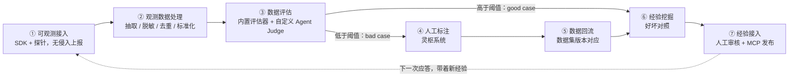
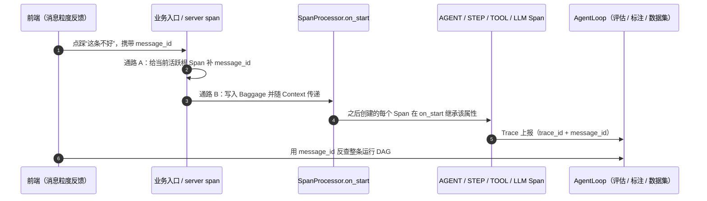
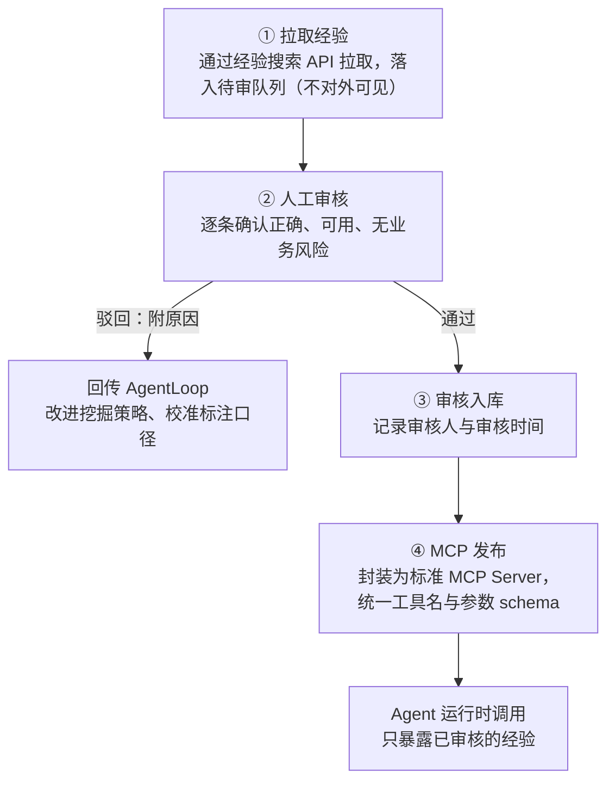

<div style="background-color: #1e1e1e; color: #00ff00; font-family: 'Courier New', Courier, monospace; border-radius: 8px; padding: 20px; box-shadow: 0 10px 30px rgba(0,0,0,0.3); margin-bottom: 30px; margin-top: 20px; position: relative; overflow: hidden;">
    <div style="display: flex; align-items: center; margin-bottom: 15px; padding-bottom: 10px; border-bottom: 1px solid #333;">
        <div style="display: flex; gap: 8px; margin-right: 15px;">
            <div style="width: 12px; height: 12px; border-radius: 50%; background-color: #ff5f56;"></div>
            <div style="width: 12px; height: 12px; border-radius: 50%; background-color: #ffbd2e;"></div>
            <div style="width: 12px; height: 12px; border-radius: 50%; background-color: #27c93f;"></div>
        </div>
        <div style="color: #ccc; font-size: 0.9em;">bash</div>
    </div>
    <div>
        <p style="margin: 5px 0; line-height: 1.6;"><span style="color: #008AFF; font-weight: bold;">ckhuang@macbookpro:~$</span> 你的 Agent 上线半年了。链路数据每天都在落，dashboard 上一片绿，P99 延迟稳如老狗。可当老板问"它到底比三个月前聪明了多少"时，你翻遍 APM、日志和工单，只能回答一句："我们采了很多数据。" <span style="display: inline-block; width: 8px; height: 16px; background-color: #00ff00; vertical-align: middle;"></span></p>
    </div>
</div>

做大数据这十几年，我见过太多"数据闭环"项目死在同一个句子上：**"数据我们都已经采了。"**

采了，然后呢？Trace 躺在 APM 里，用户反馈躺在工单里，标注结论躺在某个人的 Excel 里，Prompt 改动的理由躺在某个人的脑子里。每一份都不缺，唯独没有一条链路把它们串成一个"下一次会更好"的动作。

阿里云云原生团队最近公开的无限极"灵知"Agent 实践，难得地把这条链路完整地拆开了：**七个环节、两处跨平台交接、三道人工闸门**。原文出自《基于阿里云 AgentCore X AgentLoop，无限极灵知 Agent 持续改进及自进化实践》，这里记录我的理解与延伸。

读完本文，你会拿到三样东西：

1. 一张从 **Trace → 样本 → 经验 → 运行时召回** 的完整链路图，以及每一环真实的工程约束；
2. 两个最容易被低估的技术细节：**message_id 怎么染到每一个 Span**（含根 Span 的时序陷阱），以及**评估过程为什么要落库**；
3. 三个用血换来的判断，尤其是那个反直觉的——**闸门该放在出口，而不是入口**。

---

## 一、先把问题定义清楚：Agent 上线，能力不会自动变强

先交代背景：无限极是一家有近 7000 家门店、30 家分公司、两大生产基地的中草药健康产品公司。门店一线每天要处理大量产品咨询、顾客跟进和团队经营工作，于是在 App 里做了个 AI 助手"灵知"，依托**养生、产品、经营**三类专属知识库，覆盖四类场景：

- **找素材**："有没有讲免疫的课"——一句话定位资料与课程；
- **讲话术**："给老客户写段回访"——直接出可用的成稿；
- **带团队**："新人第一个月怎么带"——给出具体动作；
- **办业务**："这个月我的业绩"——直达对应入口。

这四个场景有个共同特征：**回答得好，用户不会夸你；回答得差，也只是一句抱怨。** 这句话是整个故事的起点，也是所有 To-C 或对内 Agent 的共同处境——质量信号天然稀薄，且高度分散。

他们复盘出的四个断点，我几乎每一条都在自己项目里见过：

| 断点 | 表面现象 | 真正的缺口 |
| --- | --- | --- |
| Trace 停在观测系统 | 完整 DAG 都采了，实际只看耗时 | 缺抽取、清洗、评估的**加工链路**，Trace 本质仍是日志 |
| bad case 靠人工翻查 | 全量标注，人贵、覆盖面窄 | 缺**阈值筛选**，标注结论也回不到数据集 |
| 优化结论停在个人经验 | 换个人接手，重新排查一遍 | 判断依据没被**结构化、没入库** |
| 反馈对不上运行链路 | "这个回答不好"，但不知道当时检索了什么 | 缺一个能贯穿全链路的**共同键** |

我给这张表补一句注解：**这四条里，没有一条是"模型不够聪明"的问题，全是数据工程问题。** 模型能力是买来的，数据链路是长出来的。

用数仓的语言类比会更清楚：原始 Trace 只是 **ODS 层**；没有清洗、评估、标注，它永远进不了 DWD，更谈不上 DWS 上的指标和 ADS 上的决策。**采集量不是资产，加工深度才是。**

## 二、全局视图：七个环节，两处交接

无限极把闭环拆成七个环节，分工极其清晰：



职责边界是这套方案里我最欣赏的部分：

- **AgentLoop**（阿里云平台）负责**数据的加工与经验生产**：接入、处理、评估、挖掘；
- **灵枢**（无限极自建的知识运营系统）负责**需要人来把关的环节**：标注、审核、入库、发布。

一句话总结：**机器做生产，人做把关；平台做通用能力，业务系统做领域判断。**

而两处跨平台交接，恰好是整条链路最脆弱的两个点——数据回流和经验接入。后面会看到，他们没把这两处交给"默契"，而是写成了**契约**。

## 三、前三环：让数据自己走到"可评估"

前三个环节由平台自动完成，目标是**让原始数据不依赖人工就能进入可评估状态**。

### 3.1 接入与处理：脏活要做得可追溯

接入环节用 SDK 与探针无侵入上报，按**应用、会话、请求**三个维度归集；`trace_id` 贯穿一次应答的完整 DAG，节点、工具调用、输入输出全部保留，多应用多环境统一上报。

处理环节按**天、小时、分钟三档粒度**周期调度，以离线批处理为主、兼顾准实时，对 Trace 依次做**抽取 → 脱敏 → 去重 → 字段标准化**，并剔除异常样本。原文特意强调了两点：清洗规则**可插拔、可追溯**。

这两点在工程上不是修辞。做过数据治理的都懂：

- **可插拔**，意味着规则迭代不需要改主链路代码；
- **可追溯**，意味着三个月后有人质疑"这条样本为什么被丢了"，你能答得出来。

我踩过反面的坑：早年做用户行为链路清洗，规则硬编码在 Spark 任务里，半年后口径变了，历史数据到底按哪版规则洗的，谁也说不清——**血缘一断，数据就只剩数字，没有结论。**

### 3.2 评估：分数是算出来的，不是"看着不错给个 0.9"

评估环节提供内置评估器，同时支持自定义 **Agent Judge** 评估器，按场景选择准确性、相关性、安全性、工具调用正确性等维度打分。原文里有一个我认为价值极高的设计：

> **评估的分数、理由、评估过程三者一并落库。**

为什么重要？因为如果只有分数没有过程，标注人员就得把同样的判断**重做一遍**，标注成本成倍增加。

这让我想起数据库的 `EXPLAIN`：只告诉你"这个查询慢"，和告诉你"走了全表扫描、用了哪个索引、预估多少行"，是完全两种可用性。**Agent 评估的可解释性，本质上是给人工标注提供"可复审的推理轨迹"。**

灵知的自定义评估器具体是四个维度加权：**规范、完整、忠实、无幻觉**。输入不是"一句 query 配一句回答"，而是**整条运行链路**——`trace_id`、`turn_index`、系统提示词、命中的技能等。只有看到整条链路，评估器才能判断"回答是否忠实于本轮实际获得的证据"。

这一条特别值得强调：**光看输入输出做评估，只能评"像不像"；看整条链路做评估，才能评"有没有依据"。** 后者才是幻觉检测的地基。

而且判评规则是**配置化管理**，不是写在代码里：调整无需发版，但**每一个版本都保留**，以便回看历史结果时能解释当时的分数依据。这就是典型的"规则即数据"——和风控规则引擎的思路完全一致。

### 3.3 用户反馈：先让它找得到那一条 Trace

用户反馈是最直接的质量信号，前提是它能精确关联到那一次运行。原文处理了三个非常具体的问题，我原样转述并加上自己的注解：

**第一，反馈挂在哪一层？** 挂在**消息粒度**，不是会话粒度。一条回答一个 id。原因很现实：一次会话里往往只有一条回答出了问题，按会话记录会把问题稀释掉。

> 这一点我给满分。做指标聚合的人最容易犯的错，就是"平均值掩盖长尾"。会话级评分 = 把 15 条好回答和 1 条烂回答平均成 0.93，然后你永远发现不了那条烂的。

**第二，用 id 换回什么？** 换回整条运行 DAG。否则反馈只是一句"这条不好"，无法知道当时检索了什么、调用了哪个工具。

**第三，谁先被评估？** 被点踩的样本**优先计算**，不必等全量批处理跑完；负面反馈低于阈值后转人工标注；负面反馈集中的场景优先排进本周评估批次。正面反馈中评分较高的，作为**正样本**进入经验挖掘。

最后这条背后有个很务实的判断：**经验挖掘需要好坏对照，带用户反馈的正样本，比随机抽"看起来不错"的样本可信得多。**

### 3.4 关键工程细节：让 message_id 出现在每一个 Span 里

这是全文技术密度最高的一段，也是我建议你逐字读的部分。

要让用户反馈与 Trace 关联，业务侧的 `message_id` 必须写进链路中的**每一个 Span**。实践里撞上两个具体问题。

**问题一：字段映射。** 原文提到，阿里云 ARMS 探针会把 LangChain metadata 中的约定字段映射为 OpenTelemetry GenAI 语义属性，例如 `user_id` → `gen_ai.user.id`、`thread_id` → `gen_ai.session.id`，且这两个属性会被自动透传到链路内所有子 Span 的 `attributes`，无需额外配置。但**自定义业务属性（比如 `message_id`）不在自动透传范围内**，需要通过当前上下文的 **Baggage** 透传。

> 这里补一个我的提醒：**具体属性名请以你所用探针版本和 OTel 语义约定为准，不要照抄字段名。** 语义约定本身在演进，跨版本升级时字段名是会影响兼容性的。工程上更稳妥的做法是：业务属性统一加前缀（如 `biz.message_id`），别和语义约定命名空间混在一起。

**问题二：时序。** 根 Span 由探针在业务 handler 执行**之前**创建，而业务代码里设置的上下文只能覆盖**之后**创建的 Span——**根节点一定会被漏掉**。于是根节点和子 Span 需要两套手段，且覆盖区间互不重叠。

他们把方案设计成两条通路：

- **通路 A（面向根节点）**：在请求入口直接写入**当前活跃 Span**，为 server span 补上 `message_id`；
- **通路 B（面向子 Span）**：在入口写入一次 Baggage，再用自定义 `SpanProcessor` 在 `on_start` 阶段让之后创建的每个 Span 继承该值，覆盖 AGENT、STEP、TOOL、LLM 等各类 Span。



对应的代码骨架大致是这样（以 Python OTel SDK 为例，思路与语言无关）：

```python
from opentelemetry import baggage, context, trace
from opentelemetry.sdk.trace import SpanProcessor

def bind_message_id(message_id: str) -> object:
    # 通路 A：补齐已经创建的当前 Span（通常就是 server span）
    trace.get_current_span().set_attribute("biz.message_id", message_id)
    # 通路 B：写入 Baggage，供之后创建的 Span 在 on_start 中读取
    return context.attach(baggage.set_baggage("biz.message_id", message_id))

class MessageIdSpanProcessor(SpanProcessor):
    def on_start(self, span, parent_context=None):
        mid = baggage.get_baggage("biz.message_id", context=parent_context)
        if mid:
            span.set_attribute("biz.message_id", mid)
```

方案上线后的验证细节很"工程师"：线上真实 Span 里，**请求根节点已带上 `message_id`，且其值与业务侧对话 id 完全一致**，反查入口由此成立；同时 `otel.scope.name` 指向的是探针插件，说明这个字段是**运行时自动注入**的，而不是业务代码里逐处手写。

我特别想夸最后这一句。它其实是在**验证"这不是巧合"**：如果字段是业务代码手写的，那么在你看不到的代码分支里一定会漏；只有由运行时统一注入，才敢说"每一个 Span 都有"。

而这条设计真正的价值是：**Trace、对话、评估结果、标注样本分布在四个系统里，`message_id` 是它们之间唯一的共同键。** 做过数据 join 的都清楚，没有共同键的"数据打通"，最后一定退化成人工对表。

## 四、中间三环：标注、回流、挖掘

### 4.1 标注：只标该标的样本

人工标注由灵枢承担。规则很干脆：

- 评估分数**低于阈值**的 bad case → 进标注队列；
- 高于阈值的 good case → 直接作为正样本；
- **标注量由评估分数阈值决定，而不由人力决定。**

还有两道我认为专业度很高的机制：

**第一，标注结论本身要抽检。** 一条错标会沿着数据集污染后续每个环节：经验挖掘可能学错，评估器校准也会偏。**抽检是这一环的关键止损点。**

**第二，人工结论被视为评估器的"地面真值"。** 阈值附近的样本判对了，评估器才有依据继续调整；判错了，往往说明**评估维度的定义本身需要修正**。

第二点是我最想重点标记的：**标注不只是"产生训练数据"，它同时是"校准评估器"的反馈信号。** 很多团队只做了前半句，于是评估器永远在自说自话。

### 4.2 数据回流：把"交回来"写成契约

标注完成后，灵枢把已标注数据回传 AgentLoop 数据集——这是第一处跨平台交接。为保证闭环稳定，双方围绕四项内容做了约定：

| 约定项 | 具体要求 | 本质 |
| --- | --- | --- |
| 字段规范 | 样本内容、评估分数、人工结论、标注人、标注时间，缺一不可 | 可追溯性 |
| 周期对齐 | 与数据处理周期一致（天/小时/分钟），**批次编号随周期生成，禁止跨周期拼接** | 幂等与可重放 |
| 版本对应 | 标注批次与数据集版本一一对应，任何一批可回滚到当时的标注状态与评估口径 | 可回滚 |
| 阈值口径 | good/bad 的分界线由双方共同定义并**版本化**，不允许两侧各维护一套 | 口径唯一 |

我看完这四条的第一反应是：**这就是一份标准的数据契约（Data Contract），只是换了个场景。**

"禁止跨周期拼接"对应流批一体的幂等边界；"口径版本化"对应指标口径治理；"批次可回滚"对应数据血缘与快照。**跨团队协作里，口头约定从来不是约定，能被校验、能被回滚的才叫约定。**

### 4.3 经验挖掘：从"好坏对比"里长出四类资产

挖掘环节的方法论很简单：**bad case 与 good case 对比**。前者进标注队列修正，后者作为正样本基线回传。

但产出不是"一段总结"，而是四类**可复用经验**，并且每一类都明确了**落到哪里**：

| 经验类型 | 内容 | 沉淀位置 |
| --- | --- | --- |
| Prompt 优化点 | 哪句指令让模型跑偏、改成什么更准 | 指令模板版本迭代 |
| 典型失败模式 | 同类错误反复出现的触发条件与前置信号 | 评估器规则、告警阈值 |
| 工具调用范式 | 正确的调用顺序、依赖链、失败回退路径 | 工具示例、few-shot |
| 业务 SOP | 业务方真实的处理流程与判断依据 | 知识库条目、检索策略 |

这张表是全文我最想抄走的东西。因为它回答了一个行业性的困惑：**"经验"到底该以什么形态存在？**

答案是：**经验不是文字，是能改变系统行为的资产。** 每条经验必须**结构化、可检索、可追溯来源**，否则只是又一次口头传授。

落地拆成四步：**接入轨迹**（确认真实数据源与应用范围）→ **开启挖掘**（配置起始时间与应用，看进度）→ **确认经验**（检查内容与证据，标注正确性与适用场景，再决定是否启用）→ **接入召回**（通过 API 或 SDK 在运行时检索，并在调试中验证命中后的实际调用效果）。

注意最后一步：**"接入召回"必须验证命中后的实际效果**。经验挖出来却从未被召回，和没挖是一样的。

## 五、最后一环：经验接入，一道必须存在的人工闸门

经验接入是第二处跨平台交接，由灵枢分四步完成：



有几个细节值得单独拎出来：

- **待审队列不对外可见**——未审核的经验在物理上就不可达，而不是靠"约定别用"；
- **只暴露已审核的经验**——权限边界收敛在发布层；
- **驳回原因回传**——被拒绝的经验不是丢弃，而是用来改进挖掘策略、校准标注口径，**形成一条反向的反馈**；
- **MCP 封装**——把经验库变成标准 MCP Server，用统一的工具名与参数 schema 供运行时调用。

最后这点体现了一个很务实的判断：**经验要能被 Agent 用起来，它就得长得像"工具"，而不是像"文档"。** 文档靠模型"想起来读"，工具靠模型"决定调用"——后者的可观测性和可控性都好得多。

## 六、三个踩过才确信的判断

原文总结的三条心得，我逐条给出自己的理解：

**第一，先建加工链路，再谈数据资产。**

原始 Trace 本身不是资产，经过清洗、评估、带有人工结论的样本才是。没有加工链路，**数据采得越多，存储成本越高**——这句话对做大数据的人应该是刺痛感最强的。我见过太多"先把数据全存进数据湖，以后再治理"的项目，最后湖变成了沼泽。

**第二，责任边界按"谁在生产这份数据"来划分。**

标注与审核放在**最了解业务后果的一侧**，而不是最方便写代码的一侧。放错了位置，闸门就只剩下流程，失去了判断。

我的补充：这条对架构师的启示是——**不要用技术便利性去决定组织边界**。把业务判断硬塞给平台团队，结果一定是"流程齐全、判断为零"。

**第三，闸门放在经验出口，而不是数据入口。**

入口卡得太严，数据进不来，闭环就无法启动；在出口把关，才能保证下发给 Agent 的每一条经验都是可信的。

这是全文最反直觉、也最正确的一条。用我自己的话说：**脏数据进来可以清洗，脏经验出去就是事故。** 入口宽松换的是启动速度，出口严格守的是风险底线。

<div style="text-align: center; font-size: 1.2em; font-style: italic; color: #008AFF; margin: 40px 0 20px; padding: 20px; border-top: 1px dashed #ccc; border-bottom: 1px dashed #ccc;">
    “数据闭环的终点，不是一张更漂亮的报表，而是下一个更好的应答。” —— CK·黄
</div>

## 写在最后

把这条链路收成一句话：

**可观测接入 → 数据处理 → 数据评估 → 人工标注 → 数据回流 → 经验挖掘 → 经验接入**，把线上 Trace 变成可复用的经验，再通过 MCP 回到运行时。

需要说明边界：这是一家客户、一个场景的实践，平台能力（AgentLoop）与自建系统（灵枢）的分工也带有它自己的组织特征。**能直接抄的是那张七环图、四项数据契约、两类 Span 染色通路和"闸门放出口"的原则；不能直接抄的是它对"谁来把关"的具体安排**——那取决于你的组织里，谁真正承担业务后果。

如果只让我带走一句话，我会选这句：**Agent 不会因为上线而变强，它只会因为"有人认真处理过它的每一次出错"而变强。**

而"认真处理"这四个字，翻译成工程语言，就是本文这七个环节。
