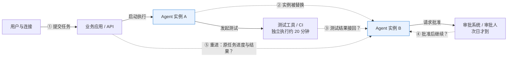
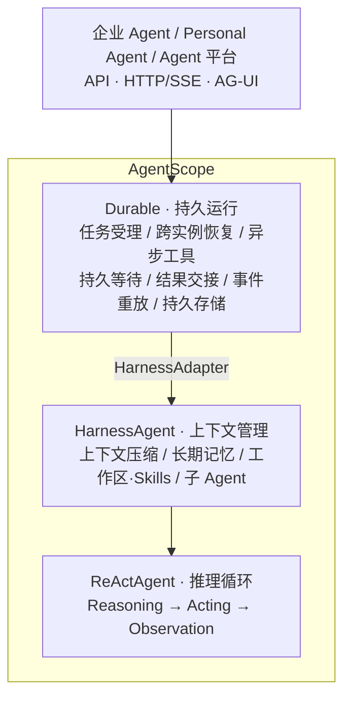
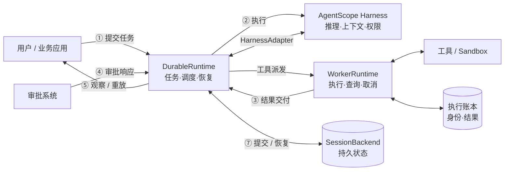
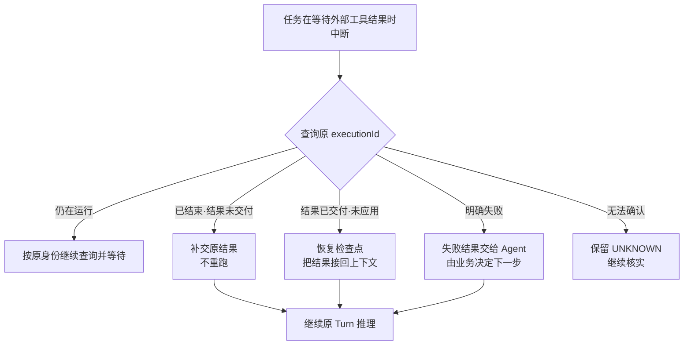
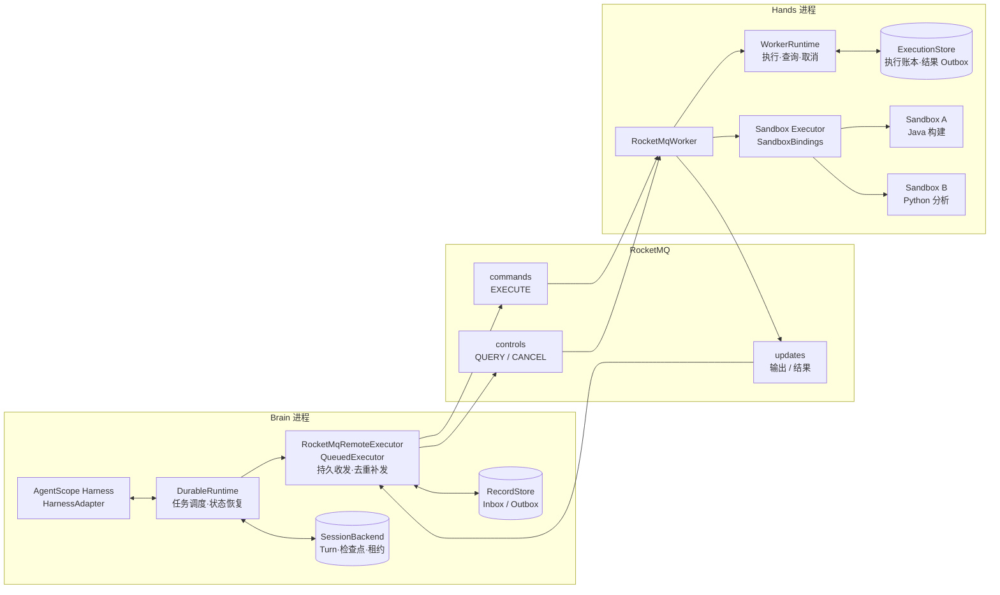

<div style="background-color: #1e1e1e; color: #00ff00; font-family: 'Courier New', Courier, monospace; border-radius: 8px; padding: 20px; box-shadow: 0 10px 30px rgba(0,0,0,0.3); margin-bottom: 30px; margin-top: 20px; position: relative; overflow: hidden;">
    <div style="display: flex; align-items: center; margin-bottom: 15px; padding-bottom: 10px; border-bottom: 1px solid #333;">
        <div style="display: flex; gap: 8px; margin-right: 15px;">
            <div style="width: 12px; height: 12px; border-radius: 50%; background-color: #ff5f56;"></div>
            <div style="width: 12px; height: 12px; border-radius: 50%; background-color: #ffbd2e;"></div>
            <div style="width: 12px; height: 12px; border-radius: 50%; background-color: #27c93f;"></div>
        </div>
        <div style="color: #ccc; font-size: 0.9em;">bash</div>
    </div>
    <div>
        <p style="margin: 5px 0; line-height: 1.6;"><span style="color: #008AFF; font-weight: bold;">ckhuang@macbookpro:~$</span> 你的 Agent 跑测试要 20 分钟，审批第二天才批，中间用户关了页面、服务滚动发布、原实例被销毁。你翻遍 session 历史，只看到一句"正在测试"——这不是 Agent 不够聪明，是你把"执行进度"放进了进程内存里。<span style="display: inline-block; width: 8px; height: 16px; background-color: #00ff00; vertical-align: middle;"></span></p>
    </div>
</div>

做分布式系统这十几年，有一类 bug 我见得太多：**状态存在了不该存的地方。** 早年是 Session 存在单机 Tomcat 内存里，一扩缩容用户就掉登录；后来是定时任务状态存在 JVM 里，一重启就丢了一批没跑完的活。

现在这轮 Agent 浪潮里，同一个坑换了个壳又出现了：**把"任务跑到哪一步"寄托在一次 HTTP 连接、一个 Agent 进程、或者一段聊天历史上。**

阿里云云原生团队最近开源的 AgentScope Durable，正面回答的就是这个问题。它做的事情，本质上和我们给业务系统做"可恢复执行"没有区别：**把任务的身份、执行进度、继续条件搬到进程之外，然后给恢复这件事写出明确规则。**

这篇文章不做 API 翻译，而是按一个架构师的视角拆三件事：

1. **为什么"会话历史"代替不了"执行进度"**——这两者差在哪；
2. **Durable 用了哪几层抽象和哪几个机制**去填这个洞（Turn/Thread/Session、检查点、租约、Fencing、Brain–Hands）；
3. **哪些设计是可以直接抄进你自己 Agent 平台的**，哪些是它明确划清的边界。

---

## 一、先把坑挖出来：会话历史 ≠ 执行进度

原文给了一个非常典型的研发 Agent 场景，我几乎可以一比一映射到自己团队踩过的坑：

- Agent 定位故障、修改代码、发起测试，测试要跑二十分钟，提交结果还要等人工审批，审批可能第二天才到；
- 这期间，**用户关了页面**，**服务做了一次滚动发布**，**最初执行任务的实例被替换掉了**。

正常的预期是：这项工作继续。已经启动的测试能被找到，已经确认的结果能被复用，审批一到，由具备执行条件的实例接着往下推。用户第二天打开应用，看到的还是同一项任务。

但现实是：你重放一遍会话历史，模型只能知道"我决定去跑测试了"，它**不知道测试到底有没有被受理、在原操作的哪个位置、结果回没回来、回来之后 Agent 有没有消费掉。**

"我决定跑测试"和"测试已经跑完"是两个不同的事实。中间这层"外部世界的真实状态"，聊天记录里没有。

<pre style="background:#f6f8fa;padding:16px;border-radius:6px;overflow:auto;font-size:13px;line-height:1.6;">
[用户与连接]      [应用边界]        [Agent 进程边界]        [外部执行与交互边界]
  用户/浏览器  ──提交任务──▶  业务应用/API  ──启动执行──▶  Agent 实例 A
      │  关闭页面                    ▲                        │  ① 执行状态能否接续？
      │  再次打开                    │                        ▼  ✕ 滚动发布 / 实例替换
      └────────── ⑤ 原任务的进度与结果？ ─────────────▶  Agent 实例 B ──请求批准──▶ 审批系统/审批人
                                                              ▲                      （次日才到）
                                                              └── ④ 批准后继续？ ──┘
                                             ③ 测试结果接回？
</pre>

原文把这类连续性问题归纳成了五个必答题，我觉得这张表值得每个做 Agent 平台的人贴在墙上：

| # | 断点 | 真正要回答的问题 | 系统层面缺什么 |
| --- | --- | --- | --- |
| ① | **连接断开** | 任务是否仍然存在？ | 任务身份与连接解耦 |
| ② | **实例替换** | 执行进度保存在哪里？ | 检查点 + 可接管的执行权 |
| ③ | **结果交接** | 测试已完成，结果丢了怎么办？ | 稳定执行 ID + 结果落库 |
| ④ | **长时间等待** | 谁在批准后唤醒原任务？ | 持久等待 + 事件唤醒 |
| ⑤ | **重新进入** | 如何找回同一任务与已确认结果？ | 快照 + 事件重放 |



这张图的重点是最后一行：**所有橙色虚线，都是"需要额外工程手段保证连续性"的交接点。** 这些交接点不解决，Agent 就只能永远做"几分钟内能跑完的活"。

<div style="text-align: center; font-size: 1.2em; font-style: italic; color: #008AFF; margin: 40px 0 20px; padding: 20px; border-top: 1px dashed #ccc; border-bottom: 1px dashed #ccc;">
    “把状态放进进程，就等于把可用性押在这台机器上。这个教训在微服务时代付过一次学费，Agent 时代又要再交一遍。” —— CK·黄
</div>

---

## 二、Durable 的定义，以及它诚实地划出的边界

原文对 Durable 的定义，我认为是整个设计里最值得抄的一句话：

> **把 Agent 的执行过程组织为可持久保存、可确认、可恢复的状态，在原生检查点、工具交接和等待条件等位置建立接续边界。**

拆开看有三个关键词：

- **可持久保存**：任务、进度、继续条件都在进程外；
- **可确认**：哪一步结果已经落库、哪一步已经进入上下文，是有明确记录的；
- **可恢复**：从**已提交的逻辑状态**继续，而不是从"最后一条聊天消息"猜。

更难得的是它把**能力边界**说清楚了，没有吹成银弹：

- 恢复需要**兼容的执行环境**和**可访问的持久状态**——换个不兼容的 Agent 定义、或者存储不通，接管就无从谈起；
- 外部动作能不能安全重试，取决于工具本身是否提供**查询能力和幂等能力**；
- 最典型的不确定性：**邮件已经发出去了，回执却丢了。** 这时系统能做的是"核实原操作"，而不是假装自己知道。

所以原文有一句我特别认同的表述：**Durable 保存处理不确定性所需的身份和状态，但它不会自动让任意业务动作"恰好执行一次"。**

这句话在分布式事务里我们叫它"没有免费的 exactly-once"。任何声称 Agent 平台能保证外部副作用 exactly-once 的宣传，基本都可以直接打问号。

---

## 三、三层抽象：把"推理""上下文""执行"切开

AgentScope 的骨架是三层，每层只干一件事，靠 `HarnessAdapter` 衔接：



三层职责，用一句工程师听得懂的话概括：

- **ReActAgent**：模型看当前输入 → 决定动什么手 → 把工具观察结果带回下一轮推理。这是"脑子"；
- **HarnessAgent**：把日志、代码、记忆、Skills、子 Agent 组织好，塞进**每一次模型决策**的上下文里。这是"记忆与工作台"；
- **Durable**：管理"工作在时间和实例之间的延续"——输入怎么受理、任务怎么排队、哪个实例有权推进、在哪恢复、等什么结果、应用怎么重新观察和控制。这是"调度与档案"。

内部职责链条是这样的：请求进来，`DurableRuntime` **先保存任务，再安排执行**；`HarnessAdapter` 把 Agent 原生检查点接进 `SessionBackend`，让"执行到哪了"能被下一次调用读到；遇到要独立执行的工具，Runtime 通过 `Executor` 把活交给 Hands，结果回来再接回原任务。



两个部署层面的细节，说明这套设计不是绑死在某朵云上的 SaaS：

- 这些职责**可以装在一个 JVM 里，也可以拆开部署**；
- 只负责提交、查询、观察的 API 服务，**可以不启动 Agent 执行循环**；执行宿主显式启动 Runtime，去认领并推进持久任务。

这实际上就是控制面与数据面分离。API 网关不该兼着跑长任务，这个道理和"不要在 Web 容器里跑批处理"是同一条。

接入层还有一句话很关键：**AG-UI 只负责事件格式适配，业务服务仍负责请求入口、身份认证与资源授权。** 这避免了框架越界去当"权限中心"，也是对的做法。

---

## 四、五个机制，逐个拆

### 4.1 Turn / Thread / Session：三层身份，解决"排队"与"插话"

对话式产品的常见设计是"一个会话一条队列"，这在长任务场景会立刻崩掉。原文的例子很典型：

- 用户让 Agent 调查订单服务超时；
- 补一句"调查结束后整理一份报告"——这是**后续工作**，该排队；
- 又想起一个约束"先不要改生产配置"——这是**对当前工作的修正**，该进入正在执行的那次调查。

如果两条都当新消息排队，第二条约束就得等调查跑完才生效，通常已经晚了。

AgentScope 用三层身份把这件事说清楚了：

| 抽象 | 含义 | 承载什么 |
| --- | --- | --- |
| **Session** | 一次业务会话 | 一个业务上下文，可含多个 Thread |
| **Thread** | 会话里的一条工作线 | 自己的上下文、检查点、任务队列 |
| **Turn** | 一次具体任务 | 身份、状态、可被 steer / cancel |

对应的两个原语，是这个设计里最漂亮的部分：

- `submit(requestId, input)`：创建新 Turn，**在同一个 Thread 内按受理顺序执行**；
- `steer(requestId, content)`：把补充要求**交给正在执行的原 Turn**，不新建排队任务。

而且它明确约束了插话语义：**插话先落库，再在原生执行的安全边界进入 Agent**。已经发出的工具调用不会被撤回，正在生成的模型响应也不会被强行改写。应用通过 `signal.applied` 这类事件确认"要求已生效"。

这个约束非常工程化——它承认了"已经在飞的东西拦不住"，只保证"下一次安全点一定生效"。这和数据库的中断点、消息队列的 at-least-once 是同一种务实。

等待期间的行为也就顺理成章了：当前调查在等测试或审批时，后面的报告继续排队；不需要等的工作可以丢到独立 Thread；要停下来检查，就先暂停原 Turn。

### 4.2 Session 重连与重放：把"用户看到的过程"和"系统真实状态"分开

第二天重新打开页面，用户期待看到昨天的任务、执行记录和当前结果，而不是一段新对话。

Durable 的做法是：**任务执行与客户端连接分开管理。** 应用保存 Session/Thread/Turn 身份，重连后直接查原任务。

两个容易被忽略但很实用的细节：

1. **幂等提交**：如果第一次提交的响应丢了，用**原 requestId + 原输入**重试，拿到的是**同一个 Turn**，不会重复发起调查。
2. **游标 + 快照**：界面恢复靠"消息历史 + 状态快照 + 带游标的持久事件"。页面从上次消费的位置继续读；游标失效时用快照重建当前视图。

更重要的是它说清了重放的语义：**会话重放重建的是"用户看到的过程"，不会重新调用模型或执行工具。**

这句话解决了一个常见的架构混淆：UI 层的"事件流"和系统层的"状态机"是两套东西。生成中的文字可以实时流式展示，但**最终消息和任务状态以持久记录为准**；断线期间丢掉的文字预览，重进后能拿到已确认的内容。

顺带还有一条明确的边界：**浏览器断线、观察超时、关闭订阅，都不会隐式取消后台任务。** 这条要是不写清楚，实现者八成会把"连接关闭"写成"取消"。

### 4.3 长耗时工具：executionId + 五态恢复

这是我认为全文技术含量最高的一节。

Agent 发起一个跑二十分钟的测试，它需要保留的不是"我在测试"，而是**稳定的 executionId、固定参数、执行状态**。原文的提交顺序设计得很讲究：

1. 工具开始前：**Agent 检查点 + 调用意图一起提交**；
2. 工具结果返回后：**先落库，再交给原 Agent**；
3. 结果进入上下文的确认：**与新的检查点一起提交**。

这样中断之后，能精确定位"到底缺了哪一步"。恢复方式取决于原操作的真实状态：

| 中断后查到的状态 | 如何继续 |
| --- | --- |
| 测试仍在运行 | 按原执行身份继续查询，等待结果 |
| 测试已结束，结果尚未交付 | **补交原结果，不重跑测试** |
| 结果已交付，Agent 尚未应用 | 恢复原检查点，把结果接回上下文 |
| 测试明确失败 | 把失败结果交给 Agent，决定修复或重新发起 |
| 原操作结果无法确认 | 保留 `UNKNOWN`，继续核实或进入业务处理流程 |

最后一行尤其值得鼓掌：**没有硬编一个"不知道就当成功/失败"的默认值，而是保留了 UNKNOWN 这个合法状态。** 做支付、做账务的人都知道，未知态不是异常，未知态就是业务的一部分。

原文还给了恢复粒度的诚实说明：外部服务有查询和幂等能力，才能接回原执行；**如果是一个内部连发五封邮件的黑盒工具，要恢复到第四封，你得自己保留逐封的操作身份。** Durable 只负责衔接它能看到的事实，不猜工具内部没记录的进度。



### 4.4 事件唤醒 + 租约 + Fencing：谁有权接着干

任务还在等测试，承载 Agent 的服务开始滚动发布。实例 A 退出，任务该由别的实例接走，用户不该再补一句"继续"。

这里用的是一套非常经典的分布式组合拳，我按原样复述，因为这套组合值得每个做 Agent 调度的人抄：

1. **变更通知（RocketMQ）**：新请求、审批响应、工具结果落库后发通知，**唤醒** Runtime 去读状态、找可运行的工作；
2. **执行租约（从共享 Backend 获取）**：实例 A 失联、租约到期，兼容的实例 B 才能**认领**未完成工作，加载检查点继续原 Turn；
3. **Fencing**：旧实例即使"复活"，其过期执行权也会被拦住，**不能覆盖新进度**；
4. **定期扫描兜底**：实例突然崩溃时未必发得出通知，所以 Runtime 还要扫过期租约和遗漏任务。

原文那句总结我原样引用：**MQ 通知帮助系统及时发现变化，持久状态和租约决定"谁能从哪里继续"。**

这是两件事，千万别混：**通知负责"快"，租约负责"对"。** 只做通知不做租约，就会出现两个实例同时推进同一个 Turn（经典的脑裂）；只做租约不做通知，恢复就会慢一个扫描周期。两个都要，缺一不可。

另外还有两个细节，说明作者是真踩过坑的：

- 每次接管都会留下新的 **Run / Step** 记录，便于排查"这项任务经历过哪些执行尝试"；
- 可重试失败的**重试次数和退避时间也会持久化**，避免"每换一个实例就从零开始退避"。

跨主机接管的前提也讲清楚了：共享存储、兼容的 Agent 定义与工具绑定、对原工作区的访问权限。

### 4.5 Brain–Hands 分离：工具跑在它该跑的地方

一个研发 Agent 既要编译 Java 项目，又要跑 Python 数据分析。这两类工具的依赖、资源、权限完全不同，硬塞进推理进程的环境里，最后一定是"环境地狱"。

Durable 的切法很干净：

- **Brain**：保留 Harness、上下文和决策过程，通过工具绑定选择 Executor；
- **Hands**：接收调用，管理原执行的状态与输出，在对应 Sandbox 或外部系统里完成工作。

注意一句容易被跳过的限定：**模型发起工具调用前，仍然经过原生权限检查。** 也就是说，分离部署不会让权限校验被绕过。

工程上的收益非常直接：

- 构建工具路由到有 JDK 和构建缓存的 Hands，分析工具路由到有 Python 依赖的另一组 Hands；
- 两侧通过 HTTP 或 RocketMQ 交接，可以**分别扩容、分别更新环境、分别设权限**；
- `SandboxBindings` 把"逻辑工作区"和"实际 Sandbox"绑定并持久化，恢复时**用原绑定连原资源**。

这句我要加粗：**Brain 被替换，不意味着要重建测试环境；Hands 进程重启，也不能把新的空目录当成原工作区。** 前半句是"环境要跟着任务走"，后半句是"别把重启后的空目录当原工作区"——这是本地开发调试最常踩的坑。

Queued 部署下，Brain 与 Hands 之间是三条独立通道，这个分层很值得抄：



三条通道职责分离得很清楚：`commands` 管执行，`controls` 管查询与取消，`updates` 管输出与结果。**同一个 executionId 贯穿派发、执行与结果交付**，重复收到消息时可以核对原执行。

有个细节必须强调，原文专门点了一句：这三条通道**与 "Thread 内用户请求的排队" 是两个层次**，会话唤醒通知又独立于工具通道。别把这四层混成一层——混了就会出现"工具结果走了用户队列"这种诡异问题。

### 4.6 多 Thread 并行：主流程等测试，审查流程不等

主 Agent 生成补丁、等测试；团队希望另一个 Agent 同时审这份补丁有没有安全问题。

两种朴素做法都错：塞进同一个队列，审查得等测试结束；塞进同一个上下文，调查过程和审查意见互相污染。

正确解是**一个 Session 多个 Thread**：主 Thread 修复测试，审查 Thread 读取**指定版本**的补丁独立审查，各自拥有历史、检查点、任务队列，在宿主容量允许时并行推进，应用在同一 Session 里统一观察。

这里还有一句非常关键的产品级提示：**审查 Agent 应该读"固定版本的补丁产物"，避免它一边审、一边读到主 Agent 正在改的文件。** 这是典型的快照隔离思路——审查对象必须不可变。

需要把结论回灌主任务时，由应用显式转交；如果是父 Agent 发起并等待子 Agent，用 `DelegationExecutor` 把父调用和持久子 Turn 关联起来，恢复后继续等原来的子任务。

---

## 五、落地：最小接入长什么样

原文的代码是删掉换行压缩过的，我整理成可读版本。最小接入只需要三样东西：**Agent 工厂、持久 Backend、Runtime**。

```java
import io.agentscope.core.ReActAgent;
import io.agentscope.durable.DurableRuntime;
import io.agentscope.durable.DurableTypes.SessionKey;
import io.agentscope.durable.agentscope.AgentScopeAdapter;
import io.agentscope.extensions.durable.jdbc.LocalBackend;
import java.nio.file.Path;
import java.util.Map;

var backend = LocalBackend.open(Path.of("./durable-data"));
var adapter = AgentScopeAdapter.forReAct(
        binding -> ReActAgent.builder()
                .name("dev-assistant")
                .model(model),
        Map.of());

var runtime = DurableRuntime.builder()
        .backend(backend)
        .harness("dev-assistant", "v1", adapter)
        .build();

var session = runtime.createSession(new SessionKey("demo", "incident-42"), "dev-assistant");
var investigation = session.submit("investigate-1", "分析订单服务超时的原因");

runtime.start();
var turnId = investigation.turnId();
```

几个约定值得注意：**应用负责保存 Session / Thread / Turn 身份**，宿主负责让 Runtime 常驻，退出时依次关闭 Runtime 与 Backend；**同一请求重试沿用原 requestId 与原输入**，新工作用新 requestId。

排队与插话，就是两个方法的区别：

```java
var report = session.submit("report-1", "根据调查结果整理一份故障报告");
investigation.steer("constraint-1", "重点检查数据库访问，先不要修改生产配置");

// 不再需要时取消排队中的 Turn
report.cancel("cancel-report-1");
```

审批也一样：应用通过 `pendingInteractions()` 找到待处理交互，用户决定后 `respond(requestId, interactionId, approved)`。**这样第二天到达的批准，能精准接到原操作上**，而不是开启一次新对话。

重连与续读：

```java
var session = runtime.getSession(new SessionKey("demo", "incident-42"));
var thread = session.getThread("main");
var investigation = thread.getTurn(savedTurnId);
var current = investigation.status();
var history = thread.history(null, 100);

var options = EventStreamOptions.builder().after(savedCursor).build();
try (var stream = investigation.streamEvents(options)) {
    stream.forEach(event -> render(event));
}
```

`render` 是应用自己的界面逻辑，需要处理"游标失效后用快照替换"。关闭 stream 只是关掉观察，后台任务仍由运行中的 Brain 推进。

多主机部署就换 Backend，用 PostgreSQL + 会话唤醒通知：

```java
var backend = PostgresBackend.builder()
        .dataSource(dataSource)
        .notifications(rocketMqWakeups)
        .build();
```

注意 `dataSource` 指向**已经初始化表结构**的共享库；`rocketMqWakeups` 只传 Session 变更提示，**不承担工具结果传输**——工具结果走 `RocketMqRemoteExecutor` / `RocketMqWorker`。

按工具路由到不同 Hands：

```java
var routedAdapter = AgentScopeAdapter.forReAct(
        binding -> ReActAgent.builder()
                .name("dev-assistant")
                .model(model),
        List.of(
                buildTool.route("build"),
                analysisTool.route("analysis")));

var runtime = DurableRuntime.builder()
        .backend(backend)
        .harness("dev-assistant", "v1", routedAdapter)
        .executor("build", buildExecutor)
        .executor("analysis", analysisExecutor)
        .build();
```

`ToolBinding` 需要**两侧一致**（包含工具 Schema 和目标配置），Executor 是已配置好的远程执行端点。仓库里的 `agentscope-examples/durable/integrated/quickstart`、`tool-in-sandbox`、`brain-hands/tool-in-sandbox` 分别演示了从本地到跨进程的接入路径。

---

## 六、从"跑完一个任务"到"长期承担一项职责"

第四节到第五节的边界是"一个长程任务怎么可靠跑完"。再往前一步，就是"让 Agent 持续承担一项职责"：不只是处理这次故障，而是持续关注服务运行、异常时调查、推动修复、跟进验证。

原文引用了 Anthropic《Building always-on agents》里的循环：**事件到达 → 唤醒 Agent → 完成当前工作 → 保存信息 → 等待下一次行动**，由**事件收件箱、定时器、记忆、权限、消息发件箱**共同支撑。没有工作时可以休眠。

把 AgentScope 的组件和这个循环对齐，一张表就够：

| 循环环节 | 由谁承担 | 关键约定 |
| --- | --- | --- |
| 事件接入 | 应用事件入口 | 保存事件与处理状态，用**稳定请求身份**提交；同事件重投能找到原 Turn |
| 排队与插话 | Durable（Thread / Turn） | 新工作进对应 Thread 排队，执行中补充走 `steer` |
| 推理与工具 | Harness + Hands | 耗时工具在 Sandbox 异步执行，等待位置与原执行身份持久化 |
| 等审批 | Durable 持久等待 | 待处理交互保留，响应到达后接回原任务 |
| 未来的行动 | 应用定时器 | **定时巡检创建新 Turn**，与"结果/审批接回原 Turn"是两回事 |
| 跨任务知识 | Harness 长期记忆 | 保留服务背景、用户偏好、处理经验，按需加载 |
| 结果交付 | 应用消息发件箱 | 保存待发内容与投递状态，失败可续投 |

表里最值得划线的是"两种继续方式"的区分，原文讲得很明确：

- **测试结果、审批响应** → 接回尚未完成的 Turn；
- **定时巡检** → 创建新的 Turn。

**业务定时器负责安排下一次行动，Durable 的执行重试、租约与恢复负责让已受理的工作可靠推进。** 这俩职责混在一起，就会出现"定时器把任务当重试、重试把任务当新任务"的经典混乱。

还有一个细节，我估计只有做过通知系统的人才会留意：**"任务完成" 和 "用户已收到通知" 要分别记录。** 工具结果回到 Agent，属于执行链路；面向用户的消息投递，属于产品链路。两条链路各有自己的状态机，不能合并。

---

## 七、我的判断：这五条可以直接抄

看完整个设计，我认为 AgentScope Durable 的价值，不在于又出了一个 Agent 框架，而在于**把分布式系统工程里被验证过二十年的模式，正式搬进了 Agent 执行域**。以下几条，我会建议任何在做 Agent 平台的同学直接拿走：

1. **任务身份必须早于执行发生**。先保存 Turn，再安排执行；连接、进程、HTTP 请求都不该是任务的家。
2. **"已提交"要分成三层**：检查点 + 调用意图、结果落库、结果进入上下文的确认。三层各自持久化，恢复才能定位缺失步骤。
3. **通知负责快，租约负责对**。MQ 唤醒 + 租约认领 + Fencing + 定期扫描，四件套缺一个都会在生产上翻车。
4. **插话只保证"下一个安全点生效"**。别承诺撤回已经发出的工具调用，那是幻觉。
5. **推理与执行分环境**。Brain 按请求推进，Hands 跟着工具特性配资源；Sandbox 身份要跟着任务持久化，重启后绝不能拿空目录冒充原工作区。

<div style="text-align: center; font-size: 1.2em; font-style: italic; color: #008AFF; margin: 40px 0 20px; padding: 20px; border-top: 1px dashed #ccc; border-bottom: 1px dashed #ccc;">
    “Agent 的可靠性，从来不取决于模型多想一步，而取决于系统能不能记住它已经想了哪一步。” —— CK·黄
</div>

当然，它也很克制地把边界留在了那里：外部动作能否安全重试，仍然取决于工具是否给得出查询与幂等；一个黑盒工具内部跑到第几封邮件，框架猜不出来。**Durable 提供的是"接得住"的基础设施，不是"万事大吉"的承诺。**

至于再往上的持续服务形态——事件接入、业务调度、消息交付——那部分依然需要应用自己设计和承担。框架把最难的状态问题解决了，剩下的业务编排，本来就是每个团队的护城河。

<div style="background-color: #1e1e1e; color: #00ff00; font-family: 'Courier New', Courier, monospace; border-radius: 8px; padding: 20px; box-shadow: 0 10px 30px rgba(0,0,0,0.3); margin-bottom: 30px; margin-top: 20px; position: relative; overflow: hidden;">
    <div style="display: flex; align-items: center; margin-bottom: 15px; padding-bottom: 10px; border-bottom: 1px solid #333;">
        <div style="display: flex; gap: 8px; margin-right: 15px;">
            <div style="width: 12px; height: 12px; border-radius: 50%; background-color: #ff5f56;"></div>
            <div style="width: 12px; height: 12px; border-radius: 50%; background-color: #ffbd2e;"></div>
            <div style="width: 12px; height: 12px; border-radius: 50%; background-color: #27c93f;"></div>
        </div>
        <div style="color: #ccc; font-size: 0.9em;">bash</div>
    </div>
    <div>
        <p style="margin: 5px 0; line-height: 1.6;"><span style="color: #008AFF; font-weight: bold;">ckhuang@macbookpro:~$</span> 检查点、租约、Fencing、幂等、未知态——这些词在分布式系统里已经吵了二十年。Agent 平台想跨过"跑几分钟的 Demo"这道坎，一个都绕不过去。<span style="display: inline-block; width: 8px; height: 16px; background-color: #00ff00; vertical-align: middle;"></span></p>
    </div>
</div>

---

**参考来源**

- 阿里云云原生《AgentScope Durable：让企业 Agent 持续、可靠地运行》，作者 刘军、朱志宇，2026-11-18
- AgentScope Durable 开源实现：https://github.com/agentscope-ai/agentscope-java
- Anthropic《Building always-on agents》：https://claude.com/resources/articles/building-always-on-agents
