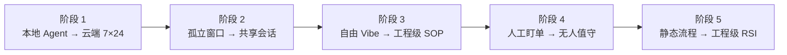
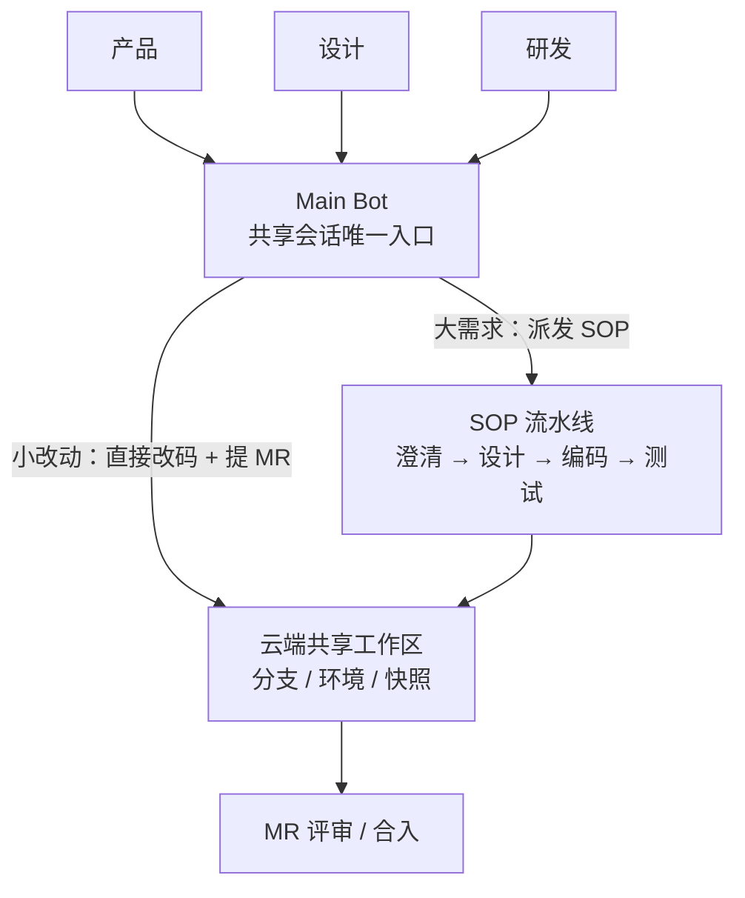
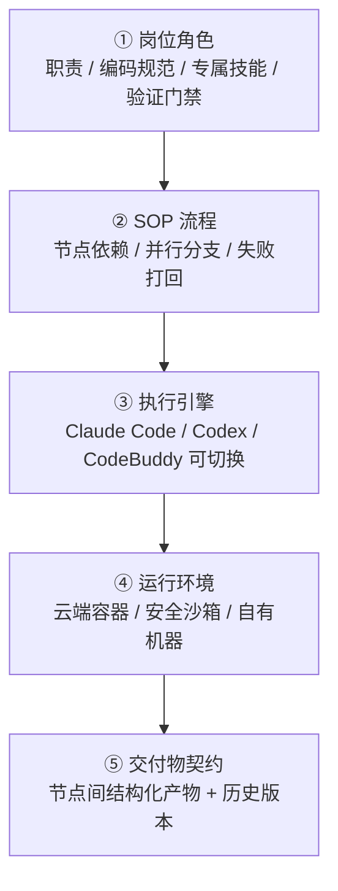
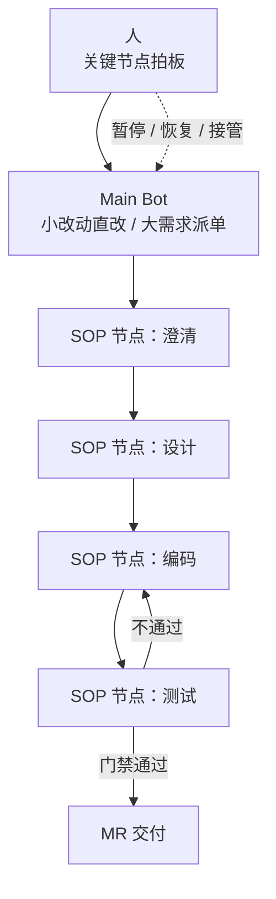
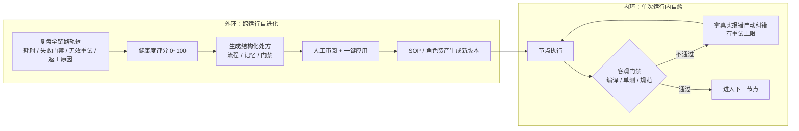
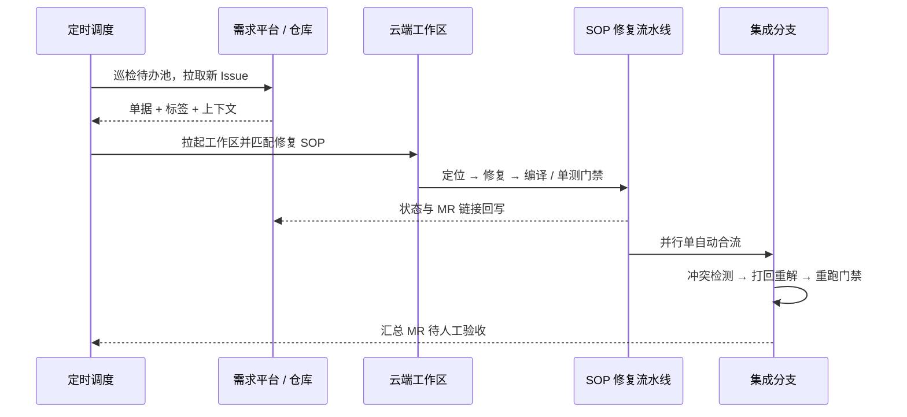

    

        

            

            

            

        

        
bash

    

    

        
ckhuang@macbookpro:~$ 你以为给每个研发发一个 Coding Agent，团队就提效了。真实情况是：五个窗口各聊各的，上下文靠人肉复制粘贴；任务跑到一半合上电脑就断流；Agent 说"已改好"，单测其实一次没跑；上周修过的环境坑，这周换个需求原样再踩一遍。单兵提效，全局内耗。

    

腾讯轻量云团队开源的 **LoopForge**，正好是一份"如何把这件事从个人玩具做成团队基础设施"的完整复盘。它目前已在内部 20+ 业务使用，单月自动完成 200+ 需求与日常单据交付，项目也登上了 GitHub Trending；更有意思的是，它与 DeepSeek 刚发布的《Super-agent 设计探索》形成了很好的对照——一个从团队交付现场往上长，一个从异步任务调度往下推。

读完本文，你会拿到三样东西：

1. 一张 **"个人工具 → 团队平台 → 自演进组织"** 的五阶段演进图，以及每个阶段的真实工程约束；
2. 三个我最看重的设计细节：**共享会话为什么坚持只留一个 Main Bot**、**独立审查模型代批如何防住群聊越权**、**工程级 RSI 的内外双环怎么转**；
3. 一个判断：为什么团队级 Agent 的瓶颈，最终一定落在"流程与门禁"，而不是"模型更聪明一点"。

---

## 一、先看清问题：限制团队的不是模型，是人的注意力

DeepSeek 在 Super-agent 文章里点破了一个大家都深有同感的事实：**模型做单个编码任务已经很强，但一个人同时盯三到五个会话就到极限了。**

单任务质量受模型能力约束，团队的多任务生产力却被人的注意力死死卡住。LoopForge 把这个观察落到了具体的研发现场，归纳出四个"单兵提效、全局内耗"的典型症状：

- **合盖断流**：半小时的重构或全量测试，人不敢关电脑、不敢断网，下班一合盖任务直接中断；
- **上下文割裂**：产品在自己的窗口让 Agent 梳理需求，设计师出稿，到研发手上又要重新贴一遍背景、分支和设计约束；
- **Vibe Coding 质量失控**：自由对话改小需求很爽，复杂工程容易"假装完成"或中途跑偏；
- **日常盯单耗时**：几十个零散 Issue 靠人一个个建会话、盯进度、解冲突，核心研发的心流被切得粉碎。

这些问题有一个共同点：**它们都不是推理问题，而是状态管理、权限治理和流程编排问题。** 也正因为如此，靠"再写一段更长的提示词"永远解决不了。

LoopForge 的演进没有一上来就设计大架构，而是顺着痛点跨过五道坎：

这个顺序本身就是一条重要的工程经验：**先解决环境，再解决协作；先解决协作，再谈质量；质量稳定之后才谈自动化，最后才谈自进化。** 顺序颠倒，投入产出比会非常难看。

### 与 DeepSeek Super-agent 原型的一次对照

原文给了一张很清晰的对比表，我摘录关键维度并补充自己的理解：

| 对比维度 | DSH Super-agent 原型 | LoopForge |
| --- | --- | --- |
| 核心定位 | 面向个人或轻量团队的异步工单调度原型 | 面向研发团队多人协同与工程交付的云端平台 |
| 交互与入口 | 浅层 Router 只做事件分发，不直接写代码 | Main Bot 主副驾：小改动直接改代码提 MR，大需求派发 SOP |
| 协作拓扑 | 单工单绑定单 Worker 独立干到底 | 产品/设计/研发同会话共享工作区 + 五层解耦多角色 SOP 流水线 |
| 中途接管 | 黑盒后台自治为主 | 共享工作区随时暂停/恢复/直接接管，支持在线 IDE 与终端介入 |
| 质量与演进 | 外部 Watchdog 监控 + 人工调提示词 | 内环客观门禁当场自愈 + 外环工程级 RSI 自动复盘改写 SOP |

看出差别了吗？Super-agent 关注的是"**怎么把任务并行调度起来**"，LoopForge 关心的是"**多人协作的现场怎么统一、交付质量怎么兜底**"。前者是调度问题，后者是工程治理问题。而后者，恰恰是企业落地时最贵的那部分。

---

## 二、阶段 1：把工作区搬上云端，先解决"物理约束"

第一刀砍得很朴素：**本地跑 Agent 的瓶颈是物理的。**

工作区与执行环境搬上云端后，LoopForge 用三层底座支撑 7×24 小时运行：

1. **云端隔离工作区**：每个任务对应独立的云端容器或安全沙箱，可同时拉取前后端多个仓库并自动切好工作分支。编码、编译、单测、联调、提 MR 全程在云上完成，本地不用起环境。
2. **存算分离与自有机器接入**：控制面与执行环境解耦，工作区既能跑平台托管容器，也能把团队云主机或闲置开发机一键接入。底层执行环境与编码工具解耦（Claude Code、Codex、CodeBuddy 可自由切换），**仓库凭证由网关按身份临时注入、任务结束自动擦除，模型全程接触不到明文密钥**。
3. **自动快照休眠**：7×24 小时在线不等于 7×24 小时空烧算力。工作区闲置回收或跨机切换时，未提交的代码修改与分支状态自动打包成快照，下次对话自动完整恢复现场。

    “云端化解决的不只是算力，而是‘现场的持久性’。Agent 的状态一旦和某台笔记本绑定，它就不可能成为团队资产。” —— CK·黄

从架构角度看，这三层分别对应了**隔离性、可移植性、可恢复性**。尤其是第二层里"凭证临时注入 + 用后擦除"这一点，是我认为最该抄走的设计：Agent 天然会把上下文里的东西复述出来，把密钥暴露在模型上下文里，本身就是一类高危攻击面。**密钥不进模型，是底线，不是加分项。**

---

## 三、阶段 2：一个共享会话 + 一个 Main Bot，比多 Bot 群聊更难也更有价值

环境上云之后，使用方式自然从"个人自用"滑向"团队共用"，第二堵墙就出现了：**每个人的窗口还是孤岛。**

很直觉的方案是把一堆 Bot 拉进群里自由群聊，但原文明确否掉了这条路——消息刷屏、上下文互相污染，更严重的是**多人对话里放开写权限，容易被他人随口发言误导，引发越权操作**。

LoopForge 的选择是收敛：

- **一个对话同一时间只绑定一个云端工作区，且只有一个 Main Bot 对接全组成员**；
- 产品、设计、研发进入同一个共享会话，成员换人发言时底层自动续接同一份会话上下文，操作的是同一个真实工作区。

改行文案、调样式、修小 Bug 这类日常需求，任何成员在共享会话里说一句，Main Bot 当场打开云端工作区改代码、跑验证、提 MR，全组实时可见，不需要二次同步。

### 独立审查模型代批：这套权限设计值得单独讲

原来的困境很经典：**所有写操作一刀切弹窗，跑完一个任务要点十几次确认；直接开全自动，又怕群内他人一句话误导越权。**

LoopForge 用三挡权限精准放行：

| 权限挡位 | 行为 | 适用场景 |
| --- | --- | --- |
| 每次确认 | 涉及修改的操作生成待确认草稿，人工确认后继续 | 高风险、不可逆操作 |
| 智能代批 | 由无工具、无凭证的独立审查模型同时评估操作风险与当前发起人的授权意图，常规操作自动放行，高风险转人工 | 日常改码、跑命令、提 MR |
| 完全自动 | 授权范围内按序一次性执行完毕，仅破坏性冲突警告时强制拦截 | 明确授权的批处理 |

这里最妙的不是"三挡"，而是**独立审查模型的隔离方式**：

- 它**不挂工具、不带凭证**，即使提示词被注入也执行不了任何动作；
- 它**严格隔离群内其他成员的发言**，他人说话不能替当前操作人授权；
- 它同时判断两件事——**操作风险**和**发起人的授权意图**。

    “权限系统的本质不是‘拦’，而是‘把决策权和执行权分开’。一个没有手的审查者，才配拥有说‘可以执行’的嘴。” —— CK·黄

我在做 AI 员工权限模型时反复验证过同一个结论：**让执行者自证安全，是最不可靠的设计。** 必须有一个上下文隔离、能力受限的第三方来做判断，这个第三方最好连工具都不给。

---

## 四、阶段 3：把 Vibe Coding 升级成工程级 SOP

共享会话解决了协作，但跨角色、长链路的正式迭代会立刻暴露自由对话的三个硬伤：

1. **流程随意、假装完成**：没有澄清、设计、评审、测试卡点，Agent 动不动自称"已改好"，实际编译都没过；
2. **交接靠聊天记录**：长对话越滚越长，上游对齐的边界条件被淹没，下游频繁漏改。DeepSeek 的消融实验也验证了：**单靠提示词让一个 Agent 自发委派子任务，遇到复杂长尾就会退化成自己硬干**；
3. **中途跑偏难接管、同类的坑反复踩**：人强行插话容易把现场搞乱，这次花两小时修好的坑下次原样再踩。

LoopForge 的答案是把专业岗位能力与团队规范**固化成带硬门禁的 SOP**，核心是三件事。

### 1）五层标准解耦：把专家能力变成可复用资产

这五层解耦的价值在于**变更的局部性**：换编码工具只动第三层，换运行环境只动第四层，调整角色规范只动第一层，不会牵一发动全身。每个 SOP 节点只加载该岗位专属的规范与技能，并自动屏蔽仓库里杂乱的个人本地配置——**这一点很关键，个人 `.cursorrules`、本地脚本之类的东西，是团队交付一致性的隐形杀手。**

另外，这些角色资产全组共享，日常对话里也可以随时 @专家角色 做**只读咨询**，拿到架构或评审建议后交给 Main Bot 统筹，做到"专业能力共享、平时绝不乱插嘴"。

### 2）主副驾三层秩序：自动驾驶，但方向盘随时能抢回来

引入 SOP 不等于人失去掌控感。LoopForge 把协作收敛为 **"人 ↔ Main Bot ↔ SOP 节点"** 三层结构：

SOP 运行时，共享会话上方实时展示节点流水线，点任意节点可查看思考过程与执行日志。发现方向偏了，不用去底层乱插话，只需跟 Main Bot 说一声，三种受控接管方式：

- **暂停介入**：当前节点安全停下，由 Main Bot 或研发直接改文件、跑命令验证；
- **恢复续跑**：带着修改说明恢复流水线，交给后续节点完成测试与交付；
- **直接接管**：终止后续流水线，接管工作区已有成果，改完由 Main Bot 推送原分支发起或更新 MR。

    “好的自动化不是让人离场，而是让人随时能进场，并且进场时现场还在原地。” —— CK·黄

### 3）工程级 RSI：内环自愈，外环进化

这是全文技术含量最高的一段。前沿 AI 领域谈的 RSI（Recursive Self-Improvement）多指模型层面的自我改进，但在真实研发团队里，**重新训练权重既不现实也太慢**。LoopForge 落地的是**工程级 RSI**：让执行轨迹反哺 SOP、角色规范和验证门禁。

它由两个环组成，职责完全不同：

**内环解决"这次改对"**：每个节点内置编译、单测、代码规范等客观门禁，不通过绝不放行；Agent 拿着**真实报错**进入纠错循环，当场修复，同时设重试上限防止死循环。这比任何"请你确保测试通过"的提示词都可靠——**门禁是可执行的，提示词只是愿望。**

**外环解决"下次更快"**：每条 SOP 运行结束，复盘引擎回溯全链路轨迹，给出 0~100 分健康度评分，并让 Agent 自己开出处方：

- **流程**：调整重试上限、失败回退路径与修复策略；
- **记忆**：把踩坑经验与边界约束追加到对应岗位的角色规范；
- **门禁**：针对漏网的缺陷类型，新增或升级客观校验门禁。

人在界面上审阅处方、点一下「一键应用」，系统自动改写对应资产并生成新版本。原文给了一个很直观的例子：**第 1 次运行返工两次、55 分；复盘开处方并新增门禁后，第 2 次一次通过、96 分。**

我的判断是：**这里的"处方"必须是结构化的、可审计的、有版本的**，而不是让 Agent 自由改写一段提示词。否则 RSI 很快会变成"自我幻觉改进"——你以为它在进化，其实它在给自己的错误找理由。工程级 RSI 能成立的前提，是**有客观门禁作为外部裁判**。

---

## 五、阶段 4：把日常碎单交给无人值守流水线

走完前三步，重点需求已经有云端工作区、共享会话和 SOP。但真实系统里，主线之外还有源源不断的线上 Bug、体验瑕疵、技术债。单个都不大，架不住又多又碎。

LoopForge 在第四阶段解决了三个真实卡点：

| 卡点 | 工程解法 |
| --- | --- |
| 人工盯单派单成本高 | 定时调度 + 需求平台/代码仓库双向打通，按周期巡检待办池，按标签匹配修复 SOP 并拉起工作区；状态与 MR 链接自动回写原单据 |
| 多 Issue 并行合并易冲突 | 集成分支按序自动合并；冲突时自动提取冲突上下文，打回 SOP 修复与验证节点自行解冲突并重跑编译与单测，最后统一生成汇总 MR |
| 个别卡点单堵死整条流水线 | 需要人工拍板的单子进入「待我确认」队列时**立即释放后台执行资源**，绝不阻塞后续批量 Issue |

“审批挂起零阻塞”这个细节值得单独点赞。很多自动化系统死在这里：**一个等待人工确认的任务占着执行槽位，把后面所有任务堵死。** 把"等待"变成一种主动让出资源的显式状态，是调度系统成熟度的分水岭。

---

## 六、五步跨越之后：从工具到组织

原文借用了自动驾驶 L1~L5 的分级来刻画这条路径，我觉得这个类比很贴切：

| 等级 | 能力形态 | 关键特征 |
| --- | --- | --- |
| L1 问答工具 | 问一句答一句 | 代码靠复制粘贴，关掉窗口就结束 |
| L2 个人本地助手 | 本地 IDE / CLI 改代码 | 环境与上下文锁在个人电脑，合盖断流 |
| L3 云端共享空间 | 阶段 1 + 2 | 云端 7×24 运行，多角色共享会话 + 独立审查代批 |
| L4 工程级 SOP 与自动化 | 阶段 3 + 4 | 客观门禁、主副驾接管、定时拉单与自动解冲突 |
| L5 自演进研发组织 | 阶段 5 | 运行后复盘根因，处方一键写回 SOP 与角色定义 |

原文最后那段总结，我认为是整篇文章的核心：

> 让 Agent 真正成为研发团队里的靠谱同事，从来不是靠写一段更长的提示词，也不是靠拉一个热闹的多 Bot 群聊，而是把"人的工程经验"转化为"系统的运行秩序"。

我完全同意，并且想把它再往前推一步：**团队级 Agent 的竞争壁垒，不在模型，而在你沉淀了多少可执行的工程秩序。** 模型会换代，工具会替换，但"澄清 → 设计 → 编码 → 测试 → 门禁 → 复盘"这套秩序，以及附着其上的团队经验，是可以跨模型复用的资产。

从单机时代把 AI 当副驾驶，到把它变成团队工程现场的一部分，瓶颈已经从"模型会不会写代码"，转移到四个更朴素的问题：

1. **环境会不会断？** —— 云端工作区与快照；
2. **上下文怎么对齐？** —— 共享会话与单一 Main Bot；
3. **质量怎么兜底？** —— 客观门禁与主副驾接管；
4. **人怎么从调度里解放？** —— 定时自动化与审批零阻塞。

四个问题都答完，才有资格谈第五个：**系统怎么自己变强？**

---

## 七、写在最后：一点可操作的落地建议

如果你是团队里第一个想把 Coding Agent 推向全员的人，我会建议按 LoopForge 的顺序倒推，而不是照着功能清单堆：

1. **先算一笔账**：你团队每周花在"建会话、贴上下文、盯进度、解冲突"上的时间是多少？这是你的 ROI 基线；
2. **先做云端工作区**：只要能解决"合盖断流"和"换机丢现场"，收益立刻可见，且几乎不涉及流程变革；
3. **再做共享会话，但坚持单入口**：多 Bot 群聊是陷阱，上下文污染和越权风险会在第二周集中爆发；
4. **SOP 从一条最痛的链路开始**：别一上来铺满所有角色，先挑返工率最高的那条，把门禁跑通；
5. **RSI 放到最后，并且必须有人审处方**：没有客观门禁之前，不要谈自进化。

目前 LoopForge 已正式开源（GitHub: `Tencent/LoopForge`），官网与在线预览为 `loopforge.cn`、`loopforge.cn/demo/`，可通过 `bash scripts/install.sh` 部署。原文提供的完整实现覆盖了云端工作区调度、多人 Main Bot 共享会话、五层 SOP 编排、客观门禁自愈、定时与 Issue 全链路自动化以及工程级 RSI 复盘进化，对正在探索团队级 AI 研发落地的团队来说，是一份可以直接上手、也可以二次定制的工程底座。

    “今天踩过的每一个坑，都应该在明天变成一条自动执行的规则。做不到这一点，你的 Agent 就只是个更快的打字员。” —— CK·黄

---

**参考来源**：腾讯轻量云团队《登上 GitHub Trending｜腾讯开源 LoopForge》（微信公众号），开源仓库 [Tencent/LoopForge](https://github.com/Tencent/LoopForge)。
