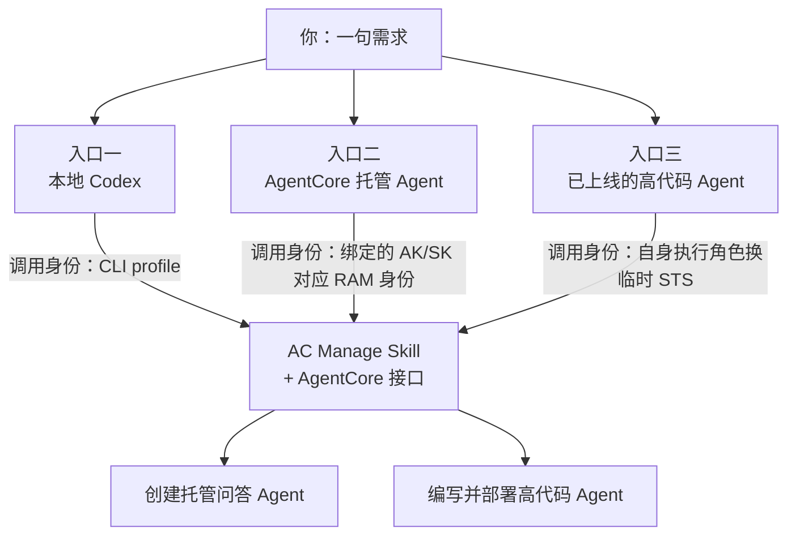
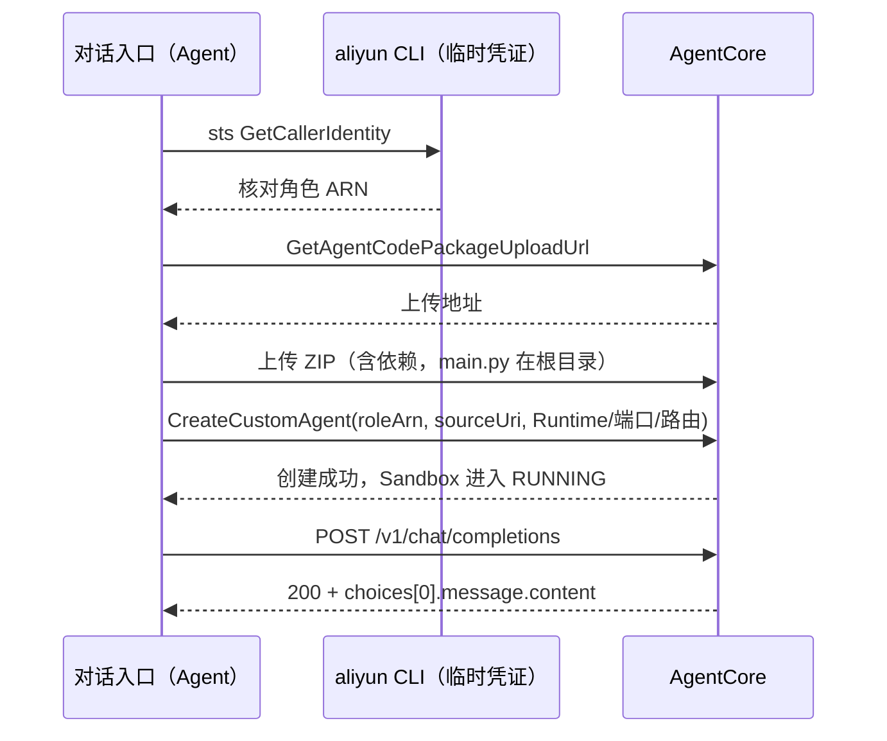

<div style="background-color: #1e1e1e; color: #00ff00; font-family: 'Courier New', Courier, monospace; border-radius: 8px; padding: 20px; box-shadow: 0 10px 30px rgba(0,0,0,0.3); margin-bottom: 30px; margin-top: 20px; position: relative; overflow: hidden;">
    <div style="display: flex; align-items: center; margin-bottom: 15px; padding-bottom: 10px; border-bottom: 1px solid #333;">
        <div style="display: flex; gap: 8px; margin-right: 15px;">
            <div style="width: 12px; height: 12px; border-radius: 50%; background-color: #ff5f56;"></div>
            <div style="width: 12px; height: 12px; border-radius: 50%; background-color: #ffbd2e;"></div>
            <div style="width: 12px; height: 12px; border-radius: 50%; background-color: #27c93f;"></div>
        </div>
        <div style="color: #ccc; font-size: 0.9em;">bash</div>
    </div>
    <div>
        <p style="margin: 5px 0; line-height: 1.6;"><span style="color: #008AFF; font-weight: bold;">ckhuang@macbookpro:~$</span> 建一个 Agent 到底有几步？打开控制台、选模型、填配置；高代码的还得写代码、装依赖、打包上传；建完等部署，部署完试调用，调不通回头查日志。每一步都不难，难的是每一步都要你放下手里正在做的事。<span style="display: inline-block; width: 8px; height: 16px; background-color: #00ff00; vertical-align: middle;"></span></p>
    </div>
</div>

这套流程有个很讽刺的地方：**读文档、跑命令、看报错、改完再试——本来就是 Agent 最擅长的事。** 既然我手边的 Agent 已经能读代码、改文件、执行命令，那它凭什么不能替我把 Agent 建出来？

阿里云 AgentCore 团队给出的答案是：差的其实只有两样东西——**一份告诉它怎么操作平台的技能（AC Manage Skill），和一个有权限的身份。** 这两样配好之后，"构建"这个动作就从一串手工操作压缩成一段话。

读完本文，你会拿到三样东西：

1. 一张**三个入口的全景图**：本地 Codex、AgentCore 托管 Agent、已经跑在云上的高代码 Agent，各自怎么接、代价是什么；
2. 一条**最容易踩坑的权限边界**："帮你建 Agent 的身份"和"新 Agent 上线后自己用的身份"，为什么必须是两个；
3. 一份**验收清单**：不要只看回答像不像对的，要看 `roleArn`、看 Sandbox 状态、看工具调用的执行记录。

---

## 一、能力搬家：把"建 Agent"这件事交还给 Agent

先说清楚 AgentCore 是什么：它是企业智能体的统一构建与治理平台，核心是三块能力——**构建与运行、协作与治理、观测与评估**，覆盖智能体全生命周期；通过多模式构建入口、统一身份鉴权与 Team 协作编排，把自研、开源 Harness、商业 SaaS 三类来源的 Agent 管在同一个平台上。

而"对话即构建"解决的，是这套平台的使用摩擦。真正耗人的不是平台能力，而是**切换成本**：为了建一个 Agent，你得离开终端、离开编辑器、离开正在推进的对话，钻进另一个 Web 界面。

这个思路的技术前提非常硬：**Agent 已经具备操作系统的手**（执行命令、读写文件）**和查阅文档的耐心**。缺的是"知识"与"授权"：

- **知识**：AgentCore 的 CLI 叫什么、参数怎么填、代码包怎么打、上传地址怎么换 `sourceUri`——这些写进 Skill，Agent 照做即可；
- **授权**：它得有一个能读模型、传代码、建 Agent、查部署结果的身份。

> 这也是我这些年做平台接入最深的感受：**任何平台的"易用性"最终都体现在能不能被自动化**。能被 Agent 稳定调用的平台，才是真正可编排的平台；只能被人点鼠标的平台，规模一上去必然成为瓶颈。

---

## 二、三个入口，同一份 Skill

原文给了三条路径，我按"你要付出什么代价"重新排一下，方便你选。



### 入口一：你正在本地写代码 —— 用本地 Codex

**代价最低，适合第一次试水。**

1. 在开发机装好 AC Manage Skill；
2. 新开一次 Codex 会话，告诉它用哪个 CLI profile、目标 Workspace 是哪个；
3. 让它**先查回 Workspace 名称**，确认账号和地域没选错，再发需求。

第 3 步看着像多余，其实是老手才会加的一步。`profile` 配错、Region 写错、AK 属于另一个账号——这类错误不会在语法层面报错，只会安静地建到你不想建的地方去。**先做一次带读回结果的校验，比事后删资源便宜得多。**

更稳的用法是：**先在本地把 Agent 跑起来，自己试通了，再让同一份对话把代码部署上云。** 本地验证逻辑、云端验证部署，两者共用同一个上下文——这就是"不用离开当前项目"的真正价值。

### 入口二：不想在本机装任何东西 —— 用托管 Agent

找一个已有的托管 Agent，给它两样东西：

| 要给的 | 怎么给 | 它替你解决什么 |
| --- | --- | --- |
| **Skill** | 在目标 Workspace 导入 AC Manage Skill 并发布，到该 Agent 的 Skill 页签绑定 | 命令行工具缺什么，它按 Skill 说明自己装 |
| **身份** | 在"凭证管理"建**两条环境变量凭证**，存一组能访问目标 Workspace 的 AK/SK；到该 Agent 的"凭证"页签绑定，保存并发布 | 让它可以调平台接口 |

之后直接发需求即可，本机从头到尾零安装。这条路径适合**团队共享**：一个人把 Skill 和凭证配好，整个 Workspace 里的托管 Agent 都能复用。

### 入口三：已有高代码应用 —— 让云上的 Agent 自己造 Agent

这是最有意思、也最能体现工程价值的一条：一个用 AgentScope 写、已经部署在 AgentCore 上的高代码 Agent，可以在**自己所在的 Workspace 里**创建托管 Agent，也可以写一个新的高代码 Agent 部署上去。**Agent 造 Agent，闭环在这里合上。**

关键在于它**不需要在应用里存放长期密钥**：

```text
应用启动 → 用自己的执行角色 → 换取临时凭证（STS）→ 调平台接口
```

想让它多做点事，就给那个执行角色加权限，**代码一行都不用改**。这是我最认可的设计——**权限从代码里搬到了身份里**。密钥进代码是安全事故的温床，而权限挂在角色上，可审计、可回收、可最小化。

代价是接入比普通对话多一些开发量：给应用加上 AgentCore 高代码 SDK、加载同一份 AC Manage Skill、把"执行命令"的工具交给它。

---

## 三、权限：真正要想清楚的只有一件事

三个入口走下来，技术实现各不相同，但**真正需要你自己想明白的只有权限**。原文那句话值得抄在工位上：

<div style="text-align: center; font-size: 1.2em; font-style: italic; color: #008AFF; margin: 40px 0 20px; padding: 20px; border-top: 1px dashed #ccc; border-bottom: 1px dashed #ccc;">
    “帮你建 Agent 的身份，和建出来的高代码 Agent 自己用的身份，是两个。” —— CK·黄
</div>

- **构建身份**决定"谁有权创建"。本地 Codex 用它选的 CLI profile，托管 Agent 用它绑定的那组 AK/SK 对应的 RAM 身份，自建应用用它的执行角色。这个身份需要：**读模型、传代码、创建 Agent、查询部署结果**。
- **运行身份**决定"新高代码 Agent 上线后能做什么"。它要调 Workspace 里的模型，就得给模型访问权限；以后要用某个 Skill 或 MCP，也要单独配。

**这两者之间没有继承关系。** 帮你建 Agent 的身份权限再大，也不会顺手带给新 Agent——这是安全上的正确设计，也是新手最容易误判的地方。所以验收时如果新 Agent 的业务要访问 AgentCore 资源，**让它做一次真实调用**，确认它自己的权限是通的。

### 三个入口的调用身份对照

| 你正在用 | 调用身份 | 权限来源 |
| --- | --- | --- |
| 本地 Codex | 你选定的 CLI profile | 本地凭证配置 |
| AgentCore 托管 Agent | 绑定的那组 AK/SK 对应的 RAM 身份 | 凭证管理里的环境变量凭证 |
| 自己部署的高代码 Agent | 它自己的执行角色 | 创建时 `create-custom-agent` 顶层 `roleArn` |

### 执行角色怎么准备，以及一个必须提醒的坑

- 在高代码 Agent 的"执行角色"配置里选已有 RAM 角色，或用"创建并授权"新建，**记录它的 ARN**；
- **信任主体**是 `workload.agentidentity.aliyuncs.com`，信任条件要允许新 Agent 的工作负载使用该角色；
- 按当前官方指南，角色需关联 `AliyunAgentIdentityDataGetCredentialAccess` 与 `AliyunAgentCoreFullAccess` 两项基础策略。

这里有个**必须点明的权限范围问题**：`AliyunAgentCoreFullAccess` 允许管理本账号下**全部** AgentCore 资源，包括创建、修改和删除。任务里填写的 Workspace ID 只是这次部署的目标，**并不会缩小这个角色的权限边界**。

换句话说，你在对话里说"只在这个 Workspace 建"，那只是 Agent 的**行为约束**，不是**权限约束**。两者千万别混为一谈——真正的边界只有 IAM 策略能给。生产环境里我的建议始终是：先按官方指南跑通，再用自定义策略把 `FullAccess` 收敛到你实际需要的动作集合上。

---

## 四、动手时的技术要点（附录级细节）

### 高代码 Agent 的部署链路



要点逐条对照：

1. **权限**：调用身份需要 `agentcore:GetAgentCodePackageUploadUrl` 和 `agentcore:CreateCustomAgent`；
2. **代码包**：把 AgentScope 及它用到的依赖一起打进去，入口 `main.py` 放在 **ZIP 根目录**（放错层级是最常见的失败原因）；
3. **服务形态**：监听 `0.0.0.0:8080`，实现 `GET /healthz` 和 `POST /v1/chat/completions`，在消息接口里把请求交给 AgentScope 的 Agent；
4. **上传与创建**：把 ZIP 传到申请到的地址，用返回的 `sourceUri` 创建 Agent；
5. **创建参数**：填入执行角色 ARN、匹配的 Python Runtime、启动命令 `python main.py`、端口与路由。

### 在自己的应用里换临时凭证并调用 CLI

下面是官方示例的 Python SDK 0.1.8 写法。注意：它用的是该版本的底层接口，**升级 SDK 时请重新核对**。

```python
import os
import subprocess
from agentcore.auth.resource_sts import HIGH_CODE_SDK_PURPOSE, ResourceSTSProvider
from agentcore.runtime.startup import ManagedRuntimeSource


async def run_cli(*args):
    source = ManagedRuntimeSource(None, env_path=None, control_plane_endpoint=None)
    runtime = await source.resolve()
    provider = ResourceSTSProvider(runtime.controller_endpoint, runtime.agent_sa_tokens)
    try:
        sts = await provider.get(HIGH_CODE_SDK_PURPOSE)
        env = {
            **os.environ,
            "ALIBABA_CLOUD_ACCESS_KEY_ID": sts.access_key_id,
            "ALIBABA_CLOUD_ACCESS_KEY_SECRET": sts.access_key_secret,
            "ALIBABA_CLOUD_SECURITY_TOKEN": sts.security_token,
            "ALIBABA_CLOUD_IGNORE_PROFILE": "TRUE",
            "ALIBABA_CLOUD_REGION_ID": "cn-hangzhou",
        }
        return subprocess.run(
            ["aliyun", *args], env=env, check=True, capture_output=True, text=True
        )
    finally:
        await provider.aclose()
```

三个细节值得多看两眼：

- `ALIBABA_CLOUD_IGNORE_PROFILE=TRUE` 很关键——它阻止 CLI 回退到本地 profile 的长期凭证，**保证这次调用真的用的是临时身份**，而不是你以为的临时身份；
- 临时凭证**只传给 CLI 子进程**（通过 `env`），不写文件、不落持久环境，用完即弃；
- `await run_cli("sts", "GetCallerIdentity")` 先跑一遍、从 `stdout` 核对角色 ARN，再查 Workspace、建 Agent。**先把身份对齐，再动手改资源**，这个顺序在自动化里比在人手里更重要。

> 一个实现层面的提醒：`subprocess.run` 是**同步阻塞**的，放在 `async def` 里会卡住事件循环。如果这个工具函数被 Agent 频繁调用，建议换成 `asyncio.create_subprocess_exec`，或用 `await asyncio.to_thread(subprocess.run, ...)` 包一层。功能能跑通，但并发下的抖动会让你排查很久。

### 验收清单：别只看回答对不对

| 验收项 | 怎么验 | 期望 |
| --- | --- | --- |
| 高代码 Agent 的执行角色 | 读回 `get-custom-agent` 的 `data.roleArn` | 与任务里给的 ARN 一致 |
| Sandbox 状态 | 查询对应 Sandbox | 进入 `RUNNING` |
| 对话接口 | 按 Endpoint 配置鉴权，`POST /v1/chat/completions` | HTTP 200，`choices[0].message.content` 为模型回答 |
| 工具是否真的被调用 | 看该次调用的**工具执行记录** | 不只是回答文本"看起来对" |

最后一行是这类验收里最容易被糊弄过去的：**"回答得像对的"和"工具真的被调用了"是两回事。** 模型完全可以凭常识编出一个合理的 Workspace 名称。所以我要求验收必须落在执行记录上，而不是文本相似度上。

---

## 五、写在最后：门槛降了，边界也清楚了

这套用法目前的能力边界非常明确，值得提前知道：

- **托管问答 Agent** 需要先在 Workspace 里配好模型；
- **高代码 Agent 的代码还是要写**，只不过"写代码"这件事也可以交给 Agent；
- **权限要自己配**，配错了它会在部署时报给你缺什么——这算是个不错的反馈闭环，但别指望它替你设计最小权限。

但起步的门槛确实降下来了。第一次不必两种都建：

- 想先看模型效果 → 让手头的 Agent 建一个**托管问答 Agent**，带回一次真实问答；
- 想跑自己的业务逻辑 → 让它部署一个**高代码 Agent**，带回调用地址和实际响应。

三个入口共用同一份 Skill、同一套接口，**换入口不用重学**，之前配好的模型、Skill 和角色也能接着用。

<div style="background-color: #1e1e1e; color: #00ff00; font-family: 'Courier New', Courier, monospace; border-radius: 8px; padding: 20px; box-shadow: 0 10px 30px rgba(0,0,0,0.3); margin-bottom: 30px; margin-top: 20px; position: relative; overflow: hidden;">
    <div style="display: flex; align-items: center; margin-bottom: 15px; padding-bottom: 10px; border-bottom: 1px solid #333;">
        <div style="display: flex; gap: 8px; margin-right: 15px;">
            <div style="width: 12px; height: 12px; border-radius: 50%; background-color: #ff5f56;"></div>
            <div style="width: 12px; height: 12px; border-radius: 50%; background-color: #ffbd2e;"></div>
            <div style="width: 12px; height: 12px; border-radius: 50%; background-color: #27c93f;"></div>
        </div>
        <div style="color: #ccc; font-size: 0.9em;">bash</div>
    </div>
    <div>
        <p style="margin: 5px 0; line-height: 1.6;"><span style="color: #008AFF; font-weight: bold;">ckhuang@macbookpro:~$</span> 你平时在哪里和 Agent 说话，就从哪里发出这段话。真正把"对话即构建"做扎实的，不是那句自然语言，而是背后那份 Skill 和那条身份边界。<span style="display: inline-block; width: 8px; height: 16px; background-color: #00ff00; vertical-align: middle;"></span></p>
    </div>
</div>

---

### 参考资料

- AC Manage Skill 安装：<https://help.aliyun.com/zh/agentcore/agentcore-management-skill>
- 管理凭证：<https://help.aliyun.com/zh/agentcore/manage-credentials>
- 给 Agent 绑定资产：<https://help.aliyun.com/zh/agentcore/manage-agents>
- 高代码 Agent 部署指南：<https://help.aliyun.com/zh/agentcore/high-code-agent-deployment-guide>
- 高代码 SDK 使用指南：<https://help.aliyun.com/zh/agentcore/agentcore-python-sdk-user-guide>
- 高代码 Agent 执行角色配置：<https://help.aliyun.com/zh/agentcore/use-high-code-agent-to-execute-roles>
- AgentCore 权限策略与范围：<https://help.aliyun.com/zh/agentcore/configure-agentcore-permissions-for-ram-users>
- CreateCustomAgent 接口：<https://api.aliyun.com/api/AgentCore/2026-08-04/CreateCustomAgent>
- CLI 凭证环境变量：<https://help.aliyun.com/zh/cli/environment-variables>
