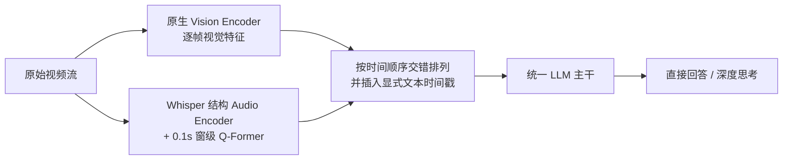
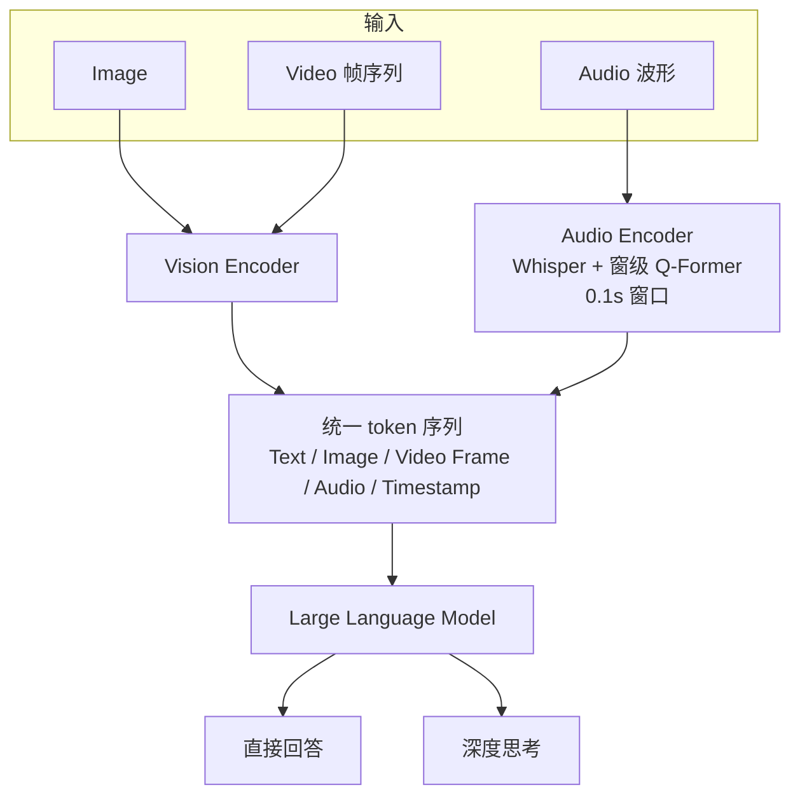
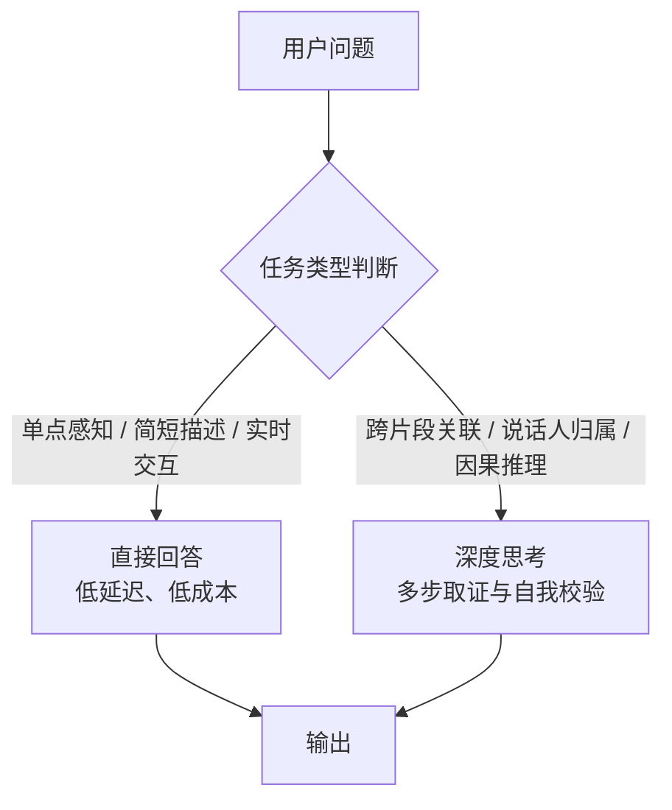

<div style="background-color: #1e1e1e; color: #00ff00; font-family: 'Courier New', Courier, monospace; border-radius: 8px; padding: 20px; box-shadow: 0 10px 30px rgba(0,0,0,0.3); margin-bottom: 30px; margin-top: 20px; position: relative; overflow: hidden;">
    <div style="display: flex; align-items: center; margin-bottom: 15px; padding-bottom: 10px; border-bottom: 1px solid #333;">
        <div style="display: flex; gap: 8px; margin-right: 15px;">
            <div style="width: 12px; height: 12px; border-radius: 50%; background-color: #ff5f56;"></div>
            <div style="width: 12px; height: 12px; border-radius: 50%; background-color: #ffbd2e;"></div>
            <div style="width: 12px; height: 12px; border-radius: 50%; background-color: #27c93f;"></div>
        </div>
        <div style="color: #ccc; font-size: 0.9em;">bash</div>
    </div>
    <div>
        <p style="margin: 5px 0; line-height: 1.6;"><span style="color: #008AFF; font-weight: bold;">ckhuang@macbookpro:~$</span> 让大模型"看视频"，行业里最常见的做法是抽几张关键帧，再叠一层语音识别字幕。这不是视频理解，这是把一条带时间顺序的因果链，硬生生拍扁成一张图文拼贴画。画面里 A 在冷笑，字幕里 B 在质问，中间一声开门声——模型听不见，也永远分不清是谁在说话。<span style="display: inline-block; width: 8px; height: 16px; background-color: #00ff00; vertical-align: middle;"></span></p>
    </div>
</div>

腾讯微信视觉团队开源的 **WeMM-Video**，正面回应了这个被行业"凑合着用"很久的问题：它不是给视频模型再加一个 ASR 管道，而是把视觉帧与音频特征**按时间顺序交织进同一条 token 流**，让模型在同一条时间线上同时处理"谁出现了""说了什么""伴随什么声音"。

这套模型覆盖 **2B / 4B / 9B / 35B-A3B（MoE）** 四个尺寸，同步开放 FP8、AWQ、GGUF、NVFP4 等量化权重与评测复现流程，并已在微信直播高光切片、视频电商、短剧分析和视频号"问小微"等线上业务落地。

读完本文，你会拿到三样东西：

1. **一个判断标准**：为什么"抽帧 + ASR 字幕"在真实视频上必然失效，失效点究竟在时间轴的哪一环；
2. **一份架构与训练配方拆解**：交错 token 序列 + 显式时间戳、0.1 秒窗级 Q-Former、1.2 万亿 token 的模态配比，以及"三阶段预训练 + 三阶段后训练"的六段式流水线；
3. **一次冷静的评测解读**：在 17 项通用视听理解基准中 16 项占优的背后，哪些任务是"深度思考"的收益区，哪些任务反而会因为多想一步而掉分。

---

## 一、先看清失效点：视频的信息在时间轴上，不在单帧里

原文开篇给的两个例子非常典型，值得逐个拆开看：

- **短剧与影视**：镜头怼着 A 的冷笑，画外音却是 B 的质问，紧接着一声开门声打破僵局。只看画面或只读转写文字，模型分不清"谁在说话"，也读不懂"配乐骤停"背后的情绪转折；
- **直播带货**：主播先举起水壶，又拿起杯子说"第二件半价，两个只要 30 元"。传统"图像 + ASR 字幕"的处理方式，字幕与画面的时间戳很难细粒度对齐，模型很可能张冠李戴，把杯子的折扣算到水壶头上。

这两类失败的本质，是**同一件事**：视频里的关键信息是"事件之间的相对位置关系"，而抽帧 + 字幕把这种关系破坏成了两个互不相干的序列。


请注意这条链路上丢失的东西：**画外音与画面的空间归属、环境音与音效的时间点、语调与情绪、配乐的变化**。它们全都在"视觉模型不认识、ASR 只输出文字"的夹缝里蒸发了。

换成同轨建模后，链路变成这样：



两条链路的差别，不是"模型更聪明了"，而是**信息的组织方式变了**。这也是我看这套工作时最认可的一点：他们把问题定义成了调度与对齐问题，而不是简单的融合问题。

## 二、架构：把画面和声音放回同一条时间线

按原文披露的模型结构，WeMM-Video 的 2B / 4B / 9B 基于 Qwen3.5 系列构建，35B-A3B 基于 Qwen3.6-35B-A3B 构建。两侧编码器的处理方式很值得细看：

| 模块 | 设计选择 | 我的解读 |
| --- | --- | --- |
| 视觉侧 | **完整保留**基座的原生视觉编码器与投影层 | 最大化继承基座已有的图文、视频感知能力，避免"再训一遍视觉"把预训练知识洗掉 |
| 音频侧 | 引入基于 **Whisper 结构**的音频编码器，配合**窗口级 Q-Former** 提取 0.1 秒窗口内的连续声学特征 | 0.1 秒是"保留语调/音效细节"与"控制上下文长度"之间的折中；Q-Former 把变长音频压成定长 query，避免音频 token 淹没视觉 token |
| 融合方式 | 视觉帧特征与音频特征**严格按时间顺序交错排列**，并插入**显式文本时间戳** | 不做后融合，而是在 token 序列层面做"时序调度"，让注意力天然可以跨模态对齐 |
| 输出模式 | 混合思考：直接回答 / 深度思考 | 响应效率与推理深度按场景路由 |

这里有一个容易被忽略的工程价值：**显式时间戳 token**。它让"时间"从隐式的位置编码，变成了模型可以直接引用、可以直接输出的符号。带来的直接收益是：

- **说话人归属**：谁说这句话，能通过"画面时间 + 音频时间 + 时间戳"三者对齐来判定；
- **事件定位**：模型可以回答"这个功能在第几秒到第几秒"，而不是给一段无法核验的泛泛描述；
- **长视频检索**：在几十万 token 的上下文里，"第 3 分 12 秒"是一个极强的检索锚点。

模型结构上，视觉帧与音频 token 在序列中交错排布，配合文本时间戳，最终进入统一的大语言模型主干：



从系统设计角度说，这套做法很像我们做大流量网关时的一个老经验：**不要指望下游的各个子系统自己去对齐，要在入口就把顺序和时钟统一好**。音视频对齐这事，交给注意力机制去"自己学"，代价是巨大的训练成本和不可控的幻觉；而在序列层面显式排好，等于把最难的对齐问题从"学习问题"降级成了"构造问题"。

## 三、混合思考：感知不够时，用推理补

WeMM-Video 支持两种模式：简单的日常问答直接给结论；人物关系复杂、线索跨多个片段时，开启深度思考，多步联动画面与声音中的细节，把散落在不同时刻的视觉线索、对白语气和环境声串成完整逻辑链。

原文给出的数据是：在 33 项公开音视频评测榜单上，**深度思考模式相比直接回答模式带来约 7% 的平均相对提升**，并有效减少跨模态幻觉。

但作为一个常年看评测表的人，我更关注**平均值之外的方差**。原文评测表里有一批非常有信息量的样本（WeMM-Video-35B-A3B，Instruct → Thinking）：

| 基准 | 任务类型 | Instruct | Thinking | 解读 |
| --- | --- | --- | --- | --- |
| SciVideoBench | 科学视频理解 | 57.8 | **69.4** | 需要多步推断场景，思考带来 +11.6 的绝对提升 |
| EvaOmni | 全模态综合 | 48.8 | **57.8** | 跨模态证据关联，思考收益明显 |
| OmniReasoningBench | 视听推理 | 44.3 | **45.4** | 推理类基准稳步提升 |
| DailyOmni | 日常视听理解 | 81.5 | **83.4** | 复杂生活场景，思考有小幅正收益 |
| FutureOmni | 未来事件预测 | 58.4 | 56.2 | 预测类任务，长推理反而引入额外假设 |
| JointAVBench | 音视频联合 | 67.4 | 65.9 | 联合判断类，思考未占优 |
| Omni-Cloze | 视听填空 | 44.2 | 42.6 | 单点感知类任务，多想一步易偏离 |

结论很清楚：**深度思考不是万能开关，它是一个按任务类型路由的策略。** 对需要"跨片段取证 + 因果串联"的任务，test-time compute 花得值；对"看一眼就该答"的填空和描述类任务，多轮推理更容易把模型带偏到无关证据上。

这也是我在做 Agent 系统时反复强调的一条：**推理预算要给有证据密度的地方，而不是平均分配。** 模型不会因为"想得更久"就凭空获得画面里没有的信息。



## 四、1.2 万亿 token 的配方：数据配比就是能力配比

原文披露的训练语料规模约 **1.2 万亿 token**，模态分布如下：

| 模态 | 占比 |
| --- | --- |
| 视听联合（Audio-Visual） | **45.4%** |
| 视觉（Visual） | 28.4% |
| 音频（Audio） | 23.6% |
| 文本（Text） | 2.6% |

按任务切分，占比最高的是 **Captioning 37.7%**，其次是 **Knowledge & Reasoning QA 17.5%**、**Grounding 12.6%**、**ASR 8.1%**、**Music Understanding 6.6%**、**Dialogue & Instruction 5.4%**、**Summarization 4.9%**、**Cross-Media Understanding 3.3%**，OCR、Counting、Agent & Tool use 合计不足 4%。

这张分布图透露了两个很实在的判断：

1. **视听联合数据是第一大模态（45.4%）**，说明团队把预算压在了"同轨对齐"这件事上，而不是继续堆纯视觉数据。纯视觉数据训出来的是"更会看图"，只有视听联合数据才能训出"会对照画面与声音"；
2. **Captioning 一家独大（37.7%）**，这是行业常态，也是最容易被低估的脏活——视频描述标注要交代"动作怎么变、对白和声音在什么时间出现"。这类数据决定了模型的时间感知底子。

内容配比上也做了刻意区分：体育、游戏、舞蹈、户外这类密集动作内容，用来学细粒度动态；影视、短剧、访谈、综艺、直播电商，用来建立人物行为、对白与环境声的完整联系。候选数据还要过自动质量评分、语义去重、有害内容过滤。另有专门的跨媒体理解数据，比如两段视频对比、视频与配乐是否匹配、电商商品与广告内容是否一致——本质是训练"比较与判别"，这比单纯描述难得多。

训练流程则是标准的六段式：

```mermaid
graph TD
    subgraph 预训练：注入多模态知识
        P1["阶段 1：音频表征对齐<br/>建立基础听觉能力"] --> P2["阶段 2：多模态统一学习<br/>建立知识/表示"]
        P2 --> P3["阶段 3：扩上下文窗口<br/>长视频/长音频/多视频"]
    end
    subgraph 后训练：稳定性与任务质量
        F1["阶段 4：多教师蒸馏<br/>文本 / VL / 视听 + 跨模态蒸馏"]
        F2["阶段 5：多轮偏好优化<br/>治理重复输出与不收敛"]
        F3["阶段 6：专项强化学习<br/>规则奖励 + 评分标准/教师一致性"]
        F1 --> F2 --> F3
    end
    P3 --> F1
```

其中第 5 步值得单独说一句。原文提到一个很"现场"的问题：**模型在复杂输入下会反复说同一句话、长时间无法结束回答。** 这是长上下文多模态模型最典型的退化模式之一——输入越长、模态越杂，模型越容易陷入"复读机"状态。团队的做法是主动挖掘视频、音频、VL 任务中的这类失败样本，用多轮偏好优化去教模型"怎么稳定地组织并在合适的地方结束回答"。

在工程上，**这类"治复读、治停不下来"的后训练脏活，往往比换一个更大的基座更能决定产品可用性**。线上业务里没人关心你在哪个榜上高了 0.5 分，但所有人都会骂一个回答停不下来的模型。

## 五、评测怎么读：别只看"16/17"，要看它赢了谁、输在哪

WeMM-Video 的评测覆盖五类模态、120 余项基准：有声/无声视频 65 项，纯音频 18 项，图像 28 项，文本 12 项。

旗舰 **WeMM-Video-35B-A3B** 在 17 项通用视听理解基准中，深度思考模式有 **16 项**取得较高结果，整体接近同档商业模型水平。挑几个有代表性的看（Thinking 模式对比 Gemini-3.0-Flash 与 Qwen3.5-Omni-Flash）：

| 基准 | Gemini-3.0-Flash | Qwen3.5-Omni-Flash | WeMM-Video-35B-A3B |
| --- | --- | --- | --- |
| Video-MME（带音频） | 88.6 | 79.3 | 86.4 |
| Daily-Omni | 82.4 | 81.8 | **83.4** |
| AVUT Human | 86.4 | 81.4 | 85.9 |
| AV-SpeakerBench | 75.9 | 65.2 | 72.6 |
| OmniVideoBench | 63.3 | 43.7 | 55.3 |
| SciVideoBench | 75.2 | 51.3 | 69.4 |
| Video-Holmes | 71.2 | 61.7 | 63.4 |
| WorldSense | 63.8 | 57.9 | 62.7 |

诚实地读这张表：**它在多个维度上逼近、个别维度上反超同档商业模型，但在 Video-MME、Video-Holmes 等"经典通用视频理解"项上仍有明显差距。** 这不是缺陷，而是训练配比的必然结果——45.4% 的预算压在视听联合上，纯视觉理解自然不会是第一名。开源模型的定位从来不是"全面压过闭源"，而是"在特定能力上给出可复现、可私有化、可改的基线"。

另外两点我认为更有价值：

**其一，9B 的性价比曲线。** 在微信内部的 11 项视频理解任务上，四个尺寸的平均分是：

| 模型 | 平均得分 |
| --- | --- |
| WeMM-Video-2B | 76.97 |
| WeMM-Video-4B | 81.68 |
| WeMM-Video-9B | 84.30 |
| WeMM-Video-35B-A3B | 85.23 |
| Qwen3.5-Omni-Flash | 79.40 |
| Qwen3-Omni-30B-A3B | 72.90 |
| Qwen3.5-35B-A3B（基座） | 74.99 |
| Qwen3.5-2B（基座） | 66.45 |

注意 2B 与同尺寸基座的差距：**76.97 vs 66.45，接近 10.5 分。** 参数没变，变的是数据配方与后训练流水线。这条曲线是我最想让团队里的同学看的部分——**在 10B 以下，"怎么训"对能力的贡献，往往大于"堆多少参数"。**

**其二，音频侧的小模型反超现象。** 在 MMAU-Pro 通用音频理解上，35B-A3B 得 70.6，而 9B 版本得 70.9；MusTBench 上 35B-A3B 为 46.6、9B 为 42.0，均高于 Qwen3.5-Omni-Flash（42.2）与 Qwen3-Omni-30B-A3B（32.4）。这说明音频模态的瓶颈更多在**数据质量与任务定义**，而不是模型容量——对做端侧或成本敏感场景的团队来说，这是个好消息。

## 六、落地：真实业务比榜单苛刻

公开榜单检验通用能力，真实业务要求的是"证据散落在不同位置时依然能找对"。WeMM-Video 已部署于微信多个核心视频业务：

- **直播高光切片**：需要把商品与优惠条件对应起来，不能把杯子的折扣算到水壶上；
- **视频电商**：商品讲解、价格、卖点的多模态一致性核验；
- **短剧分析**：人物行为必须放回前后情节理解，否则就是断章取义；
- **视频号"问小微"**：围绕用户问题从长视频中提取相关证据段。

原文给出的两个样例很能说明能力边界。一个是让模型"总结视频里介绍的微信小功能并给出时间段"，模型输出了五个功能及各自的秒级区间（标为未读、群聊免打扰与特别关注、切出未读消息合集、边写边译、私密发表朋友圈）；另一个是让模型详细描述一段绕口令挑战视频，模型不仅讲清了两位博主的分工，还准确抓住了"第二关把发音换成猪叫与马叫、自称口才大师的一方反而破功"这个笑点结构。

这两类输出看着"只是描述得好"，实际背后是三件事同时成立：**时间定位准、说话人归属对、情绪与音效没漏。** 少任何一个，描述都会露怯。

## 七、给工程团队的四条可复用经验

把这套工作放到我自己的架构经验里过一遍，有四条是能直接迁移的：

1. **先修数据的时间轴，再修模型的参数。** 视频任务里，"时间戳细粒度对齐"是比模型结构更前置的工程问题。时间轴是错的，再大的模型也只能学到错的因果。
2. **时间戳要当一等公民。** 把时间当成显式 token 输出，带来的不只是可解释性，更是可核验性——业务方可以拿着秒数回看原始视频，这是幻觉最好的解法。
3. **双模式推理要按任务路由，不要默认开思考。** 33 项榜单上约 7% 的平均相对提升是真的，但填空类、描述类任务上的掉分也是真的。把推理预算花在证据密集的地方。
4. **后训练的脏活决定可用性。** 治复读、治不收敛、治"假装完成"，这些工作在论文里不出彩，在线上决定生死。

<div style="text-align: center; font-size: 1.2em; font-style: italic; color: #008AFF; margin: 40px 0 20px; padding: 20px; border-top: 1px dashed #ccc; border-bottom: 1px dashed #ccc;">
    "多模态的难点从来不是'把两种模态拼起来'，而是'让它们在同一个时钟上说话'。" —— CK·黄
</div>

## 结语：从"看图"到"看片"，差的是一条时间线

WeMM-Video 给出的答案并不花哨：视觉编码器尽量继承基座，音频侧用 Whisper 结构加窗级 Q-Former，然后在 token 序列里按时间顺序交错排列、显式插入时间戳，再用 1.2 万亿 token（视听联合占 45.4%）把这种"同轨感知"训出来，最后用多教师蒸馏、偏好优化和专项强化学习把稳定性与任务质量补齐。

它同时开放了 2B / 4B / 9B / 35B-A3B 四个尺寸的权重与评测复现流程，这对做视频分析、多模态问答、内容交互的团队来说，是一个可以直接落地、也可以直接改的起点。

<div style="background-color: #1e1e1e; color: #00ff00; font-family: 'Courier New', Courier, monospace; border-radius: 8px; padding: 20px; box-shadow: 0 10px 30px rgba(0,0,0,0.3); margin-bottom: 30px; margin-top: 20px; position: relative; overflow: hidden;">
    <div style="display: flex; align-items: center; margin-bottom: 15px; padding-bottom: 10px; border-bottom: 1px solid #333;">
        <div style="display: flex; gap: 8px; margin-right: 15px;">
            <div style="width: 12px; height: 12px; border-radius: 50%; background-color: #ff5f56;"></div>
            <div style="width: 12px; height: 12px; border-radius: 50%; background-color: #ffbd2e;"></div>
            <div style="width: 12px; height: 12px; border-radius: 50%; background-color: #27c93f;"></div>
        </div>
        <div style="color: #ccc; font-size: 0.9em;">bash</div>
    </div>
    <div>
        <p style="margin: 5px 0; line-height: 1.6;"><span style="color: #008AFF; font-weight: bold;">ckhuang@macbookpro:~$</span> 判断一个视频模型是不是真的"懂视频"，别问它看到了什么，问它"第几秒谁说了什么、当时画面在干什么、这句话改变了什么"。答不上来，它就还是在看默片。<span style="display: inline-block; width: 8px; height: 16px; background-color: #00ff00; vertical-align: middle;"></span></p>
    </div>
</div>

**参考资料**

- 论文：<https://arxiv.org/abs/2611.26409>
- 代码仓库：<https://github.com/Tencent/WeMM-Video>
- 模型合集：<https://huggingface.co/collections/tencent/wemm-video>
